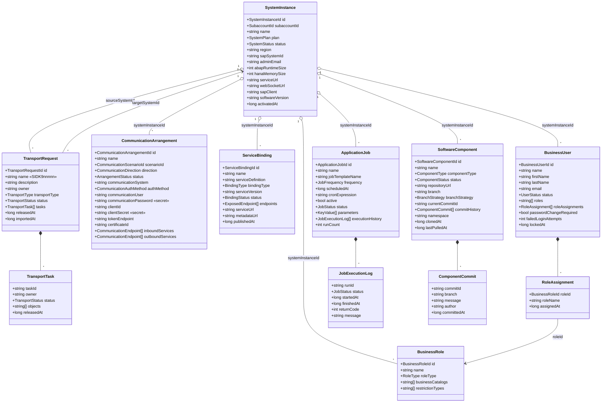
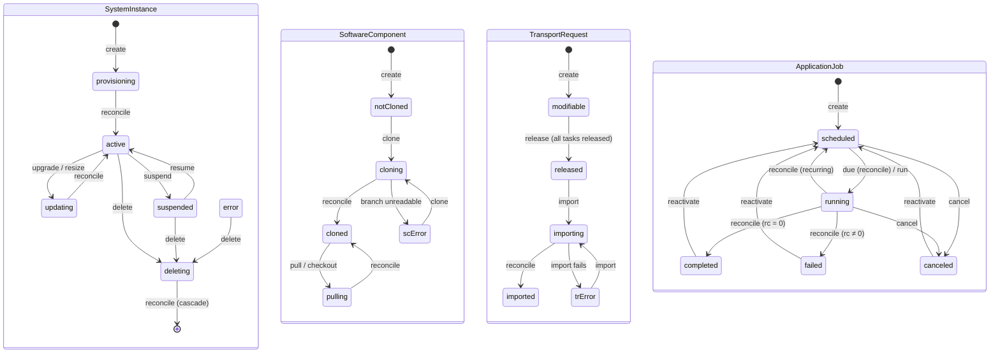
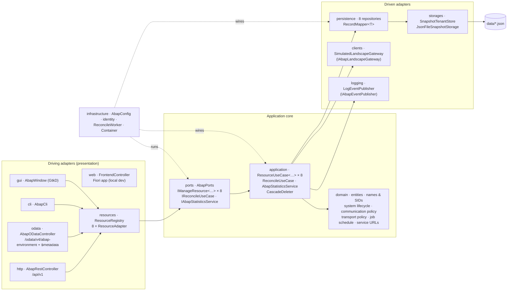
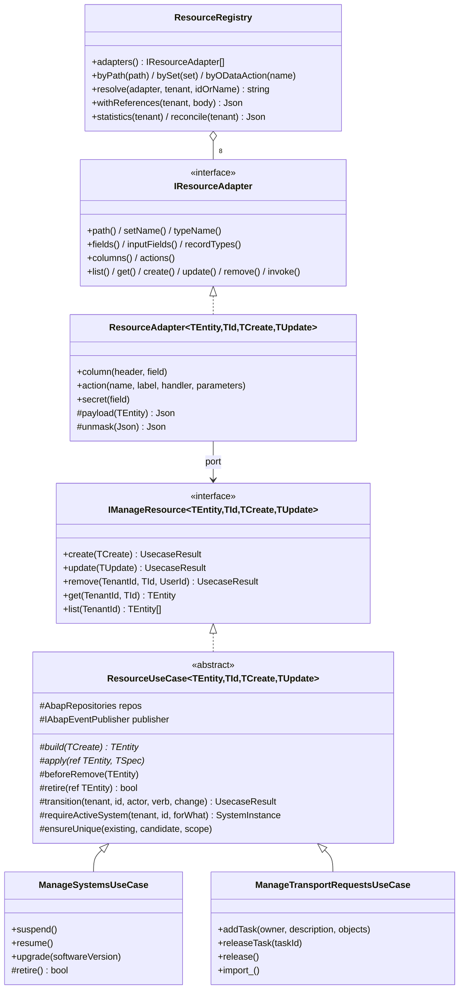
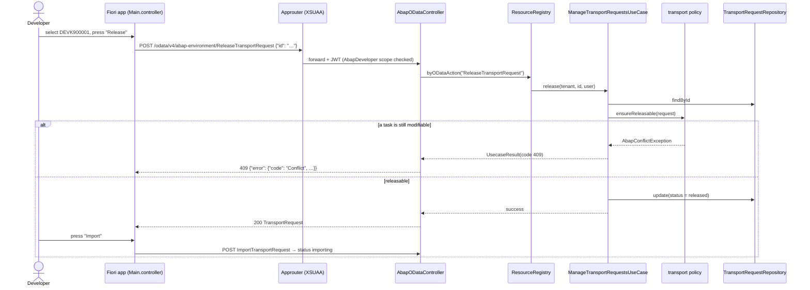
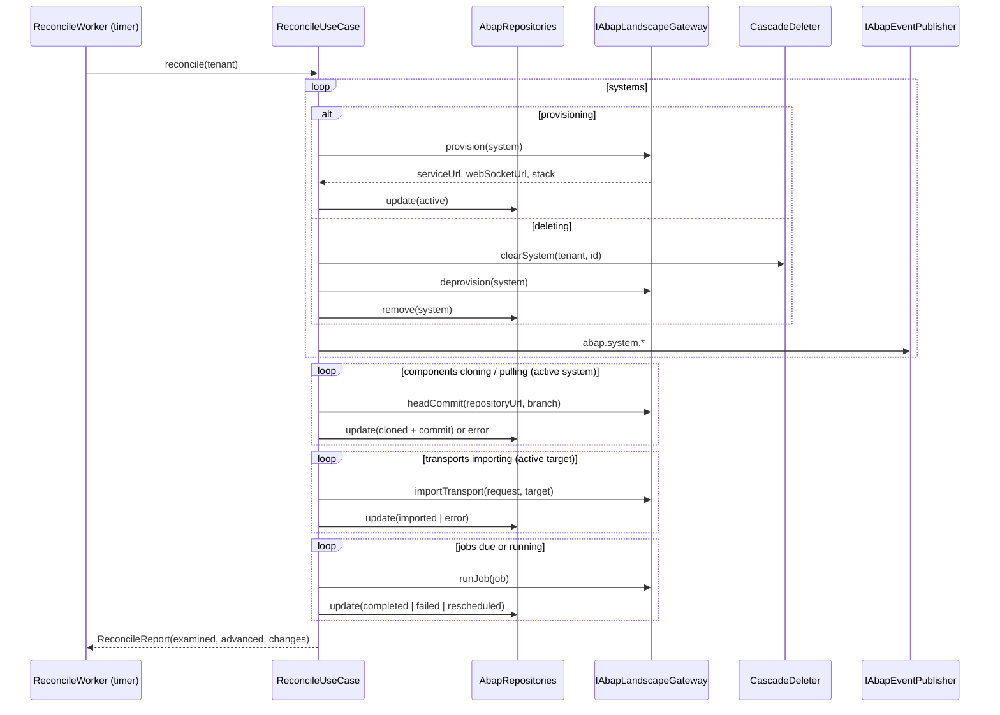
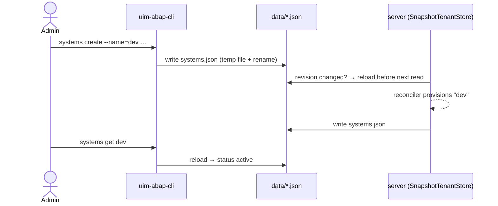
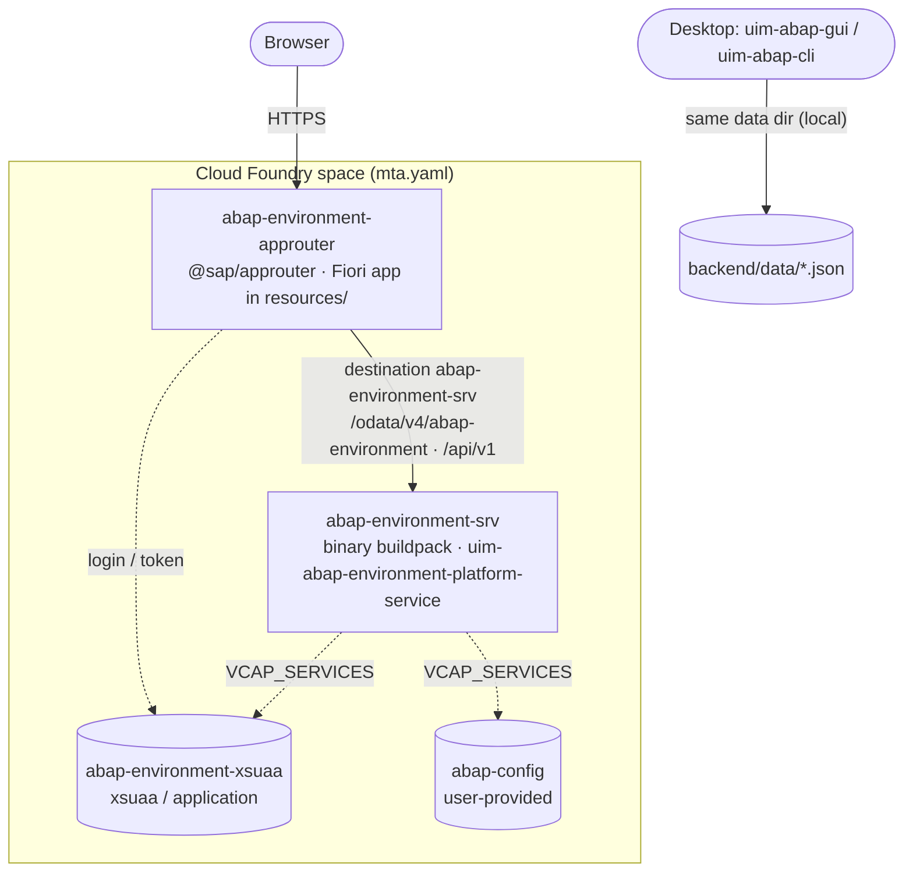

# UML — ABAP Environment Service

Diagrams of the hexagonal backend (`backend/source/uim/platform/abap_environment`), the
Fiori frontend and the BTP deployment. All diagrams are Mermaid.

## Class Diagram — Domain Entities

All aggregates mix in `TenantEntity` (`tenantId`, `id`, `createdBy/At`, `updatedBy/At`).
Every aggregate except `SystemInstance` belongs to one system; transports belong to their
source system and reference a target system.

Deleting a system deletes all objects of the system; transports from other systems that
wait for an import into it fail. A business role that is assigned to users cannot be deleted.

## State Diagram — Lifecycles driven by actions and the reconciler

Action-only transitions: service binding `unpublished → published → deprecated`
(and back to `unpublished`), communication arrangement `active ⇄ inactive`, business
user `active → locked → active`. Components, imports and jobs only progress while their
system (for imports: the target system) is active.

## Component Diagram — Hexagonal Architecture

Dependencies point inwards: presentation knows only `AbapPorts`; use cases know only
port interfaces (`AbapRepositories`, `IAbapLandscapeGateway`, `IAbapEventPublisher`).

## Class Diagram — Generic use cases and adapters

The other six interactors (`ManageSoftwareComponentsUseCase`, `ManageCommunicationArrangementsUseCase`,
`ManageServiceBindingsUseCase`, `ManageBusinessRolesUseCase`, `ManageBusinessUsersUseCase`,
`ManageApplicationJobsUseCase`) follow the same pattern. Persistence mirrors it:
`SystemScopedRepository<TEntity, TId>` provides `findByName` / `findBySystem` for all
system-scoped aggregates.

## Sequence Diagram — Fiori releases and imports a transport

## Sequence Diagram — Reconciliation

## Sequence Diagram — CLI and server share data

## Deployment Diagram — SAP BTP (Cloud Foundry)

