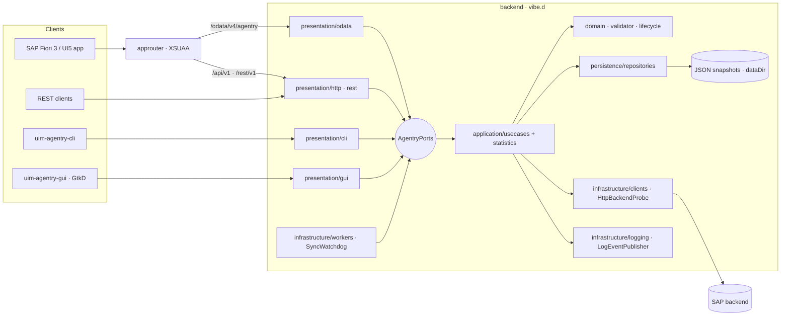
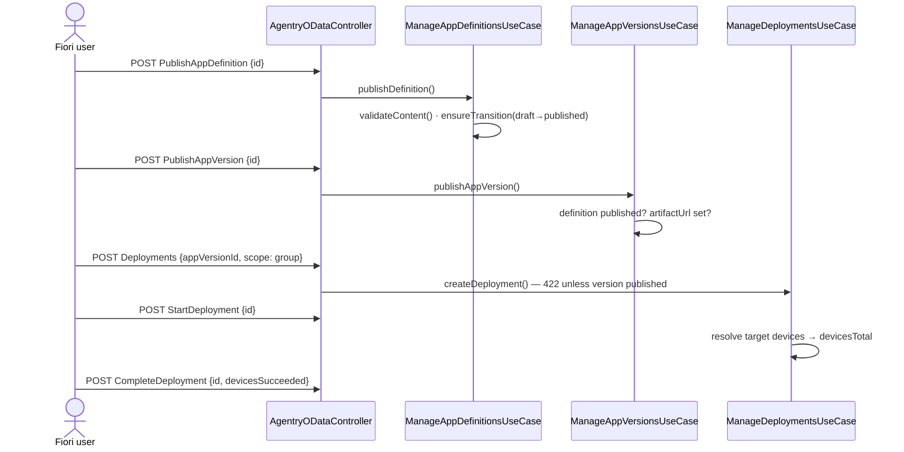
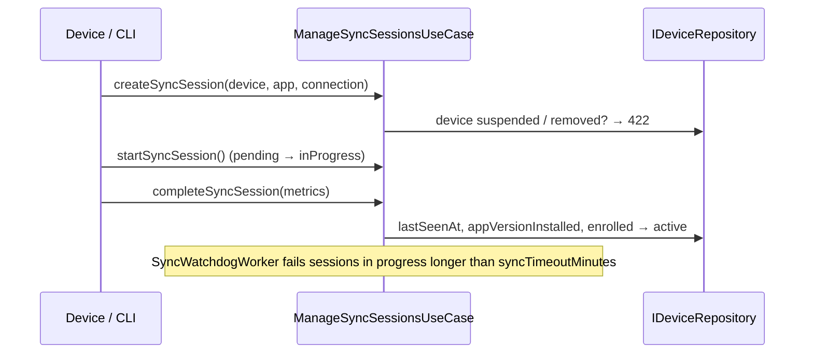
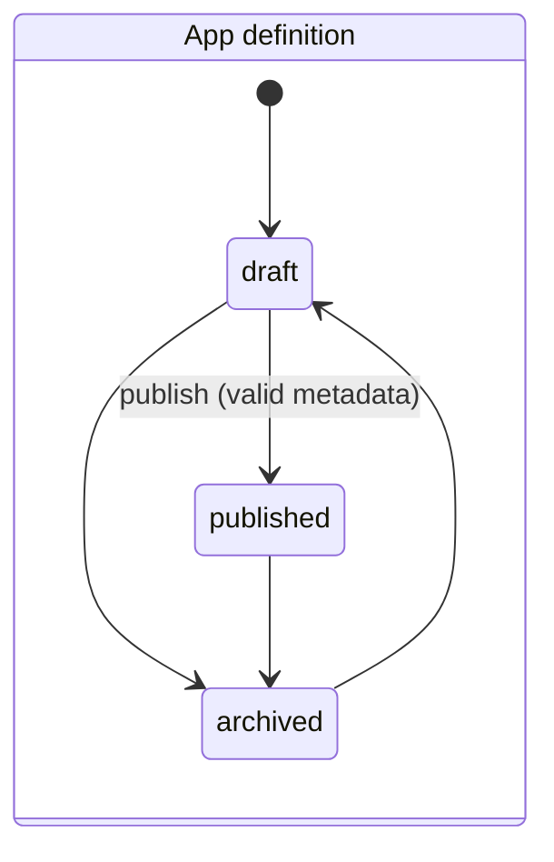
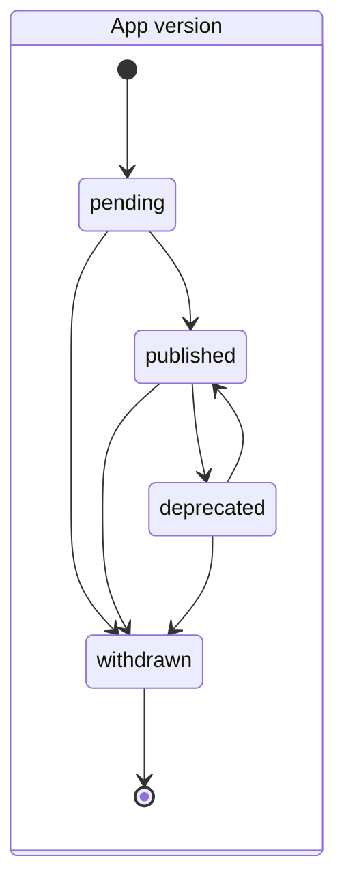
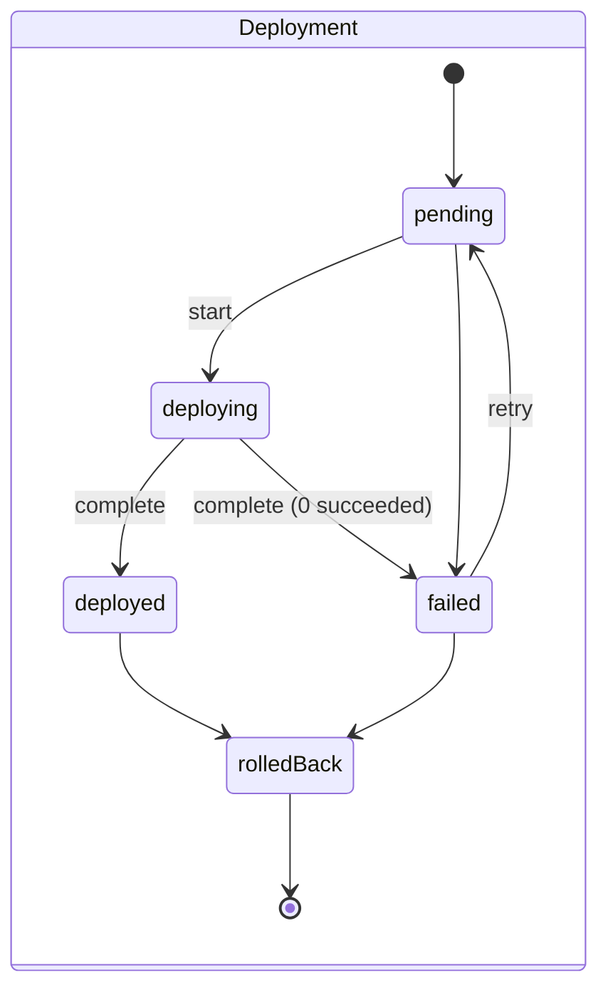
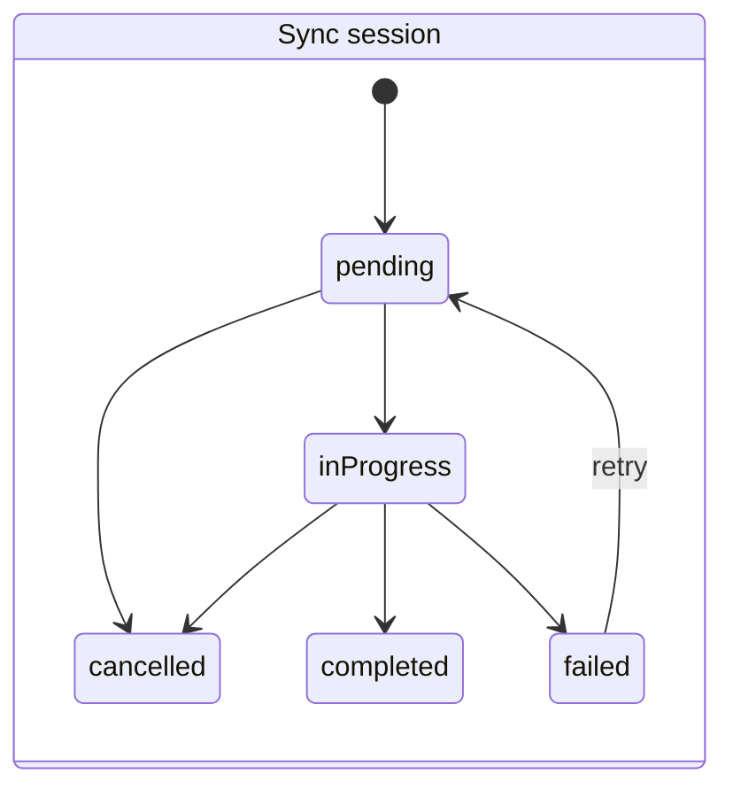

# UML — Agentry Service

## Component diagram

## Class diagram — domain and ports

```mermaid
classDiagram
  class MobileApplication { name; packageName; platform: AppPlatform; status: AppStatus; offlineCapable; pushNotificationsEnabled }
  class AppDefinition { applicationId; name; definitionFormat; definitionContent; status: DefinitionStatus; validationPassed; publishedAt }
  class AppVersion { mobileApplicationId; definitionId; versionNumber; artifactUrl; status: AppVersionStatus; isMandatoryUpdate }
  class MobileDevice { mobileApplicationId; deviceName; platform; osVersion; status: DeviceStatus; groupName; lastSeenAt }
  class SyncSession { deviceId; applicationId; connectionId; status: SyncStatus; direction; bytesSent; bytesReceived }
  class BackendConnection { name; backendType; backendUrl; authMethod; status: ConnectionStatus; lastTestedAt }
  class Deployment { appVersionId; scope_: DeploymentScope; targetGroupName; status: DeploymentStatus; devicesTotal; devicesSucceeded }

  MobileApplication "1" o-- "*" AppDefinition
  MobileApplication "1" o-- "*" AppVersion
  AppDefinition "1" o-- "*" AppVersion
  MobileApplication "1" o-- "*" MobileDevice
  MobileDevice "1" o-- "*" SyncSession
  BackendConnection "1" o-- "*" SyncSession
  AppVersion "1" o-- "*" Deployment

  class AgentryPorts {
    IManageMobileApplicationsUseCase mobileApplications
    IManageAppDefinitionsUseCase appDefinitions
    IManageAppVersionsUseCase appVersions
    IManageDevicesUseCase devices
    IManageSyncSessionsUseCase syncSessions
    IManageBackendConnectionsUseCase backendConnections
    IManageDeploymentsUseCase deployments
    IAgentryStatisticsService statistics
  }
  class ManageDeploymentsUseCase { createDeployment(); startDeployment(); completeDeployment(); rollbackDeployment() }
  ManageDeploymentsUseCase ..|> IManageDeploymentsUseCase
  ManageDeploymentsUseCase --> IDeploymentRepository
  ManageDeploymentsUseCase --> IAppVersionRepository
  ManageDeploymentsUseCase --> IDeviceRepository
  ManageDeploymentsUseCase --> IAgentryEventPublisher
  class ManageBackendConnectionsUseCase { testBackendConnection() }
  ManageBackendConnectionsUseCase --> IBackendProbe
  DeploymentRepository ..|> IDeploymentRepository
  DeploymentRepository --> SnapshotTenantStore
  SnapshotTenantStore --> ISnapshotStorage
  JsonFileSnapshotStorage ..|> ISnapshotStorage
```

## Sequence — release and roll out a version (OData)

## Sequence — data synchronisation

## State diagrams

