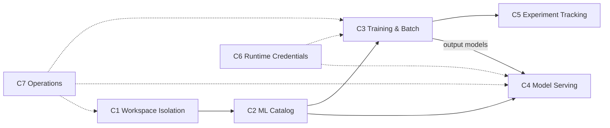
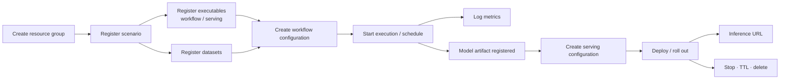

# NAF v4 Architecture Description — AI Core Service

> NATO Architecture Framework v4 (NAF v4) description of the UIM Platform
> **AI Core** service: an SAP AI Core style runtime for the machine learning
> lifecycle (AI API v2). It covers resource groups, scenarios, executables,
> configurations, executions, deployments, artifacts, metrics, execution
> schedules and runtime secrets.
>
> Version 2.0.0 · Implementation: [backend/](backend/) (D, vibe.d 0.10.5),
> [frontend/](frontend/) (SAP Fiori 3 / OpenUI5), [approuter/](approuter/),
> [mta.yaml](mta.yaml), [k8s/](k8s/). Diagrams: [UML.md](UML.md).

---

## 1. NAF v4 grid mapping

| Viewpoint group | Viewpoints used | Section |
| --- | --- | --- |
| **C – Concepts** | C1 Capability Taxonomy, C2 Enterprise Vision, C3 Capability Dependencies | §2 |
| **S – Service Specification** | S1 Service Taxonomy, S2 Service Structure, S3 Service Interfaces, S4 Service Functions, S5 Service States | §3 |
| **L – Logical Specification** | L1 Node Types, L2 Logical Scenario, L4 Logical Activities, L6 Logical Sequence, L7 Logical Data Model, L8 Logical Constraints | §4 |
| **P – Physical Resource Specification** | P1 Resource Types, P2 Resource Structure, P4 Resource Functions, P5 Resource Interactions | §5 |
| **A – Architecture Meta-Data** | A1 Meta-Data Definitions, A3 Architecture Status, A7 Standards, A8 Decisions | §6 |

---

## 2. Concepts (C)

### C1 – Capability taxonomy

```
AI Core
├── C1  Workspace Isolation
│   ├── C1.1  Tenant isolation (every record is tenant partitioned)
│   ├── C1.2  Resource group provisioning (PROVISIONING → PROVISIONED; "default" on first use)
│   └── C1.3  Cascading clean-up of a resource group
├── C2  ML Catalog
│   ├── C2.1  Scenario management
│   ├── C2.2  Executable templates (workflow / serving, parameters, artifact slots, versions)
│   ├── C2.3  Configuration binding (parameters + input artifacts, validated against the template)
│   └── C2.4  Artifact registry (dataset, model, resultset, other; URL based)
├── C3  Training & Batch Execution
│   ├── C3.1  Execution submission and lifecycle (PENDING → RUNNING → COMPLETED / STOPPED)
│   ├── C3.2  Output artifact registration on completion
│   ├── C3.3  Bulk stop / delete
│   └── C3.4  Scheduling (5-field cron, UTC, validity window, manual trigger)
├── C4  Model Serving
│   ├── C4.1  Deployment lifecycle (PENDING → RUNNING → STOPPING → STOPPED, restart)
│   ├── C4.2  Inference endpoint URL
│   ├── C4.3  Configuration rollout (lastOperation UPDATE)
│   └── C4.4  Time to live (≥ 10 min)
├── C5  Experiment Tracking
│   ├── C5.1  Metric logging per execution, name and step
│   └── C5.2  Execution tags
├── C6  Runtime Credentials
│   ├── C6.1  Docker registry secrets (tenant wide)
│   └── C6.2  Object store secrets (per resource group)
└── C7  Operations
    ├── C7.1  Lifecycle reconciliation (background worker, on demand)
    ├── C7.2  Lifecycle events (structured log / event publisher port)
    ├── C7.3  Statistics (KPI singleton)
    ├── C7.4  Health probes
    └── C7.5  Demo content for onboarding
```

### C2 – Enterprise vision

| Aspect | Description |
| --- | --- |
| **Mission** | Give UIM platform teams an AI API v2 compatible ML lifecycle service that works the same way locally, on Kubernetes and on SAP BTP. |
| **Vision** | One model of the ML lifecycle, from dataset to served model. It is reachable through the standard AI API for SDKs and pipelines, and through a Fiori app, a CLI and a desktop GUI for people. |
| **Scope** | Catalog, execution, serving, tracking and credentials of ML workloads. Container orchestration is **simulated** by a configurable lifecycle policy; no workloads are started. |
| **Out of scope** | Real training or inference runtimes, Git synchronisation of templates, log streaming, multi-node storage. |
| **Stakeholders** | Data scientists, ML engineers, MLOps / platform operators, AI application developers, security officers. |

### C3 – Capability dependencies



---

## 3. Service specification (S)

### S1 – Service taxonomy

```
AI Core Services
├── SVC-AIAPI   AI API v2 (client API, SAP AI Core wire format)        /api/v2
│   ├── SVC-META   Capabilities                                         /lm/meta
│   ├── SVC-SCN    Scenarios, versions, executables                     /lm/scenarios…, /lm/executables
│   ├── SVC-CFG    Configurations                                       /lm/configurations
│   ├── SVC-EXE    Executions (+ bulk)                                  /lm/executions
│   ├── SVC-DEP    Deployments (+ bulk, TTL, rollout)                   /lm/deployments
│   ├── SVC-ART    Artifacts                                            /lm/artifacts
│   ├── SVC-SCH    Execution schedules                                  /lm/executionSchedules
│   ├── SVC-MET    Metrics                                              /lm/metrics
│   └── SVC-ADM    Resource groups, docker registry / object store secrets   /admin/…
├── SVC-ODATA   Management API for SAP Fiori (OData v4, $metadata, $batch, actions)   /odata/v4/ai-core
├── SVC-CLI     Administration CLI (uim-ai-core-cli)
├── SVC-GUI     Desktop entity browser (uim-ai-core-gui, GtkD)
├── SVC-UI      Fiori 3 application                                     /app (local) · approuter (BTP)
└── SVC-HLTH    Health                                                   /health, /api/v1/health, /api/v2/health
```

### S2 – Service structure

| Service | Realised by (presentation) | Driving ports used |
| --- | --- | --- |
| SVC-AIAPI | `AiApiController` (`presentation/http/controllers/ai_api.d`) | all `IManage*` ports |
| SVC-ODATA | `ODataController` (shared) + `aiCoreEngine` (`presentation/odata/engine.d`) | all ports, `IReconcileLifecycle`, `IAiCoreStatisticsService` |
| SVC-CLI | `buildAiCoreCli` (`presentation/cli/commands.d`) | via `ODataEngine`, `IReconcileLifecycle` |
| SVC-GUI | `runAiCoreGui` → shared `EntityBrowserWindow` | via `ODataEngine` |
| SVC-UI | `frontend/` (manifest, views, controllers) | SVC-ODATA |
| SVC-HLTH | `AiCoreHealthController` | — |

### S3 – Service interfaces

| Interface | Protocol | Format | Authentication | Tenant / scope |
| --- | --- | --- | --- | --- |
| AI API v2 | HTTP/1.1 REST | JSON (`{count, resources}`, AI Core error envelope) | Bearer JWT (XSUAA RS256 or HS256) or open (dev) | `X-Tenant-Id` / token zone; `AI-Resource-Group` header |
| OData v4 | HTTP/1.1 OData 4.0 | JSON, CSDL XML (`$metadata` with UI/Common/Capabilities annotations), multipart `$batch` | as above, via approuter | token / `X-Tenant-Id`; group via `resourceGroupId` / composite key |
| CLI / GUI | in-process | text table, JSON, CSV / GTK | local trust | `--tenant` |
| Events | in-process port `IAiCoreEventPublisher` | JSON `{type, tenantId, subject, data, time}` | — | per tenant |

Scopes: `Read` (all reads), `Manage` (writes and actions). Role collections:
`AiCoreViewer`, `AiCoreOperator`.

### S4 – Service functions

| Function | AI API | OData | CLI |
| --- | --- | --- | --- |
| Create resource group | `POST /admin/resourceGroups` | `POST ResourceGroups` | `create ResourceGroups --id=…` |
| Delete resource group (cascade) | `DELETE /admin/resourceGroups/{id}` | `DELETE ResourceGroups('id')` | `delete ResourceGroups id --yes` |
| Register executable | `POST /lm/scenarios/{id}/executables` | `POST Executables` | `create Executables …` |
| Create configuration | `POST /lm/configurations` | `POST Configurations` | `create Configurations …` |
| Start execution | `POST /lm/executions` | `POST Executions` | `run <group> <configuration>` |
| Stop execution(s) | `PATCH /lm/executions[/{id}]` | action `StopExecution` / `PATCH targetStatus` | `stop Executions <key>` |
| Deploy model | `POST /lm/deployments` | `POST Deployments` | `deploy <group> <configuration> --ttl=` |
| Stop / restart / roll out | `PATCH /lm/deployments/{id}` | `StopDeployment`, `ResumeDeployment`, `PATCH configurationId` | `stop Deployments <key>` |
| Log / clear metrics | `PATCH` / `DELETE /lm/metrics` | `POST Metrics`, action `ClearMetrics` | `create Metrics …` |
| Schedule | `POST /lm/executionSchedules` | `POST ExecutionSchedules`, `TriggerSchedule` | `invoke TriggerSchedule --key=` |
| Advance lifecycles | (background worker) | action `Reconcile` | `reconcile [--times=N]` |
| Demo content | — | action `SeedDemoData` | `seed` |
| Key figures | — | singleton `Statistics` | `stats` |

### S5 – Service states

| Resource | States | Transitions |
| --- | --- | --- |
| Resource group | `PROVISIONING`, `PROVISIONED`, `ERROR` | provisioned after `provisionSeconds` (0 = immediately) |
| Execution | `UNKNOWN`, `PENDING`, `RUNNING`, `COMPLETED`, `DEAD`, `STOPPING`, `STOPPED` | see UML §6; deletable only when not `PENDING`/`RUNNING`/`STOPPING` |
| Deployment | same set | start, TTL stop, stop, restart, rollout; deletable only when stopped |
| Schedule | `ACTIVE`, `INACTIVE` | fires when `nextRunAt ≤ now` and inside its window |

---

## 4. Logical specification (L)

### L1 – Node types

| Node | Role |
| --- | --- |
| **AI API Client** | SDK, pipeline or script calling the AI API v2 |
| **Fiori User** | Data scientist / operator in the browser |
| **Administrator** | Operator using the CLI or the GUI |
| **Approuter** | Single entry point on BTP: login, CSRF, routing to backend and static UI |
| **Identity Provider** | XSUAA: issues the JWTs with `Read` / `Manage` scopes |
| **AI Core Service** | Domain logic, adapters, reconciler |
| **Document Store** | Tenant-partitioned JSON documents (memory / file snapshot) |
| **Event Consumer** | Log pipeline, or a future broker behind `IAiCoreEventPublisher` |

### L2 – Logical scenario (node connectivity)

```
┌──────────────┐ HTTPS AI API v2 ┌────────────┐  HTTP + JWT   ┌──────────────────────────┐
│ AI API Client├────────────────►│            ├──────────────►│ AI Core Service           │
└──────────────┘                 │ Approuter  │               │  AI API · OData · health  │
┌──────────────┐ HTTPS (Fiori)   │ (BTP)      │               │  reconciler worker        │
│ Fiori User   ├────────────────►│            │               └──────┬──────────┬────────┘
└──────────────┘                 └─────┬──────┘                      │          │ events
                                       │ OAuth 2.0                   │ JSON docs│
                                 ┌─────▼──────┐               ┌──────▼─────┐ ┌──▼────────────┐
                                 │   XSUAA    │               │ Document   │ │ Event consumer │
                                 └────────────┘               │ Store      │ │ (structured log)│
┌──────────────┐   in-process (shared container + file store) └──────▲─────┘ └────────────────┘
│Administrator ├──────────────────────────────────────────────────────┘
└──────────────┘
```

### L4 – Logical activities (ML lifecycle)



### L6 – Logical sequence

The training, rollout and schedule sequences are in [UML.md §7](UML.md#7-sequence-diagrams).

### L7 – Logical data model

| Entity | Identity | Key relationships |
| --- | --- | --- |
| `ResourceGroup` | tenant + id | contains everything below; root of the cascade |
| `Scenario` | group + id | owns executables, configurations, artifacts |
| `Executable` | group + id | belongs to a scenario; declares `ParameterDef[]`, input/output `ArtifactSlot[]`; type workflow / serving |
| `Configuration` | group + id (generated or given) | binds one executable: `Label[]` parameter bindings, `ArtifactRef[]` input bindings |
| `Execution` | group + generated id | runs a workflow configuration; optional `scheduleId`; produces `outputArtifacts`, `Metric`s, `tags` |
| `Deployment` | group + generated id | serves a serving configuration; `latestRunningConfigurationId`, `deploymentUrl`, `ttlSeconds` |
| `Artifact` | group + id | belongs to a scenario; optionally produced by an execution |
| `ExecutionSchedule` | group + id | triggers executions of a workflow configuration |
| `Metric` | group + `<execution>.<name>.<step>` | one value per execution, name and step |
| `DockerRegistrySecret` | tenant + name | fingerprint only |
| `ObjectStoreSecret` | group + name | fingerprint only; referenced by `ai://<name>/…` URLs |

Common attributes: `tenantId`, `createdAt`, `createdBy`, `updatedAt`, `updatedBy`.

### L8 – Logical constraints

| ID | Constraint | Enforced in |
| --- | --- | --- |
| LC-1 | Resource group ids: 3–253 chars `[a-z0-9.-]`, alphanumeric at both ends; other ids 1–64 chars `[A-Za-z0-9._-]` | `domain/services/identifiers.d` |
| LC-2 | Configurations must bind every mandatory parameter and every input slot; no unknown keys; artifacts of the same scenario and matching kind | `domain/services/bindings.d` |
| LC-3 | Workflow → executions / schedules only; serving → deployments only | `ManageExecutionsUseCase`, `ManageDeploymentsUseCase`, `ManageSchedulesUseCase` |
| LC-4 | Runs need a `PROVISIONED` group; `ERROR` groups are unusable | `AiCoreInteractor` |
| LC-5 | Active runs (`PENDING`, `RUNNING`, `STOPPING`) cannot be deleted; a group with active runs cannot be deleted | `lifecycle.d`, `ManageResourceGroupsUseCase` |
| LC-6 | Referenced scenarios, executables, configurations and artifacts cannot be deleted | catalog use cases |
| LC-7 | Deployment TTL is 0 (unlimited) or 600 s – 365 d | `ManageDeploymentsUseCase` |
| LC-8 | Cron: 5 fields, valid ranges; the schedule window end must be after its start | `domain/services/cron.d`, `ExecutionSchedule.validate` |
| LC-9 | Secret material is never stored or returned; only fingerprints | `ManageSecretsUseCase`, serializers |
| LC-10 | Labels: key 1–256 printable characters without `=` or spaces, value ≤ 5000 | `domain/types/labels.d` |

---

## 5. Physical resource specification (P)

### P1 – Resource types

| Resource | Technology |
| --- | --- |
| Backend executable | D (DMD 2.11x / LDC 1.40), vibe.d 0.10.5, uim-framework 26.11, shared `service` package |
| CLI / GUI executables | same code base; GtkD 3.11 for the GUI |
| Frontend | OpenUI5 1.120 (`sap.m`, `sap.f`, `sap.ui.layout`), theme `sap_fiori_3` |
| Approuter | Node.js ≥ 20, `@sap/approuter` 20 |
| Identity | SAP XSUAA (plan `application`) |
| Configuration | `config/default.json`, `AICORE_*` env, user-provided service `ai-core-config` |
| Storage | `MemoryDocumentStore` / `FileDocumentStore` (JSON snapshot) |
| Containers | Docker / Podman multi-stage (`dlang2/ldc-ubuntu` → `ubuntu:24.04`), non-root |
| Orchestration | Cloud Foundry (MTA), Kubernetes (ConfigMap, Deployment, Service) |

### P2 – Resource structure

**SAP BTP Cloud Foundry** (`mta.yaml`)

```
ai-core-approuter (approuter.nodejs, 256M) ── destination ai-core-srv ──► ai-core-srv (binary_buildpack, 256M)
        │ resources/ = frontend (without test/, localService/)               │ AICORE_STORAGE=file, health /health
        └── requires ai-core-xsuaa                                             ├── requires ai-core-xsuaa
                                                                               └── requires ai-core-config (user-provided)
```

**Kubernetes** (`k8s/`)

```
Namespace (any)
├── ConfigMap ai-core-config   AICORE_PORT=8090, AICORE_STORAGE=file, AICORE_DATA_FILE=/data/ai-core.json,
│                              AICORE_RECONCILE_INTERVAL_SECONDS=5, AICORE_EXECUTION_RUN_SECONDS=30, …
├── Deployment ai-core         1 replica (Recreate) · image uim-platform/ai-core · port 8090
│                              probes GET /health · 64Mi/100m → 256Mi/500m
│                              runAsNonRoot · readOnlyRootFilesystem · /data emptyDir (PVC recommended)
└── Service ai-core            ClusterIP :8090
```

**Local development**

```
backend/  ./build/uim-ai-core-platform-service   :8090  (/api/v2, /odata/v4/ai-core, /app)
approuter/ npm start                             :5000  (default-env.json → http://localhost:8090)
frontend/ ui5 serve (optional)                   :8080
```

### P4 – Resource functions

| Physical component | Logical functions |
| --- | --- |
| `AiApiController` | SVC-AIAPI: header resolution, scope check, envelopes, paging, error mapping |
| `ODataController` + `ODataEngine` | SVC-ODATA: `$metadata`, query options, `$batch`, payload validation, actions |
| `Manage*UseCase` | C1–C6 business rules |
| `ReconcileLifecycleUseCase` + `ReconcilerWorker` | C7.1 lifecycle progress, output artifacts, schedule firing |
| `LoggingEventPublisher` | C7.2 events as structured log lines |
| `GroupDocumentRepository` / `TenantDocumentRepository` | persistence by composite key |
| `SecuritySetup` | token verification (RS256 / HS256), tenant resolution |
| `loadAiCoreConfig` | layered configuration |

### P5 – Resource interactions

| From | To | Interaction |
| --- | --- | --- |
| Browser | Approuter | HTTPS, session cookie, CSRF token |
| Approuter | ai-core-srv | HTTPS, `Authorization: Bearer <JWT>` (forwardAuthToken) |
| ai-core-srv | XSUAA | none at runtime: the verification key comes from `VCAP_SERVICES` |
| ai-core-srv | Document store | in-process; `file` writes the JSON snapshot on every change |
| CLI / GUI | Document store | in-process, same snapshot file (`--data-file`) |
| Reconciler | Use cases | vibe.d timer fiber in the server process |

---

## 6. Architecture meta-data (A)

### A1 – Meta-data

| Item | Value |
| --- | --- |
| Architecture | UIM Platform — AI Core Service |
| Version | 2.0.0 |
| Framework | NAF v4 |
| Date | 2026-11-21 |
| Sources | `ai-core/backend/source/uim/platform/ai_core`, `ai-core/frontend`, `ai-core/approuter`, `ai-core/mta.yaml`, `ai-core/k8s` |

### A3 – Architecture status

| Area | Status |
| --- | --- |
| Domain, application, ports | implemented, unit tested (cron, lifecycle, bindings, labels, identifiers, …) |
| AI API v2, OData v4, CLI, GUI | implemented; integration tests in `backend/tests/ai_core_flows.d` |
| Fiori app | implemented (main page, 3 detail pages, 10 dialogs, EN/DE); QUnit + OPA5 |
| Persistence | memory and single-node file snapshot; a database adapter is open |
| Runtime | simulated lifecycle; real container orchestration is open |
| Events | log adapter; message broker adapter is open |

### A7 – Standards

| Standard | Use |
| --- | --- |
| SAP AI Core AI API v2 | Client API: resources, `AI-Resource-Group`, status values, `ttl`, bulk PATCH, error envelope |
| OData 4.0 / CSDL | Management API, `$metadata`, `$batch` |
| SAP OData vocabularies (UI, Common), OASIS Core / Capabilities | Fiori annotations |
| OAuth 2.0 / JWT (RFC 6749, 7519) | XSUAA and HS256 bearer tokens |
| Cron (POSIX / Vixie) | Execution schedules |
| ISO 8601 | Timestamps (UTC) |
| SAP Fiori 3 design | Frontend |
| Twelve-factor configuration | env > files, `VCAP_SERVICES` |

### A8 – Architecture decisions

| ID | Decision | Rationale |
| --- | --- | --- |
| AD-1 | Hexagonal / Clean Architecture with explicit ports | The domain is testable without HTTP or storage; adapters can be swapped (memory / file / DB, log / broker, system / manual clock). |
| AD-2 | AI API v2 wire compatibility | Existing SAP AI Core tooling and SDK concepts carry over (header, envelopes, status values, `ttl`). |
| AD-3 | One EDM model drives OData, CLI and GUI | A single source for validation, scopes and query semantics; no drift between front ends. |
| AD-4 | Composite key `<group>~<id>` | AI Core ids are unique per resource group only; one string key keeps OData, storage and URLs simple. `~` is excluded from ids. |
| AD-5 | Simulated runtime via `LifecyclePolicy` + reconciler | Realistic asynchronous state progress without a container platform; deterministic in tests with `ManualClock`. |
| AD-6 | Output artifacts registered on completion | Training produces models that can be bound into serving configurations right away (closes the train → deploy loop). |
| AD-7 | Configurations immutable | Same as AI Core: reproducible runs; a change means a new configuration (and a deployment rollout). |
| AD-8 | Secrets stored as fingerprints only | No credential material at rest or in responses; changes stay detectable. |
| AD-9 | Default resource group created on first use | Matches AI Core's always-present `default` group; zero setup for clients. |
| AD-10 | Port 8090, `AICORE_` env prefix | Keeps the existing container, ConfigMap and probe conventions of the service. |
| AD-11 | Single-replica file store | Simple operation for development and edge setups; scaling out needs a database adapter behind `IDocumentStore`. |
| AD-12 | Lifecycle events behind `IAiCoreEventPublisher` | Audit and integration (e.g. event mesh) can be added without touching use cases. |
