# UML — AI Core Service

Diagrams of the AI Core service (`ai-core/backend`, module
`uim.platform.ai_core`). They match the code: entity fields, port names,
state transitions and adapters are taken from the sources. Rendered with
Mermaid.

Contents

1. [Domain model](#1-domain-model)
2. [Value types and building blocks](#2-value-types-and-building-blocks)
3. [Ports and interactors](#3-ports-and-interactors)
4. [Component diagram (hexagonal layers)](#4-component-diagram-hexagonal-layers)
5. [Persistence](#5-persistence)
6. [State machines](#6-state-machines)
7. [Sequence diagrams](#7-sequence-diagrams)
8. [Deployment diagram](#8-deployment-diagram)
9. [Frontend](#9-frontend)

---

## 1. Domain model

Every entity mixes in `TenantEntity!(TId)`: `tenantId`, `id`, `createdAt`,
`createdBy`, `updatedAt`, `updatedBy`. Everything except `ResourceGroup` and
`DockerRegistrySecret` lives inside a resource group and is identified by
(resource group, id).

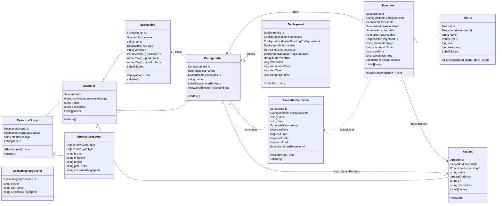

Enumerations (wire values of the AI API):

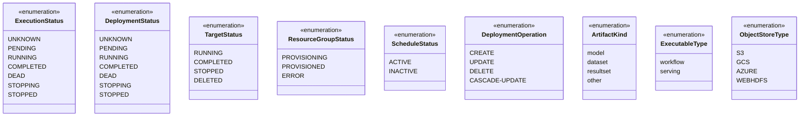

## 2. Value types and building blocks

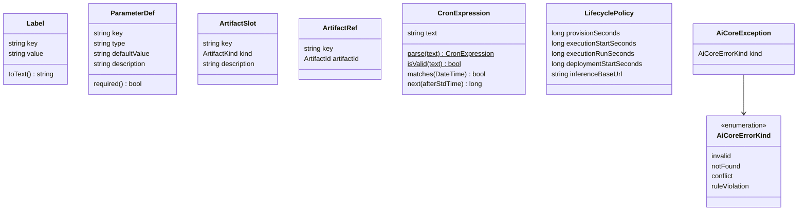

Domain services are pure functions:

| Module | Functions |
| --- | --- |
| `domain/services/identifiers.d` | `isValidResourceGroupId`, `isValidResourceId`, `requireResourceGroupId`, `requireResourceId` |
| `domain/services/cron.d` | `CronExpression` (lists, ranges, steps, `7` = Sunday, Vixie day-of-month / day-of-week OR) |
| `domain/services/lifecycle.d` | `advanceResourceGroup`, `submitExecution`, `requestExecutionStop`, `advanceExecution`, `submitDeployment`, `requestDeploymentTarget`, `changeDeploymentConfiguration`, `advanceDeployment`, `planSchedule`, `isScheduleDue`, `recordScheduleRun` |
| `domain/services/bindings.d` | `checkParameterBindings`, `checkArtifactBindings`, `effectiveParameters` |
| `domain/types/keys.d` | `resourceKey(group, id)` → `"group~id"`, `splitResourceKey` |

## 3. Ports and interactors

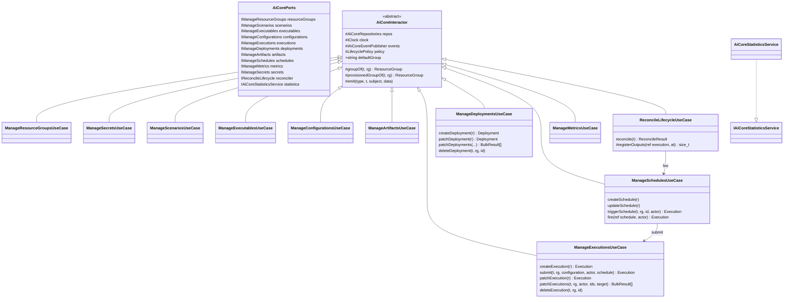

Driven ports:

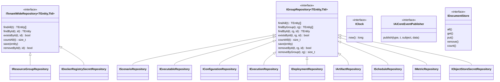

## 4. Component diagram (hexagonal layers)

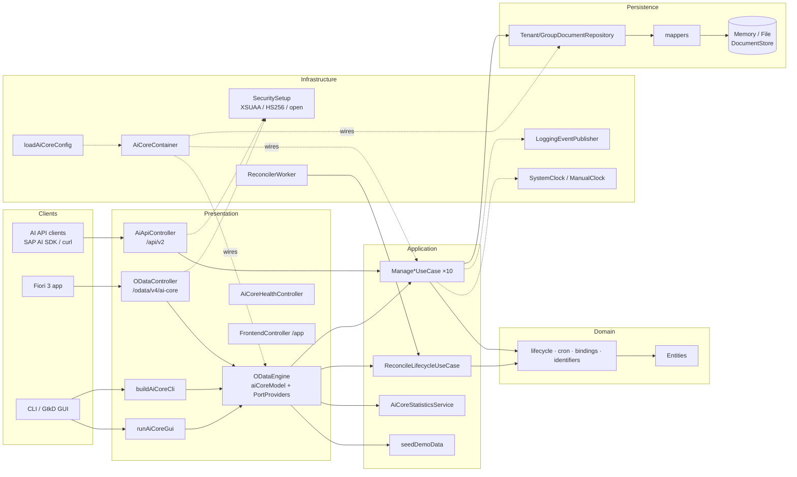

## 5. Persistence

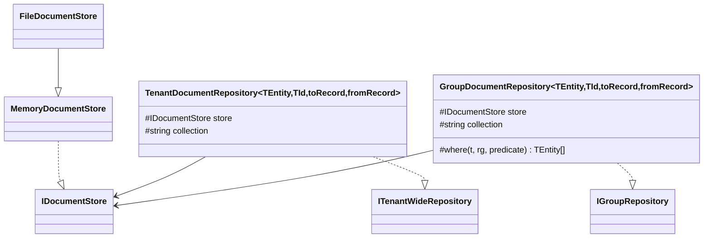

| Collection | Key | Mapper |
| --- | --- | --- |
| `aicore.resourceGroups` | `id` | `resourceGroupToRecord` / `recordToResourceGroup` |
| `aicore.dockerRegistrySecrets` | `id` | `dockerSecretToRecord` / `recordToDockerSecret` |
| `aicore.scenarios`, `.executables`, `.configurations`, `.executions`, `.deployments`, `.artifacts`, `.executionSchedules`, `.metrics`, `.objectStoreSecrets` | `<resourceGroupId>~<id>` | `*ToRecord` / `recordTo*` |

Records store times as std time (hnsecs, UTC). Unknown enum values fall back
to safe defaults so older snapshots stay readable.

## 6. State machines

Execution (`domain/services/lifecycle.d`):

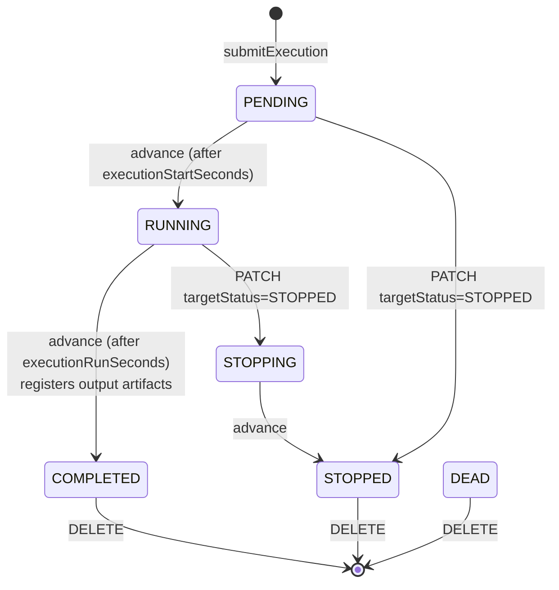

Deployment:

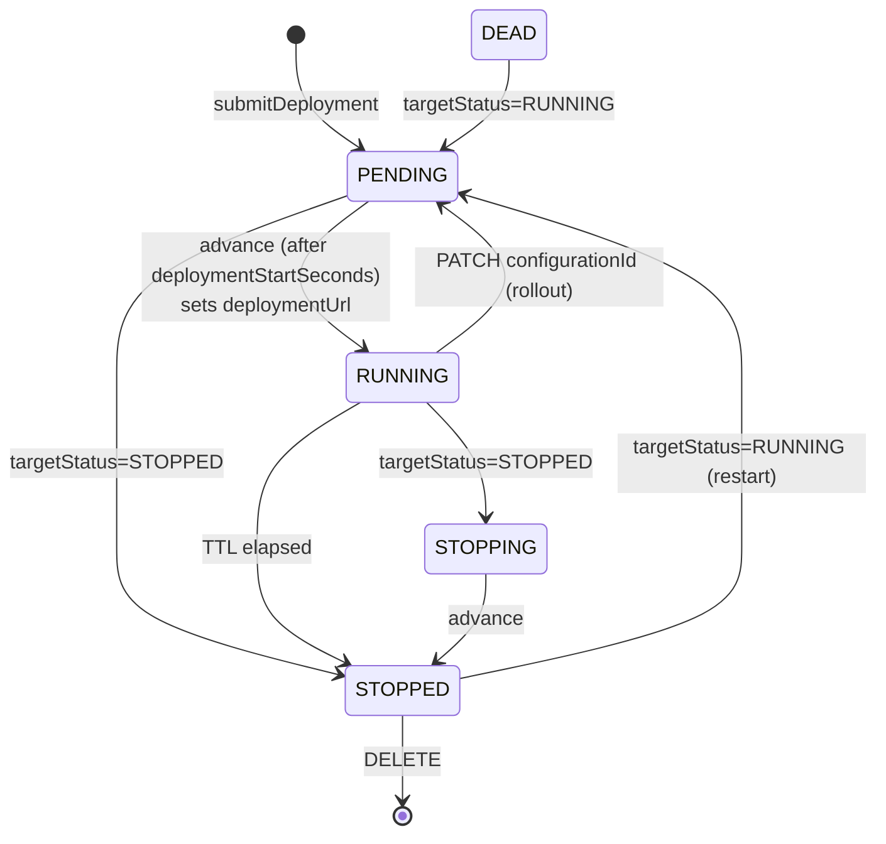

Resource group and schedule:

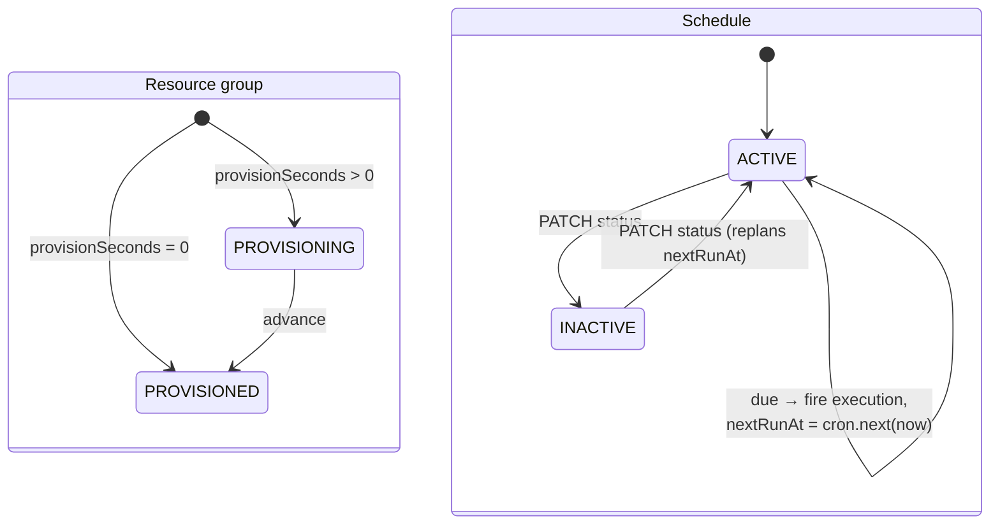

## 7. Sequence diagrams

### Training run through the AI API

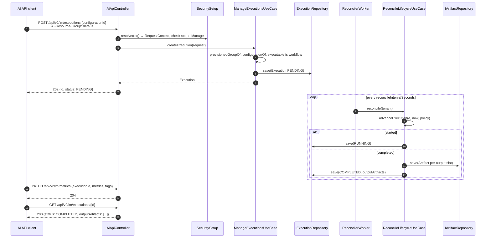

### Deployment rollout from the Fiori app

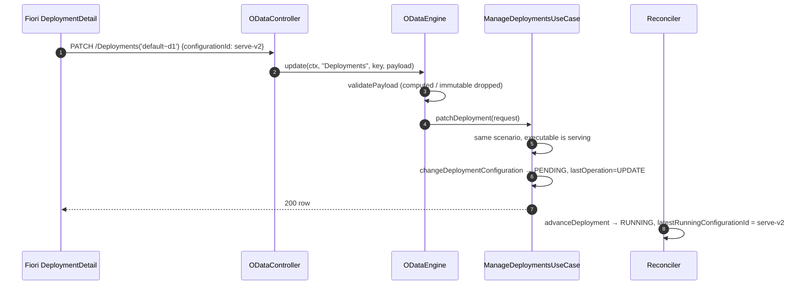

### Schedule firing

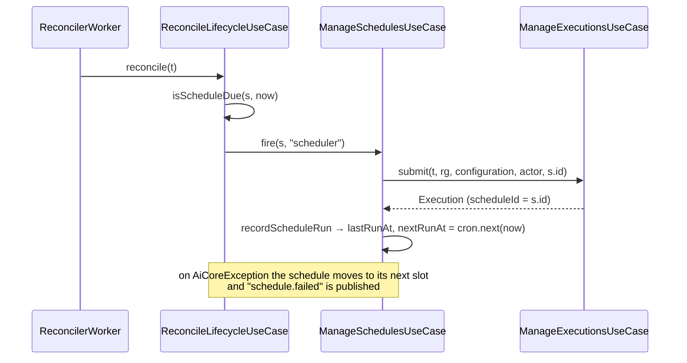

## 8. Deployment diagram

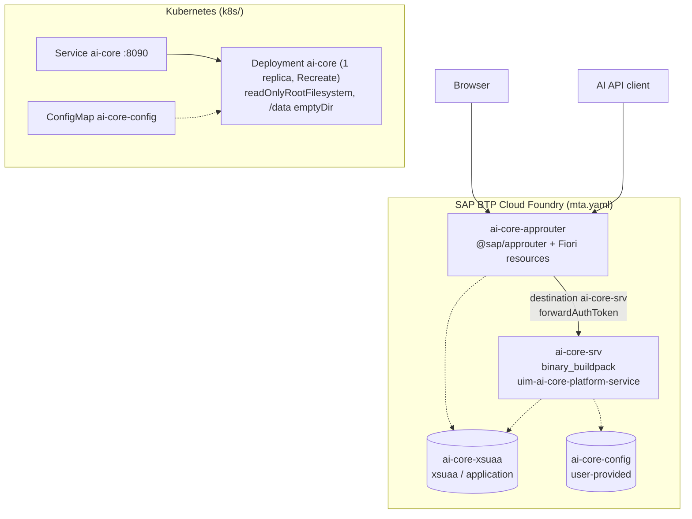

## 9. Frontend

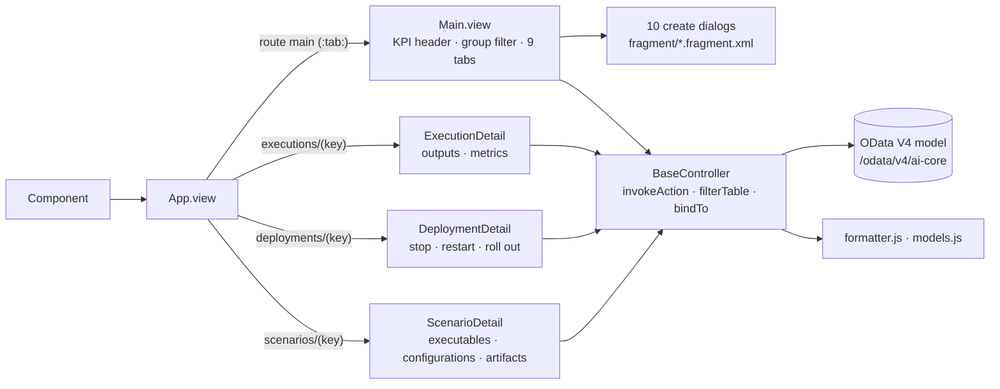
