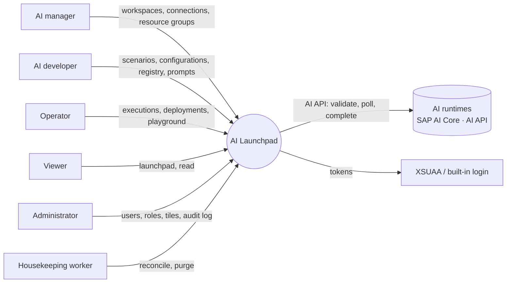

# NAF v4 Architecture Description — UIM AI Launchpad

> NATO Architecture Framework v4 description of the UIM AI Launchpad service 2.0: a launchpad in the style of
> SAP AI Launchpad for AI runtimes (SAP AI Core or other AI API implementations), the machine learning life
> cycle (scenarios, configurations, executions, deployments), a model and dataset registry and the generative AI
> hub (prompts and playground) — with a tile based launchpad, an administration for users, roles, audit log and
> tiles, a D/vibe.d backend, an SAP Fiori 3 / OpenUI5 frontend, built-in JWT login or SAP XSUAA.

---

## 1. Grid mapping

| NAF v4 viewpoint | Subject | Section |
|---|---|---|
| C1 Capability Taxonomy · C2 Enterprise Vision | what the service is able to do and why | §2 |
| C4 Standard Processes / L4 Logical Activities | connect, develop, operate, prompt engineering, administrate, log on | §3 |
| S1 Service Taxonomy · S4 Service Functions | launchpad, OData, REST, auth, worker, CLI, GUI | §4 |
| L2 Logical Scenario · L3 Node Interactions | operational nodes and information flows | §5 |
| L7 Logical Data Model | entities and relations | §6 |
| P1 Resource Types · P2 Resource Structure | software components and layers | §7 |
| P4 Resource Functions / P5 Resource Connectivity | deployment | §8 |
| A8 Standards Profile | standards and technologies | §9 |
| Cr Security / constraints | authentication, authorization, audit, data protection | §10 |
| Ar Architecture decisions | decisions and rationale | §11 |

---

## 2. Capability viewpoint

### C1 — Capability taxonomy

```text
C0 AI Launchpad
├── C1 Launchpad
│   ├── C1.1 Tiles grouped by section, with live KPIs (statistics)
│   ├── C1.2 Scope based visibility of tiles; search
│   └── C1.3 Targets: app routes and external links
├── C2 AI runtime management
│   ├── C2.1 Workspaces (team isolation, active / inactive)
│   ├── C2.2 Connections to SAP AI Core / AI API (write-only secrets, validation)
│   └── C2.3 Resource groups with labels (ready / disabled)
├── C3 ML operations
│   ├── C3.1 Scenarios with executables
│   ├── C3.2 Configurations: parameters and input artifacts, immutable once used
│   ├── C3.3 Executions (training): start, monitor, stop
│   ├── C3.4 Deployments (inference): replicas, time to live, stop / restart
│   └── C3.5 Reconciliation with the runtime (worker, on demand)
├── C4 ML registry
│   ├── C4.1 Models (name + version per scenario, producing execution)
│   └── C4.2 Datasets
├── C5 Generative AI hub
│   ├── C5.1 Prompt collections
│   ├── C5.2 Prompt templates with {{placeholders}}, model parameters, versions, status
│   └── C5.3 Playground (render + complete, token counts)
└── C6 Administration
    ├── C6.1 Users of the built-in login (PBKDF2, lock, last-admin protection)
    ├── C6.2 Roles: built-in (Viewer … Administrator) and custom; scopes Read · Operate · Develop · Manage · Admin
    ├── C6.3 Audit log: persistent, categorised, filterable, retention
    └── C6.4 Tile catalog (create, edit, restore defaults)
```

### C2 — Enterprise vision

| Goal | Measure |
|---|---|
| One entry point to all AI work of a team | launchpad with role specific tiles and live KPIs |
| Controlled, reproducible ML operations | validated connections, immutable used configurations, explicit life cycle states |
| Safe experimentation with generative AI | versioned prompt templates, playground without prompt texts in the log |
| Accountability | every change, login and administration action in the audit log |
| Operable everywhere | the same engine behind Fiori, OData, REST, CLI and GUI; BTP, Kubernetes, single binary |

---

## 3. Processes (C4 / L4)

| Process | Steps | Implemented in |
|---|---|---|
| P1 Connect a runtime | workspace → connection → validate → resource groups | `usecases/runtimes.d` |
| P2 Develop | scenario → datasets → configuration (executable, parameters, inputs) | `usecases/lifecycle.d`, `registry.d` |
| P3 Train | start execution → reconcile (pending → running → completed / failed) → register model | `lifecycle.d`, `reconcile.d`, `registry.d` |
| P4 Serve | create deployment → reconcile (running, URL) → scale / stop / restart / TTL | `lifecycle.d`, `reconcile.d` |
| P5 Prompt engineering | collection → prompt template → playground run → new version | `usecases/genai.d` |
| P6 Administrate | users and roles → tile catalog → audit log review / purge | `usecases/access.d`, `launchpad.d`, `logging.d` |
| P7 Log on | `/auth/login` → token with role scopes → launchpad tiles filtered by scope | `access.d`, `security/*`, `launchpad.d` |

---

## 4. Service viewpoint (S1 / S4)

| Service | Interface | Function |
|---|---|---|
| S1 Launchpad (Fiori) | `/app/index.html` (or approuter) | tiles, apps for runtimes, ML operations, generative AI, administration |
| S2 AI Launchpad OData service | OData v4 `/odata/v4/ai-launchpad` (`$metadata`, `$batch`, 9 actions) | Fiori launchpad, analytics tools |
| S3 AI Launchpad REST API | JSON `/api/v1/ai-launchpad/…` | integration, scripts, automation |
| S4 Authentication | `/auth/config`, `/auth/login`, `/auth/me`, `/auth/password`, `/auth/logout` | built-in JWT login |
| S5 Health | `/health`, `/api/v1/health` | probes, reconcile worker metrics |
| S6 Housekeeping worker | in-process timer | reconciliation, audit log retention |
| S7 Administration CLI | `uim-ai-launchpad-cli` | seed, validate, execute, deploy, stop, reconcile, run-prompt, logs, tokens, passwords |
| S8 Desktop GUI | GtkD entity browser | model-driven forms and actions |
| S9 AI runtime (driven) | `IAiRuntime` | validation, execution / deployment state, prompt completion (simulation shipped) |

---

## 5. Logical / operational viewpoint (L2 / L3)



| Flow | From → to | Content |
|---|---|---|
| IF1 | users → AI Launchpad | OData / REST requests with bearer token |
| IF2 | AI Launchpad → AI runtimes | connection validation, execution / deployment state, prompt completion |
| IF3 | worker → use cases | reconciliation, log retention |
| IF4 | AI Launchpad → audit log / log stream | events with ids, states and field names (no secrets, passwords or prompt texts) |

---

## 6. Logical data model (L7)

| Entity | Key | Main attributes | Relations |
|---|---|---|---|
| Workspace | technical name | name, status | connections, prompt collections |
| Connection | id | type, URL, auth URL, client id, secret (write-only), default resource group, status | workspace; resource groups, scenarios |
| ResourceGroup | technical name | labels, status | connection; executions, deployments |
| Scenario | technical name | name, executables, labels | connection; configurations, models, datasets |
| Configuration | id | name, executable, parameters, input artifacts | scenario; datasets / models; executions, deployments |
| Execution | id | status, started / completed, duration, message | configuration, resource group (scenario, connection copied) |
| Deployment | id | status, URL, replicas, TTL, started / stopped | configuration, resource group |
| Model | id | name, version, URL, size, status, labels | scenario, producing execution |
| Dataset | id | name, URL, size, status, labels | scenario |
| PromptCollection | technical name | name, description | workspace; prompts |
| Prompt | technical name | model, system / user message, temperature, max tokens, top P, status, version, last output, runs | collection |
| Tile | technical name | title, subtitle, icon, group, order, target type / target, KPI, required scope, visible | — |
| Role | technical name | name, scopes, built-in | users |
| UserAccount | user name | display name, e-mail, password hash, roles, lock state, last login | roles |
| LogEntry | id | time, user, category, severity, event type, subject, message, details | — |

All entities are tenant scoped; records are flat JSON documents in collections `ailp.*`.

---

## 7. Resource viewpoint (P1 / P2)

| Layer | Package | Content |
|---|---|---|
| Domain | `domain/` | 15 entities, ids, time, scopes, enumerations, exceptions; services labels, prompt templates, roles |
| Ports | `ports/` | driving: use case interfaces, `AilpPorts`, statistics; driven: repositories, unit of work, AI runtime, clock, audit, credentials |
| Application | `application/` | DTOs (inputs, PATCH changes, results), interactors, statistics, capabilities, default tiles, demo data |
| Persistence | `persistence/` | compile-time entity ↔ record mapper, document repositories, batching file / memory stores |
| Infrastructure | `infrastructure/` | configuration (layered), security (PBKDF2, HS256, XSUAA RS256), audit trail (log + LogEntries), simulated runtime, worker, metrics, container |
| Presentation | `presentation/` | OData model + engine binding, REST, auth, health, Fiori files, CLI, GtkD GUI |
| Frontend | `frontend/` | Fiori 3 app `uim.ailaunchpad`: ShellBar, Launchpad, Runtimes, Lifecycle, GenAI, Admin, 17 fragments, i18n en/de, QUnit + OPA5 |
| Approuter | `approuter/` | routes, XSUAA scopes, role templates and role collections |

---

## 8. Physical deployment (P4 / P5)

### SAP BTP (Cloud Foundry) — `mta.yaml`

`ai-launchpad-srv` (binary buildpack, health check `/health`) and `ai-launchpad-approuter` (serves the Fiori
launchpad, forwards the XSUAA token via destination `ai-launchpad-srv`); resources `ai-launchpad-xsuaa`
(`approuter/xs-security.json`) and the user-provided service `ai-launchpad-config` for runtime overrides. File
storage is per container — one instance.

### Kubernetes — `k8s/`

Deployment with one replica (`Recreate`), PVC mounted at `/data` for `ai-launchpad.json`, ConfigMap (`AILP_*`),
Secret (`AILP_JWT_SECRET`, `AILP_ADMIN_PASSWORD`), ClusterIP service on 8097, read-only root file system,
non-root user, liveness / readiness on `/health`.

### Container

`backend/Dockerfile` / `Containerfile`: multi-stage build with ldc2 from the repository root (path dependency on
`service`); runtime Ubuntu 24.04 with server, CLI, `config/` and the Fiori launchpad.

---

## 9. Standards profile (A8)

| Area | Standard / technology |
|---|---|
| Data access | OData v4.01 (JSON, `$metadata` CSDL XML, `$batch`), Fiori UI annotations |
| APIs | REST / JSON, HTTP 1.1 status semantics; AI API (SAP AI Core) concepts |
| Security | OAuth 2.0 bearer tokens, JWT (RFC 7519) HS256 / RS256, PBKDF2-HMAC-SHA256 (RFC 8018), XSUAA |
| Time | ISO 8601 / RFC 3339 UTC |
| UI | SAP Fiori 3 design (ShellBar, GenericTile, DynamicPage), OpenUI5 1.120 |
| Runtime | D (dmd / ldc2), vibe.d 0.10.5, uim-framework |
| Deployment | MTA 3.3, Cloud Foundry, OCI images, Kubernetes |
| Logging | structured JSON lines; persistent audit log |

---

## 10. Security and constraints

* **Authentication**: XSUAA (when bound) or the built-in login (`authMode jwt`); `open` only for local development.
* **Authorization**: scopes per entity set (read / write) and per action; Manage ⊃ Develop ⊃ Operate ⊃ Read; Admin
  for the administration. Users get scopes through roles; the launchpad shows only permitted tiles and the server
  enforces the same scopes. The CLI and GUI are trusted local adapters.
* **Secrets**: client secrets are write-only (never in rows, logs or audit entries); password hashes never leave the
  service; `jwtSecret` ≥ 32 characters from a secret store; `toMaskedJson` hides secrets in diagnostics.
* **Account protection**: lock after `maxFailedLogins` failures for `lockSeconds`; equal answers and timing for
  unknown users; the last administrator can neither be deleted, locked nor lose Admin (also not via roles).
* **Audit**: logins (succeeded / failed / locked), password changes, tokens, every create / update / delete, life
  cycle transitions and administration actions are logged with time, user and subject; prompt texts and outputs
  are not logged; retention `logRetentionDays`.
* **Input safety**: identifiers, URLs, labels, placeholders and ranges validated in the domain; request size limit
  (`maxRequestBytes`); typed OData payload validation.
* **Constraints**: the file store is a single-node snapshot (one replica / instance); the shipped AI runtime is a
  deterministic simulation — a real AI API client implements `IAiRuntime`.

---

## 11. Architecture decisions

| # | Decision | Rationale |
|---|---|---|
| AD1 | Hexagonal layers with explicit driving / driven ports | business rules independent of vibe.d, storage and the AI runtime; testable with fakes |
| AD2 | One model-driven OData engine behind OData, REST, CLI and GUI | identical validation, scopes and answers on every channel |
| AD3 | Workloads start `pending`; a reconcile step applies runtime state | the same flow for a simulation and a remote AI API; no blocking HTTP calls in requests |
| AD4 | Configurations immutable once used | executions and deployments stay reproducible (SAP AI Core semantics) |
| AD5 | Launchpad tiles as data (catalog) with scope filter and KPI binding | administrators adapt the launchpad without a release; users see only what they may use |
| AD6 | Roles map to scopes; built-in roles mirror the XSUAA role templates | the same authorization model with the built-in login and on BTP |
| AD7 | Audit trail port with a persistent adapter | one place emits events; logs and the administration see the same entries |
| AD8 | Built-in JWT login with XSUAA-compatible claims; XSUAA wins when bound | the same scopes locally, in Kubernetes and on BTP |
| AD9 | Fiori launchpad talks OData V4 only (+ `/auth`); collection properties patched directly | standard UI5 model behaviour; works behind the approuter with CSRF |
