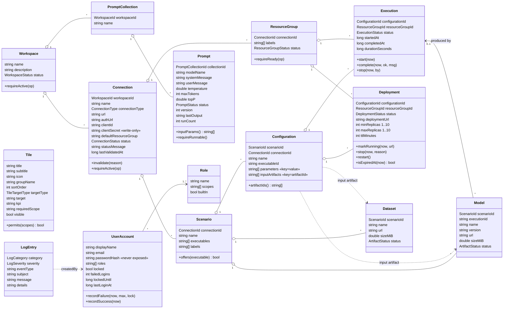
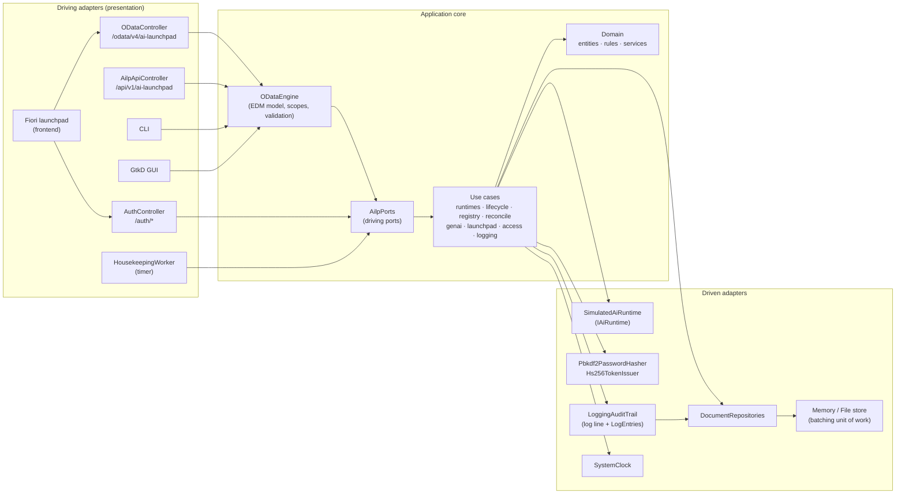
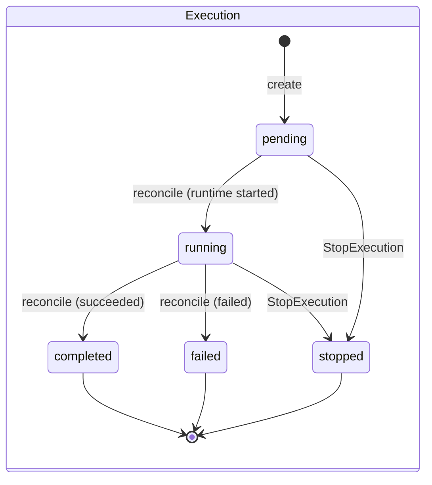
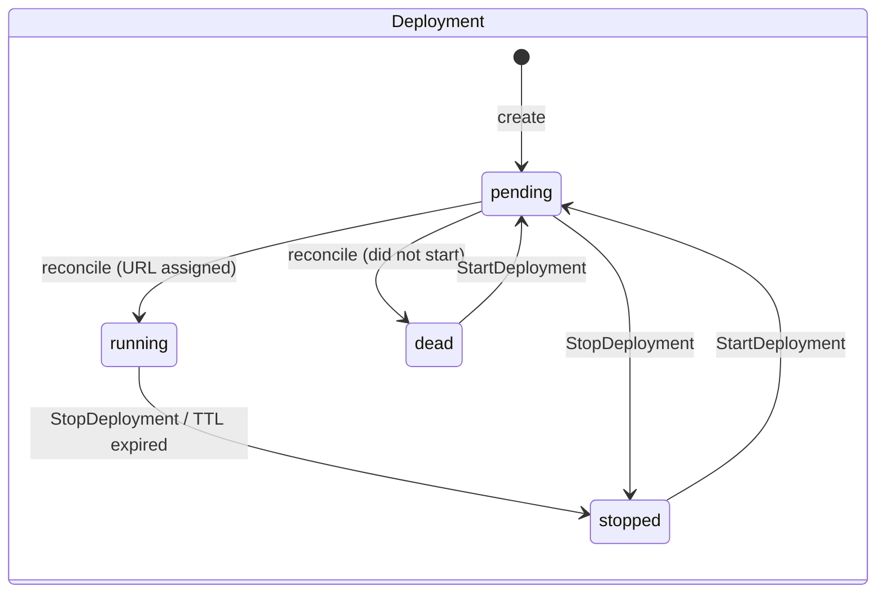
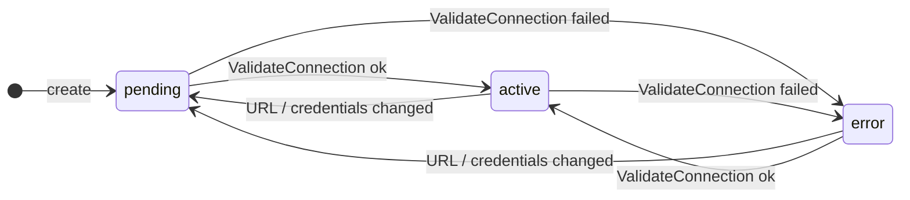
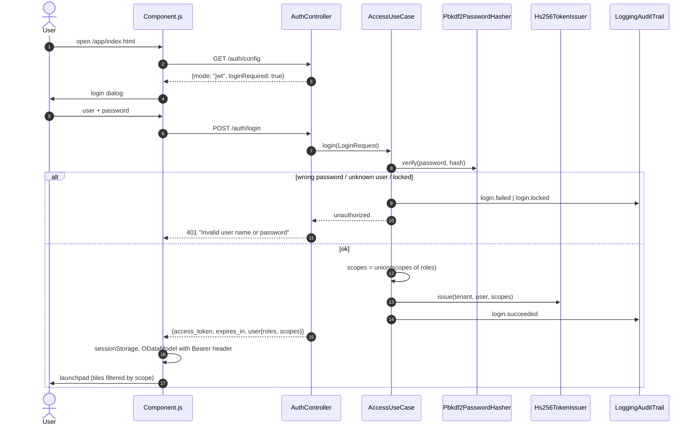
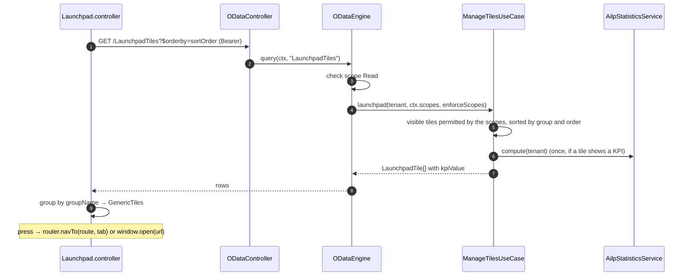
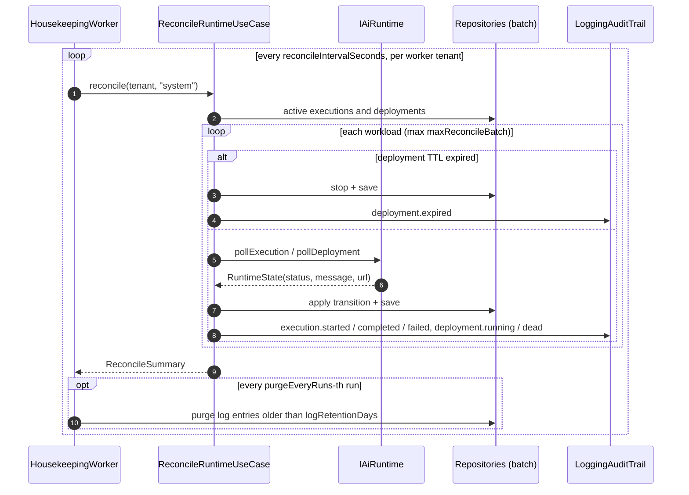
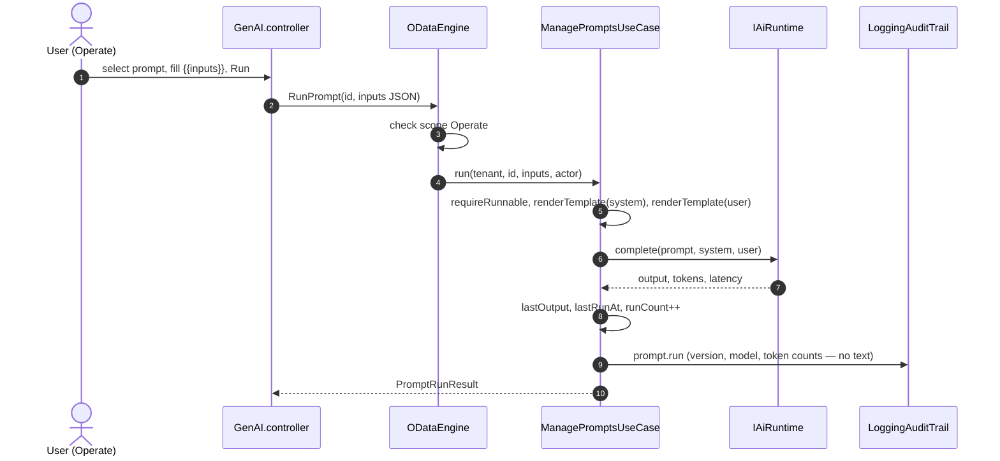
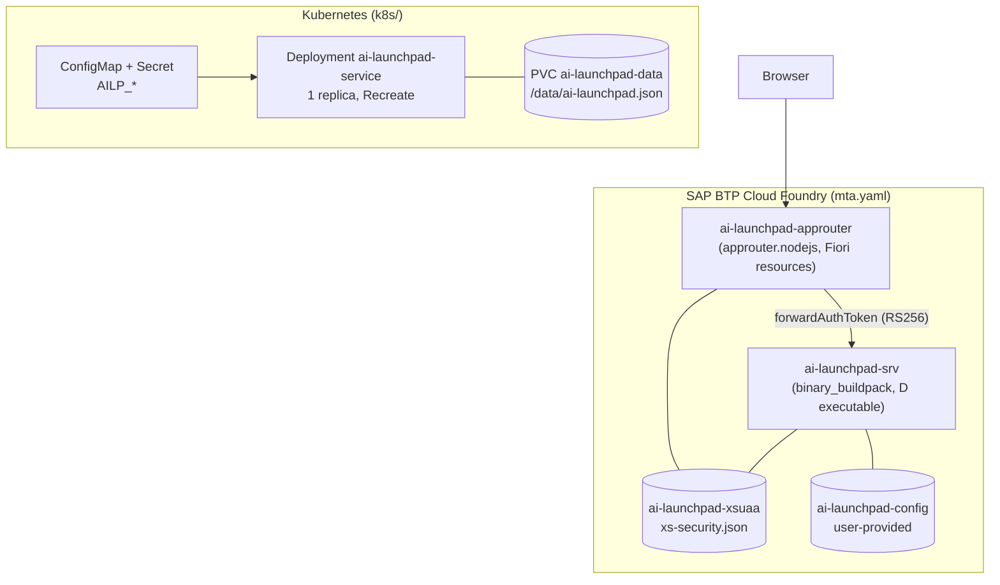

# UML — UIM AI Launchpad

Diagrams of the AI Launchpad service 2.0 (Mermaid). Source:
[backend/source/uim/platform/ai_launchpad](backend/source/uim/platform/ai_launchpad).

## 1. Domain model

Every entity mixes in `TenantEntity` (`tenantId`, `id`, `createdAt/By`, `updatedAt/By`). References between
entities are ids. Executions and deployments copy `scenarioId` and `connectionId` from their configuration so
that they can be filtered without joins.

## 2. Hexagonal components

Layer rules: `domain` depends on nothing; `ports` on the domain and the DTOs; `application` implements
the driving ports against the driven ports; `persistence` and `infrastructure` implement the driven
ports; `presentation` only talks to `AilpPorts` and the `ODataEngine`. `AilpContainer` wires everything.

## 3. Execution and deployment states

## 4. Connection states

## 5. Sequence — login with the built-in JWT

## 6. Sequence — launchpad

## 7. Sequence — reconcile worker

## 8. Sequence — playground run

## 9. Deployment

