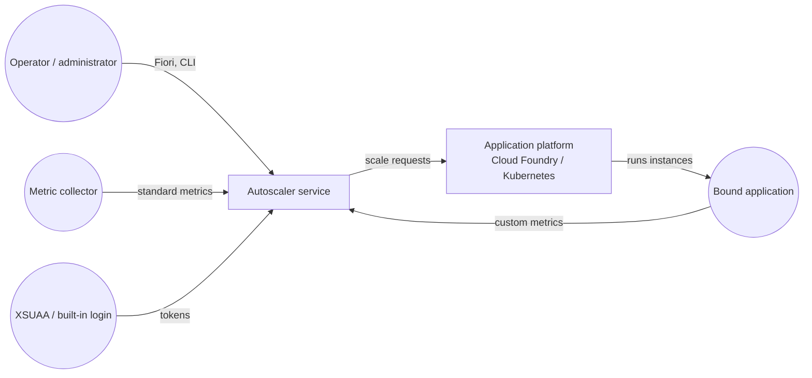

# NAF v4 Architecture Description — UIM Application Autoscaler

> NATO Architecture Framework v4 description of the UIM Application Autoscaler service 2.0: automatic scaling of
> bound applications by scaling policies with dynamic metric rules and schedules (SAP BTP Application Autoscaler
> style), with a D/vibe.d backend, an SAP Fiori 3 / OpenUI5 frontend, built-in JWT login or SAP XSUAA.

---

## 1. Grid mapping

| NAF v4 viewpoint | Subject | Section |
|---|---|---|
| C1 Capability Taxonomy · C2 Enterprise Vision | what the service is able to do and why | §2 |
| C4 Standard Processes / L4 Logical Activities | metric ingestion, evaluation, scaling, schedules, login | §3 |
| S1 Service Taxonomy · S4 Service Functions | OData, REST, CLI, GUI, auth | §4 |
| L2 Logical Scenario · L3 Node Interactions | operational nodes and information flows | §5 |
| L7 Logical Data Model | entities and relations | §6 |
| P1 Resource Types · P2 Resource Structure | software components and layers | §7 |
| P4 Resource Functions / P5 Resource Connectivity | deployment | §8 |
| A8 Standards Profile | standards and technologies | §9 |
| Cr Security / constraints | authentication, authorization, data protection | §10 |
| Ar Architecture decisions | decisions and rationale | §11 |

---

## 2. Capability viewpoint

### C1 — Capability taxonomy

```text
C0 Application Autoscaling
├── C1 Application binding
│   ├── C1.1 Bind / unbind applications (app GUID, service instance)
│   ├── C1.2 Attach / detach a scaling policy
│   └── C1.3 Suspend / resume autoscaling of an application
├── C2 Scaling policy management
│   ├── C2.1 Instance limits, time zone, activation, copy
│   ├── C2.2 Dynamic rules (metric, operator, threshold, breach duration, cool-down, adjustment ±n / ±n %)
│   └── C2.3 Schedules (recurring by weekday / day of month, specific dates; initial minimum)
├── C3 Metric ingestion
│   ├── C3.1 Standard metrics (cpu, memory, disk, throughput, response time) from collectors
│   ├── C3.2 Custom metrics sent by applications (same app / bound apps of the service instance)
│   ├── C3.3 Load simulation (tests, demos)
│   └── C3.4 Retention and purge
├── C4 Scaling decision and execution
│   ├── C4.1 Effective limits (schedule over policy)
│   ├── C4.2 Rule evaluation with breach duration, staleness and cool-down
│   ├── C4.3 Conflict resolution (scale-out before scale-in)
│   ├── C4.4 Instance change through the platform (simulated / HTTP adapter)
│   ├── C4.5 Manual scaling and decision preview
│   └── C4.6 Periodic evaluation (background worker)
├── C5 Scaling history and monitoring
│   ├── C5.1 Immutable scaling events (trigger, before / after, reason, platform answer)
│   └── C5.2 KPIs (autoscaled apps, instances, scale-outs / -ins, failures, active schedules)
└── C6 Access management
    ├── C6.1 Built-in login with JWT, password policy, lockout
    ├── C6.2 XSUAA single sign-on on SAP BTP
    └── C6.3 Scopes Read / Operate / Manage / Admin
```

### C2 — Enterprise vision

| Goal | Measure of effectiveness |
|---|---|
| Applications have enough instances under load | scale-out within breach duration + evaluation interval (default ≤ 2.5 min) |
| No waste outside peak times | scale-in rules and schedules bring instances back to the minimum |
| Predictable behaviour | every decision explained (reason, metric, threshold, limits source) and recorded |
| Stability | breach durations, cool-downs, scale-out priority, limits; stale metrics never trigger |
| Same tool on and off SAP BTP | identical API, UI and rules with XSUAA or the built-in login |

---

## 3. Processes (C4 / L4)

| # | Process | Actor | Steps |
|---|---|---|---|
| P1 | Onboard an application | Scaling administrator | create policy → add rules / schedules → bind application (or attach policy) |
| P2 | Report metrics | Collector / application | `POST /apps/{guid}/metrics` or `MetricSamples` → sample validated (binding, name, value, time, sender) and stored |
| P3 | Evaluate | Worker / operator | effective limits → limits / schedule start → rules (breach, staleness, cool-down) → target |
| P4 | Scale | Scaling engine | platform call → event succeeded / failed → binding updated (instances, last scaled) |
| P5 | Scale manually | Operator | `ScaleBinding(id, instances, reason)` within 1 … policy maximum → event `manual` → cool-down starts |
| P6 | Pause | Operator | `SuspendBinding` → engine skips the binding → `ResumeBinding` |
| P7 | Housekeeping | Worker | every `purgeEveryRuns` runs: samples > `metricRetentionHours`, events > `eventRetentionDays` removed |
| P8 | Log in | User | `/auth/login` → PBKDF2 check → HS256 token → Fiori / API calls with bearer token |

---

## 4. Service viewpoint (S1 / S4)

| Service | Interface | Functions | Consumers |
|---|---|---|---|
| S1 OData v4 | `/odata/v4/autoscaler` | CRUD of Bindings, Policies, Rules, Schedules, MetricSamples, Users; read ScalingEvents, Statistics; 14 actions; `$metadata`, `$batch` | Fiori app, integration |
| S2 REST | `/api/v1/autoscaler` | resources and operations (evaluate, preview, scale, suspend, attach, simulate, app metrics, purge) | scripts, collectors, applications |
| S3 Authentication | `/auth/*` | config, login, me, password, logout | Fiori app, clients |
| S4 Health | `/health` | liveness / readiness with worker metrics | CF, Kubernetes |
| S5 CLI | `uim-application-autoscaler-cli` | generic entity commands + bind, metric, simulate, evaluate, preview, scale, history, token, passwd | operators |
| S6 Desktop | `uim-application-autoscaler-gui` | model driven entity browser and action runner (GtkD) | operators |
| S7 Platform (consumed) | `IInstanceController` | apply instance counts (simulate / HTTP POST) | scaling engine |

---

## 5. Logical / operational viewpoint (L2 / L3)



| Need line | From → to | Information | Frequency |
|---|---|---|---|
| N1 | collector → service | metric samples (binding / app GUID, name, value, time) | every 30–60 s per app |
| N2 | application → service | custom metric samples | as produced |
| N3 | service → platform | target instances, reason | on decision |
| N4 | platform → service | success, actual instances, message | per call |
| N5 | operator ↔ service | policies, rules, schedules, bindings, decisions, history | interactive |
| N6 | IdP → service | JWT with tenant and scopes | per session |

---

## 6. Logical data model (L7)

| Entity | Key attributes | Relations |
|---|---|---|
| AppBinding | name, appGuid (unique, immutable), serviceInstanceId, status, currentInstances, lastScaledAt, lastDecision | → 0..1 ScalingPolicy; 1 → * MetricSample, * ScalingEvent (cascade) |
| ScalingPolicy | name (unique), instanceMin/MaxCount, timezone, status, customMetricAllowFrom | 1 → * ScalingRule, * ScalingSchedule (cascade); ← * AppBinding (blocks delete) |
| ScalingRule | metricType / customMetricName, operator, threshold, breachDurationSeconds, coolDownSeconds, adjustment, enabled | → 1 ScalingPolicy (immutable) |
| ScalingSchedule | kind, start/end time or date-time, days of week / month, validity, instance limits, initial minimum, enabled | → 1 ScalingPolicy (immutable) |
| MetricSample | metricName, value, unit, measuredAt, source | → 1 AppBinding |
| ScalingEvent | trigger, direction, status, old/new instances, metric value, threshold, reason, message | → 1 AppBinding, 0..1 policy, rule, schedule |
| UserAccount | id (user name), displayName, passwordHash, scopes, locked, failedLogins, lockedUntil | — |

All entities are tenant scoped and audited (created/updated at/by). Records are flat JSON documents in the
collections `aas.bindings`, `aas.policies`, `aas.rules`, `aas.schedules`, `aas.metricSamples`, `aas.scalingEvents`,
`aas.users`; times are std time (UTC), schedule times local to the policy's time zone.

---

## 7. Resource viewpoint (P1 / P2)

| Layer | Resources (`backend/source/uim/platform/application_autoscaler/…`) |
|---|---|
| domain | entities (7), types (ids, time zones, adjustment, scopes), enumerations, exceptions, services `rule_evaluator`, `scaling_decider` (pure) |
| ports | use case ports (bindings, policies / rules / schedules, metrics, scaling, access), statistics, repositories, unit of work, events, gateways (clock, credentials, instance controller) |
| application | interactors (`ResourceInteractor` base + 7 use cases), statistics, capabilities, demo data, DTOs (inputs, changes, results, access) |
| persistence | `DocumentRepository<E,Id>`, compile-time entity ↔ record mapper, batching memory / file stores |
| infrastructure | configuration loader, security (PBKDF2, HS256 issuer, XSUAA RS256), logging, worker metrics, instance controllers, scaling worker, `AasContainer` |
| presentation | EDM model + engine (OData), REST, auth, health, Fiori static files, CLI, GtkD GUI |
| frontend | `frontend/`: Component (login), Main (KPIs, bindings, policies, history, metrics, users), BindingDetail, PolicyDetail, 12 dialogs, i18n en/de |
| approuter | `approuter/`: routes, CSRF, XSUAA scopes and role templates |

---

## 8. Physical deployment (P4 / P5)

### SAP BTP (Cloud Foundry) — `mta.yaml`

| Module / resource | Type | Notes |
|---|---|---|
| application-autoscaler-srv | binary buildpack | D executable + CLI, `/health` check, single instance (file snapshot) |
| application-autoscaler-approuter | approuter.nodejs | serves the Fiori app, XSUAA login, destination with token forwarding |
| application-autoscaler-xsuaa | xsuaa / application | scopes Read, Operate, Manage, Admin; role collections Viewer … Administrator |
| application-autoscaler-config | user-provided service | runtime overrides (instance controller, intervals, retention) |

### Kubernetes — `k8s/`

| Object | Notes |
|---|---|
| Deployment `application-autoscaler` | 1 replica, `Recreate`, non-root, read-only root FS, probes on `/health` |
| PersistentVolumeClaim | `/data` holds the JSON snapshot |
| ConfigMap / Secret | `AUTOSCALER_*` settings; JWT secret, admin password, platform authorization |
| Service | port 80 → 8097 |

---

## 9. Standards profile (A8)

| Area | Standard / technology |
|---|---|
| Data access | OData v4.0 (JSON format, `$metadata` CSDL XML, `$batch`), OASIS vocabularies Core, Common, UI |
| API | REST / JSON, HTTP status semantics (400, 401, 403, 404, 405, 409, 422) |
| Identity | JWT (RFC 7519) HS256 / RS256, OAuth 2.0 bearer tokens (RFC 6750), XSUAA claim layout (`zid`, `scope`, `user_name`) |
| Passwords | PBKDF2-HMAC-SHA256 (RFC 8018), 128-bit salt |
| Time | ISO 8601 date-times (UTC), IANA time zone names / fixed offsets, ISO weekday numbering (1 = Monday) |
| Scaling semantics | SAP BTP Application Autoscaler metric names, breach duration, cool-down, adjustments |
| UI | SAP Fiori 3 design (sap_fiori_3), OpenUI5 1.120 (sap.m, sap.f, sap.uxap), i18n properties (en, de) |
| Deployment | MTA 3.3 (SAP BTP), OCI images, Kubernetes |
| Languages | D (dmd 2.112+ / ldc 1.40), vibe.d 0.10.5, JavaScript ES5 (UI5 modules) |

---

## 10. Security and constraints

| Topic | Measure |
|---|---|
| Authentication | `jwt` (built-in login), `xsuaa` (approuter, RS256) or `open` (development only); `/health` and `/auth/config` public |
| Authorization | scopes per entity set (read / write) and per action enforced in the `ODataEngine` for OData, REST, CLI and GUI alike; the app metrics endpoint checks `Operate` itself |
| Credentials | PBKDF2 hashes only, rehash on login when rounds increase, uniform answers for unknown users and wrong passwords, lockout after `maxFailedLogins` |
| Tokens | HS256 secret ≥ 32 characters (random per process if not configured, with a warning), TTL 60 s … 7 days, tampered tokens rejected |
| Secrets | from environment / Kubernetes secret / XSUAA binding; masked in `config` output; never stored in records or events |
| Metric integrity | custom metrics only from the bound app or, if allowed, apps bound to the same service instance; no future timestamps; values ≥ 0 |
| Abuse limits | 1–100 metrics per app request, simulation ≤ 240 samples, request size `maxRequestBytes` |
| Constraints | file storage is a single-node snapshot (one replica / instance); `simulate` changes no real instances — production needs `instanceMode: http` and a platform adapter |

---

## 11. Architecture decisions

| # | Decision | Rationale |
|---|---|---|
| AD1 | Hexagonal layering under `backend/source/uim/platform/application_autoscaler` (domain, ports, application, persistence, infrastructure, presentation) | business rules testable without HTTP or storage; adapters replaceable |
| AD2 | The scaling decision as a pure domain function (`decideScaling`) | deterministic, unit-testable with a manual clock; preview and evaluation share one code path |
| AD3 | Rules and schedules as aggregates of their own (referencing the policy) instead of nested arrays | OData CRUD and filtering, Fiori tables, per-rule audit; cascades handled by the use case |
| AD4 | Platform access behind `IInstanceController` with simulated and HTTP adapters | runs and tests without Cloud Foundry; any platform plugs in through a small adapter |
| AD5 | Breach duration over the uninterrupted run of samples plus staleness limit | no scaling on single spikes or on missing data |
| AD6 | Scale-out before scale-in; cool-down per binding after every scaling (also manual) | availability first; no flapping |
| AD7 | Schedules replace the limits; initial minimum applied once per occurrence | matches the SAP autoscaler semantics; dynamic rules keep working inside the window |
| AD8 | One EDM model and `ODataEngine` drive OData, REST, CLI and GUI | one place for validation, scopes and error mapping; Fiori metadata for free |
| AD9 | Built-in JWT login with XSUAA compatible claims, XSUAA binding wins | same authorization code on BTP and off BTP; Fiori login dialog when no approuter |
| AD10 | Batching unit of work over the JSON snapshot store | an evaluation run over all bindings costs one file write; server, CLI and GUI share the file |
| AD11 | Replaced the first-generation code (`/api/v1/policies`, nested rule arrays, in-memory only, no auth) | it did not compile; consistent resources, persistence, OData parity and security |
