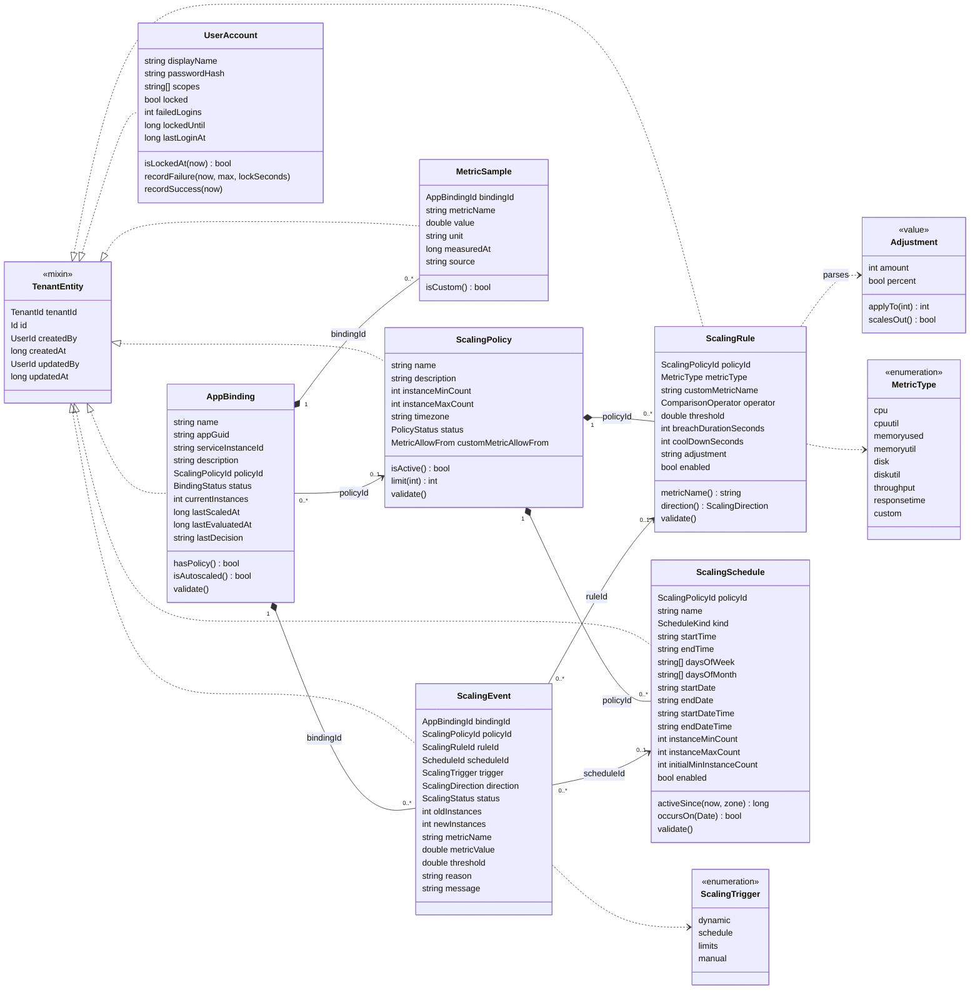
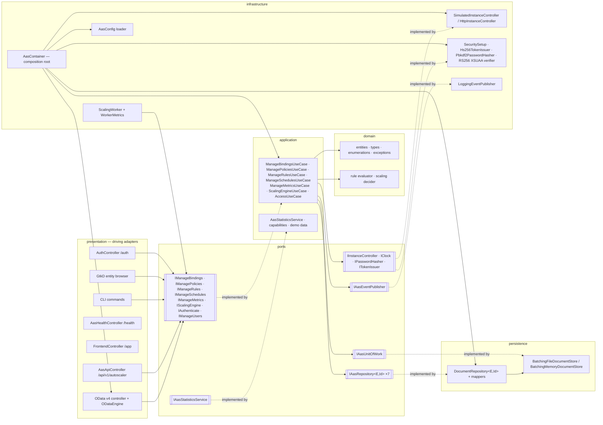
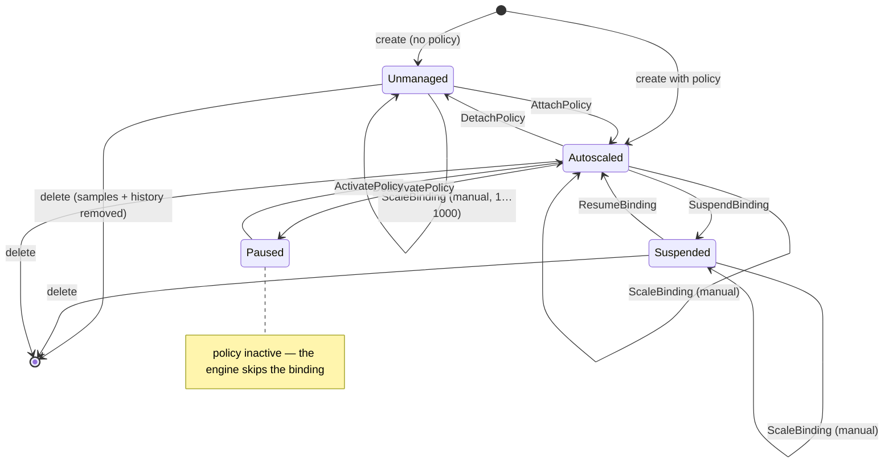
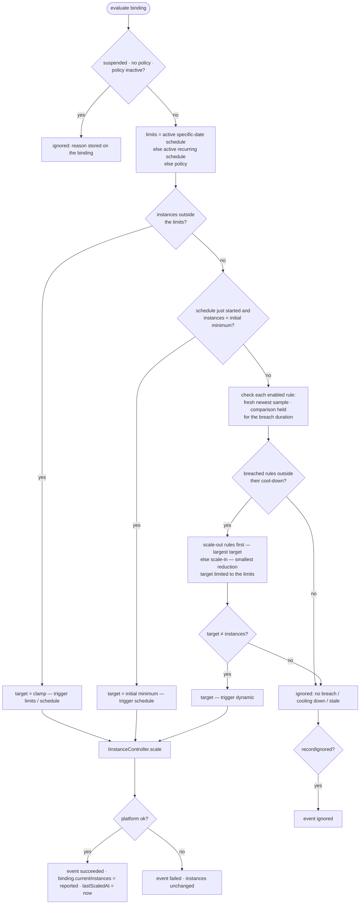
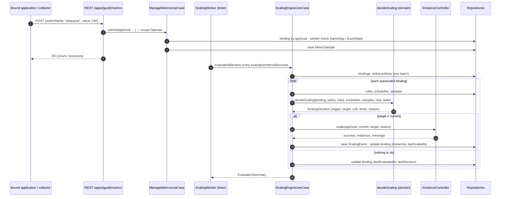
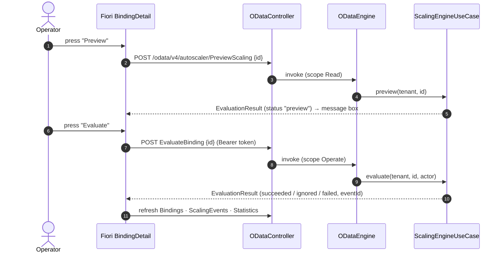
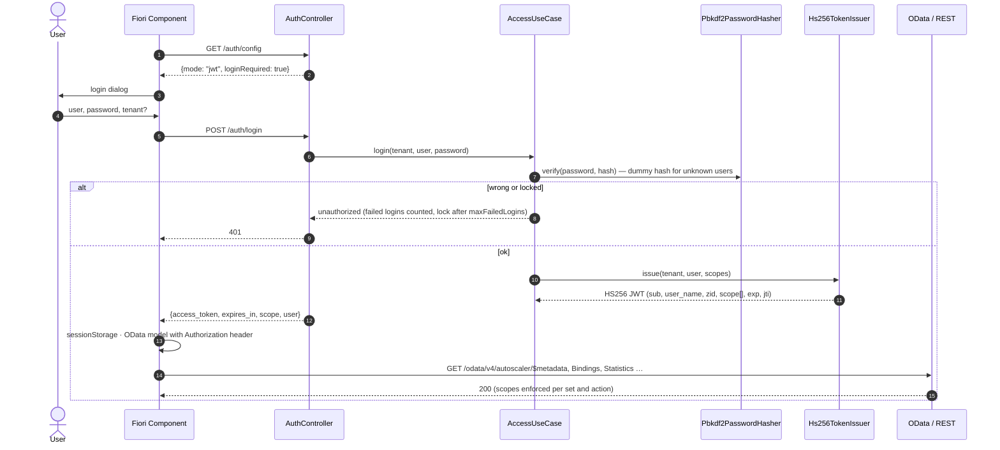

# UML — UIM Application Autoscaler

Diagrams in Mermaid. They describe version 2.0 of the service (`backend/source/uim/platform/application_autoscaler`).

## 1. Domain model



Composition (`*--`) means a cascade on delete: deleting a policy removes its rules and schedules, deleting a binding
removes its samples and history. A policy referenced by bindings cannot be deleted.

## 2. Hexagonal components



Dependencies point inwards: the domain knows nothing of vibe.d, JSON stores or HTTP; the scaling decision is a pure
function of binding, policy, rules, schedules, samples and time; use cases see only ports; the container wires
adapters to ports once for server, CLI and GUI.

## 3. Binding states



## 4. Policy and schedule states

```mermaid
stateDiagram-v2
  state Policy {
    [*] --> active : create
    active --> inactive : DeactivatePolicy
    inactive --> active : ActivatePolicy
    active --> [*] : delete (only without bindings)
    inactive --> [*] : delete (only without bindings)
    active --> inactiveCopy : CopyPolicy
    inactiveCopy : inactive copy with all rules and schedules
  }
  state Schedule {
    [*] --> waiting
    waiting --> applying : start time reached (policy time zone)
    applying --> waiting : end time reached
    applying --> applying : limits replace the policy limits;\ninitial minimum applied once
    waiting --> disabled : enabled = false
    disabled --> waiting : enabled = true
  }
```



## 5. Scaling decision (activity)



## 6. Sequence — metrics, evaluation and scaling



## 7. Sequence — Fiori evaluation of one binding



## 8. Sequence — built-in login (authMode jwt)



## 9. Deployment

```mermaid
flowchart TB
  subgraph BTP[SAP BTP · Cloud Foundry — mta.yaml]
    AR[application-autoscaler-approuter\n@sap/approuter + Fiori resources]
    SRV[application-autoscaler-srv\nbinary buildpack · D executable]
    XS[(XSUAA\napplication-autoscaler-xsuaa)]
    UPS[(user-provided service\napplication-autoscaler-config)]
    AR -- destination application-autoscaler-srv\nforwardAuthToken --> SRV
    AR -. login .-> XS
    SRV -. verificationkey .-> XS
    SRV -. overrides .-> UPS
  end
  subgraph K8S[Kubernetes — k8s/]
    POD[Deployment application-autoscaler\n1 replica · Recreate]
    PVC[(PVC application-autoscaler-data\n/data snapshot)]
    CM[ConfigMap] --> POD
    SEC[Secret jwt secret · admin password] --> POD
    POD --> PVC
    SVC[Service :80 → 8097] --> POD
  end
  PLAT[Platform adapter\ninstanceMode http] <-. POST instances .- SRV
  PLAT <-. POST instances .- POD
  Browser((Browser)) --> AR
  Browser --> SVC
```
