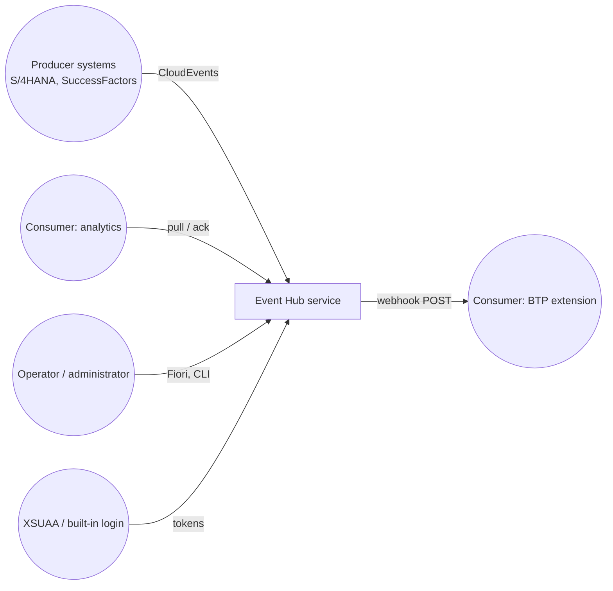

# NAF v4 Architecture Description — UIM Application Event Hub

> NATO Architecture Framework v4 description of the UIM Application Event Hub service 2.0: distribution of business
> events (CloudEvents 1.0) between the SAP cloud systems of a customer landscape — formations, an event catalog,
> subscriptions with filters, webhook and queue channels, at-least-once delivery and dead letters (SAP Cloud
> Application Event Hub style) — with a D/vibe.d backend, an SAP Fiori 3 / OpenUI5 frontend, built-in JWT login or
> SAP XSUAA.

---

## 1. Grid mapping

| NAF v4 viewpoint | Subject | Section |
|---|---|---|
| C1 Capability Taxonomy · C2 Enterprise Vision | what the service is able to do and why | §2 |
| C4 Standard Processes / L4 Logical Activities | onboarding, publishing, routing, delivery, recovery, login | §3 |
| S1 Service Taxonomy · S4 Service Functions | OData, REST, CloudEvents intake, queues, CLI, GUI, auth | §4 |
| L2 Logical Scenario · L3 Node Interactions | operational nodes and information flows | §5 |
| L7 Logical Data Model | entities and relations | §6 |
| P1 Resource Types · P2 Resource Structure | software components and layers | §7 |
| P4 Resource Functions / P5 Resource Connectivity | deployment | §8 |
| A8 Standards Profile | standards and technologies | §9 |
| Cr Security / constraints | authentication, authorization, data protection | §10 |
| Ar Architecture decisions | decisions and rationale | §11 |

---

## 2. Capability viewpoint

### C1 — Capability taxonomy

```text
C0 Application Event Distribution
├── C1 Landscape management
│   ├── C1.1 Register SAP cloud systems (producer / consumer / both), activate / deactivate
│   └── C1.2 Formations: group the systems of a landscape, assign / remove systems, activate / deactivate
├── C2 Event catalog
│   ├── C2.1 Event types with owner, category, schema version
│   └── C2.2 Life cycle active → deprecated → retired
├── C3 Delivery channels
│   ├── C3.1 Webhooks (push, HTTP POST of the CloudEvent)
│   ├── C3.2 Queues (pull and acknowledge)
│   └── C3.3 Delivery mode (at least once / at most once), size limit, active / draining / inactive
├── C4 Subscriptions
│   ├── C4.1 Producer → consumer for a type or a pattern over a channel of the consumer
│   ├── C4.2 Filters on envelope attributes and payload members (include / exclude)
│   ├── C4.3 Retry policy (max. retries, exponential back-off)
│   └── C4.4 Pause / resume; health (ok / warning / error)
├── C5 Publishing and routing
│   ├── C5.1 CloudEvents intake: structured, batch and binary content modes
│   ├── C5.2 Producer and catalog checks; idempotency by event id
│   ├── C5.3 Routing preview (what would happen, nothing stored)
│   └── C5.4 Routing with filters, formation and channel states
├── C6 Reliable delivery
│   ├── C6.1 Immediate first attempt, periodic retries (background worker)
│   ├── C6.2 Dead letters (retries exhausted, oversized, channel deleted); requeue / discard
│   └── C6.3 Retention and purge
├── C7 Monitoring
│   └── C7.1 KPIs (events and deliveries in 24 h, open / retrying / queued messages, open dead letters), message history, audit trail
└── C8 Access management
    ├── C8.1 Built-in login with JWT, password policy, lockout
    ├── C8.2 XSUAA single sign-on on SAP BTP
    └── C8.3 Scopes Read / Publish / Operate / Manage / Admin
```

### C2 — Enterprise vision

| Goal | Measure of effectiveness |
|---|---|
| Loose coupling of SAP cloud applications | producers know event types only, never consumers; consumers subscribe without changes in the producer |
| No lost events | at-least-once delivery, retries with back-off, every give-up visible as a dead letter that can be requeued |
| Only intended data flows | formations, a catalog with owners, scopes per producer user, filters per subscription |
| Transparency | every publish answers per subscription why it was routed, filtered or skipped; message and audit history |
| Same tool on and off SAP BTP | identical API, UI and rules with XSUAA or the built-in login |

---

## 3. Processes (C4 / L4)

| # | Process | Actor | Steps |
|---|---|---|---|
| P1 | Onboard a landscape | Integration administrator | formation → register systems → event types (owner) → channels of the consumers → subscriptions (+ filters) |
| P2 | Publish | Producer system | `POST /events` (CloudEvent) → envelope, producer, catalog and idempotency checks → routing → messages |
| P3 | Deliver | Hub / worker | first attempt on publish → webhook 2xx = delivered / queue = queued → failures retried with back-off |
| P4 | Consume a queue | Consumer system | `GET /channels/{id}/pull` → process → `POST /messages/{id}/ack` |
| P5 | Recover | Operator | open dead letters → fix the cause (endpoint, consumer) → requeue (one / all of a subscription) or discard |
| P6 | Change safely | Operator | pause a subscription, drain or deactivate a channel, deprecate / retire an event type |
| P7 | Housekeeping | Worker | every `purgeEveryRuns` runs: finished messages > `messageRetentionHours`, resolved dead letters > `deadLetterRetentionDays` |
| P8 | Log in | User / technical user | `/auth/login` → PBKDF2 check → HS256 token → Fiori / API calls with bearer token |

---

## 4. Service viewpoint (S1 / S4)

| Service | Interface | Functions | Consumers |
|---|---|---|---|
| S1 OData v4 | `/odata/v4/appevents` | CRUD of Formations, Systems, EventTypes, Channels, Subscriptions, Filters, Users; read Messages, DeadLetters, Statistics; 18 actions; `$metadata`, `$batch` | Fiori app, integration |
| S2 Event intake | `POST /api/v1/appevents/events` | CloudEvents structured / batch / binary, preview | producer systems |
| S3 Queue consumption | `GET /channels/{id}/pull`, `POST /messages/{id}/ack` | pull queued messages, acknowledge | consumer systems |
| S4 REST management | `/api/v1/appevents` | resources and operations (status, assign, pause, deliver, requeue, discard, dispatch, purge) | scripts, operators |
| S5 Authentication | `/auth/*` | config, login, me, password, logout | Fiori app, clients |
| S6 Health | `/health` | liveness / readiness with worker metrics | CF, Kubernetes |
| S7 CLI | `uim-application-events-cli` | generic entity commands + publish, preview, dispatch, deliver, pull, ack, requeue, discard, pause, … | operators |
| S8 Desktop | `uim-application-events-gui` | model driven entity browser and action runner (GtkD) | operators |
| S9 Webhook delivery (consumed) | `IDeliveryGateway` | POST CloudEvents to consumer endpoints (simulate / HTTP) | delivery use case |

---

## 5. Logical / operational viewpoint (L2 / L3)



| Need line | From → to | Information | Frequency |
|---|---|---|---|
| N1 | producer → hub | CloudEvent (id, type, source, subject, time, data) | as business objects change |
| N2 | hub → webhook consumer | CloudEvent, correlation id | per routed event + retries |
| N3 | consumer → hub | HTTP status of the webhook | per attempt |
| N4 | queue consumer ↔ hub | queued messages / acknowledgements | polling |
| N5 | operator ↔ hub | landscape, catalog, subscriptions, filters, messages, dead letters | interactive |
| N6 | IdP → hub | JWT with tenant and scopes | per session / technical user |

---

## 6. Logical data model (L7)

| Entity | Key attributes | Relations |
|---|---|---|
| Formation | name, global account, status | groups 0..n systems |
| SystemRegistration | name, type (producer / consumer / both), URL, status | 0..1 formation; owns event types; consumes through channels |
| EventTopic | event type (unique, immutable), title, category, version, status | 0..1 owner system |
| EventChannel | type (webhook / queue, immutable), endpoint, delivery mode, max size, status | 1 consumer system (immutable) |
| EventSubscription | type pattern, max retries, back-off, status, last matched | 1 producer, 1 consumer (immutable), 1 channel, derived formation; 0..n filters |
| EventFilter | include / exclude, attribute, operator, value, active | 1 subscription (immutable) |
| EventMessage | event id, type, subject, payload, status, attempts, next attempt, last error | 1 subscription, 1 channel, producer, consumer |
| DeadLetterEntry | reason, attempts, status, resolved at / by | 1 message |
| UserAccount | display name, PBKDF2 hash, scopes, lock state | — |

All entities are tenant scoped and carry `createdAt/By`, `updatedAt/By`. Records are flat JSON documents in the
collections `aeh.formations`, `aeh.systems`, `aeh.topics`, `aeh.channels`, `aeh.subscriptions`, `aeh.filters`,
`aeh.messages`, `aeh.deadLetters`, `aeh.users`.

---

## 7. Resource viewpoint (P1 / P2)

| Layer | Resources (backend/source/uim/platform/application_events) |
|---|---|
| domain | entities (9), `CloudEvent`, typed ids, scopes, enumerations, `EventHubException`; services: event type patterns, filters, retries, router |
| ports | use case ports (landscape, catalog, subscriptions, publishing, delivery, access), statistics, `IAehRepository<E,Id>`, `IAehUnitOfWork`, `IAuditTrail`, gateways (`IDeliveryGateway`, `IClock`, `IPasswordHasher`, `ITokenIssuer`) |
| application | interactors (formations, systems, topics, channels, subscriptions, filters, publishing, delivery + dead letters, access), statistics, capabilities, demo data, DTOs (inputs, PATCH changes, results) |
| persistence | `DocumentRepository<E,Id>` with compile-time mappers, batching memory / JSON file stores |
| infrastructure | `AehConfig` loader, `SecuritySetup` (HS256 / RS256), PBKDF2 hasher, simulated / HTTP delivery gateway, `DeliveryWorker`, `LoggingAuditTrail`, `AehContainer` |
| presentation | EDM model + `ODataEngine`, OData controller, REST API, auth, health, Fiori file server, CLI, GtkD GUI |
| frontend | Fiori 3 app: Main (KPIs, tabs), SubscriptionDetail, ChannelDetail, 11 dialogs + user menu, i18n en / de, QUnit / OPA5 |
| approuter | XSUAA login, routes, CSRF, role templates Viewer / Producer / Operator / IntegrationAdministrator / Administrator |

---

## 8. Physical deployment (P4 / P5)

### SAP BTP (Cloud Foundry) — `mta.yaml`

| Module / resource | Type | Notes |
|---|---|---|
| `application-events-srv` | binary buildpack | server + CLI, `/health` check, `deliveryMode http` |
| `application-events-approuter` | `approuter.nodejs` | serves the Fiori app, forwards the XSUAA token |
| `application-events-xsuaa` | managed service `xsuaa` (application) | `approuter/xs-security.json` |
| `application-events-config` | user-provided service | runtime overrides (`VCAP_SERVICES`) |

### Kubernetes — `k8s/`

| Object | Notes |
|---|---|
| Deployment `application-events-service` | 1 replica, `Recreate`, non-root, read-only root file system, probes on `/health` |
| PersistentVolumeClaim `application-events-data` | the JSON snapshot under `/data` |
| ConfigMap / Secret | `APPEVENTS_*` settings; JWT secret, admin password, webhook authorization |
| Service `application-events-service` | port 8132 |

---

## 9. Standards profile (A8)

| Area | Standard / technology |
|---|---|
| Events | CloudEvents 1.0 (structured, batch and binary HTTP content modes; `application/cloudevents+json`) |
| Data access | OData v4.0 (JSON format, `$metadata` CSDL XML, `$batch`), OASIS vocabularies Core, Common, UI |
| API | REST / JSON, HTTP status semantics (400, 401, 403, 404, 405, 409, 413, 422, 207 multi-status for batches) |
| Identity | JWT (RFC 7519) HS256 / RS256, OAuth 2.0 bearer tokens (RFC 6750), XSUAA claim layout (`zid`, `scope`, `user_name`) |
| Passwords | PBKDF2-HMAC-SHA256 (RFC 8018), 128-bit salt |
| Time | ISO 8601 date-times (UTC) |
| Event types | SAP business event naming (`sap.<product>.<area>.<object>.v<n>.<Object>.<Action>.v<n>`) |
| UI | SAP Fiori 3 design (sap_fiori_3), OpenUI5 1.120 (sap.m, sap.f, sap.uxap), i18n properties (en, de) |
| Deployment | MTA 3.3 (SAP BTP), OCI images, Kubernetes |
| Languages | D (dmd 2.114 tested; ldc 1.40 in the container build), vibe.d 0.10.5, JavaScript ES5 (UI5 modules) |

---

## 10. Security and constraints

| Topic | Measure |
|---|---|
| Authentication | `jwt` (built-in login), `xsuaa` (approuter, RS256) or `open` (development only); `/health` and `/auth/config` public |
| Authorization | scopes per entity set (read / write) and per action enforced in the `ODataEngine` for OData, REST, CLI and GUI alike; event intake checks `Publish`, queue pull `Operate` |
| Producer authenticity | the event source must be an active producer system and, for owned event types, the owner; producers get technical users with `Publish` only |
| Data minimisation | filters keep payloads away from consumers that must not receive them; formations separate landscapes; audit entries carry ids and states, never payloads or credentials |
| Credentials | PBKDF2 hashes only, rehash on login when rounds increase, uniform answers for unknown users and wrong passwords, lockout after `maxFailedLogins` |
| Tokens | HS256 secret ≥ 32 characters (random per process if not configured, with a warning), TTL 60 s … 7 days, tampered tokens rejected |
| Secrets | from environment / Kubernetes secret / XSUAA binding; masked in `config` output |
| Abuse limits | payload ≤ `maxPayloadBytes`, request ≤ `maxRequestBytes` (413), ≤ `maxBatchEvents` per batch, ≤ 100 messages per pull, ≤ `maxDispatchBatch` per worker run |
| Constraints | file storage is a single-node snapshot (one replica / instance); `simulate` sends nothing — production needs `deliveryMode: http`; idempotency covers events that were routed to at least one subscription |

---

## 11. Architecture decisions

| # | Decision | Rationale |
|---|---|---|
| AD1 | Hexagonal layering under `backend/source/uim/platform/application_events` (domain, ports, application, persistence, infrastructure, presentation) | business rules testable without HTTP or storage; adapters replaceable |
| AD2 | Routing as a pure domain function (`routeEvent`) returning a decision with a reason per subscription | deterministic and unit-testable; publish and preview share one code path; every skip explained |
| AD3 | CloudEvents 1.0 as the only envelope, also in the store (`toCloudEvent`) | interoperable with SAP Event Mesh / Advanced Event Mesh and any CloudEvents SDK |
| AD4 | One message per routed subscription with its own attempts and state | independent retries per consumer; a slow consumer never blocks the others |
| AD5 | At-least-once with exponential back-off and dead letters; at-most-once as a channel option | no silent loss; operators decide; bounded load on failing consumers |
| AD6 | Webhook push behind `IDeliveryGateway` with simulated and HTTP adapters; queues inside the hub (pull / ack) | runs and tests without network; consumers behind firewalls can pull |
| AD7 | Patterns with segment wildcards instead of regular expressions | predictable, cheap to evaluate, aligned with SAP event type naming |
| AD8 | Filters as entities of their own (referencing the subscription) | OData CRUD, Fiori tables, per-filter activation; cascades handled by the use case |
| AD9 | One EDM model and `ODataEngine` drive OData, REST, CLI and GUI | one place for validation, scopes and error mapping; Fiori metadata for free |
| AD10 | Built-in JWT login with XSUAA compatible claims, XSUAA binding wins; dedicated `Publish` scope | same authorization code on BTP and off BTP; least privilege for producer systems |
| AD11 | Batching unit of work over the JSON snapshot store | a publish or dispatch run over many messages costs one file write; server, CLI and GUI share the file |
| AD12 | Replaced the first-generation code (CRUD only, no routing or delivery, unused MongoDB adapter, no auth) with the backend / frontend / approuter layout | real event distribution, consistent resources, OData parity and security; MongoDB can return behind `IDocumentStore` |
