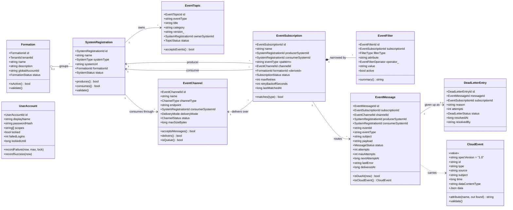
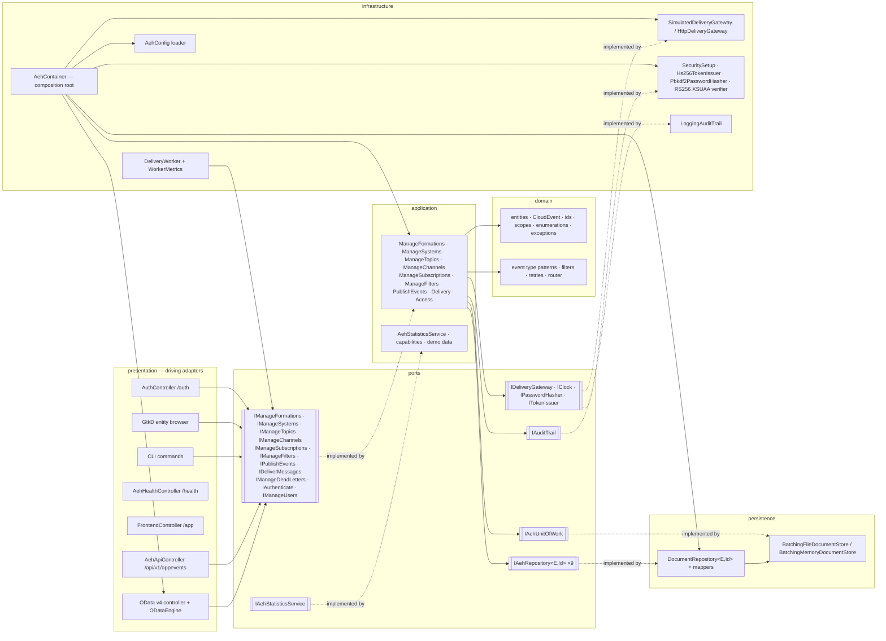
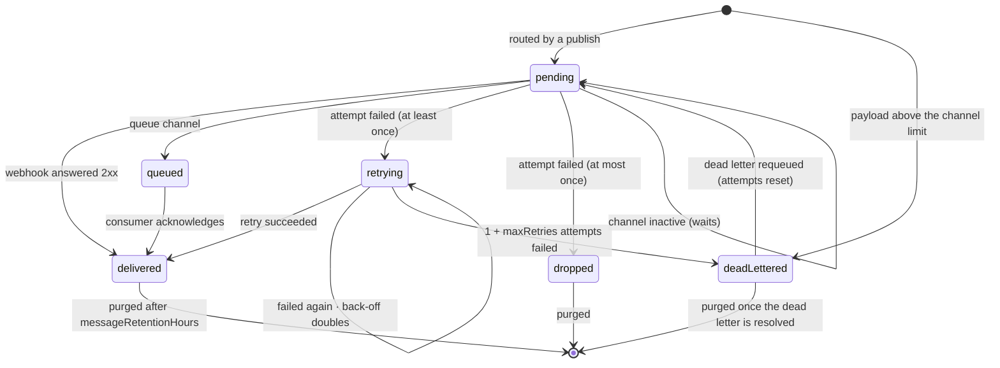
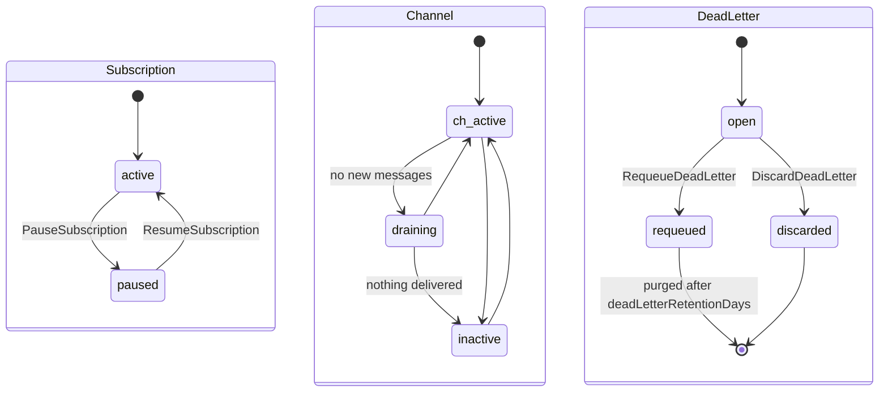
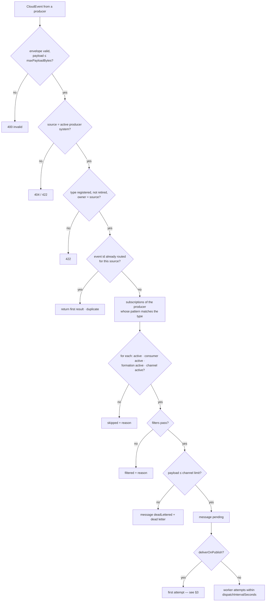
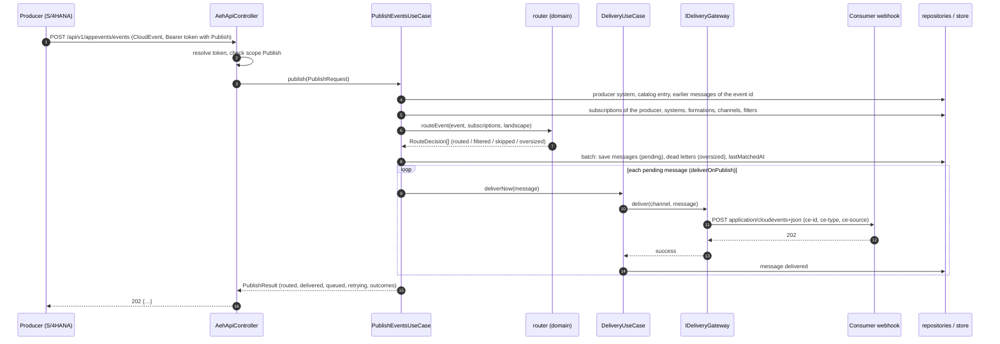
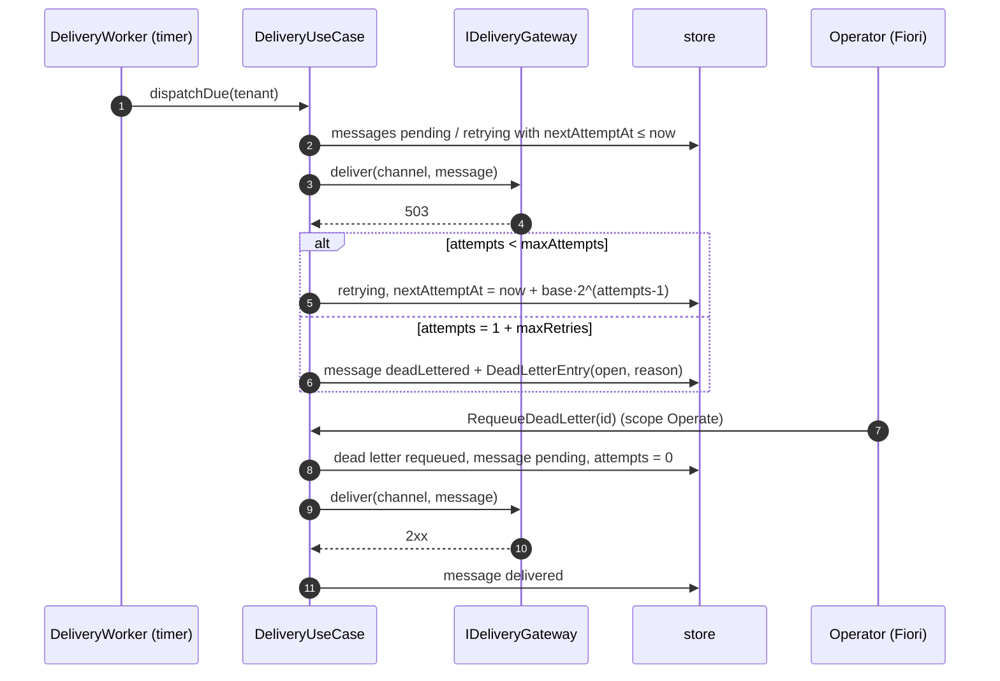
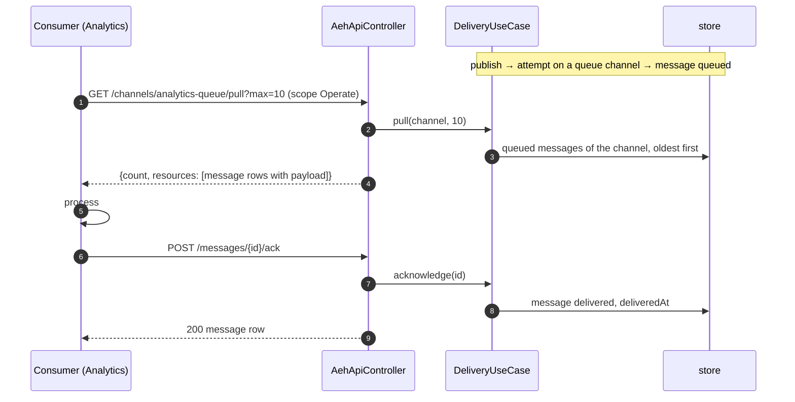
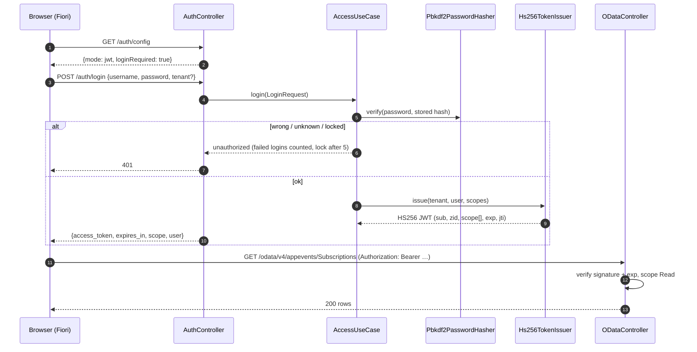

# UML — UIM Application Event Hub

Diagrams in Mermaid. Source of truth: `backend/source/uim/platform/application_events/`.

## 1. Domain model



Enumerations (string valued — the value is what the APIs accept and return):

| Enumeration | Values |
|---|---|
| `FormationStatus` | active, inactive |
| `SystemType` · `SystemStatus` | producer, consumer, both · active, inactive |
| `TopicStatus` | active, deprecated, retired |
| `ChannelType` · `ChannelStatus` · `DeliveryMode` | webhook, queue · active, inactive, draining · atLeastOnce, atMostOnce |
| `SubscriptionStatus` | active, paused |
| `FilterType` · `EventFilterOperator` | include, exclude · equals, notEquals, contains, startsWith, endsWith, exists, oneOf |
| `MessageStatus` | pending, retrying, queued, delivered, deadLettered, dropped |
| `DeadLetterStatus` | open, requeued, discarded |

Pure domain services: `event_types` (type / pattern syntax, `matchesEventType`), `filters` (`evaluateFilters`),
`retries` (`backoffSeconds`, `afterFailure`), `router` (`routeEvent` → `RouteDecision[]`).

## 2. Hexagonal components



Dependencies point inwards: the domain knows nothing of vibe.d, JSON stores or HTTP; routing is a pure function of
event, subscriptions and landscape; use cases see only ports; the container wires adapters to ports once for server,
CLI and GUI. `DeliveryUseCase` implements both `IDeliverMessages` and `IManageDeadLetters`; `PublishEventsUseCase`
uses it for the first delivery attempt.

## 3. Message states



## 4. Subscription, channel and dead letter states



Event types: `active` → `deprecated` (still published and delivered; new exact subscriptions refused) → `retired`
(events refused); any status can be set again by `SetEventTypeStatus`.

## 5. Routing (activity)



## 6. Sequence — publish and webhook delivery



## 7. Sequence — retries, dead letter and requeue



## 8. Sequence — queue consumer (pull / acknowledge)



## 9. Sequence — built-in login (authMode jwt)



## 10. Deployment

```mermaid
flowchart LR
  subgraph btp[SAP BTP · Cloud Foundry — mta.yaml]
    AR[application-events-approuter\n@sap/approuter + Fiori resources]
    SRV[application-events-srv\nbinary_buildpack · D/vibe.d]
    XS[(XSUAA\napplication-events-xsuaa)]
    UPS[(user-provided\napplication-events-config)]
  end
  subgraph k8s[Kubernetes — k8s/]
    POD[Deployment application-events-service\nimage uim-platform/application-events]
    PVC[(PVC application-events-data\n/data/application-events.json)]
    CM[ConfigMap · Secret]
  end
  USER((Browser)) --> AR --> SRV
  AR -. login .-> XS
  SRV -. verification key .-> XS
  SRV -. overrides .-> UPS
  PROD((Producer systems)) -->|CloudEvents| SRV
  SRV -->|webhooks| CONS((Consumer systems))
  CONS -->|pull / ack| SRV
  POD --> PVC
  CM --> POD
```
