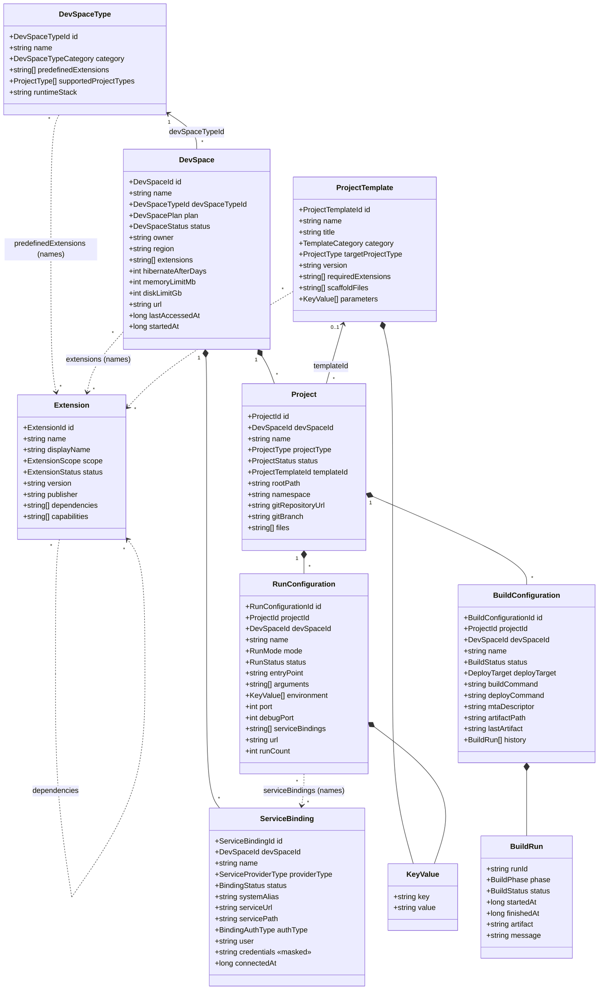
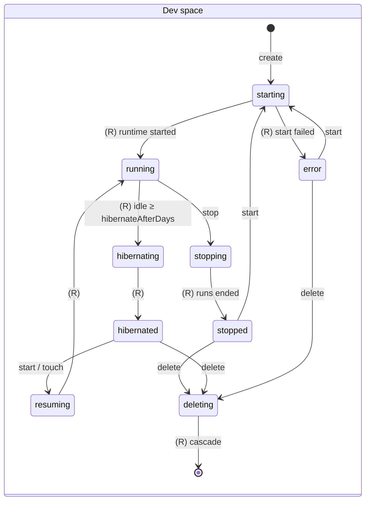
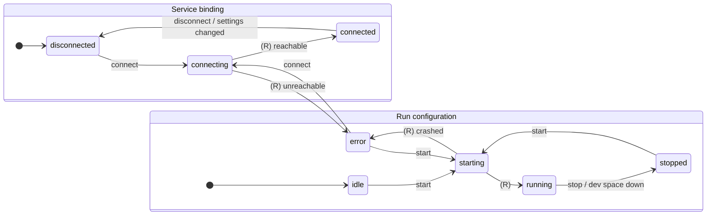
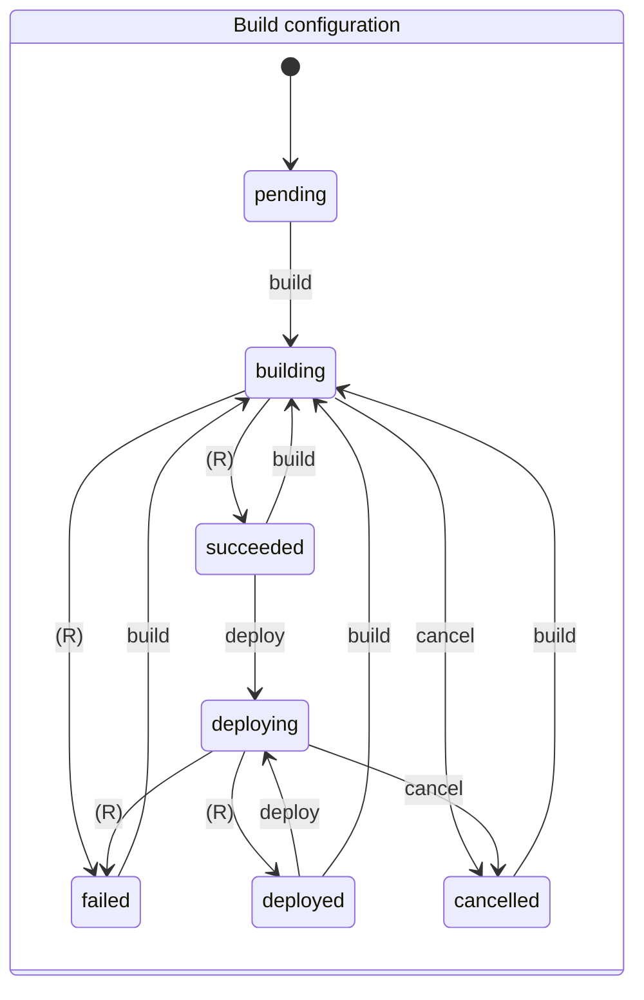
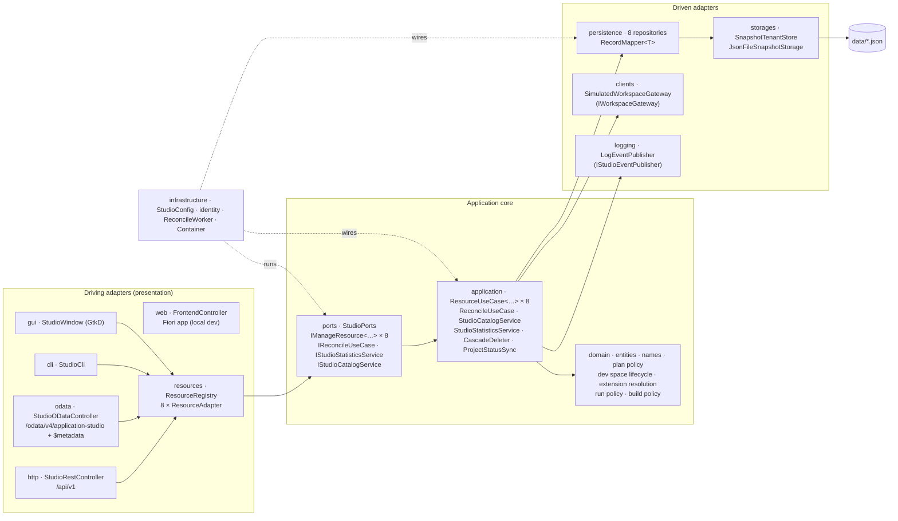
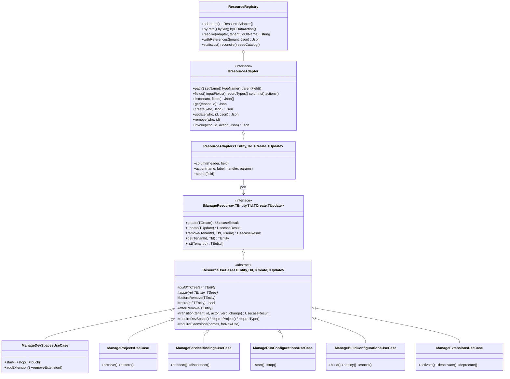
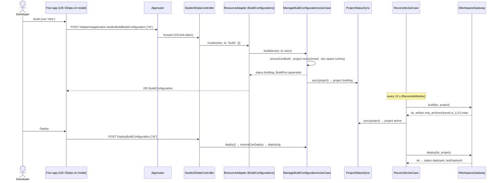
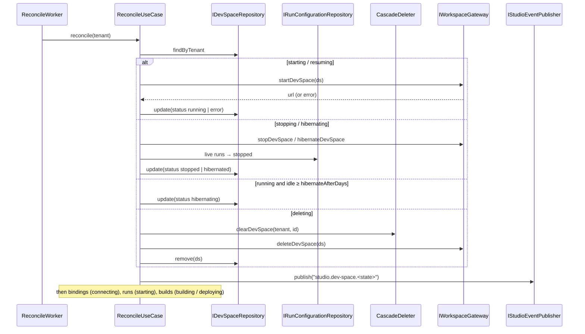
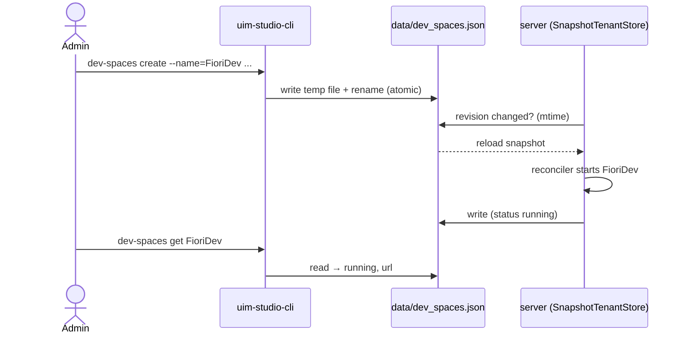
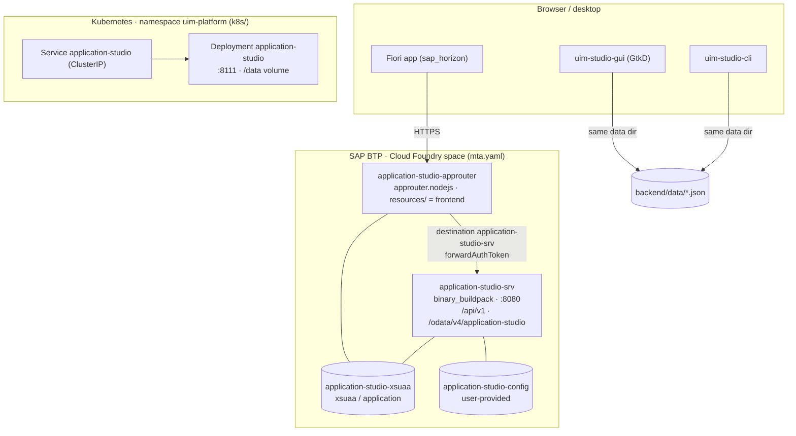

# UML — Application Studio Service

Diagrams of the hexagonal backend (`backend/source/uim/platform/application_studio`), the
Fiori frontend and the deployment. All diagrams are Mermaid.

## Class Diagram — Domain Entities

All aggregates mix in `TenantEntity` (`tenantId`, `id`, `createdBy/At`, `updatedBy/At`).
Catalogue entries and dev spaces are tenant-wide; projects and service bindings belong
to a dev space; run and build configurations belong to a project (and carry its
`devSpaceId` for dev-space-wide checks such as port conflicts).

## State Diagram — Lifecycles driven by actions and the reconciler

Solid transitions are requested through the use cases (REST/OData/CLI/GUI actions);
transitions marked *(R)* are performed by the reconciler.

A project mirrors its build configurations: `deploying` if one deploys, else `building`
if one builds, else `error` if the latest run of one failed, else `active`
(`ProjectStatusSync`). `archived` is set and cleared by the archive/restore actions.

## Component Diagram — Hexagonal Architecture

Dependencies point inwards: presentation knows only `StudioPorts`; use cases know only
port interfaces (`StudioRepositories`, `IWorkspaceGateway`, `IStudioEventPublisher`).

## Class Diagram — Generic use cases and adapters

`ManageDevSpaceTypesUseCase` and `ManageProjectTemplatesUseCase` extend `ResourceUseCase`
without extra actions.

## Sequence Diagram — Fiori builds and deploys a project

## Sequence Diagram — Reconciliation of a dev space

## Sequence Diagram — CLI and server share data

## Deployment Diagram — SAP BTP (Cloud Foundry) and Kubernetes

