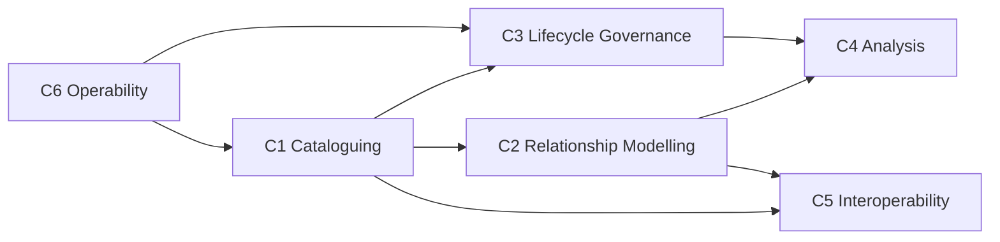
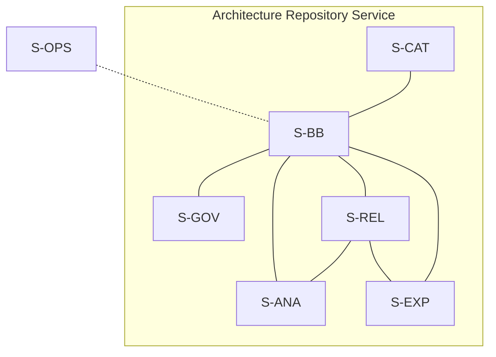
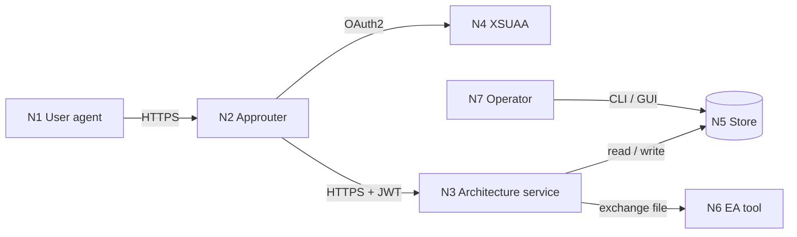
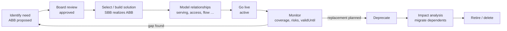
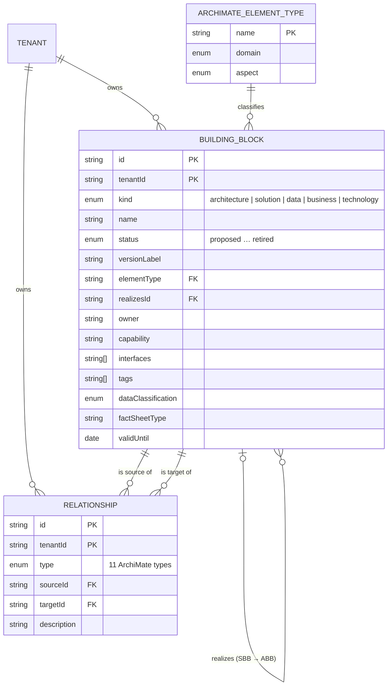
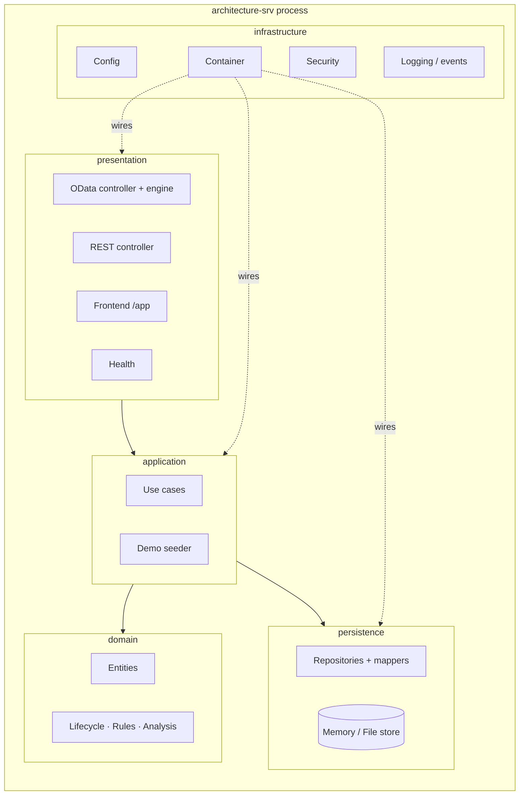

# NAF v4 Architecture Description — Architecture Repository

> This is the NATO Architecture Framework v4 (NAF v4) description of the UIM Platform **architecture
> repository** service. The service manages TOGAF building blocks (ABB, SBB, data, business,
> technology) and the ArchiMate 3.2 relationships between them. It governs their lifecycle, analyses
> gaps, impact and phase-out risks, and exports the repository in the ArchiMate Model Exchange File
> Format.
>
> Version 2.0.0 · Implementation: [backend/](backend/) (D, vibe.d 0.10.5),
> [frontend/](frontend/) (SAP Fiori 3 / OpenUI5), [approuter/](approuter/),
> [mta.yaml](mta.yaml), [k8s/](k8s/). Diagrams: [UML.md](UML.md). Usage: [README.md](README.md).

---

## 1. NAF v4 grid mapping

| Viewpoint group | Viewpoints used | Section |
| --- | --- | --- |
| **C – Concepts** | C1 Capability Taxonomy, C2 Enterprise Vision, C3 Capability Dependencies, C4 Standard Processes | §2 |
| **S – Service Specification** | S1 Service Taxonomy, S2 Service Structure, S3 Service Interfaces, S4 Service Functions, S5 Service States | §3 |
| **L – Logical Specification** | L1 Node Types, L2 Logical Scenario, L4 Logical Activities, L6 Logical Sequence, L7 Logical Data Model, L8 Logical Constraints | §4 |
| **P – Physical Resource Specification** | P1 Resource Types, P2 Resource Structure, P4 Resource Functions, P5 Resource Interactions | §5 |
| **A – Architecture Meta-Data** | A1 Meta-Data Definitions, A3 Architecture Status, A7 Standards, A8 Decisions | §6 |

---

## 2. Concepts (C)

### C1 – Capability taxonomy

```
Architecture Repository
├── C1  Building Block Cataloguing
│   ├── C1.1  Five TOGAF kinds in one aggregate (ABB, SBB, DBB, BBB, TBB)
│   ├── C1.2  ArchiMate 3.2 classification (60 element types → layer and aspect)
│   ├── C1.3  Ownership, versioning, tags, interfaces, capability, vendor / component, endpoint
│   ├── C1.4  Data governance attributes (classification, data owner, system of record)
│   └── C1.5  SAP LeanIX cross reference (fact sheet type and ID)
├── C2  Relationship Modelling
│   ├── C2.1  Typed, directed ArchiMate relationships (11 types)
│   ├── C2.2  ArchiMate and TOGAF rule checks (aspect, layer, direction, retired blocks)
│   ├── C2.3  SBB → ABB realization (field and relationship)
│   └── C2.4  Duplicate and self-reference prevention
├── C3  Lifecycle Governance
│   ├── C3.1  Status model: proposed → approved → inDevelopment → active → deprecated → retired
│   ├── C3.2  Governed transitions (separate Govern scope, architecture board)
│   ├── C3.3  Deletion protection for blocks in use
│   └── C3.4  Planned end of life (validUntil) and detection of expired blocks
├── C4  Architecture Analysis
│   ├── C4.1  Gap analysis (ABBs without a solution) and ABB coverage
│   ├── C4.2  Impact analysis (transitive dependents, depth, path)
│   ├── C4.3  Phase-out risk analysis (deprecated / retired blocks still depended upon)
│   ├── C4.4  Orphan detection
│   └── C4.5  Repository key figures (by kind, by status)
├── C5  Interoperability
│   ├── C5.1  ArchiMate Model Exchange File export (Archi, BiZZdesign, Sparx EA, LeanIX, …)
│   ├── C5.2  OData v4 with Fiori annotations
│   └── C5.3  REST API (compatible with 1.x field names)
└── C6  Operability
    ├── C6.1  Tenant isolation
    ├── C6.2  XSUAA / JWT authentication with scopes Read, Manage and Govern
    ├── C6.3  Layered configuration (defaults → file → env → VCAP_SERVICES)
    ├── C6.4  Structured logging of requests and domain events
    └── C6.5  Health probes, CLI and desktop GUI
```

### C2 – Enterprise vision

| Element | Statement |
| --- | --- |
| Vision | One governed source for the building blocks of the enterprise architecture, which architects, solution teams and the architecture board use in their daily work. |
| Goals | (1) Every ABB is realized by an approved SBB (coverage). (2) Nothing new depends on deprecated technology. (3) The impact of a change is known before it is made. (4) Models can be exchanged with EA tools without loss. |
| Measures (KPIs) | ABB coverage %, number of gaps, phase-out risks, orphans, blocks past `validUntil`. These are shown live in the Fiori header and in `Statistics`. |
| Stakeholders | Enterprise architects, solution architects, data architects, business analysts, platform teams, architecture board, operations. |

### C3 – Capability dependencies



* C4 needs C2: impact and phase-out analysis follow the dependency edges derived from relationships.
* C4 needs C3: gaps ignore retired SBBs, and phase-out risks need the status.
* C3 needs C6.2: transitions require the `Govern` scope.

### C4 – Standard processes

| Process | Steps | Supported by |
| --- | --- | --- |
| Introduce a building block | propose → architecture board approves → build (inDevelopment) → go live (active) | Create dialog, Lifecycle action sheet, `ChangeStatus` |
| Close a gap | Analysis tab ▸ Gaps → create an SBB with `realizesId` → approve | Gaps set, coverage KPI |
| Phase out technology | deprecate → impact analysis → migrate the dependents → retire → delete | Phase-out risks, `AnalyzeImpact`, deletion protection |
| Publish the landscape | export the ArchiMate exchange file → import it into the EA tool | `ExportArchiMate`, `/api/v1/export/archimate`, CLI `export` |

---

## 3. Service specification (S)

### S1 – Service taxonomy

| Service | Channel | Consumers |
| --- | --- | --- |
| S-BB Building block management | OData `BuildingBlocks`, REST `/building-blocks`, CLI | Fiori app, integrations, scripts |
| S-REL Relationship management | OData `Relationships`, REST `/relationships`, CLI `relate` | Fiori app, integrations |
| S-GOV Lifecycle governance | OData `ChangeStatus`, REST `…/{id}/status`, CLI `status` | Architecture board |
| S-ANA Architecture analysis | OData `Statistics`, `Gaps`, `Orphans`, `PhaseOutRisks`, `AnalyzeImpact`; REST `/analysis/*`, `…/impact` | Fiori app, dashboards |
| S-CAT ArchiMate catalogue | OData `ElementTypes`, REST `/element-types` | Fiori value help, clients |
| S-EXP Model exchange | OData `ExportArchiMate`, REST `/export/archimate`, CLI `export` | EA tools |
| S-OPS Operations | `/health`, CLI `config`, structured logs | CF, Kubernetes, operators |

### S2 – Service structure



All services are exposed through one EDM model and one engine, so the OData, REST, CLI and GUI channels
behave the same way.

### S3 – Service interfaces

| Interface | Protocol | Contract | Security |
| --- | --- | --- | --- |
| OData v4 | HTTP/JSON, `$batch` | `/odata/v4/architecture/$metadata` (CSDL with UI, Common, Core and Capabilities annotations) | Bearer JWT (XSUAA RS256 / HS256) or open in development; CSRF token |
| REST | HTTP/JSON | `/api/v1` ([README](README.md#rest--apiv1)) | as OData |
| Exchange file | HTTP / file, XML | Open Group ArchiMate Model Exchange File Format 3.1 | Read scope |
| CLI | process, stdout (text or `--json`) | `uim-architecture-cli help` | local, trusted |
| GUI | GtkD desktop | the EDM model | local, trusted |
| Health | HTTP/JSON | `GET /health` → `{status: "UP", …}` | none |

### S4 – Service functions

| Function | Input | Output | Rules |
| --- | --- | --- | --- |
| Create block | kind, name, optional id and attributes | block row | the element type must fit the kind; `realizesId` must be an existing, not retired ABB |
| Change block | id, changed attributes | block row | `kind`, `id` and `status` cannot change |
| Change status | id, status | previous and new status | lifecycle transition table; Govern scope |
| Delete block | id | — | not active or deprecated; relationships and realizations are cleaned up |
| Create relationship | type, sourceId, targetId, description | relationship row | ArchiMate / TOGAF rules; no duplicates; no retired ends |
| Analyse | — / id | statistics, gaps, orphans, risks, impact | see C4 |
| Export | modelName | exchange file XML | — |
| Seed | — | number of blocks and relationships created | empty tenant only |

### S5 – Service states

The state model of the managed object, the building block lifecycle, is defined in
[UML §5](UML.md#5-lifecycle-state-machine). The service itself is stateless apart from the document
store. It is `UP` as soon as it listens and has no warm-up phase.

---

## 4. Logical specification (L)

### L1 – Node types

| Node | Responsibility |
| --- | --- |
| N1 User agent | Fiori 3 app (browser) |
| N2 Approuter | login (XSUAA), session, CSRF, routing, static UI |
| N3 Architecture service | REST, OData, domain logic, analysis, export |
| N4 Identity provider | XSUAA, which issues JWTs with `zid` and scopes |
| N5 Repository store | tenant partitioned JSON documents (memory or file) |
| N6 EA tool (external) | consumes the exchange files |
| N7 Operator workstation | CLI and GUI on the same store |

### L2 – Logical scenario (node connectivity)



### L4 – Logical activities (governance cycle)



### L6 – Logical sequence

The sequences for a lifecycle transition, relationship creation, impact analysis and deletion are in
[UML §9](UML.md#9-sequences).

### L7 – Logical data model



### L8 – Logical constraints

| ID | Constraint | Enforced in |
| --- | --- | --- |
| LC-01 | Every record belongs to exactly one tenant, and no query crosses tenants. | repositories (document store partition) |
| LC-02 | A data block is a passive structure element, a technology block a technology element, a business block a business, strategy or motivation element. | `BuildingBlock.validate` |
| LC-03 | Only an SBB realizes, and only an existing, not retired ABB. | `ManageBuildingBlocksUseCase.checkRealization` |
| LC-04 | Status changes follow the transition table; `retired` is final. | `domain.services.lifecycle` |
| LC-05 | Active and deprecated blocks are not deleted. | `requireDeletable` |
| LC-06 | Relationships obey the ArchiMate / TOGAF rules (UML §3) and are unique per (source, type, target). | `domain.services.rules`, use case |
| LC-07 | Status transitions need the `Govern` scope, writes need `Manage` and reads need `Read`. | `ODataEngine.checkScope`, XSUAA |
| LC-08 | Ids are stable and URL safe: `[a-z0-9][a-z0-9._-]{0,63}`. | `requireResourceId` |
| LC-09 | The file store is a single-node snapshot: one instance only. | MTA / k8s `replicas: 1`, `Recreate` |

---

## 5. Physical resource specification (P)

### P1 – Resource types

| Resource | Type | Version |
| --- | --- | --- |
| `uim-architecture-platform-service` | native executable (D) | 2.0.0 |
| `uim-architecture-cli`, `uim-architecture-gui` | native executables | 2.0.0 |
| uim-platform `service` library | D library (OData engine, stores, CLI, GtkD browser, security) | in repository |
| uim-framework | D library | 26.11.1 (pinned until the shared `service` library is ported to 26.11.2) |
| vibe.d | D web framework | 0.10.5 |
| OpenUI5 | UI framework, `sap_fiori_3` theme | 1.120.21 |
| @sap/approuter | Node.js | ^20 |
| XSUAA | BTP service, plan `application` | — |
| Container base | `dlang2/ldc-ubuntu:1.40.1` (build), `ubuntu:24.04` (runtime) | — |

### P2 – Resource structure



### P4 – Resource functions

| Resource | Functions |
| --- | --- |
| Service executable | serve REST and OData, validate, enforce scopes, run analyses, render the exchange file, seed the demo, log requests and events |
| CLI | generic entity commands plus `stats`, `seed`, `status`, `relate`, `impact`, `gaps`, `export`, `config` |
| GUI | entity browser (filter, search, forms), Statistics sheet, action runner |
| Approuter | XSUAA login, token forwarding, CSRF, static Fiori resources |
| Fiori app | KPI header, building block / relationship / analysis tabs, detail page, create and edit dialogs, lifecycle, impact, export |

### P5 – Resource interactions

| From | To | Protocol | Purpose |
| --- | --- | --- | --- |
| Browser | Approuter | HTTPS | UI, OData calls |
| Approuter | XSUAA | OAuth 2.0 | login, token |
| Approuter | Service | HTTPS, destination `architecture-srv`, `forwardAuthToken` | OData, REST |
| Service | Store | in-process / file I/O | persistence |
| CF / Kubernetes | Service | HTTP `GET /health` | liveness and readiness |
| CLI / GUI | Store (file) | file I/O | administration on the same snapshot |

---

## 6. Architecture meta-data (A)

### A1 – Meta-data

| Item | Value |
| --- | --- |
| Architecture | UIM Platform — Architecture Repository |
| Version | 2.0.0 |
| Date | 2026-11-21 |
| Framework | NAF v4, with TOGAF 10 (Enterprise Continuum, building blocks) and ArchiMate 3.2 as content standards |
| Owner | UIM Platform team |
| Sources | `architecture/backend/source/uim/platform/architecture/**`, `architecture/frontend/**` |

### A3 – Architecture status

| Area | Status |
| --- | --- |
| Backend (domain, application, persistence, REST, OData, CLI, GUI) | implemented; 24 test modules pass (`dub test`) |
| Fiori app | implemented (en, de); QUnit tests pass |
| BTP deployment (MTA, approuter, XSUAA) | defined |
| Kubernetes (ConfigMap, Deployment, PVC, Service) | defined |
| Persistent database store (PostgreSQL / HANA) | not implemented; add an `IDocumentStore` adapter |
| Import of exchange files | not implemented (export only) |

### A7 – Standards

| Standard | Use |
| --- | --- |
| TOGAF 10 — Enterprise Continuum, building blocks | ABB / SBB concept, realization, gap analysis |
| ArchiMate 3.2 | element types, layers and aspects, relationship types and rules |
| Open Group ArchiMate Model Exchange File Format 3.1 | export |
| OData v4.01 (OASIS), SAP vocabularies (UI, Common), OASIS Core and Capabilities | Fiori integration |
| SAP Fiori 3 design guidelines | UI |
| OAuth 2.0 / JWT (RFC 6749, RFC 7519), SAP XSUAA | authentication and authorization |
| Twelve-factor configuration (env, VCAP_SERVICES) | configuration |
| NAF v4 | this document |

### A8 – Architecture decisions

| ID | Decision | Rationale |
| --- | --- | --- |
| AD-01 | Clean / hexagonal architecture with domain → ports → application → adapters | Business rules can be tested without a framework, and adapters can be replaced. |
| AD-02 | One `BuildingBlock` aggregate with a `kind`, instead of five entity types (1.x) | Removes duplicated code. Analyses and relationships work across kinds. The kind still constrains the element types. |
| AD-03 | Relationships as their own aggregate instead of embedded arrays | Both ends are validated, duplicates are detected, and lookups by target, impact analysis and export become possible. |
| AD-04 | The ArchiMate element type determines layer and aspect | One source of truth for the relationship rules and for the export (`xsi:type`). |
| AD-05 | Status changes through a separate action with its own scope (`Govern`) | Separates maintenance from governance decisions (architecture board) and gives an audit trail through events. |
| AD-06 | One EDM model and engine for OData, REST, CLI and GUI | The same validation, scopes and errors on every channel, and less code. |
| AD-07 | A document store (memory / file) from the shared library | Zero setup for development and demos. A database adapter can be added behind `IDocumentStore`. |
| AD-08 | Fiori app with the OData V4 model; writes through plain JSON requests with CSRF | Simple PATCH semantics for collections (tags, interfaces), and actions through the V4 model. |
| AD-09 | uim-framework pinned to 26.11.1 | The shared `service` library still imports `uim.services`, which 26.11.2 renamed. Lift the pin together with the library. |
| AD-10 | Keep the 1.x REST paths and accept the 1.x field names | Existing clients keep working. Only status changes moved to a dedicated endpoint. |
