# UML — Architecture Repository

Diagrams of the architecture repository service (`architecture/backend`, module
`uim.platform.architecture`), drawn with Mermaid. Entity fields, port names, state transitions and
adapters are taken from the source code.

Contents

1. [Component view](#1-component-view)
2. [Layers and packages](#2-layers-and-packages)
3. [Domain model](#3-domain-model)
4. [Enumerations and the ArchiMate catalogue](#4-enumerations-and-the-archimate-catalogue)
5. [Lifecycle state machine](#5-lifecycle-state-machine)
6. [Ports and interactors](#6-ports-and-interactors)
7. [Persistence](#7-persistence)
8. [Presentation adapters](#8-presentation-adapters)
9. [Sequences](#9-sequences)
10. [Deployment](#10-deployment)

---

## 1. Component view

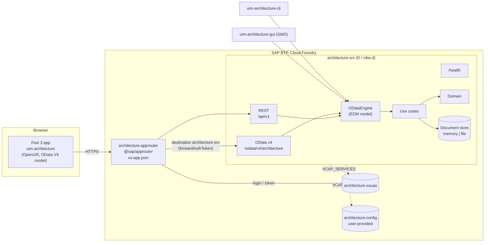

The OData controller, the REST facade, the CLI and the GUI all go through **one `ODataEngine`**. Payload
validation, scope checks and error mapping are therefore identical on every channel.

---

## 2. Layers and packages

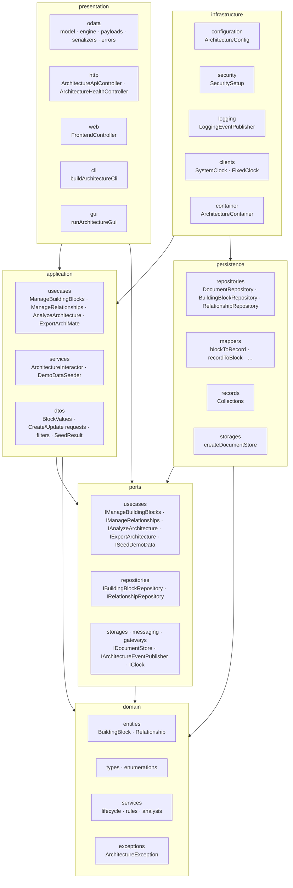

Dependencies point inwards. The domain has no framework or I/O dependencies. `ArchitectureContainer`
is the only place that wires concrete classes together.

---

## 3. Domain model

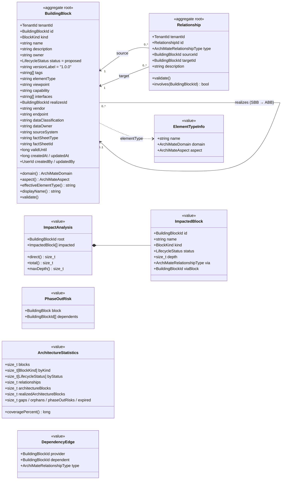

**Invariants (`BuildingBlock.validate`)**

* The id matches `[a-z0-9][a-z0-9._-]{0,63}`. Name and version are required, and every text field has a
  length limit. A list has at most 50 entries of at most 128 characters each.
* `data` blocks are passive structure elements. `technology` blocks are technology elements. `business`
  blocks are business, strategy or motivation elements.
* `realizesId` is set only on `solution` blocks and never points to the block itself.
  `dataClassification` is set only on `data` blocks and must be a valid value.

**Domain services**

| Module | Functions |
|---|---|
| `services/lifecycle` | `nextStatuses`, `canTransition`, `requireTransition`, `requireDeletable` |
| `services/rules` | `relationshipViolation`, `requireValidRelationship`, `sourceImpactsTarget`, `carriesDependency` |
| `services/analysis` | `dependencyEdges`, `realizersOf`, `findGaps`, `findOrphans`, `findPhaseOutRisks`, `analyzeImpact`, `computeStatistics`, `indexById` |

---

## 4. Enumerations and the ArchiMate catalogue

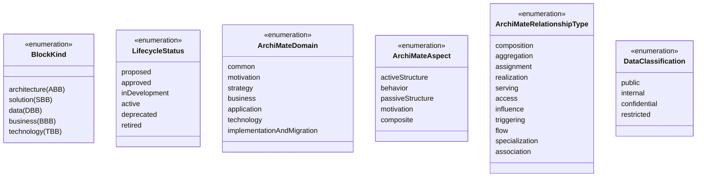

`archimateElementTypes` lists the 60 element types of ArchiMate 3.2 with their domain and aspect.
Physical elements are filed under `technology`. `leanixFactSheetTypes` lists the SAP LeanIX fact sheet
types. Parsing ignores case and the characters `-`, `_` and space. Values from 1.x are accepted as well,
such as `identified`, `used-by` and `ABB`.

---

## 5. Lifecycle state machine

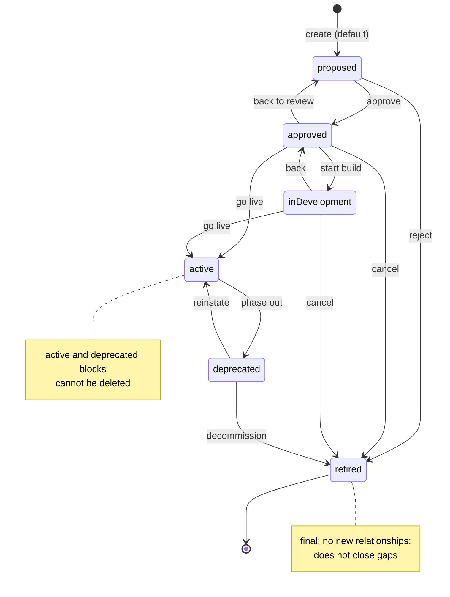

Only the `ChangeStatus` action (scope **Govern**) and `POST /api/v1/building-blocks/{id}/status` perform
transitions. On PATCH, `status` is immutable.

---

## 6. Ports and interactors

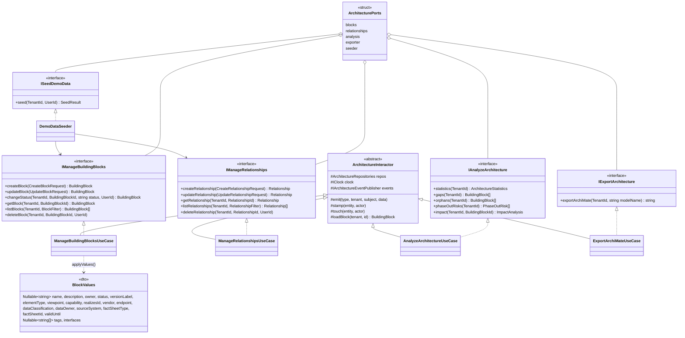

`BlockValues` holds only the values that were sent, so the same DTO serves create and PATCH.
Enumerations arrive as text and the use case parses them, so every channel gets the same error message.

**Domain events** (`IArchitectureEventPublisher`, written as JSON log lines by `LoggingEventPublisher`):
`block.created`, `block.updated`, `block.statusChanged {from, to}`,
`block.deleted {relationshipsRemoved, realizationsCleared}`, `relationship.created`,
`relationship.updated`, `relationship.deleted`.

---

## 7. Persistence

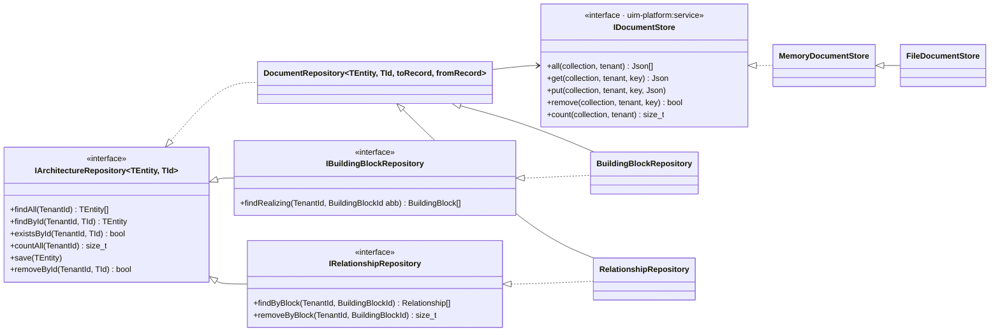

| Collection | Key | Record |
|---|---|---|
| `buildingBlocks` | block id | flat JSON. Times are std time (hnsecs), enumerations are their string value, `schema: 2` |
| `relationships` | relationship id | `type`, `sourceId`, `targetId`, `description` and the audit fields |

Documents are partitioned by tenant. When a record is read, unknown fields are ignored and missing fields
take their defaults, so 1.x records stay readable.

---

## 8. Presentation adapters

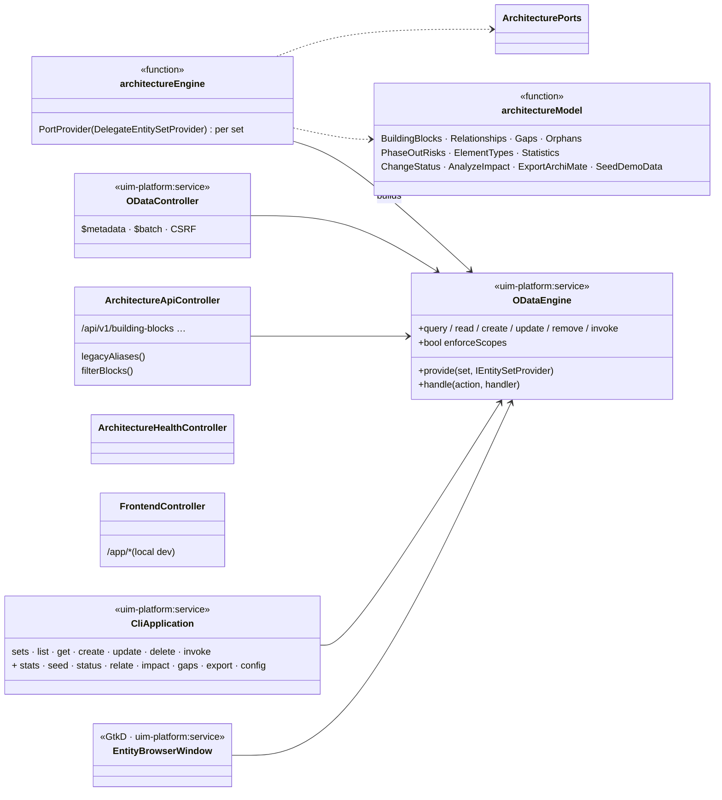

The adapters map errors in one way: `ArchitectureException` becomes `EntitySetException` through
`translated()`. The kind `invalid` maps to 400, `notFound` to 404, `conflict` to 409 and
`ruleViolation` to 422. A missing scope gives 403 and a missing token in `xsuaa` or `hs256` mode gives
401.

---

## 9. Sequences

### 9.1 Lifecycle transition from the Fiori app

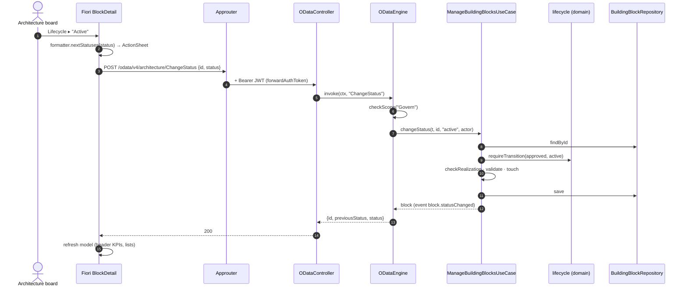

### 9.2 Creating a relationship (rules)

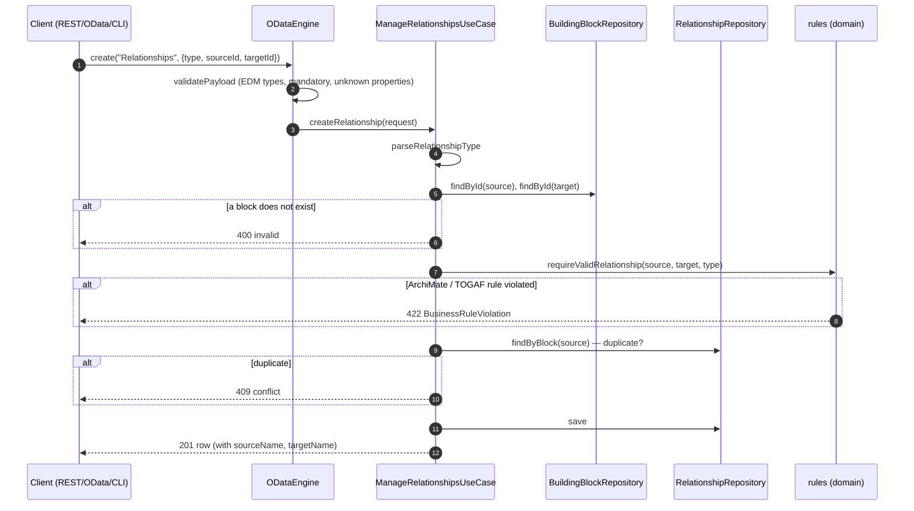

### 9.3 Impact analysis

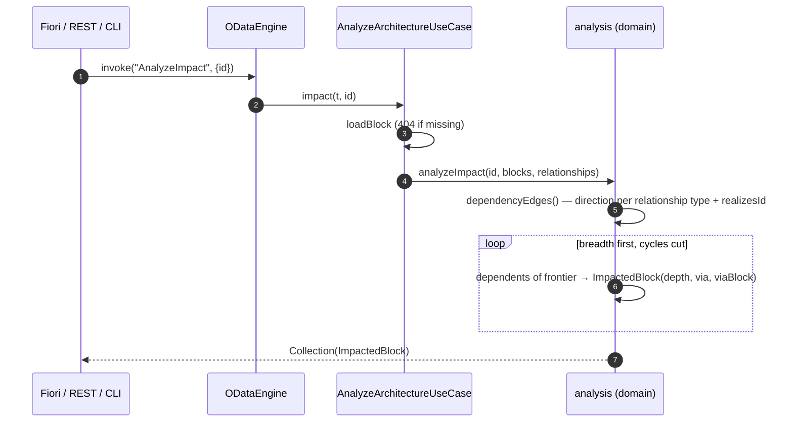

### 9.4 Deleting a building block

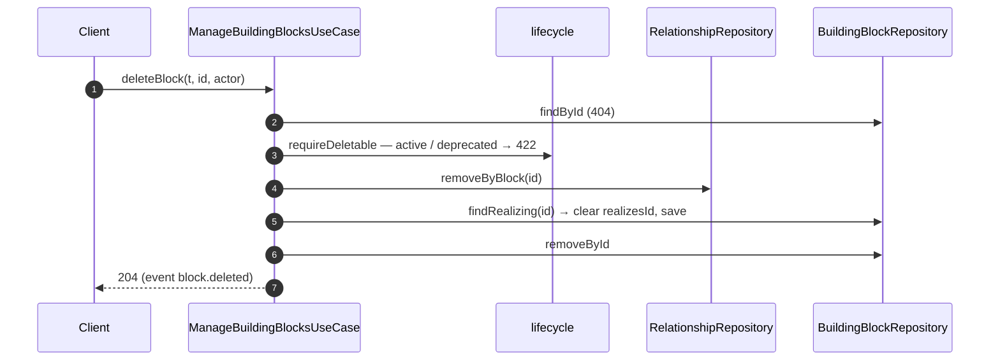

---

## 10. Deployment

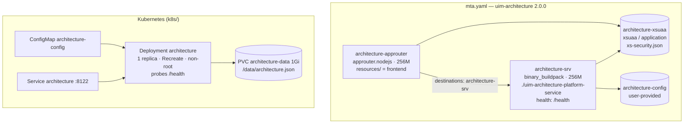

| Artefact | Built from | Runs |
|---|---|---|
| `uim-architecture-platform-service` | `dub build --config=defaultRun` | HTTP server (REST, OData, `/app`) |
| `uim-architecture-cli` | `dub build --config=cli` | administration and scripting on the same store |
| `uim-architecture-gui` | `dub build --config=gui` | GtkD desktop browser |
| container image | `backend/Dockerfile` / `Containerfile` (repository root as the build context) | server + CLI + frontend |
