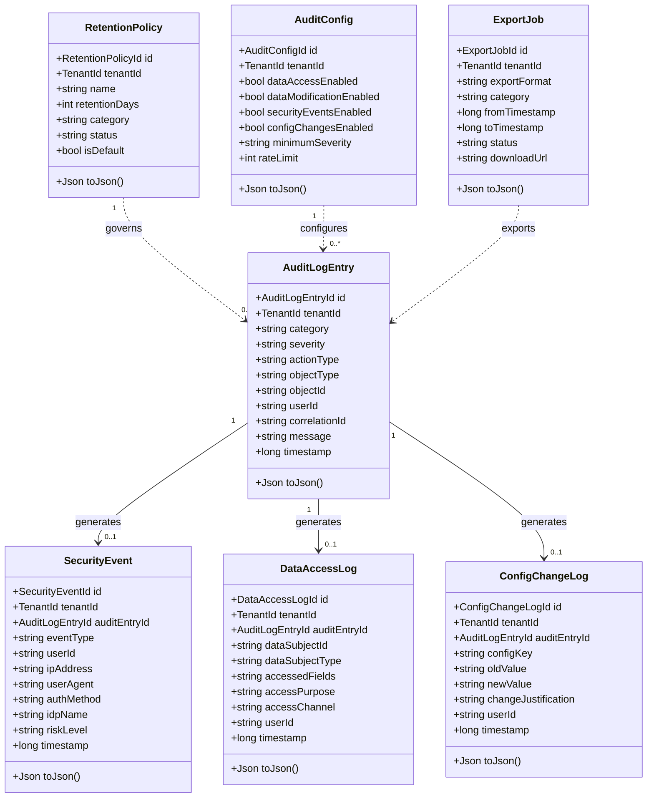
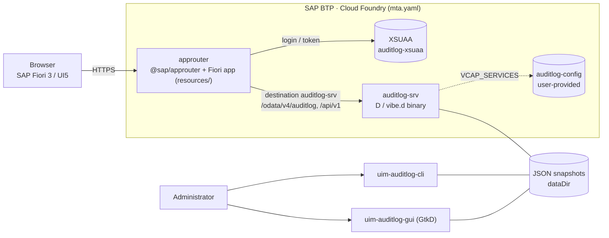
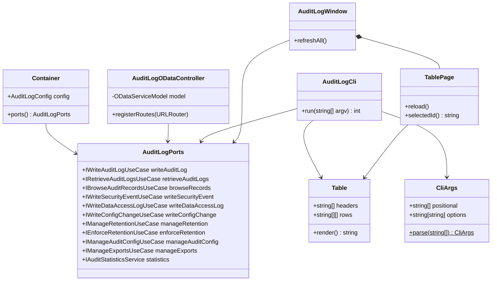
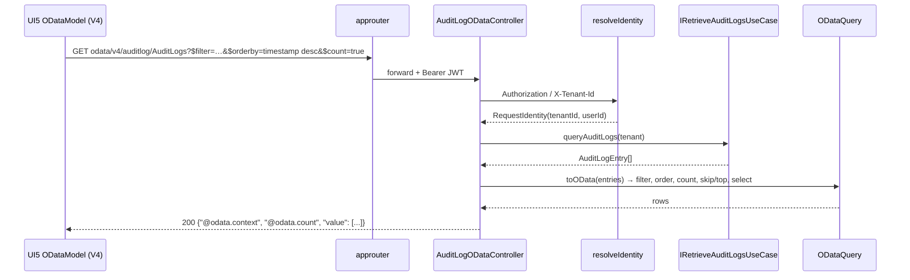
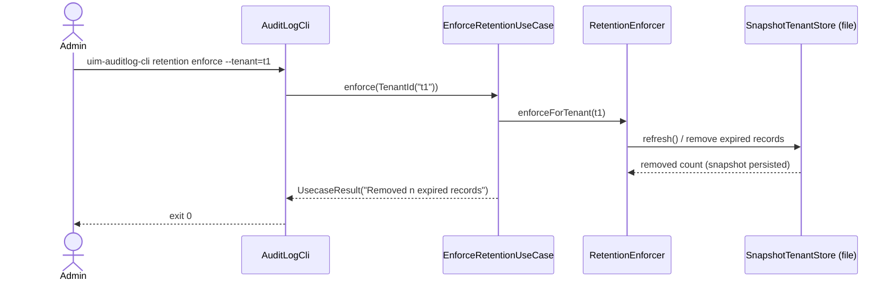
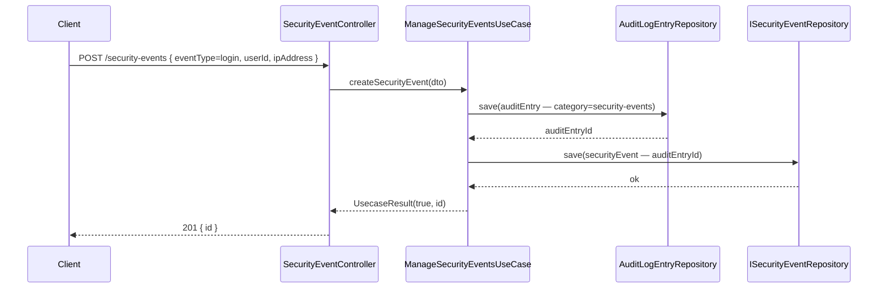
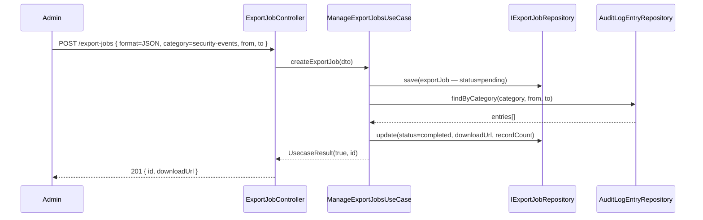

# UML — Audit Log Service

## Documentation update

This document is maintained alongside the implementation, deployment manifests, and tests for the same package so the service documentation stays aligned with the codebase.

## Class Diagram — Domain Entities

---

## Deployment / Component Diagram

## Component Diagram — Hexagonal Architecture

```mermaid
flowchart TB
    subgraph Presentation["presentation (driving adapters)"]
        REST["http/controllers<br/>REST /api/v1"]
        OD["odata<br/>AuditLogODataController · EDM model ·<br/>\$metadata · query engine · serializers"]
        CLIA["cli<br/>CliArgs · AuditLogCli"]
        GUIA["gui<br/>AuditLogWindow · TablePage"]
        WEB["web<br/>FrontendController"]
        TAB["tabular<br/>Table projections"]
    end
    subgraph Ports["ports"]
        DP["driving.d — AuditLogPorts<br/>I*UseCase · IAuditStatisticsService"]
        RP["repositories — I*Repository"]
        SP["storages — ISnapshotStorage"]
        MP["messaging — IAuditEventPublisher"]
    end
    subgraph Application["application"]
        UCW["usecases/write<br/>AuditLog · SecurityEvent · DataAccess · ConfigChange"]
        UCR["usecases/retrieve<br/>AuditLogs · Records"]
        UCM["usecases/manage<br/>Retention · AuditConfig · Exports · EnforceRetention"]
        AS["services<br/>AuditStatisticsService"]
    end
    subgraph Domain["domain"]
        ENT["entities · types · enumerations"]
        DS["services<br/>AuditPolicy · AuditFilterService · RetentionEnforcer"]
    end
    subgraph Persistence["persistence (driven adapters)"]
        REPO["repositories ×7"]
        STO["storages<br/>memory · JsonFileSnapshotStorage · SnapshotTenantStore"]
        MAP["mappers · records"]
    end
    subgraph Infrastructure["infrastructure"]
        CFG["configuration<br/>defaults → file → env → VCAP_SERVICES"]
        SEC["security<br/>XSUAA JWT → RequestIdentity"]
        WRK["workers<br/>RetentionWorker"]
        LOG["logging<br/>LogEventPublisher"]
        CTR["container<br/>Container.ports()"]
    end

    REST & OD & CLIA & GUIA --> DP
    CLIA & GUIA --> TAB
    OD --> SEC
    WRK --> DP
    DP -.implemented by.-> UCW & UCR & UCM & AS
    UCW & UCR & UCM & AS --> DS & ENT
    UCW & UCR & UCM & AS --> RP
    UCW & UCM --> MP
    REPO -.implements.-> RP
    REPO --> STO --> SP
    STO --> MAP
    LOG -.implements.-> MP
    CTR --> REPO & UCW & UCR & UCM & AS & CFG
```

## Class Diagram — Driving Adapters

## Sequence Diagram — Fiori reads audit logs

## Sequence Diagram — CLI retention enforcement

---

## Sequence Diagram — Write Security Event

---

## Sequence Diagram — Export Job

