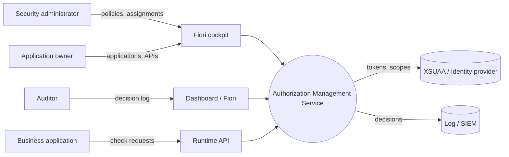
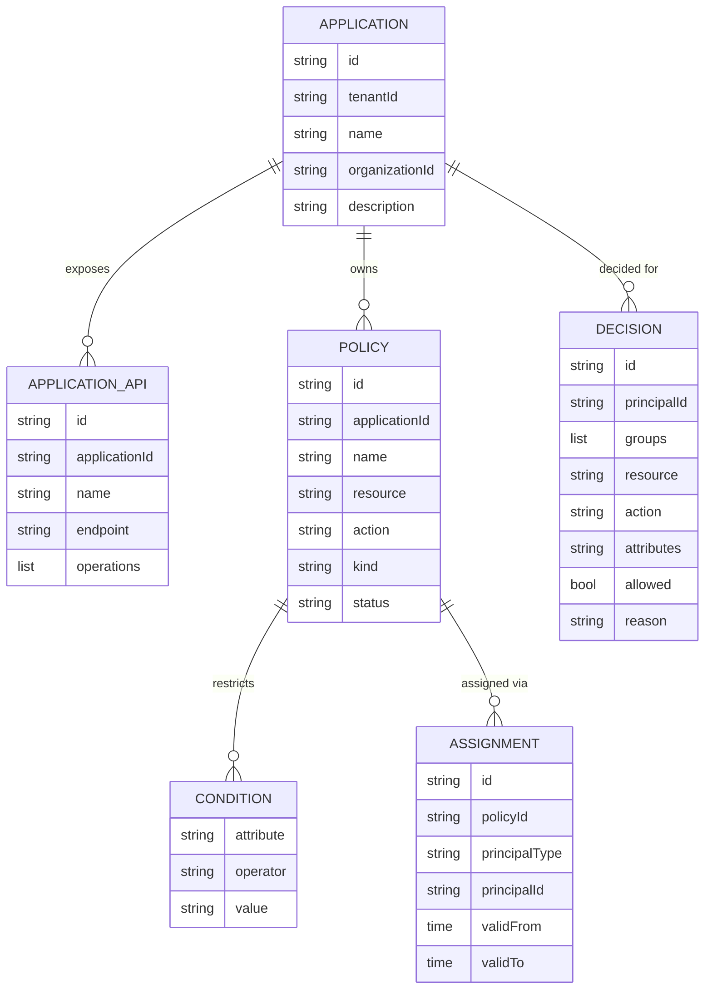
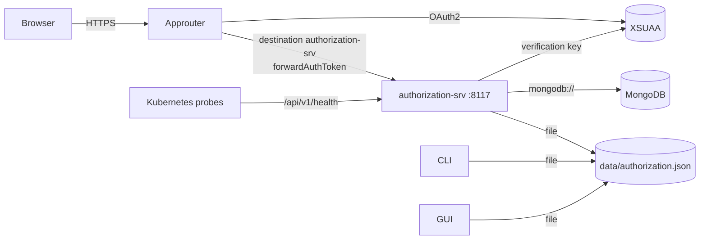

# NAF v4 Architecture Description — Authorization Management Service

> NATO Architecture Framework v4 (NAF v4) description of the UIM Platform **Authorization Management Service**:
> applications and APIs, base and custom authorization policies with attribute conditions, assignments to users and
> groups, runtime authorization decisions and the decision log. Implementation: D / vibe.d backend (hexagonal
> architecture), SAP Fiori 3 frontend, approuter, CLI and GtkD GUI.

---

## 1. NAF v4 grid mapping

| NAF view | Viewpoints | Section |
|---|---|---|
| **C** — Concepts | C1 Capability Taxonomy, C2 Enterprise Vision, C4 Standard Processes | §2 |
| **S** — Service Specification | S1 Service Taxonomy, S2 Service Interfaces, S3 Service Interface Parameters, S4 Service Functions | §3 |
| **L** — Logical Specification | L2 Logical Scenario, L4 Logical Activities, L5 Logical States, L7 Logical Data Model | §4 |
| **P** — Physical Resource Specification | P1 Resource Types, P2 Resource Structure, P3 Resource Connectivity | §5 |
| **A** — Architecture Metadata | A1 Meta-data, A3 Architecture Products, A5 Requirements traceability | §6 |

---

## 2. Concepts (C)

### C1 — Capability taxonomy

```
Authorization Management
├── C1.1  Application Registry
│   ├── C1.1.1  Application lifecycle (create, change, cascade delete)
│   └── C1.1.2  Application API catalogue (endpoints, operations)
├── C1.2  Policy Management
│   ├── C1.2.1  Base policies (admin, reader, support) — idempotent seeding
│   ├── C1.2.2  Custom policies (resource, action, attribute conditions)
│   └── C1.2.3  Policy lifecycle (active ⇄ disabled)
├── C1.3  Assignment Management
│   ├── C1.3.1  Assignment to users and groups
│   └── C1.3.2  Time-bound assignments (validFrom / validTo)
├── C1.4  Authorization Decisioning
│   ├── C1.4.1  Runtime evaluation (resource/action wildcards, condition operators)
│   ├── C1.4.2  Effective policies of a principal
│   └── C1.4.3  Decision log, publication and retention
└── C1.5  Cross-cutting
    ├── C1.5.1  Multi-tenancy (tenant isolation by zone / X-Tenant-Id)
    ├── C1.5.2  Authentication & scopes (XSUAA RS256, HS256; Read / Admin / Check)
    ├── C1.5.3  Configuration (defaults → files → env → VCAP_SERVICES)
    └── C1.5.4  Observability (structured logs, health, statistics)
```

### C2 — Enterprise vision

| Aspect | Description |
|---|---|
| **Mission** | Provide centrally managed, attribute-based authorizations for business applications, modelled on SAP Cloud Identity Services AMS. |
| **Vision** | Administrators author and assign policies in a Fiori cockpit; applications ask one service "may X do Y on Z?" and receive an explainable, logged decision. |
| **Scope** | Applications, APIs, policies, assignments, decisions, statistics; operated on SAP BTP, Kubernetes or a desktop. |
| **Stakeholders** | Security administrators, application owners, auditors, application developers, platform operators. |
| **Principles** | Least privilege (deny by default) · explainability (reason + matched policies) · one model for all channels · tenant isolation. |

### C4 — Standard processes

| Process | Steps |
|---|---|
| **Onboard application** | create application → register APIs → `SeedBasePolicies` → derive custom policies |
| **Grant access** | select policy → assign user/group (optionally time bound) → verify with *Check Access* |
| **Revoke access** | revoke assignment *or* disable policy (all assignees at once) |
| **Runtime check** | application calls `EvaluateAuthorization` / `POST /rest/v1/authorization/check` → decision logged |
| **Audit** | review Decision Log (filter permit/deny, principal) → prune after retention |

---

## 3. Service specification (S)

### S1 — Service taxonomy

| ID | Service | Consumers |
|---|---|---|
| SVC-ODATA | Authorization OData v4 service | SAP Fiori app, integration tools |
| SVC-JSON | JSON API `/api/v1` (release 1 compatible) | scripts, legacy clients |
| SVC-REST | Runtime REST interface `/rest/v1/authorization` | business applications |
| SVC-WEB | Dashboard `/web` | auditors, operators |
| SVC-CLI | `uim-authorization-cli` | administrators, CI pipelines |
| SVC-GUI | `uim-authorization-gui` | desktop administrators |
| SVC-HEALTH | `/health`, `/api/v1/health` | Cloud Foundry, Kubernetes probes |

### S2 — Service interfaces

| Interface | Operations |
|---|---|
| SVC-ODATA | `$metadata` (incl. `UI.LineItem`, `UI.HeaderInfo`, `UI.SelectionFields`, capabilities), `$batch`, CRUD on `Applications`, `ApplicationApis`, `Policies`, `Assignments`; read `Decisions`; singleton `Statistics`; actions `EvaluateAuthorization`, `SeedBasePolicies`, `EnablePolicy`, `DisablePolicy`, `PruneDecisions`, `SeedDemoData` |
| SVC-JSON | CRUD on `applications`, `application-apis`, `policies`, `policy-assignments`; `decisions`; `policies/base`; `policies/seed-base`; `policies/{id}/enable|disable`; `authorization/evaluate`; `principals/{type}/{id}/policies`; `statistics` |
| SVC-REST | `POST /check`, `GET /principals/{id}/policies`, `GET /statistics` |
| SVC-CLI | generic: `sets`, `metadata`, `list`, `count`, `get`, `create`, `update`, `delete`, `invoke`; specific: `check`, `effective`, `stats`, `seed`, `seed-base`, `enable`, `disable`, `prune`, `config` |

### S3 — Interface parameters (EvaluateAuthorization)

| Parameter | Type | Mandatory | Description |
|---|---|---|---|
| `principalId` | Edm.String | yes | user id / login name |
| `application` | Edm.String | yes | application id or name |
| `resource` | Edm.String | yes | protected resource, e.g. `Incident` |
| `action` | Edm.String | yes | requested action, e.g. `Read` |
| `groups` | Edm.String | no | `Support, Administrators` |
| `attributes` | Edm.String | no | `country=US, level=3` |
| `record` | Edm.Boolean | no | write a decision record (default true) |

Result `AuthorizationResult`: `allowed`, `reason`, `matchedPolicies`, `matchedPolicyIds`, `candidatePolicies`,
`decisionId`, `evaluatedAt`.

### S4 — Service functions & quality of service

| Function | Scope | Error semantics |
|---|---|---|
| reads | `Read` | 404 not found, 400 invalid query |
| changes, admin actions | `Admin` | 400 invalid · 409 conflict (duplicate names/assignments) · 422 rule violation (base policy change, disabled policy assignment, invalid validity) |
| authorization check | `Check` | 404 unknown application · decision itself is never an error |
| all (with XSUAA) | token | 401 missing/invalid token · 403 missing scope |

---

## 4. Logical specification (L)

### L2 — Logical scenario (operational nodes)



### L4 — Logical activities (layers)

| Layer | Responsibility | Elements |
|---|---|---|
| Domain | business rules, decision logic | entities, `PolicyCondition`, `PolicyEvaluator`, enumerations, `AuthorizationException` |
| Ports | contracts | `AuthorizationPorts`, use case / service / repository / storage / messaging ports |
| Application | orchestration | 6 use cases, `StatisticsService`, `DemoDataService`, DTOs |
| Persistence | data access | `DocumentRepository`, mappers, `AuthorizationCollections`, memory / file / MongoDB stores |
| Infrastructure | technical concerns | configuration, security, logging, `DecisionRetentionWorker`, container |
| Presentation | channels | OData, JSON API, vibe.d REST, Diet dashboard, CLI, GtkD GUI — all through one `ODataEngine` |

### L5 — Logical states

| Object | States | Transitions |
|---|---|---|
| Policy | `active`, `disabled` | `DisablePolicy`, `EnablePolicy`, delete |
| Assignment | pending (before `validFrom`), effective, expired (after `validTo`) | time, revoke |
| Decision | recorded | pruned after `decisionRetentionDays` |

### L7 — Logical data model



All records carry `tenantId`, `createdAt/By`, `updatedAt/By`.

---

## 5. Physical resource specification (P)

### P1 — Resource types

| Resource | Technology |
|---|---|
| Backend service | D (dmd/ldc), vibe.d 0.10.3, uim-framework, `uim-platform:service` |
| Frontend | SAP UI5 1.120 (Fiori 3 theme), OData V4 model |
| Approuter | Node.js ≥ 20, `@sap/approuter` |
| Desktop GUI | GtkD 3.11 / GTK 3.24 |
| Storage | in-memory, JSON snapshot file, MongoDB |
| Identity | SAP XSUAA (RS256), HS256 for non-BTP setups |

### P2 — Resource structure

| Artifact | Built from | Configuration |
|---|---|---|
| `uim-authorization-platform-service` | `dub build` (`defaultRun`) | `config/default.json`, `AUTHORIZATION_*`, `VCAP_SERVICES` |
| `uim-authorization-cli` | `dub build --config=cli` | same + `--storage`, `--data-file`, `--tenant` |
| `uim-authorization-gui` | `dub build --config=gui` | same + `--refresh` |
| Fiori app | `frontend/` (`ui5 build`) | `manifest.json` → `/odata/v4/authorization/` |
| MTA archive | `mbt build` (`mta.yaml`) | modules `authorization-srv`, `authorization-approuter`; resources `authorization-xsuaa`, `authorization-config` |
| Container image | `backend/Dockerfile` / `Containerfile` | env vars, volume `/data` |

### P3 — Resource connectivity



---

## 6. Architecture metadata (A)

### A1 — Meta-data

| Item | Value |
|---|---|
| Architecture | Authorization Management Service |
| Version | 2.0.0 |
| Framework | NAF v4 |
| Status | implemented, tested (`dub test`: domain, mappers, configuration, OData model, JSON API, CLI, end-to-end lifecycle) |

### A3 — Architecture products

| Product | Location |
|---|---|
| Overview & operations | [README.md](README.md) |
| UML (component, class, sequence, state, deployment) | [UML.md](UML.md) |
| NAF v4 description | NAFv4.md |
| OData CSDL | `GET /odata/v4/authorization/$metadata`, `frontend/localService/metadata.xml` |
| Approuter & security | `approuter/README.md`, `approuter/xs-security.json` |

### A5 — Requirements traceability

| Requirement | Capability | Realisation |
|---|---|---|
| Central authoring of authorizations | C1.2 | `ManagePoliciesUseCase`, Fiori Policies tab, CLI `create Policies` |
| Attribute-based restrictions | C1.2.2, C1.4.1 | `PolicyCondition`, `PolicyEvaluator.conditionMatches` |
| Group-based and temporary access | C1.3 | `PolicyAssignment.appliesTo`, `isEffective` |
| Explainable decisions | C1.4.1 | `AccessDecision.reason`, `matchedPolicies` |
| Auditability | C1.4.3 | `DecisionRecord`, Decision Log, `/web`, retention worker |
| Separation of duties | C1.5.2 | scopes `Read` / `Admin` / `Check`, role templates in `xs-security.json` |
| Tenant isolation | C1.5.1 | `TenantId` on every record, `RequestContext.tenantId` |
| Channel consistency | — | single `ODataEngine` for OData, JSON, REST, web, CLI, GUI |
