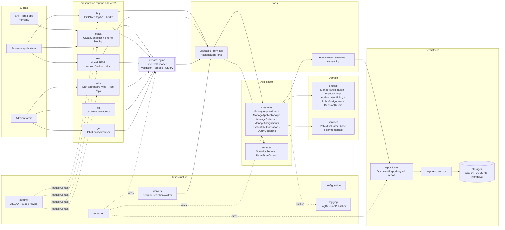
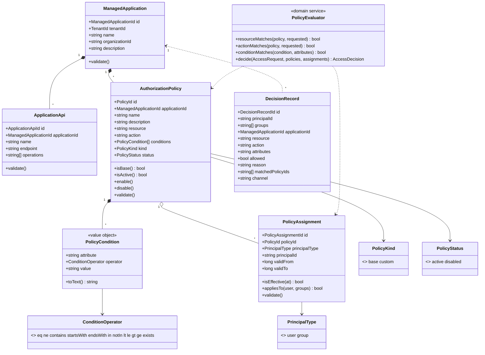
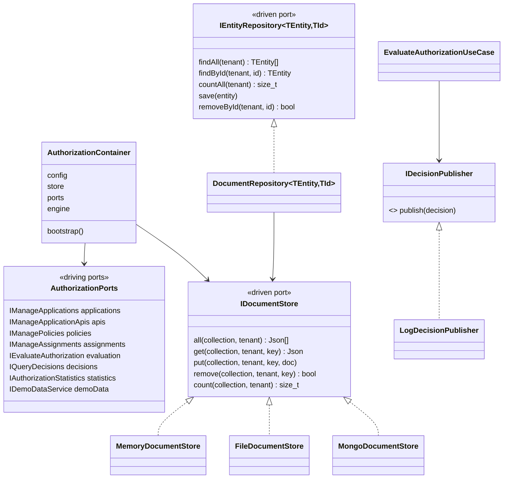
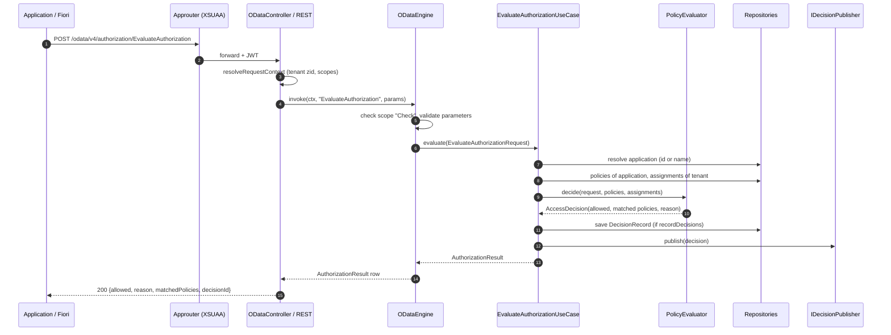
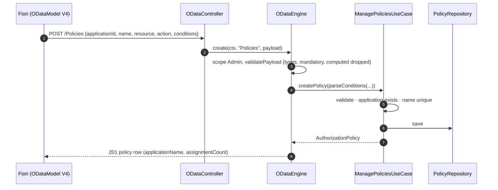
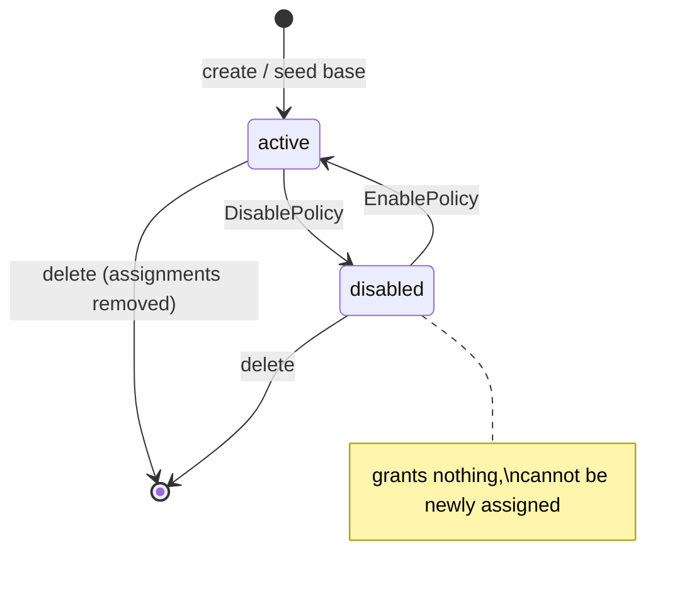
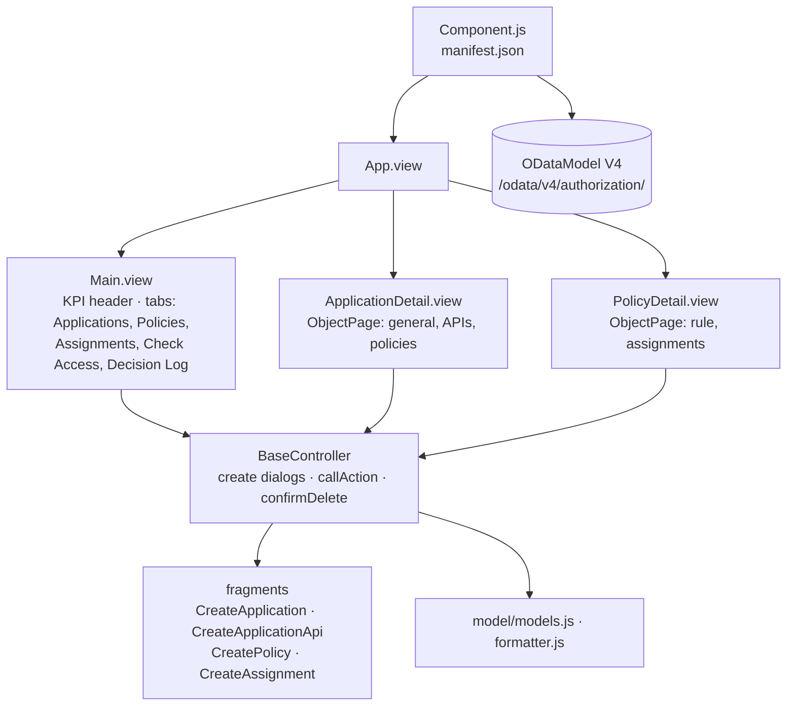

# UML — Authorization Management Service

Diagrams of the D/vibe.d backend (hexagonal architecture), the SAP Fiori frontend and the deployment.
Module root: `backend/source/uim/platform/authorization/`.

## 1. Component diagram (hexagonal architecture)



## 2. Domain class diagram



All entities mix in `TenantEntity` (`id`, `tenantId`, `createdAt/By`, `updatedAt/By`) from `uim-platform:service`.

## 3. Ports and adapters (class diagram)



Repositories: `ApplicationRepository`, `ApplicationApiRepository`, `PolicyRepository`, `AssignmentRepository`,
`DecisionRepository` (collections `ams.applications`, `ams.applicationApis`, `ams.policies`, `ams.assignments`, `ams.decisions`).

## 4. Sequence — runtime authorization check



## 5. Sequence — create a policy from the Fiori app



## 6. Policy state machine



## 7. Frontend structure (SAP Fiori 3)



## 8. Deployment

```mermaid
flowchart LR
  subgraph BTP["SAP BTP — Cloud Foundry (mta.yaml)"]
    AR[authorization-approuter<br/>@sap/approuter + Fiori resources]
    SRV[authorization-srv<br/>binary_buildpack<br/>uim-authorization-platform-service]
    XS[(authorization-xsuaa<br/>scopes Read · Admin · Check)]
    UPS[(authorization-config<br/>user-provided)]
  end
  subgraph K8s["Kubernetes (k8s/)"]
    POD[Deployment authorization] --- CM[ConfigMap]
    POD --- SVC[Service :8117]
    POD --> MDB[(MongoDB)]
  end
  subgraph Desktop
    CLI[uim-authorization-cli]
    GUI[uim-authorization-gui]
    FILE[(data/authorization.json)]
  end
  Browser --> AR --> SRV
  AR --- XS
  SRV --- XS
  SRV --- UPS
  CLI --- FILE
  GUI --- FILE
```
