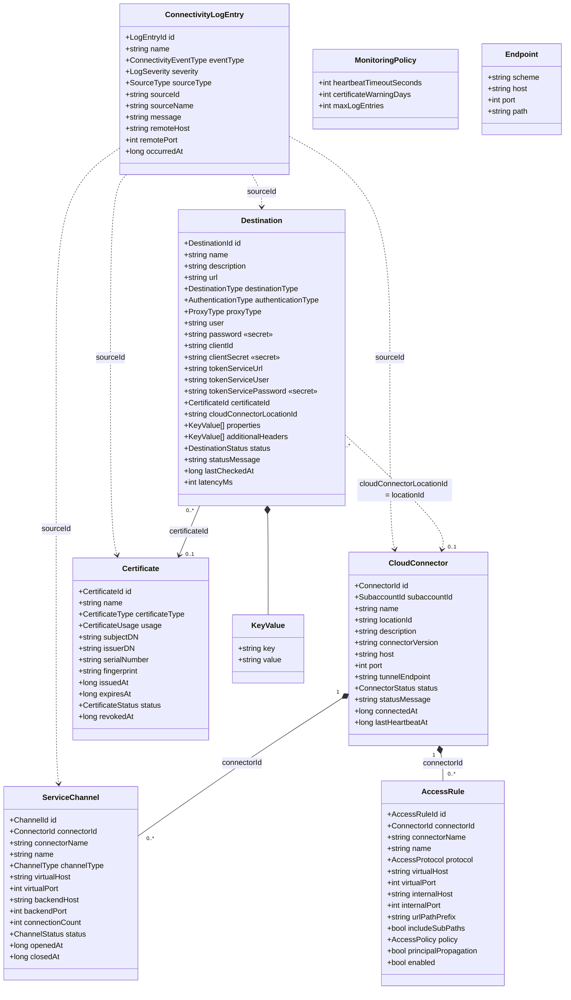
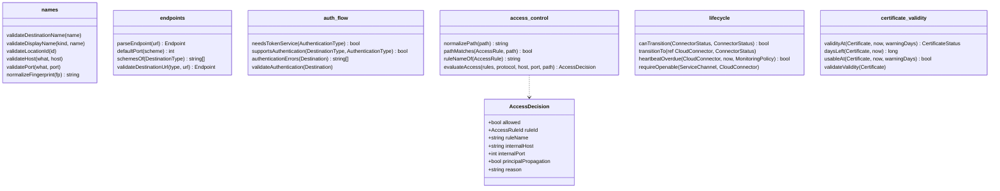
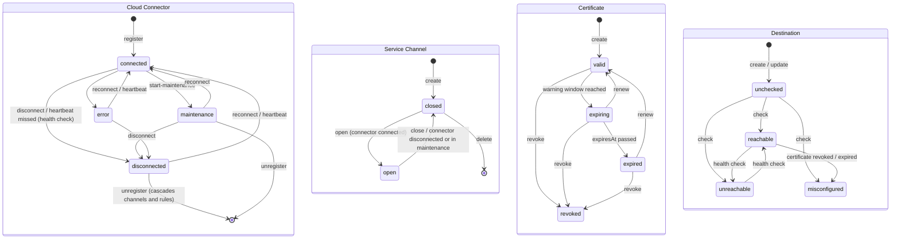
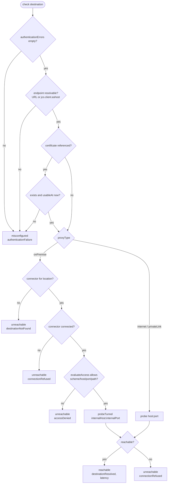
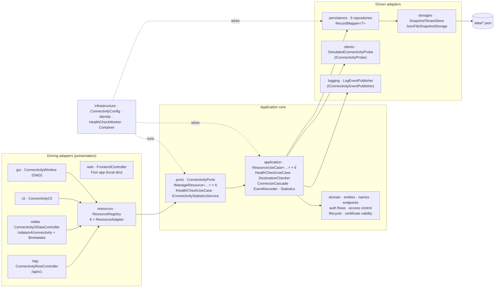
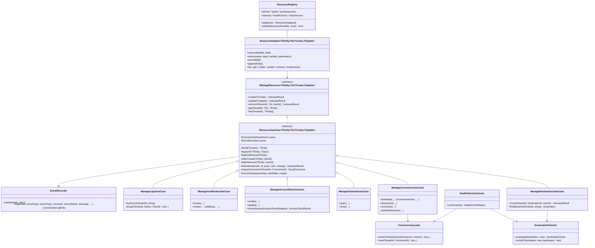
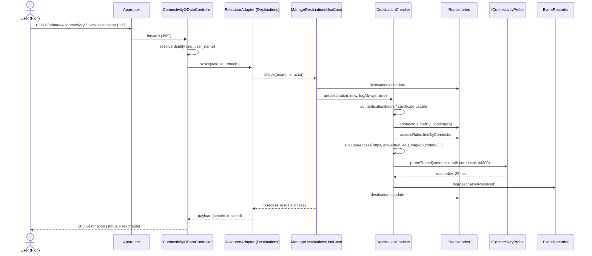
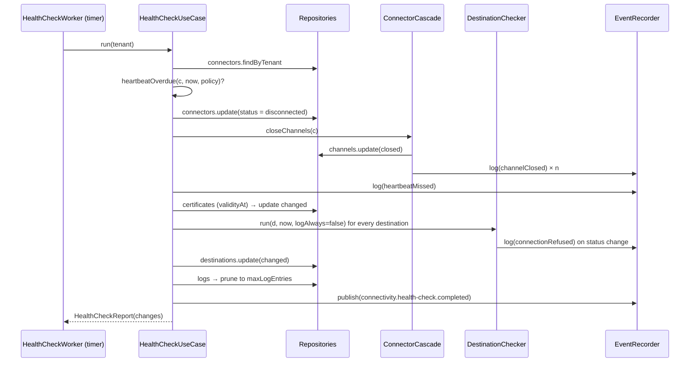
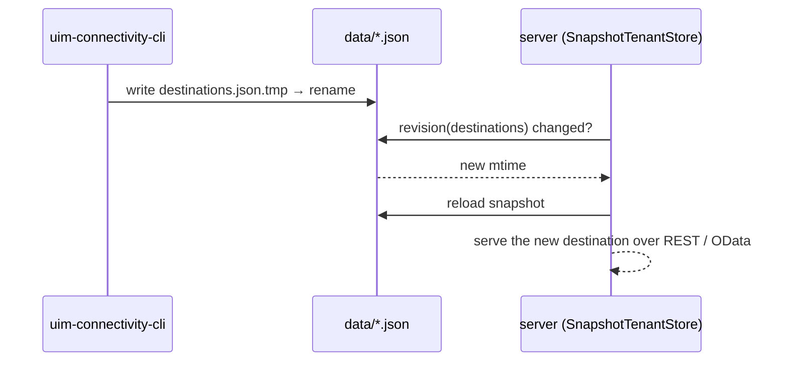

# UML — Connectivity Service

Diagrams of the hexagonal backend (`backend/source/uim/platform/connectivity`), the
Fiori frontend and the BTP deployment. All diagrams are Mermaid.

## Class Diagram — Domain Entities

All aggregates mix in `TenantEntity` (`tenantId`, `id`, `createdBy/At`, `updatedBy/At`).
Service channels and access rules belong to one Cloud Connector; destinations reach a
connector indirectly through its location ID and may reference a certificate.



## Class Diagram — Domain Services

Pure functions without I/O; the application layer calls them and throws their
`ConnectivityValidationException` (422) / `ConnectivityConflictException` (409).



## State Diagram — Lifecycles



## Activity Diagram — Connection check (`DestinationChecker`)



## Component Diagram — Hexagonal Architecture



Dependencies point inwards: presentation knows only `ConnectivityPorts`; use cases know
only port interfaces (`ConnectivityRepositories`, `IConnectivityProbe`,
`IConnectivityEventPublisher`).

## Class Diagram — Generic use cases and adapters



## Sequence Diagram — Fiori checks an on-premise destination



## Sequence Diagram — Health check detects a lost Cloud Connector



## Sequence Diagram — CLI and server share data



## Deployment Diagram — SAP BTP (Cloud Foundry)

```mermaid
flowchart LR
    B[Browser<br/>Fiori app] -->|HTTPS| AR[connectivity-approuter<br/>@sap/approuter + resources/]
    AR -->|XSUAA login| X[(connectivity-xsuaa)]
    AR -->|destination connectivity-srv<br/>JWT forwarded| SRV[connectivity-srv<br/>binary buildpack<br/>uim-connectivity-platform-service]
    SRV -->|VCAP_SERVICES| CFG[(connectivity-config<br/>user-provided)]
    SRV --> DISK[(data/*.json<br/>container disk)]
    SCC[Cloud Connector<br/>on premise] -.->|"POST /api/v1/connectors/:id/heartbeat"| AR
    ADM[CLI / GtkD GUI<br/>local] --> DISK2[(backend/data)]
```
