# UML — Data Quality Service

Diagrams of the data quality service (Mermaid). Code lives under
`backend/source/uim/platform/data_quality/`; the layers are described in
[README.md](README.md), the architecture views in [NAFv4.md](NAFv4.md).

Contents:

1. Domain model
2. Value types and domain services
3. Ports and interactors
4. Component diagram (hexagonal layers)
5. Persistence
6. State machines
7. Sequence diagrams
8. Deployment diagram

## 1. Domain model

Every entity mixes in `TenantEntity!(Id)` (tenantId, id, createdAt/By,
updatedAt/By). Resources inside a dataset carry `datasetId` and are
addressed by the composite key `<datasetId>~<id>`. Special ids: a violation
is `<recordId>:<ruleId>`, a column profile is the field name, a user account
is the user name. `IDocumentStore` comes from uim-platform:service.

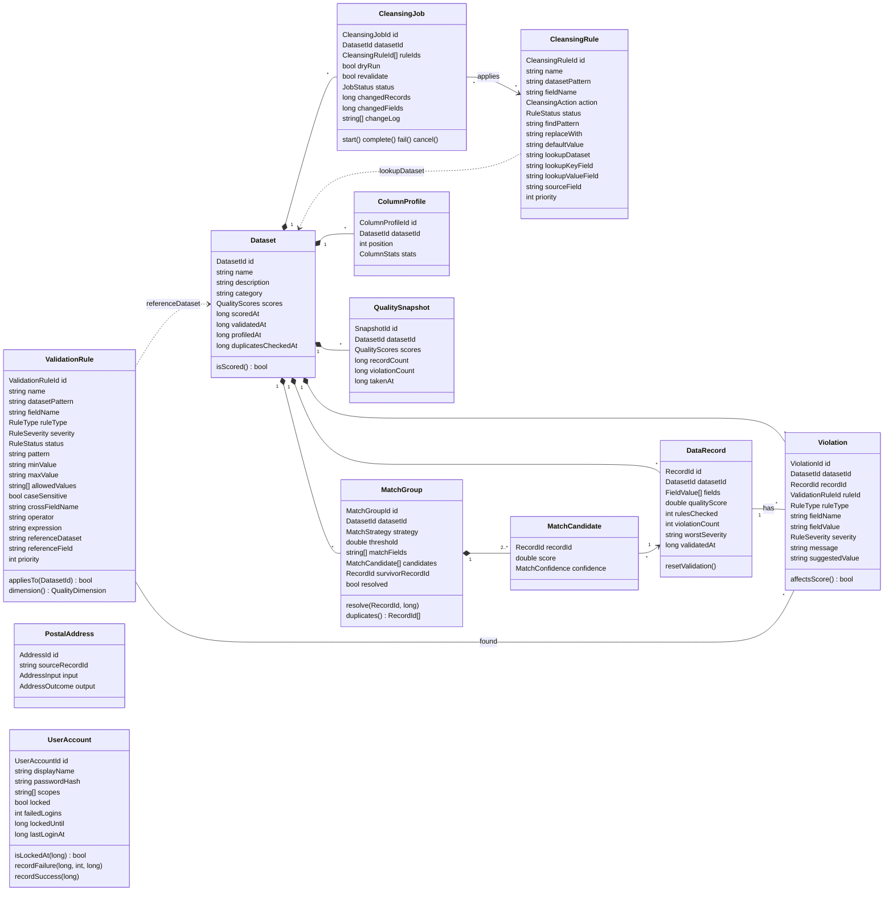

### Enumerations

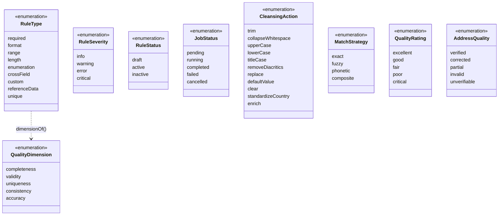

## 2. Value types and domain services

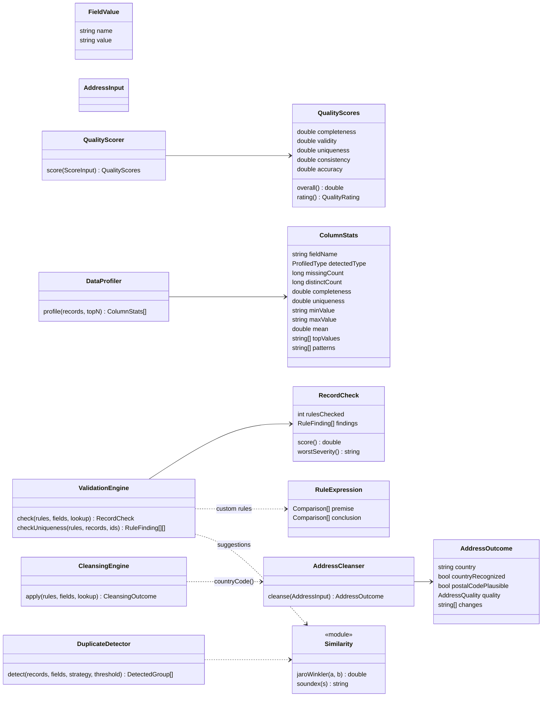

The domain services are pure: no I/O, no framework types. Reference data
reaches them through delegates (`ReferenceLookup`, `EnrichmentLookup`) that
the application layer fills from the record repository.

## 3. Ports and interactors

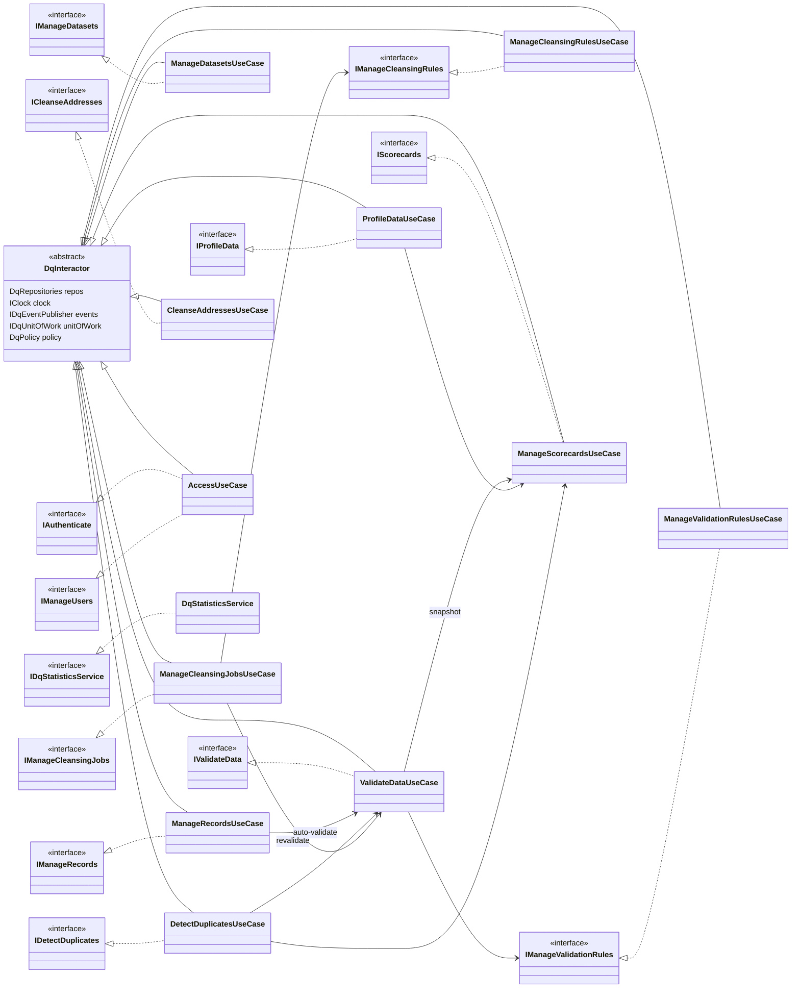

Driven ports:

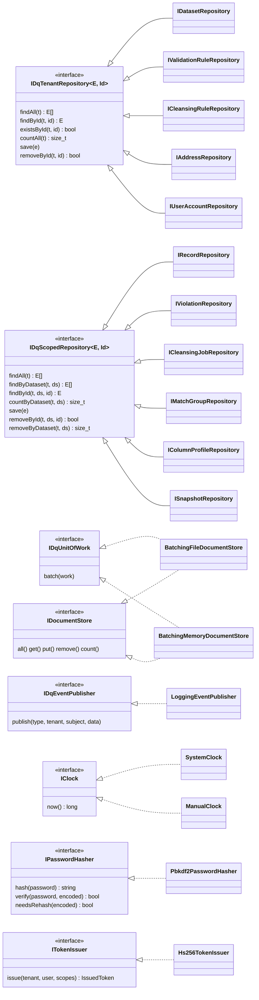

## 4. Component diagram (hexagonal layers)

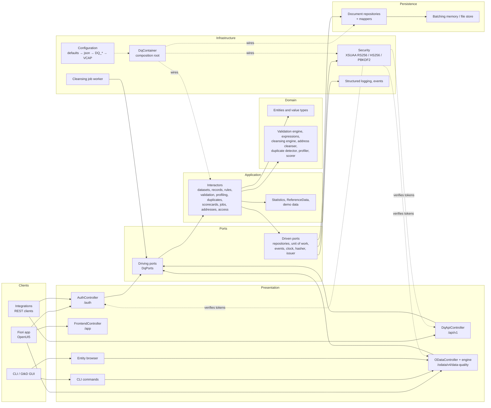

Dependencies point inwards: the domain knows nothing of ports, vibe.d or
storage; interactors only know ports; adapters only know driving ports.

## 5. Persistence

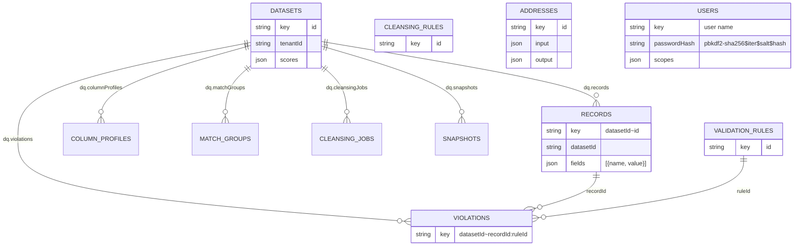

Each collection is partitioned by tenant (`IDocumentStore`: collection →
tenant → key → JSON document). The file store keeps one JSON snapshot;
`IDqUnitOfWork.batch` defers the snapshot write to the end of a batch.

## 6. State machines

Cleansing job:

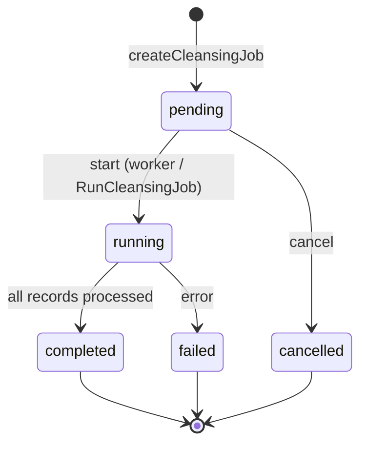

Match group:

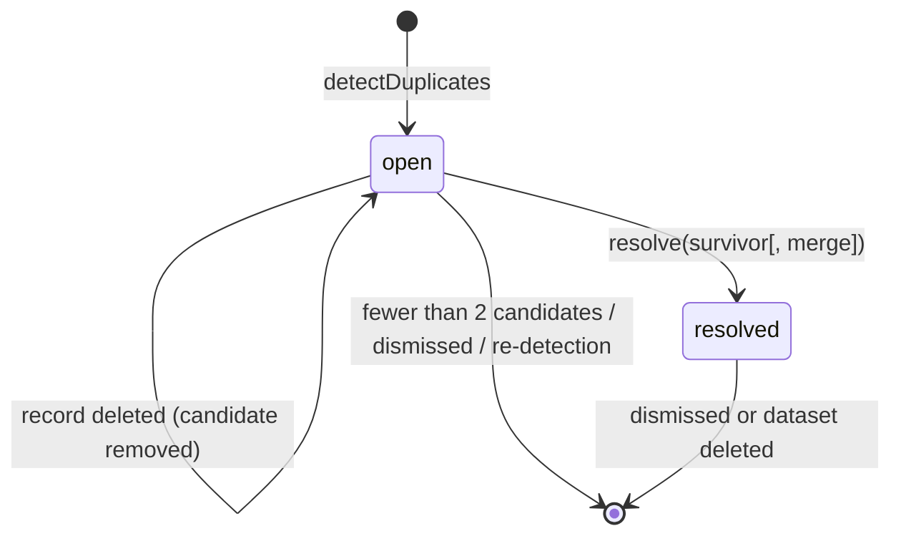

User account (built-in login):

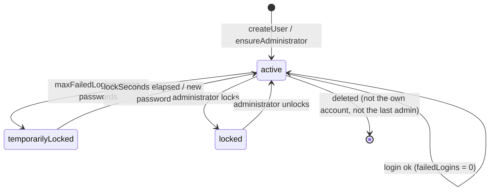

Validation rule / cleansing rule: `draft → active ⇄ inactive`; only active
rules run.

## 7. Sequence diagrams

### Login and an authorized OData call (authMode jwt)

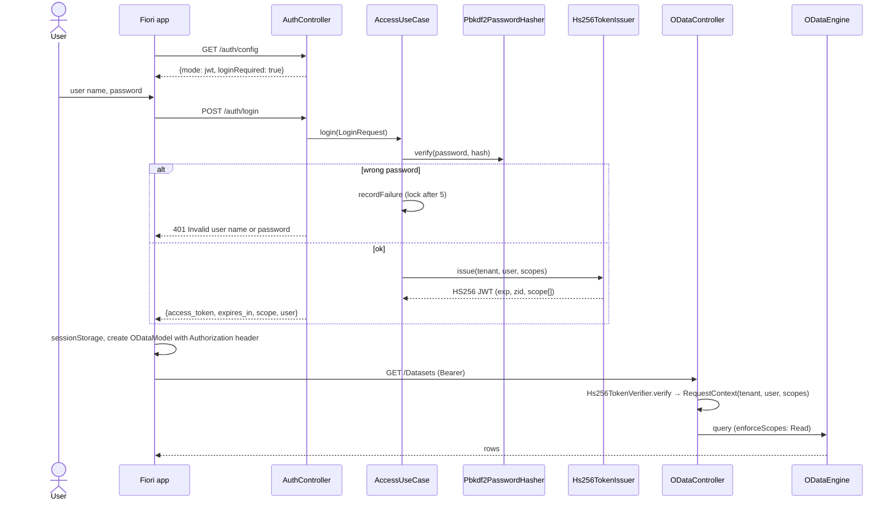

### Validating a dataset

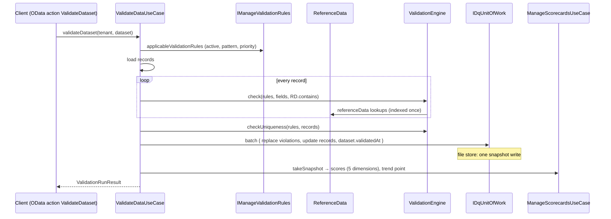

### Cleansing job with revalidation

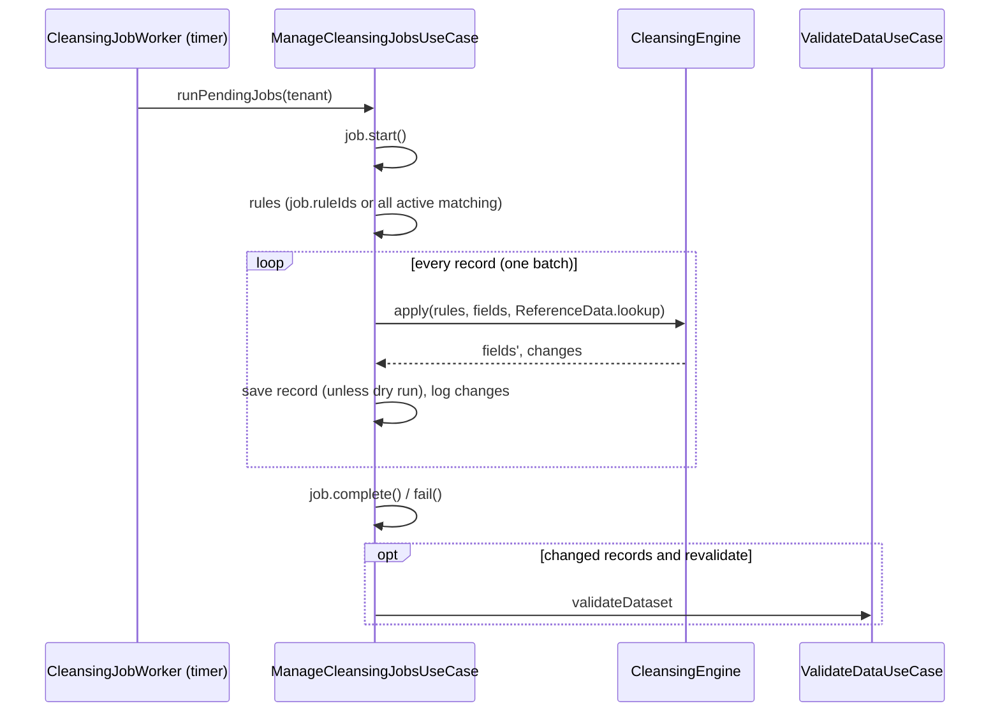

### Resolving duplicates into a golden record

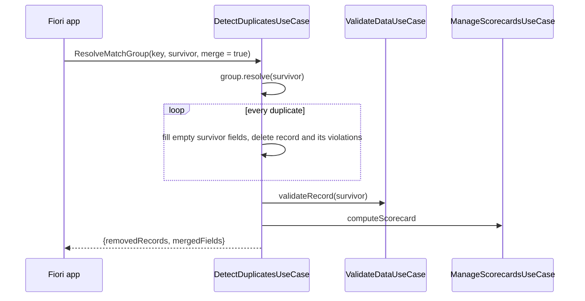

## 8. Deployment diagram

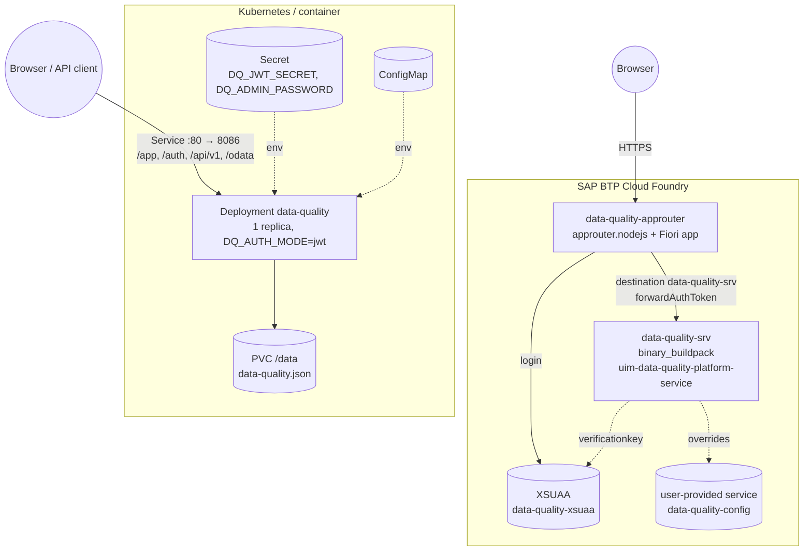
