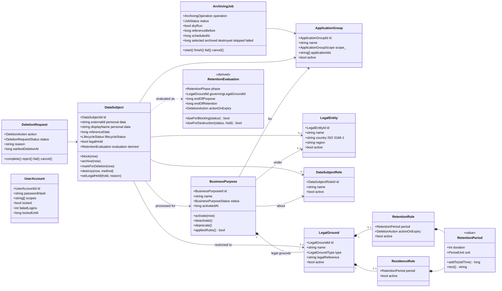
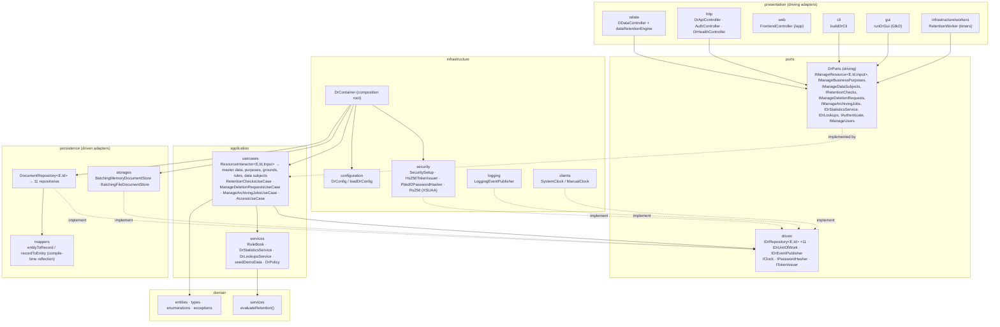
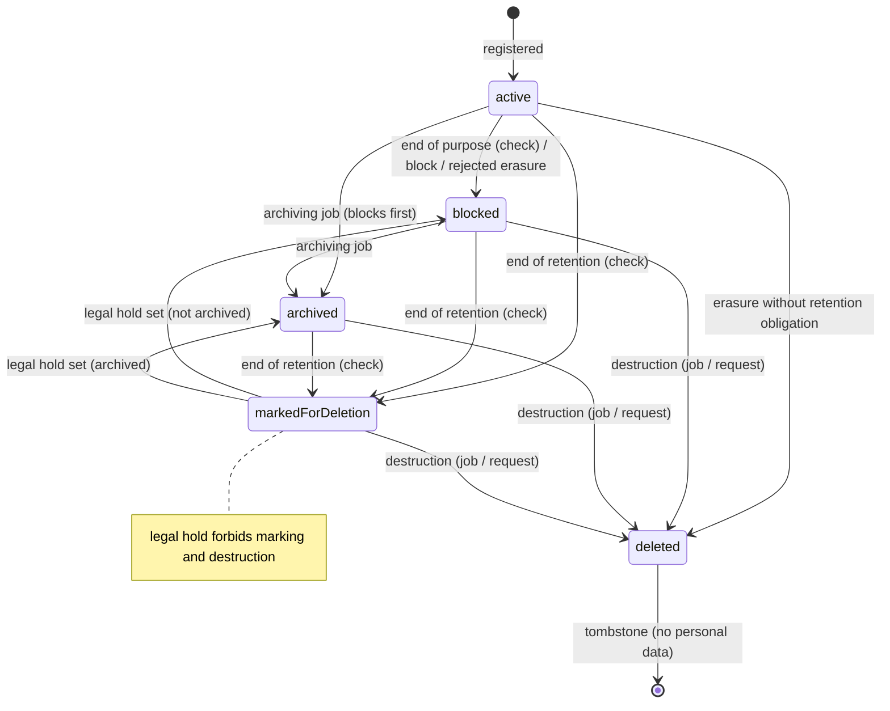
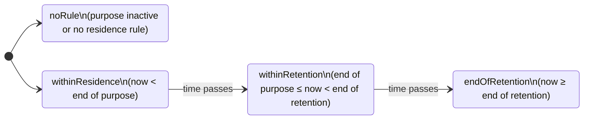
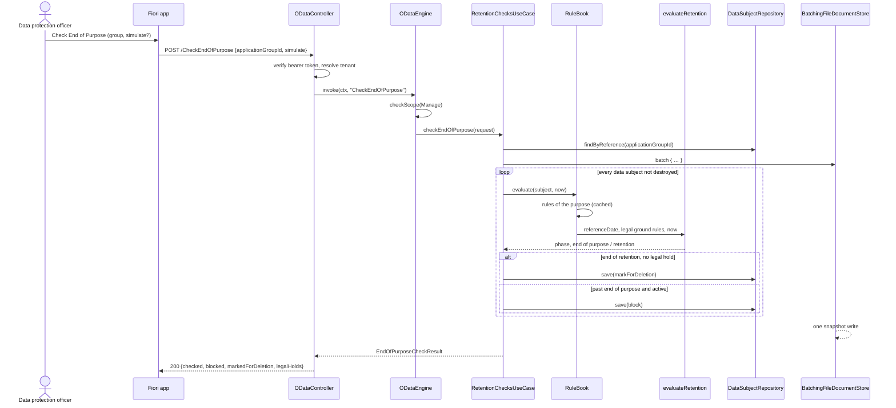
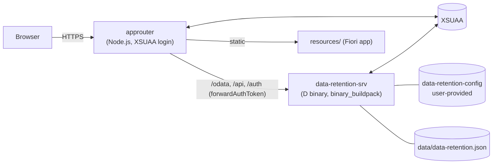

# UML — UIM Data Retention

Diagrams of the redesigned service (backend 2.0). Mermaid renders them on GitHub/GitLab and in most Markdown viewers.

## 1. Domain model



All entities mix in `TenantEntity` (tenantId, id, createdAt/By, updatedAt/By). Enumerations are string valued:
`ApplicationGroupScope`, `BusinessPurposeStatus`, `LegalGroundType`, `PeriodUnit`, `DeletionAction`,
`LifecycleStatus`, `RetentionPhase`, `DeletionRequestStatus`, `ArchivingOperation`, `JobStatus`.

## 2. Hexagonal components



Dependencies point inwards: the domain knows nothing about ports, the application only about ports and domain,
adapters only about ports. `DrContainer` wires everything once for server, CLI and GUI.

## 3. Lifecycle of a data subject



## 4. Retention phases



## 5. Sequence — end-of-purpose check



## 6. Sequence — erasure request against a retention obligation

```mermaid
sequenceDiagram
  participant W as RetentionWorker
  participant UC as ManageDeletionRequestsUseCase
  participant RB as RuleBook
  participant DS as DataSubject
  W->>UC: processPending(tenant)
  UC->>RB: evaluate(subject)
  alt legal hold
    UC->>DS: block(); request.reject("legal hold")
  else endOfRetention or retention = 0
    UC->>DS: destroy(delete | anonymize)
    UC-->>UC: request.complete()
  else retention obligation open
    UC->>DS: block()
    UC-->>UC: request.reject(earliestDeletion = end of retention)
  end
```

## 7. Sequence — built-in login (authMode jwt)

```mermaid
sequenceDiagram
  actor U as User
  participant C as Component.js / session.js
  participant A as AuthController
  participant AC as AccessUseCase
  participant H as Pbkdf2PasswordHasher
  participant I as Hs256TokenIssuer
  C->>A: GET /auth/config
  A-->>C: {mode: "jwt", loginRequired: true}
  U->>C: user name, password (LoginDialog)
  C->>A: POST /auth/login
  A->>AC: login(LoginRequest)
  AC->>H: verify(password, hash)
  alt wrong / unknown / locked
    AC-->>A: unauthorized (failed login counted, lock after 5)
    A-->>C: 401
  else ok
    AC->>I: issue(tenant, user, scopes)
    A-->>C: {access_token, expires_in, scope, user}
    C->>C: sessionStorage; ODataModel with Authorization header
  end
```

## 8. Deployment


