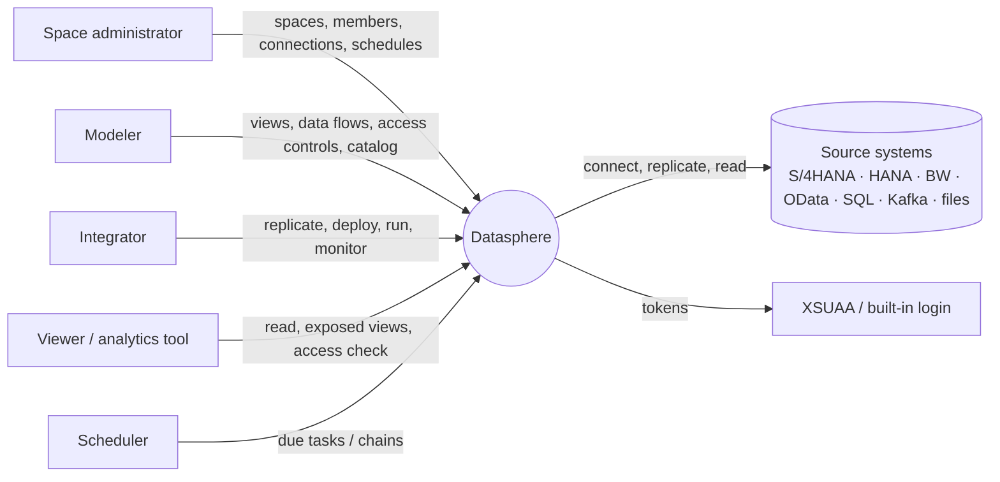

# NAF v4 Architecture Description — UIM Datasphere

> NATO Architecture Framework v4 description of the UIM Datasphere service 2.0: a business data fabric in the
> style of SAP Datasphere — spaces with quotas and members, connections to source systems, federated and
> replicated remote tables, SQL views, data flows, scheduled tasks and task chains with a run monitor, row level
> security and a governed catalog — with a D/vibe.d backend, an SAP Fiori 3 / OpenUI5 frontend, built-in JWT login
> or SAP XSUAA.

---

## 1. Grid mapping

| NAF v4 viewpoint | Subject | Section |
|---|---|---|
| C1 Capability Taxonomy · C2 Enterprise Vision | what the service is able to do and why | §2 |
| C4 Standard Processes / L4 Logical Activities | provisioning, integration, modeling, operation, governance, login | §3 |
| S1 Service Taxonomy · S4 Service Functions | OData, REST, CLI, GUI, scheduler, auth | §4 |
| L2 Logical Scenario · L3 Node Interactions | operational nodes and information flows | §5 |
| L7 Logical Data Model | entities and relations | §6 |
| P1 Resource Types · P2 Resource Structure | software components and layers | §7 |
| P4 Resource Functions / P5 Resource Connectivity | deployment | §8 |
| A8 Standards Profile | standards and technologies | §9 |
| Cr Security / constraints | authentication, authorization, data protection | §10 |
| Ar Architecture decisions | decisions and rationale | §11 |

---

## 2. Capability viewpoint

### C1 — Capability taxonomy

```text
C0 Business Data Fabric
├── C1 Space management
│   ├── C1.1 Spaces with disk / memory quota, priority, audit log; lock / unlock
│   ├── C1.2 Members with scoped roles (viewer, modeler, integrator, administrator)
│   └── C1.3 Disk usage derived from replicas, persisted views and data flow targets
├── C2 Data integration
│   ├── C2.1 Connections (HANA, S/4HANA, BW/4HANA, HDL files, OData, SQL, ABAP, Kafka, files) with validation
│   ├── C2.2 Remote tables: federated access, snapshot, scheduled and real-time replication
│   └── C2.3 Data flows: sources → transformations → target table (append, truncate, upsert)
├── C3 Modeling
│   ├── C3.1 SQL views with semantic usage (relational / analytical dataset, fact, dimension, text, hierarchy)
│   ├── C3.2 Deployment life cycle (notDeployed → deployed → changesToDeploy)
│   └── C3.3 View persistence (materialisation) and exposure for consumption
├── C4 Scheduling and monitoring
│   ├── C4.1 Tasks (replication, data flow, view persistence) with schedules and retries
│   ├── C4.2 Task chains with stop / continue failure policy
│   ├── C4.3 Scheduler worker, run log, retention
│   └── C4.4 KPIs (statistics)
├── C5 Governance
│   ├── C5.1 Data access controls (row level security) and access checks
│   └── C5.2 Catalog: business names, owners, quality, sensitivity, tags, glossary, ranked search
└── C6 Access management
    ├── C6.1 Built-in login with PBKDF2 passwords and HS256 JWT, account lock
    ├── C6.2 SAP XSUAA via approuter (RS256)
    └── C6.3 Scopes Read · Integrate · Model · Manage · Admin
```

### C2 — Enterprise vision

| Goal | Measure |
|---|---|
| One governed place for the business data of a team | spaces with quotas, members, catalog, data access controls |
| Trustworthy, repeatable data loads | deployment status, schedules, retries, chains, run log with rows / duration / message |
| Self-service without losing control | scoped roles, row level security, references kept inside a space, quota enforcement |
| Operable everywhere | the same engine behind Fiori, OData, REST, CLI and GUI; BTP, Kubernetes, single binary |

---

## 3. Processes (C4 / L4)

| Process | Steps | Implemented in |
|---|---|---|
| P1 Provision a space | create space → add members → set quota / priority | `usecases/spaces.d` |
| P2 Connect a source | create connection → validate → (credentials changed → untested) | `usecases/integration.d`, `services/runner.d` |
| P3 Integrate data | create remote table → snapshot / schedule / real-time → replica counts against quota | `integration.d`, `runner.d` |
| P4 Model | create view (SQL) → sources derived → deploy (sources must exist) → persist / expose | `usecases/modeling.d` |
| P5 Transform | create data flow → deploy → run → target rows / size | `modeling.d`, `runner.d` |
| P6 Operate | tasks and chains → scheduler → runs (retries, stop / continue) → monitor → purge | `usecases/scheduling.d`, `workers/scheduler.d` |
| P7 Govern | data access controls → access check; catalog assets → search | `modeling.d`, `domain/services/access.d` |
| P8 Log on | /auth/login → token → scopes enforced per entity set and action | `usecases/access.d`, `security/*` |

---

## 4. Service viewpoint (S1 / S4)

| Service | Interface | Function |
|---|---|---|
| S1 Datasphere OData service | OData v4 `/odata/v4/datasphere` (`$metadata`, `$batch`, 20 actions) | Fiori app, analytics tools |
| S2 Datasphere REST API | JSON `/api/v1/datasphere/…` | integration, scripts, automation |
| S3 Authentication | `/auth/config`, `/auth/login`, `/auth/me`, `/auth/password`, `/auth/logout` | built-in JWT login |
| S4 Health | `/health`, `/api/v1/health` | probes, scheduler metrics |
| S5 Scheduler | in-process timer | due tasks and chains, run retention |
| S6 Administration CLI | `uim-datasphere-cli` | seed, run, deploy, validate, access check, runs, tokens, passwords |
| S7 Desktop GUI | GtkD entity browser | model-driven forms and actions |
| S8 Processing engine (driven) | `IProcessingEngine` | connection check, replication, data flow, persistence (simulation shipped) |

---

## 5. Logical / operational viewpoint (L2 / L3)



| Flow | From → to | Content |
|---|---|---|
| IF1 | users → Datasphere | OData / REST requests with bearer token |
| IF2 | Datasphere → source systems | connection check, snapshot reads (via processing engine) |
| IF3 | scheduler → use cases | due schedules, purge |
| IF4 | Datasphere → audit log | structured JSON events (ids and states, no data or secrets) |

---

## 6. Logical data model (L7)

| Entity | Key | Main attributes | Relations |
|---|---|---|---|
| Space | technical name | name, status, priority, disk / memory quota, used disk | owns all space-scoped entities |
| SpaceMember | id | userName, role | space |
| Connection | id | type, host, port, database, user, password (write-only), status | space; remote tables |
| RemoteTable | id | name, remote schema / object, replication mode / status, columns, rows, size | space, connection |
| DataView | id | name, semantic, SQL, sources (derived), columns, exposed, deployment, persistence | space; sources by name |
| DataFlow | id | name, sources, transforms, target table, load mode, deployment, last run | space; sources by name |
| DataTask | id | type, target object, schedule, retries, next / last run | space; remote table / flow / view |
| TaskChain | id | ordered task ids, failure policy, schedule | space; tasks |
| TaskRun | id | object type / id, task, chain run, trigger, status, attempt, rows, size, duration, message | space |
| DataAccessControl | id | criteria column / operator / values, protected views, users, enabled | space; views |
| CatalogAsset | id | type, described object, owner, quality, sensitivity, tags, glossary, accesses | space; object |
| UserAccount | user name | display name, password hash, scopes, lock state | tenant |

All entities are tenant scoped; records are flat JSON documents in collections `dsp.*`.

---

## 7. Resource viewpoint (P1 / P2)

| Layer | Package | Content |
|---|---|---|
| Domain | `domain/` | entities, ids, time, scopes, enumerations, exceptions; services columns, sql, schedules, access, lifecycle |
| Ports | `ports/` | driving: use case interfaces, `DspPorts`; driven: repositories, unit of work, processing engine, clock, audit, credentials |
| Application | `application/` | DTOs (inputs, PATCH changes), interactors, RunService, statistics, capabilities, demo data |
| Persistence | `persistence/` | compile-time entity ↔ record mapper, document repositories, batching file / memory stores |
| Infrastructure | `infrastructure/` | configuration (layered), security (PBKDF2, HS256, XSUAA RS256), logging, simulated engine, scheduler worker, metrics, container |
| Presentation | `presentation/` | OData model + engine binding, REST, auth, health, Fiori files, CLI, GtkD GUI |
| Frontend | `frontend/` | Fiori 3 app `uim.datasphere`: Main (KPIs, 7 tabs), SpaceDetail, 14 dialogs, i18n en/de, QUnit + OPA5 |
| Approuter | `approuter/` | routes, XSUAA scopes and role templates |

---

## 8. Physical deployment (P4 / P5)

### SAP BTP (Cloud Foundry) — `mta.yaml`

`datasphere-srv` (binary buildpack, health check `/health`) and `datasphere-approuter` (serves the Fiori app,
forwards the XSUAA token via destination `datasphere-srv`); resources `datasphere-xsuaa`
(`approuter/xs-security.json`) and the user-provided service `datasphere-config` for runtime overrides. File
storage is per container — one instance.

### Kubernetes — `k8s/`

Deployment with one replica (`Recreate`), PVC mounted at `/data` for `datasphere.json`, ConfigMap
(`DATASPHERE_*`), Secret (`DATASPHERE_JWT_SECRET`, `DATASPHERE_ADMIN_PASSWORD`), ClusterIP service on 8095,
read-only root file system, non-root user, liveness / readiness on `/health`.

### Container

`backend/Dockerfile` / `Containerfile`: multi-stage build with ldc2 from the repository root (path dependency on
`service`); runtime Ubuntu 24.04 with server, CLI, `config/` and the Fiori app.

---

## 9. Standards profile (A8)

| Area | Standard / technology |
|---|---|
| Data access | OData v4.01 (JSON, `$metadata` CSDL XML, `$batch`, IEEE754Compatible), Fiori UI annotations |
| APIs | REST / JSON, HTTP 1.1 status semantics |
| Query language | SQL (SELECT subset of SAP HANA SQL) for views |
| Security | OAuth 2.0 bearer tokens, JWT (RFC 7519) HS256 / RS256, PBKDF2-HMAC-SHA256 (RFC 8018), XSUAA |
| Time | ISO 8601 / RFC 3339 UTC |
| UI | SAP Fiori 3 design, OpenUI5 1.120 |
| Runtime | D (dmd / ldc2), vibe.d 0.10.5, uim-framework |
| Deployment | MTA 3.3, Cloud Foundry, OCI images, Kubernetes |
| Logging | structured JSON lines |

---

## 10. Security and constraints

* **Authentication**: XSUAA (when bound) or the built-in login (`authMode jwt`); `open` only for local development.
* **Authorization**: scopes per entity set (read / write) and per action; Manage ⊃ Model ⊃ Integrate ⊃ Read; Admin
  for user accounts only. The CLI and GUI are trusted local adapters.
* **Secrets**: connection passwords are write-only (never in rows, logs or audit entries); password hashes never leave
  the service; `jwtSecret` ≥ 32 characters from a secret store; `toMaskedJson` hides secrets in diagnostics.
* **Account protection**: lock after 5 failed logins for 15 minutes; equal answers and timing for unknown users;
  the last administrator can neither be deleted, locked nor lose Admin.
* **Data protection**: row level security for views via data access controls; sensitivity classification in the
  catalog; audit events carry ids and states only.
* **Input safety**: view SQL restricted to one read-only SELECT; identifiers validated; request size limit
  (`maxRequestBytes`); typed OData payload validation.
* **Constraints**: the file store is a single-node snapshot (one replica / instance); the shipped processing engine
  is a deterministic simulation — a HANA Cloud adapter implements `IProcessingEngine` for production data work.

---

## 11. Architecture decisions

| # | Decision | Rationale |
|---|---|---|
| AD1 | Hexagonal layers with explicit driving / driven ports | business rules independent of vibe.d, storage and the processing engine; testable with fakes |
| AD2 | One model-driven OData engine behind OData, REST, CLI and GUI | identical validation, scopes and answers on every channel; less code |
| AD3 | Runs never throw; every outcome is a logged `TaskRun` | operators see failures in the monitor; schedules and chains continue deterministically |
| AD4 | Processing behind `IProcessingEngine`, simulation shipped | reproducible demos and tests; real engines plug in without touching the use cases |
| AD5 | Quota checked per run from the objects' sizes | a space cannot silently outgrow its disk; usage is derived, not maintained by hand |
| AD6 | View sources derived from the SQL, checked at deployment | design-time freedom, deploy-time integrity (Datasphere-like life cycle) |
| AD7 | Built-in JWT login with XSUAA-compatible claims; XSUAA wins when bound | the same scopes locally, in Kubernetes and on BTP |
| AD8 | Batching unit of work around chains, scheduler runs and cascades | one snapshot write per batch instead of one per record |
| AD9 | Fiori app talks OData V4 only (+ `/auth`); collection properties patched directly | standard UI5 model behaviour; works behind the approuter with CSRF |
