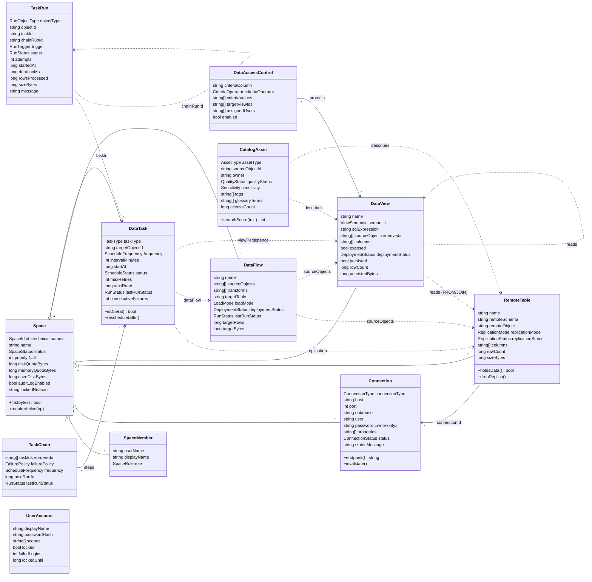
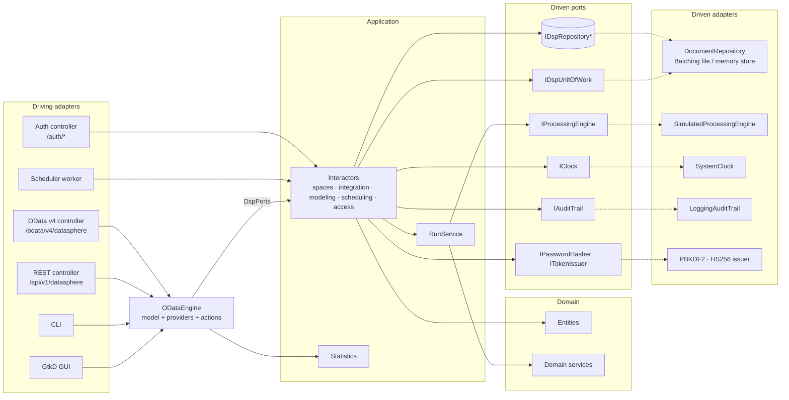
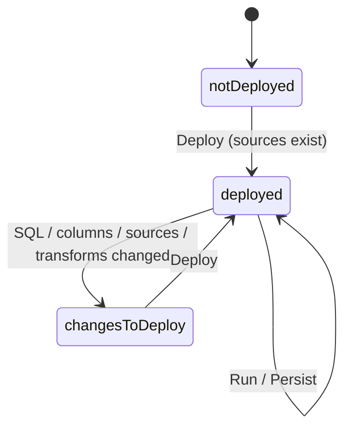
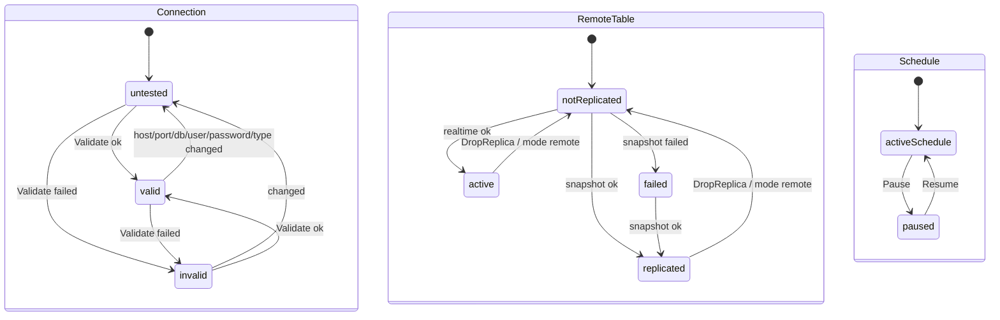
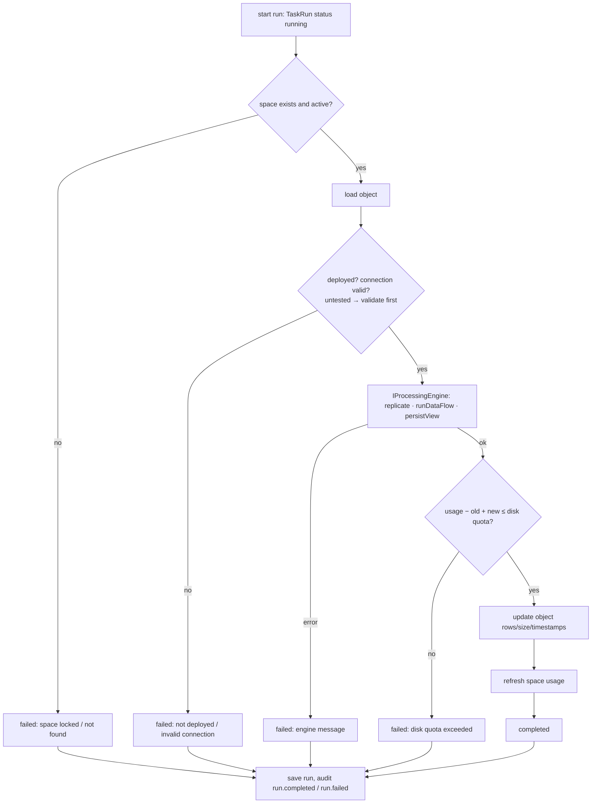
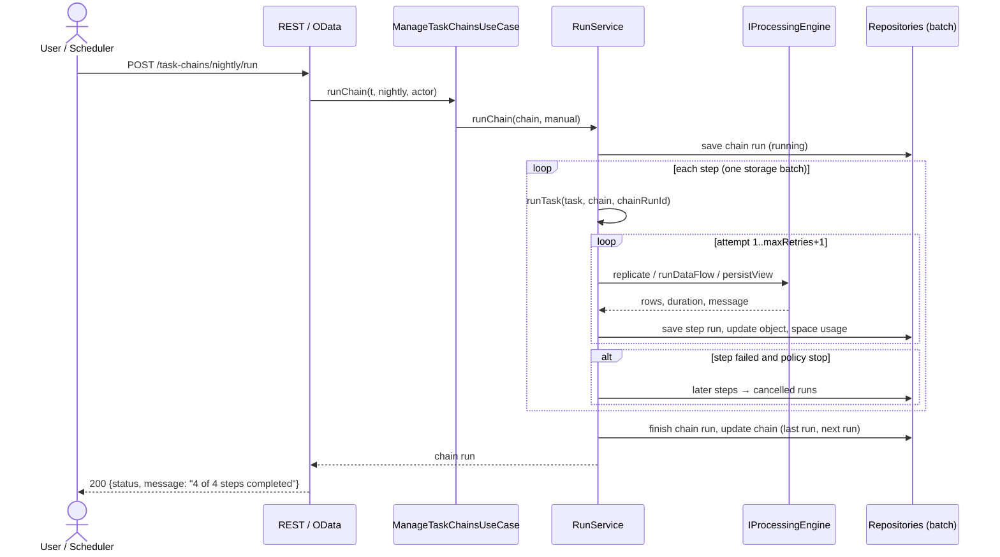
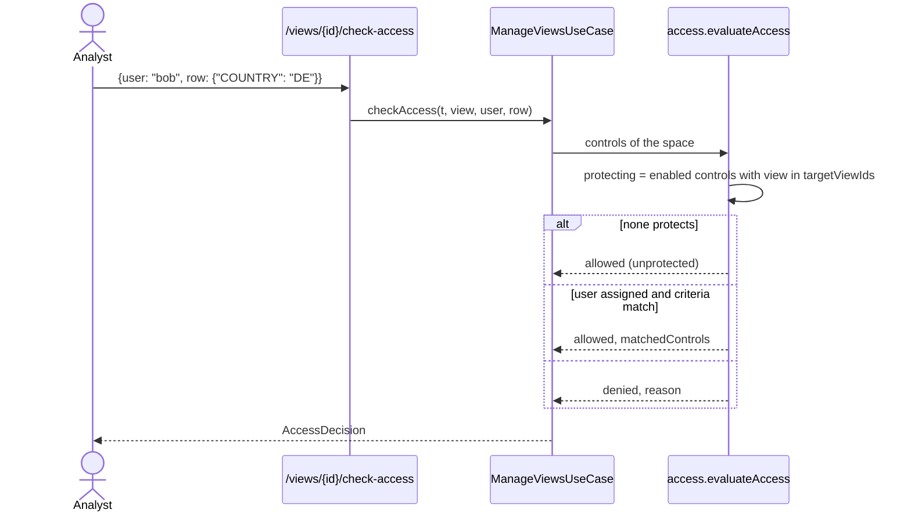
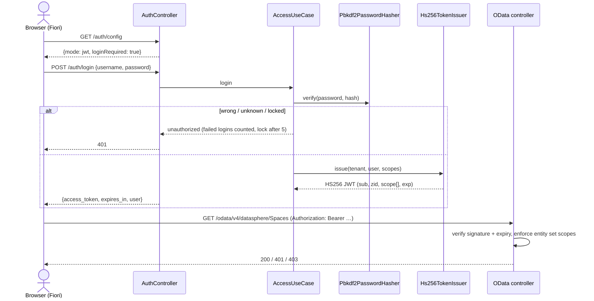
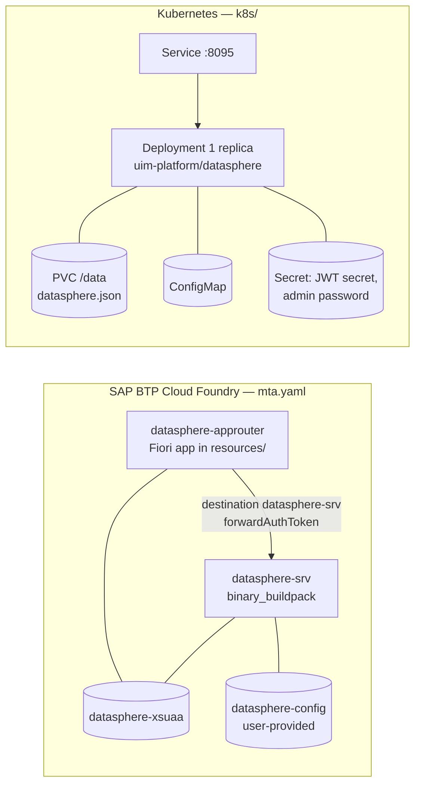

# UML — UIM Datasphere

Diagrams of the Datasphere service 2.0 (Mermaid). Source: [backend/source/uim/platform/datasphere](backend/source/uim/platform/datasphere).

## 1. Domain model

Every entity mixes in `TenantEntity` (`tenantId`, `id`, `createdAt/By`, `updatedAt/By`). References between
entities are ids; all space-scoped entities carry `spaceId`.



Domain services (pure functions): `columns` (parse `NAME:TYPE(len) key`, row width), `sql` (tokenizer, single
read-only SELECT, sources), `schedules` (next firing), `access` (row level decision), `lifecycle` (deployment
status after a change, disk usage of a space).

## 2. Hexagonal components



`DspContainer` (infrastructure) wires everything once and is shared by server, CLI and GUI.

## 3. Deployment status of views and data flows



## 4. Connection, replication and schedule states



## 5. Run (activity) — `RunService.execute`



## 6. Sequence — task chain run



## 7. Sequence — scheduler worker

```mermaid
sequenceDiagram
  participant T as vibe.d timer
  participant W as SchedulerWorker
  participant M as MonitorRunsUseCase
  participant R as RunService
  T->>W: every schedulerIntervalSeconds
  W->>M: runDue(tenant, "scheduler")
  M->>M: due chains (nextRunAt ≤ now), then due tasks not in those chains
  alt space locked
    M->>M: skipped, reschedule
  else
    M->>R: runChain / runTask (trigger schedule)
  end
  M-->>W: SchedulerSummary
  W->>W: metrics; every purgeEveryRuns-th run: purgeRuns
```

## 8. Sequence — row access check



## 9. Sequence — built-in login (authMode jwt)



## 10. Deployment


