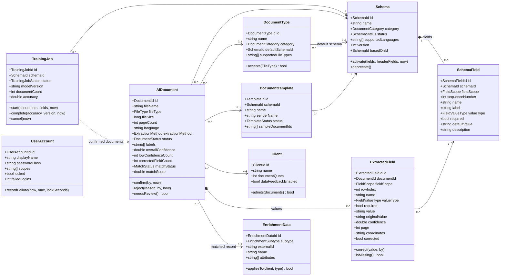
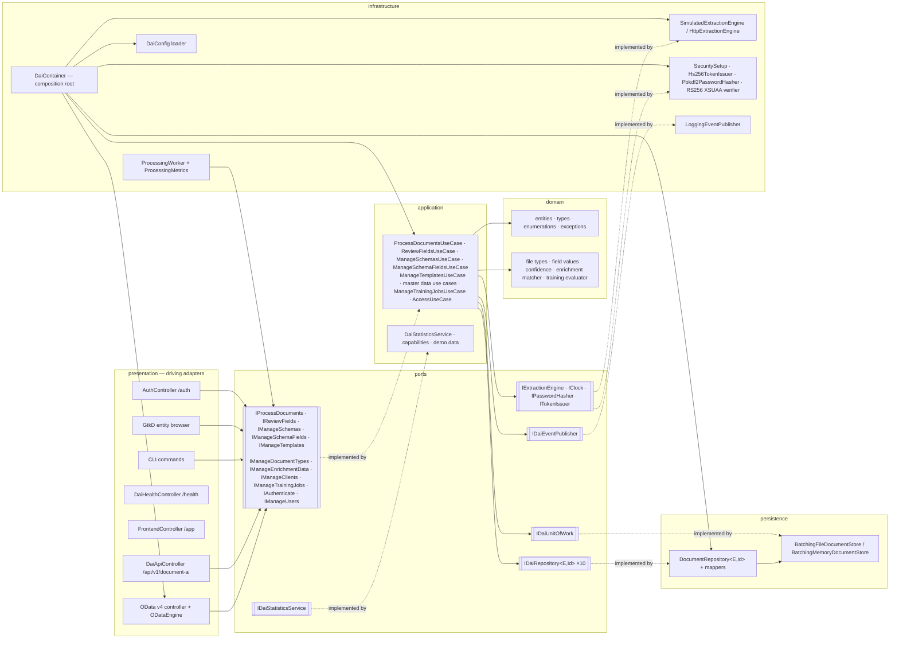
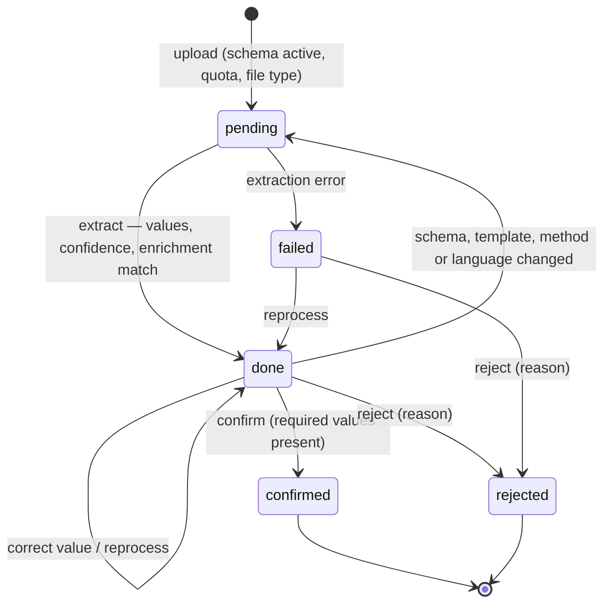
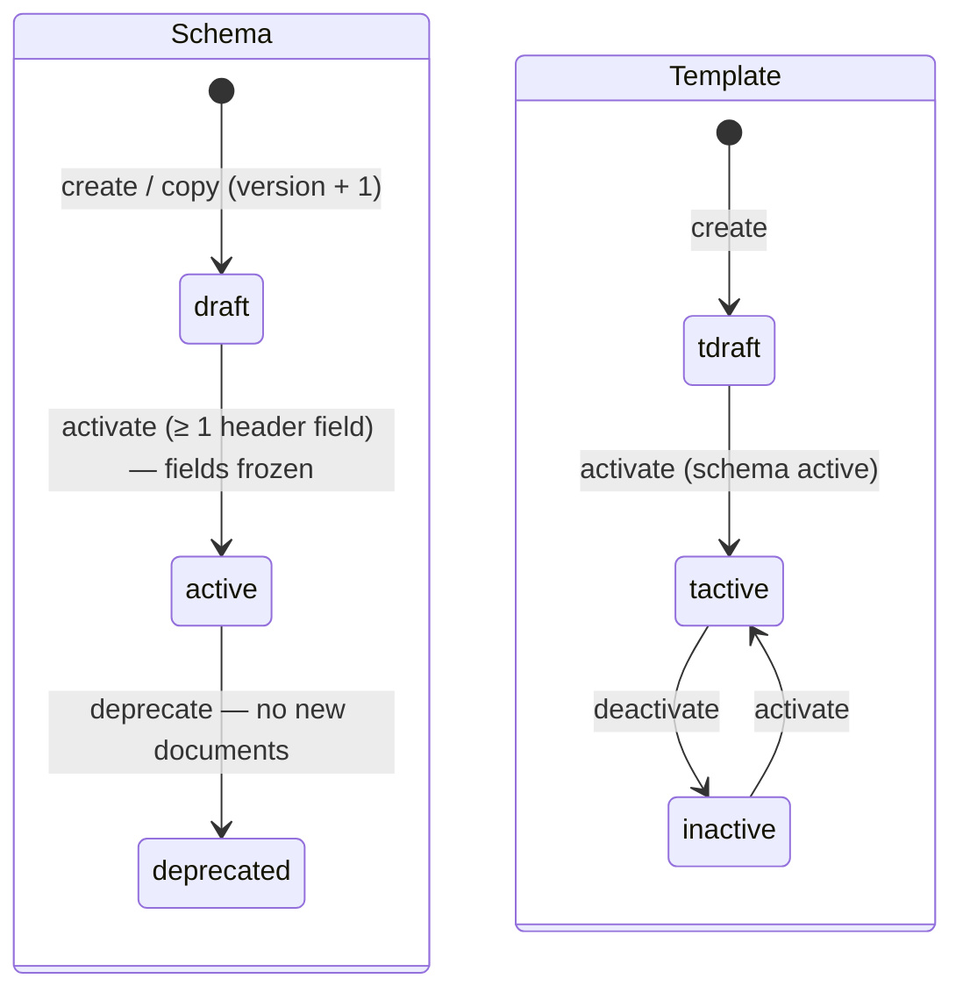
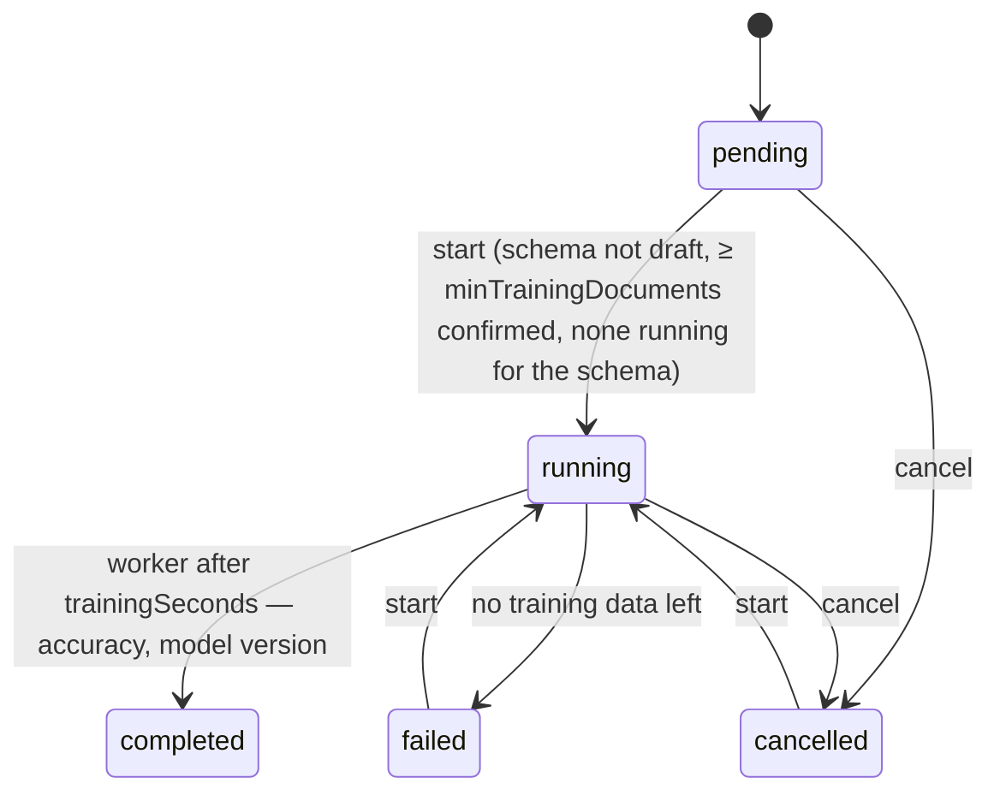
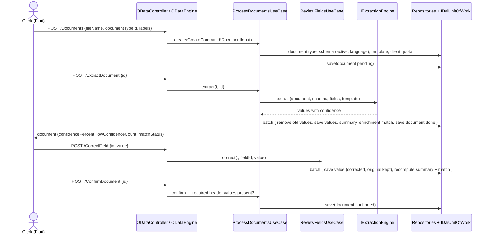
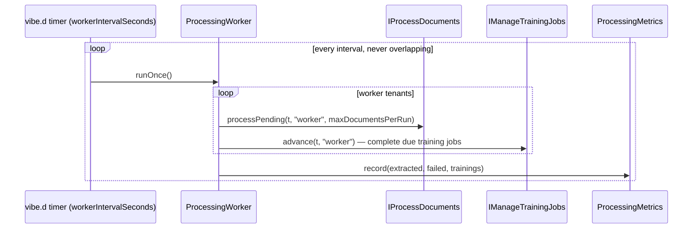
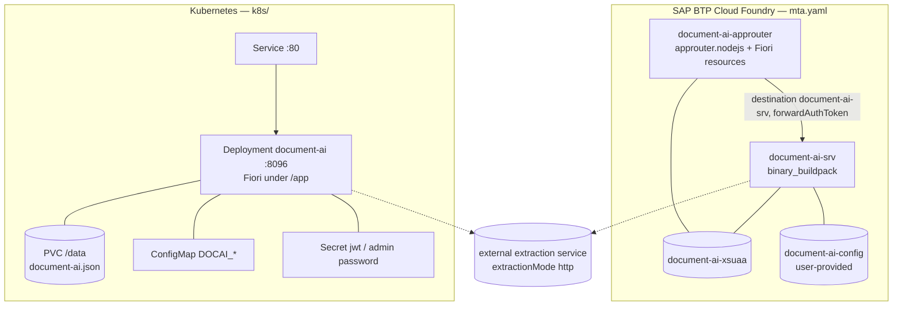

# UML — UIM Document AI

Diagrams of the redesigned service (backend 2.0). Mermaid renders them on GitHub/GitLab and in most Markdown viewers.

## 1. Domain model



Every entity is tenant scoped (`TenantEntity` mixin: `tenantId`, `id`, `createdAt/By`, `updatedAt/By`). Optional
references (`clientId`, `documentTypeId`, …) left empty mean "shared by all".

## 2. Hexagonal components



Dependencies point inwards: the domain knows nothing of vibe.d, JSON stores or HTTP; use cases see only ports; the
container wires adapters to ports once for server, CLI and GUI.

## 3. Document lifecycle



## 4. Schema and template lifecycles



## 5. Training job lifecycle



## 6. Sequence — upload, extraction, review and confirmation



## 7. Sequence — background worker



## 8. Sequence — built-in login (authMode jwt)

```mermaid
sequenceDiagram
  actor U as User
  participant C as Component.js / session.js
  participant A as AuthController
  participant AC as AccessUseCase
  participant H as Pbkdf2PasswordHasher
  participant I as Hs256TokenIssuer
  C->>A: GET /auth/config
  A-->>C: {mode: "jwt", loginRequired: true}
  U->>C: user name, password (LoginDialog)
  C->>A: POST /auth/login
  A->>AC: login(LoginRequest)
  AC->>H: verify(password, hash)
  alt wrong / unknown / locked
    AC-->>A: unauthorized (failed login counted, lock after 5)
    A-->>C: 401
  else ok
    AC->>I: issue(tenant, user, scopes)
    A-->>C: {access_token, expires_in, scope "Read Process …", user}
    C->>C: sessionStorage; ODataModel with Authorization header; buttons by scope
  end
  C->>A: OData / REST with Bearer token → verified (HS256), scopes enforced by ODataEngine
```

## 9. Deployment


