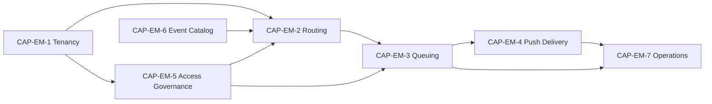
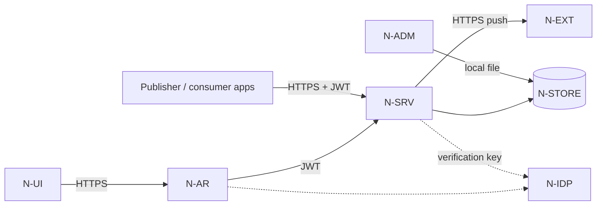
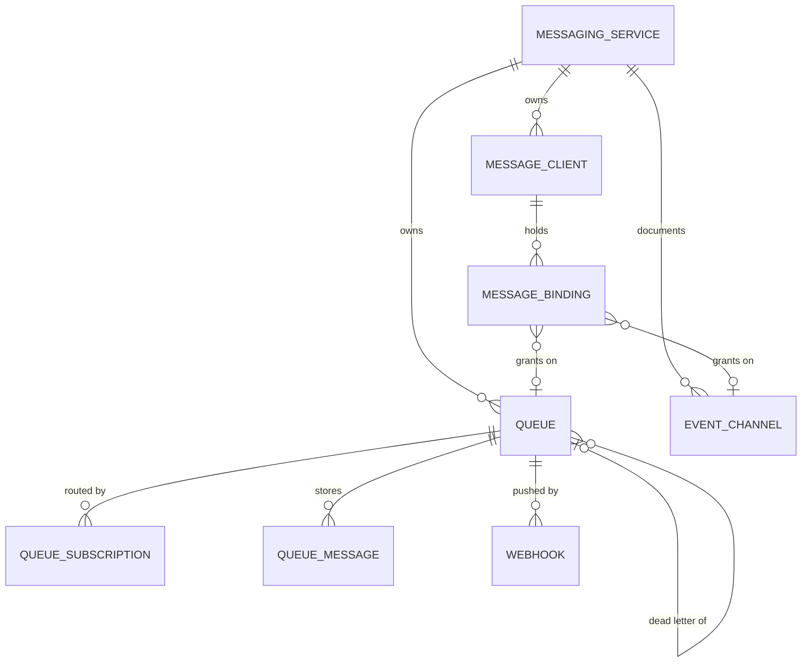

# NAF v4 Architecture Description — Event Mesh

> This is the NATO Architecture Framework v4 description of the UIM Platform
> Event Mesh 2.0. The service is modelled on SAP Event Mesh. It provides
> namespace-scoped messaging services, durable queues with topic subscriptions,
> publishing with fan-out, consumption, webhook push delivery with redelivery
> and dead-lettering, event channels and permissioned message clients. It is
> accessible through OData v4 (SAP Fiori), REST, a CLI and a GtkD desktop GUI.

---

## 1. NAF v4 grid coverage

| View | Viewpoints covered | Section |
|---|---|---|
| **C** Concepts | C1 Capability Taxonomy, C2 Enterprise Vision, C3 Capability Dependencies | §2 |
| **S** Service Specifications | S1 Service Taxonomy, S3 Service Interfaces, S4 Service Functions and Policies, S5 Service States | §3 |
| **L** Logical | L1 Node Types, L2 Logical Scenario, L4 Logical Activities, L6 Logical Sequence, L7 Logical Data Model, L8 Logical Constraints | §4 |
| **P** Physical Resources | P1 Resource Types, P2 Resource Structure, P4 Resource Functions, P5 Resource Interactions | §5 |
| **A** Architecture Metadata | A3 Architecture Decisions, A7 Standards | §6 |

---

## 2. Concepts (C)

### C1 — Capability taxonomy

```text
CAP-EM  Event Mesh
├── CAP-EM-1  Messaging Tenancy
│   ├── 1.1  Provision messaging services with an exclusive namespace
│   └── 1.2  Plan-based quotas (clients, queues, depth, message size)
├── CAP-EM-2  Event Routing
│   ├── 2.1  Topic validation within the namespace
│   ├── 2.2  Topic-pattern subscriptions (* and trailing #)
│   └── 2.3  Fan-out to all matching queues with back-pressure (rejection)
├── CAP-EM-3  Durable Queuing
│   ├── 3.1  FIFO storage with TTL and depth limits
│   ├── 3.2  Consumption with auto-acknowledgement, purge
│   └── 3.3  Dead letter queues
├── CAP-EM-4  Push Delivery
│   ├── 4.1  Webhooks with Basic / API key / OAuth2 authentication
│   ├── 4.2  QoS 0 / QoS 1 delivery, redelivery counting
│   └── 4.3  Periodic background delivery
├── CAP-EM-5  Access Governance
│   ├── 5.1  Message clients with OAuth2 credentials and permitted namespace
│   ├── 5.2  Bindings (publish / subscribe / manage) to queues and channels
│   └── 5.3  XSUAA scopes Read / Manage / Publish / Consume
├── CAP-EM-6  Event Catalog
│   └── 6.1  Event channels with AsyncAPI definitions
└── CAP-EM-7  Operations
    ├── 7.1  Statistics (queued, dead-lettered, delivered, failing webhooks)
    └── 7.2  Administration via Fiori, CLI and desktop GUI
```

### C2 — Enterprise vision

| Element | Statement |
|---|---|
| Vision | Applications on the UIM platform exchange business events loosely coupled, reliably and under tenant isolation, without operating a broker themselves. |
| Goal G1 | Decouple producers from consumers through topics and queues. |
| Goal G2 | Never silently lose an event accepted by a queue: failed deliveries are retried or dead-lettered, and quota violations are visible to the publisher. |
| Goal G3 | One model, many front ends: OData/Fiori, REST, CLI and GUI behave identically. |
| Goal G4 | Deployable on SAP BTP Cloud Foundry and Kubernetes with the same artefact. |

### C3 — Capability dependencies



---

## 3. Service specifications (S)

### S1 — Service taxonomy

| Service | Kind | Realised by |
|---|---|---|
| SVC-EM-ADMIN Configuration Service | CRUD over MessagingServices, MessageClients, Queues, QueueSubscriptions, Webhooks, EventChannels, MessageBindings | `Manage*UseCase` |
| SVC-EM-PUB Publishing Service | action `PublishEvent` | `PublishEventsUseCase` |
| SVC-EM-CON Consumption Service | action `ConsumeMessages`, `QueueMessages` read/acknowledge, `PurgeQueue` | `ConsumeMessagesUseCase` |
| SVC-EM-PUSH Push Delivery Service | action `DeliverWebhook`, background worker | `DeliverWebhooksUseCase`, `WebhookDeliveryWorker` |
| SVC-EM-STAT Statistics Service | singleton `Statistics` | `EventsStatisticsService` |

### S3 — Service interfaces

| Interface | Protocol | Endpoint | Consumers |
|---|---|---|---|
| IF-ODATA | OData v4 (JSON, `$batch`, CSRF) | `/odata/v4/event-mesh` | SAP Fiori app, integration tools |
| IF-REST | HTTP/JSON | `/api/v1/event-mesh` | applications, scripts |
| IF-CLI | process arguments, table/JSON/CSV output | `uim-event-mesh-cli` | operators, CI |
| IF-GUI | GTK 3 | `uim-event-mesh-gui` | desktop administrators |
| IF-HOOK (outbound) | HTTP POST with `X-Event-Topic`, `X-Message-Id` | customer URL | webhook receivers |
| IF-HEALTH | HTTP | `/health` | CF / Kubernetes probes |

### S4 — Service functions and policies

| Policy | Rule |
|---|---|
| P-NS | A topic or pattern must lie inside the service namespace; a client may only publish inside its permitted namespace. |
| P-AUTH | A publishing client needs an active binding with publish permission: a channel binding for that topic, or any queue binding. A consuming client needs a subscribe binding on the queue. |
| P-QUOTA | Plan defaults (dev / standard / premium), overridable per service; queue limits are capped by the service quota. |
| P-BACKPRESSURE | A full, inactive or ingress-disabled queue rejects its copy. The publish result lists rejected queues. |
| P-REDELIVERY | QoS 1: a message is retried until `maxRedeliveryCount`, then dead-lettered (or discarded without a DLQ). QoS 0: the message is removed after one attempt. |
| P-TTL | Expired messages are invisible and removed during consumption, delivery runs or `expire`. |
| P-INTEGRITY | No deletion while dependents exist (service → clients/queues/channels; queue → webhooks / DLQ users). Cascades: queue → subscriptions, bindings and messages; client/channel → bindings. |
| P-SECRET | Client secrets and webhook credentials are write-only. |

### S5 — Service states

| Object | States |
|---|---|
| Messaging service | creating, active, inactive, updating, deleting, failed — only *active* routes events |
| Queue | active, inactive, pendingDelete (+ ingress/egress switches) |
| Webhook | active, paused, failed — only *active* is delivered |
| Queue message | queued → (consumed / delivered / discarded / expired) or → deadLettered |

---

## 4. Logical (L)

### L1 — Node types

| Node | Responsibility |
|---|---|
| N-UI Fiori launchpad / browser | Event Mesh Fiori 3 app |
| N-AR Approuter | Login (XSUAA), routing, CSRF, static resources |
| N-SRV Event Mesh service | Domain, application, adapters, worker |
| N-STORE Document store | Tenant partitioned JSON documents (memory / file snapshot) |
| N-IDP XSUAA | Tokens, scopes, role collections |
| N-EXT Webhook receiver | External HTTP endpoint |
| N-ADM Operator workstation | CLI and GtkD GUI on a shared store |

### L2 — Logical scenario (connectivity)



### L4 — Logical activities (set up → publish → deliver)

1. The administrator creates a messaging service (namespace, plan).
2. The administrator creates queues (optionally with a dead letter queue) and subscribes them to topic patterns.
3. The administrator registers clients and binds them (publish on channels, subscribe on queues).
4. A publisher sends an event to a topic; the service fans it out to the matching queues.
5. Consumers pull messages (`ConsumeMessages`), or webhooks push them.
6. Failed pushes are retried and then dead-lettered. Operators watch the statistics and drain or purge the DLQ.

### L6 — Logical sequences

See [UML.md](UML.md) — *Sequence: publish an event* and *Sequence: webhook
delivery with redelivery and dead-lettering*.

### L7 — Logical data model



All records carry `tenantId`, `id`, `createdAt/By` and `updatedAt/By`. They
are stored in the collections `events.messagingServices`,
`events.messageClients`, `events.queues`, `events.queueSubscriptions`,
`events.webhooks`, `events.eventChannels`, `events.messageBindings` and
`events.queueMessages`.

### L8 — Logical constraints

| ID | Constraint |
|---|---|
| LC-1 | Namespace format: two or more segments `[A-Za-z0-9._-]` separated by `/`. A topic has at most 150 characters. |
| LC-2 | Names are unique: services per tenant (name and namespace); clients and queues per service; channels per topic. |
| LC-3 | A binding targets exactly one queue or one channel of the client's service. |
| LC-4 | The dead letter queue belongs to the same service. The queue cannot use itself, and two queues cannot use each other. |
| LC-5 | `maxMessages` per consume call is 1–1000; webhook `batchSize` is 1–1000. |
| LC-6 | Every operation is scoped to the caller's tenant (token zone or `X-Tenant-Id`). |

---

## 5. Physical resources (P)

### P1 / P2 — Resource types and structure

| Resource | Type | Structure |
|---|---|---|
| R-SRV `uim-event-mesh-platform-service` | native executable (D, vibe.d 0.10.3) | layers `domain`, `ports`, `application`, `persistence`, `infrastructure`, `presentation` |
| R-CLI `uim-event-mesh-cli` | native executable | the same container, generic entity commands + publish/consume/purge/deliver/seed |
| R-GUI `uim-event-mesh-gui` | native executable (GtkD 3) | model-driven entity browser |
| R-UI `uim.eventmesh` | SAP UI5 1.120 app (Fiori 3) | views Main and QueueDetail, 8 dialogs, i18n en/de |
| R-AR approuter | Node.js 20, `@sap/approuter` | `xs-app.json`, `xs-security.json` |
| R-DATA snapshot | JSON file | `data/event-mesh.json` (or a `/data` volume) |
| R-IMG container image | OCI | multi-stage `ldc2` build → Ubuntu 24.04, non-root |

### P4 / P5 — Deployment and interactions

| Target | Artefacts | Interaction |
|---|---|---|
| SAP BTP CF | `mta.yaml`: `event-mesh-srv` (binary_buildpack), `event-mesh-approuter`, `event-mesh-xsuaa`, `event-mesh-config` | approuter → destination `event-mesh-srv` with `forwardAuthToken`. The backend reads XSUAA and config from `VCAP_SERVICES`. |
| Kubernetes | `k8s/configmap.yaml`, `deployment.yaml` (1 replica, Recreate, `/data`), `service.yaml` | ClusterIP :8109, liveness and readiness probes on `/health` |
| Local | `dub build` (+ `--config=cli`, `--config=gui`), `approuter/default-env.json` | server, CLI and GUI share the snapshot file |

---

## 6. Architecture metadata (A)

### A3 — Architecture decisions

| ID | Decision | Rationale |
|---|---|---|
| AD-1 | Hexagonal / Clean Architecture with explicit driving and driven ports | The domain and rules can be tested without vibe.d. Adapters can be replaced. |
| AD-2 | One EDM model and one `ODataEngine` for OData, REST, CLI and GUI (from `uim-platform:service`) | Identical validation, scopes and query semantics. No duplicated controllers (this replaces seven hand-written CRUD controllers of 1.x). |
| AD-3 | Messages are stored as one copy per queue (fan-out on publish) | Independent consumption, TTL and dead-lettering per queue |
| AD-4 | Typed numeric quotas and plan defaults instead of free-text limits | Enforceable limits and Int32/Int64 types in `$metadata` |
| AD-5 | Delivery outcome is a pure domain function (`deliveryOutcome`) | Retry and DLQ semantics can be unit tested and are independent of HTTP |
| AD-6 | Webhook gateway is a port (`IWebhookEndpointGateway`) | Tests use `RecordingWebhookGateway`. Production uses the vibe.d HTTP client with token caching. |
| AD-7 | Document store `memory` / `file` | Zero dependencies for development and single-node use. A database adapter only needs `IDocumentStore`. |
| AD-8 | Secrets are write-only in every adapter | Prevents credential leaks through UIs and exports |

### A7 — Standards

| Area | Standard |
|---|---|
| API | OASIS OData v4.01 (CSDL XML, JSON format, `$batch`), SAP OData vocabularies (UI, Common), OASIS Core and Capabilities vocabularies |
| Security | OAuth 2.0 (client credentials for webhooks), JWT RS256/HS256, SAP XSUAA |
| Events | Topic naming per SAP Event Mesh (`org/app/service/...`), AsyncAPI documents for channels |
| UI | SAP Fiori 3 design, SAPUI5 1.120 |
| Deployment | SAP MTA 3.3, Cloud Foundry binary buildpack, OCI images, Kubernetes apps/v1 |
| Language | D (dmd/ldc2), vibe.d 0.10.3, GTK 3.24 via GtkD 3.11 |
