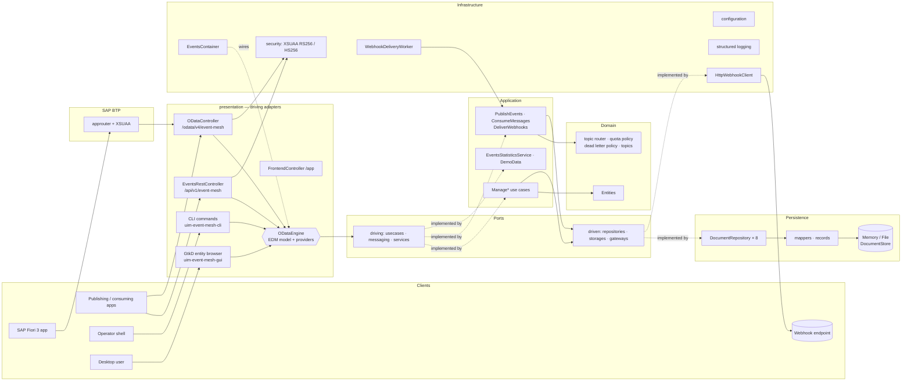
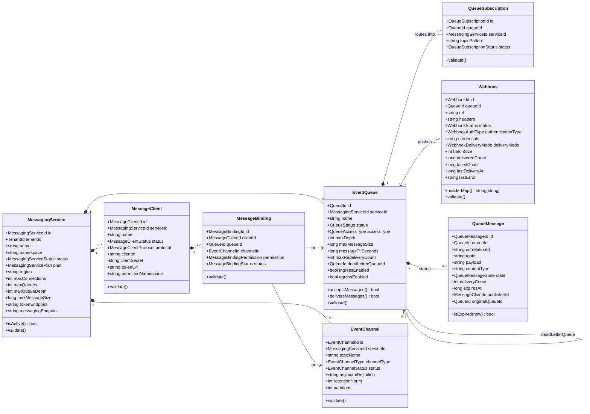
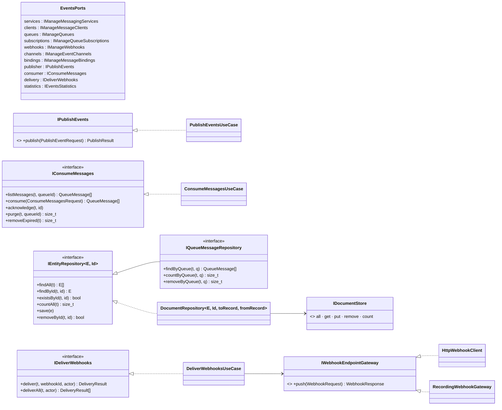
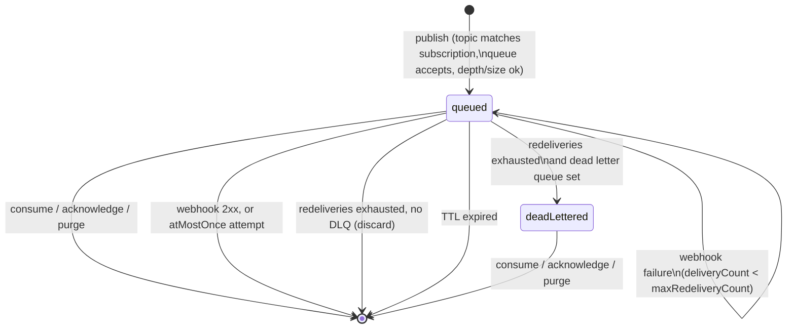
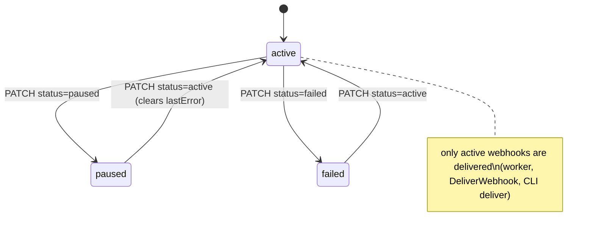
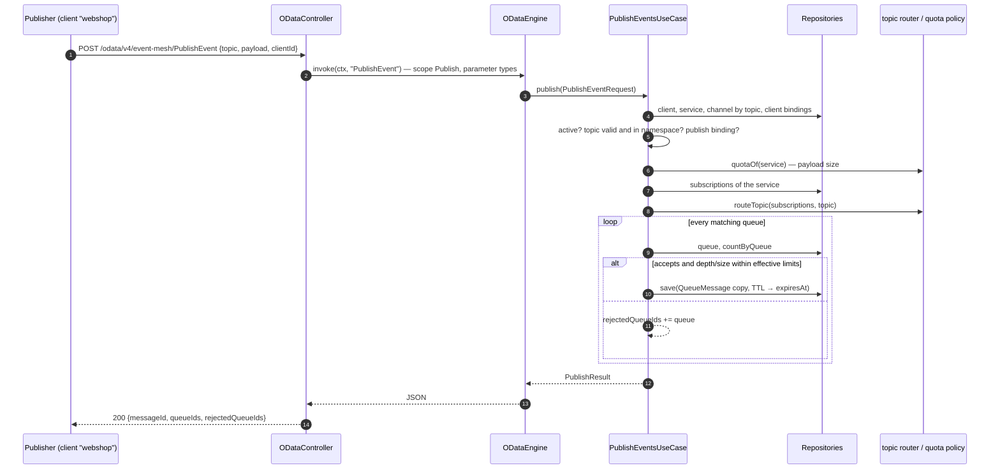
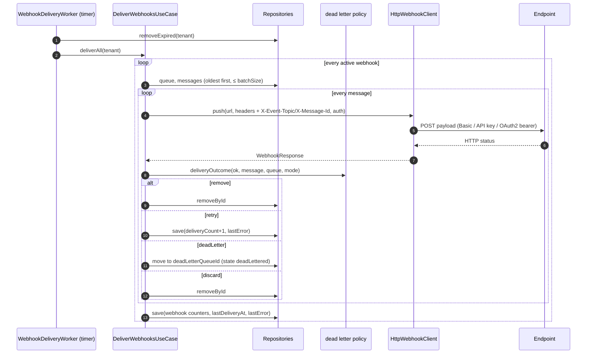

# UML — Event Mesh

These diagrams describe the 2.0 implementation in
`backend/source/uim/platform/events/`.

## Component diagram (hexagonal architecture)



Dependencies point inwards: `presentation → ports → application → domain`.
`persistence` and `infrastructure.clients` implement driven ports. Only
`EventsContainer`, the composition root, knows the concrete classes.

## Domain class diagram



Every entity mixes in `TenantEntity` (`tenantId`, `createdAt/By`,
`updatedAt/By`).

### Enumerations and domain services

```mermaid
classDiagram
  class MessagingServicePlan { <<enum>> dev standard premium }
  class QueueAccessType { <<enum>> exclusive nonExclusive }
  class WebhookAuthType { <<enum>> none basic oauth2 apiKey }
  class WebhookDeliveryMode { <<enum>> atLeastOnce atMostOnce }
  class MessageBindingPermission { <<enum>> publish subscribe publishSubscribe manage }
  class QueueMessageState { <<enum>> queued deadLettered }
  class DeliveryOutcome { <<enum>> remove retry deadLetter discard }

  class topics {
    <<module>>
    +isValidNamespace(ns) bool
    +isValidTopic(topic) bool
    +isValidTopicPattern(pattern) bool
    +isInNamespace(topic, ns) bool
    +isPatternInNamespace(pattern, ns) bool
    +topicMatches(pattern, topic) bool
  }
  class topic_router { <<module>> +routeTopic(subscriptions, topic) QueueId[] }
  class quota_policy {
    <<module>>
    +planDefaults(plan) ServiceQuota
    +quotaOf(service) ServiceQuota
    +effectiveDepth(queue, service) int
    +effectiveMessageSize(queue, service) long
  }
  class dead_letter_policy { <<module>> +deliveryOutcome(ok, message, queue, mode) DeliveryOutcome }
  class EventsException {
    +EventsErrorKind kind
    invalid · notFound · conflict · ruleViolation · quotaExceeded · gateway
  }
```



| Plan | Clients | Queues | Queue depth | Message size |
|---|---|---|---|---|
| dev | 10 | 10 | 1 000 | 64 KB |
| standard | 100 | 100 | 100 000 | 1 MB |
| premium | 1 000 | 1 000 | 1 000 000 | 10 MB |

## Ports and application



The seven `Manage*UseCase` classes follow the same pattern: `list`, `get`,
`create` (validation, references, uniqueness, quotas), `update` (PATCH
semantics through `Patch!T`) and `delete` (dependency checks and cascades).

## State machines

### Queue message



### Webhook



## Sequence: publish an event (OData)



## Sequence: webhook delivery with redelivery and dead-lettering



## Deployment diagram

```mermaid
flowchart TB
  subgraph CF[SAP BTP Cloud Foundry space]
    AR[event-mesh-approuter\n@sap/approuter + Fiori resources]
    SRV[event-mesh-srv\nbinary_buildpack\nuim-event-mesh-platform-service]
    UAA[(event-mesh-xsuaa\nxsuaa / application)]
    CFG[(event-mesh-config\nuser-provided)]
  end
  Browser((Browser)) -->|HTTPS| AR
  AR -->|destination event-mesh-srv\nforwardAuthToken| SRV
  AR -.-> UAA
  SRV -.VCAP_SERVICES.-> UAA
  SRV -.VCAP_SERVICES.-> CFG
  SRV -->|HTTPS push| EXT[(Webhook endpoints)]

  subgraph K8s[Kubernetes namespace uim-platform]
    POD[Deployment uim-event-mesh\n1 replica, /data volume]
    SVCK[Service uim-event-mesh :8109]
  end
  SVCK --> POD
```
