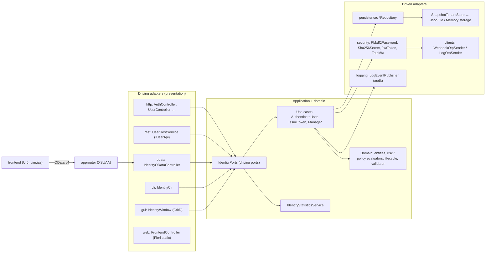
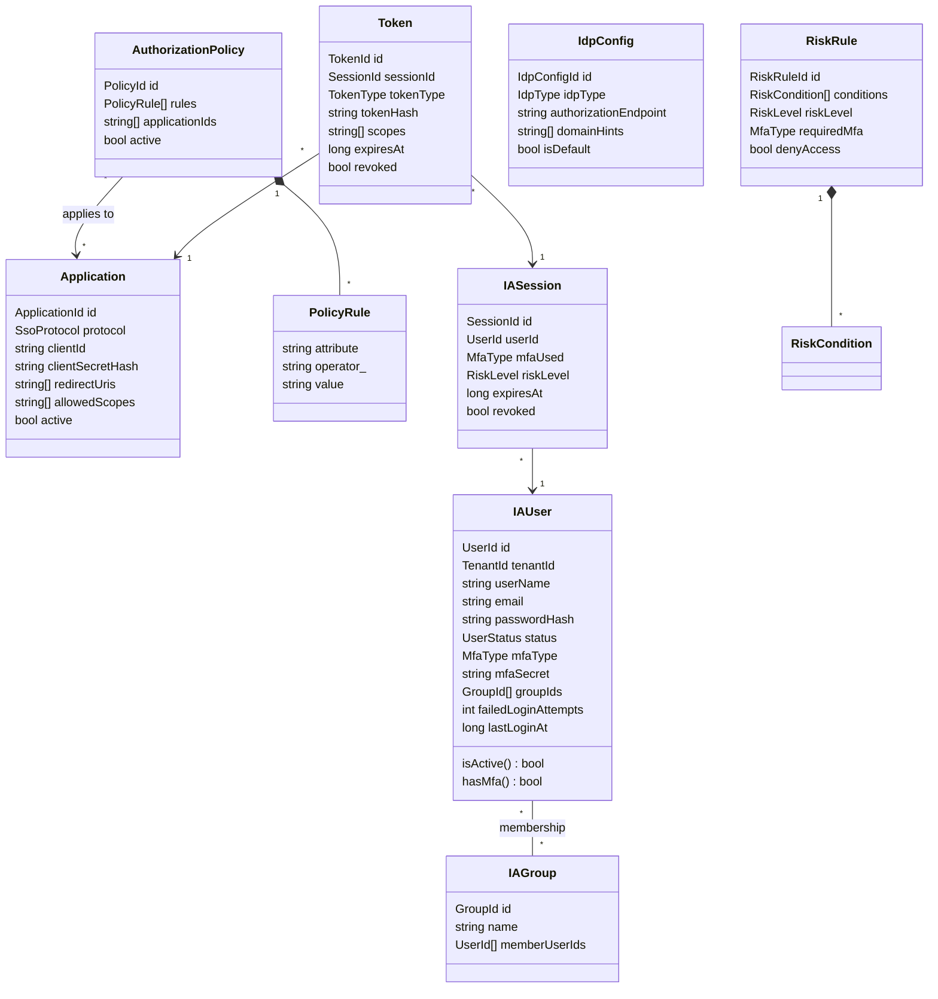
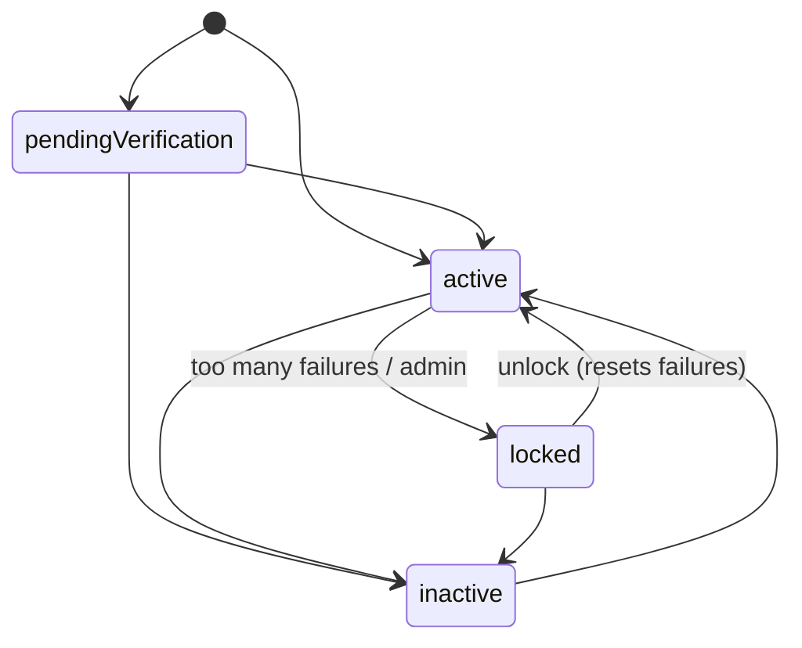
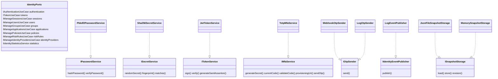

# UML — Identity Authentication Service

## Components (hexagonal architecture)



## Domain model



User status lifecycle (`domain/services/lifecycle.d`):



## Ports



## Login and token flow

```mermaid
sequenceDiagram
  participant C as Client
  participant A as AuthenticateUserUseCase
  participant R as RiskRules
  participant M as IMfaService
  participant T as IssueTokenUseCase
  participant P as Policies
  C->>A: login(email, password, mfaCode?)
  A->>A: find user, check status, verify PBKDF2 hash
  A->>R: assessRisk(rules, user, ip / agent / groups)
  alt denied
    A-->>C: 403
  else second factor needed, no code
    A->>M: sendOtp (SMS / e-mail)
    A-->>C: 401 mfaRequired
  else ok
    A->>M: validateCode (TOTP)
    A-->>C: sessionId
  end
  C->>T: token(sessionId, client_id, client_secret, scope)
  T->>T: session active? client secret fingerprint? scopes allowed?
  T->>P: findDenyingPolicies(app policies, user)
  T-->>C: access / refresh / id token (JWT, stored as SHA-256)
  C->>T: refresh_token
  T->>T: rotate (old refresh token revoked); reuse ⇒ revoke session
```
