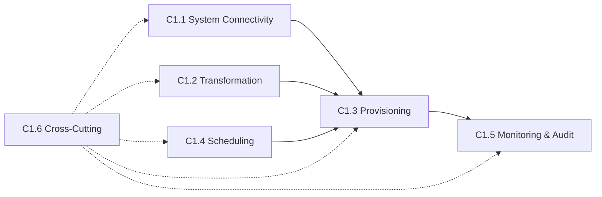

# NAF v4 Architecture Description — Identity Provisioning Service

> NATO Architecture Framework v4 (NAF v4) description of the UIM Platform
> Identity Provisioning Service — synchronisation of users and groups from
> source systems into target systems with transformations, scheduled jobs,
> delta state and an audit log. Implementation: D / vibe.d backend (REST,
> OData v4, CLI, GtkD GUI), SAP Fiori 3 frontend, SAP approuter / XSUAA.

---

## 1. NAF v4 Grid Mapping

| NAF View | Viewpoints | Section |
|---|---|---|
| **NCV** – Capability View | C1 Capability Taxonomy, C2 Enterprise Vision, C3 Capability Dependencies | §2 |
| **NSV** – Service View | NSOV-1 Service Taxonomy, NSOV-2 Service Definitions, NSOV-3 Service Interfaces | §3 |
| **NOV** – Operational View | NOV-1 Concept, NOV-2 Node Connectivity, NOV-5 Operational Activities | §4 |
| **NLV** – Logical View | NLV-1 Logical Data Model, NLV-2 Logical Components, NLV-6 State Transitions | §5 |
| **NPV** – Physical View | NPV-1 Physical Deployment, NPV-2 Configuration | §6 |
| **NIV** – Information View | NIV-1 Information Structure, NIV-2 Business Rules | §7 |
| Architecture Decisions | AD-1 … AD-12 | §8 |
| Traceability | capability → service → component | §9 |

---

## 2. Capability View (NCV)

### C1 – Capability Taxonomy

```
Identity Provisioning
├── C1.1  System Connectivity
│   ├── C1.1.1  Source systems (SuccessFactors, SAP HCM, LDAP, Entra ID, CSV, IAS, SCIM)
│   ├── C1.1.2  Target systems (IAS, SCIM applications, LDAP, SuccessFactors, Entra ID)
│   ├── C1.1.3  Proxy systems (SCIM bridge for an external IdM)
│   ├── C1.1.4  Connector catalogue (role support, URL schemes, authentication)
│   └── C1.1.5  Connection test and activation
│
├── C1.2  Transformation
│   ├── C1.2.1  Attribute mappings (functions, defaults, constants, mandatory attributes)
│   ├── C1.2.2  Entity filters (conditions)
│   ├── C1.2.3  Read / write chaining by sequence and entity scope
│   └── C1.2.4  Preview against sample attributes
│
├── C1.3  Provisioning
│   ├── C1.3.1  Full, delta and simulated runs
│   ├── C1.3.2  Delta state with attribute checksums, deletion of vanished entities
│   ├── C1.3.3  Per-entity error isolation and retry on the next run
│   └── C1.3.4  Delta reset
│
├── C1.4  Scheduling
│   ├── C1.4.1  Interval-based job scheduling
│   └── C1.4.2  Cancel / resume
│
├── C1.5  Monitoring & Audit
│   ├── C1.5.1  Immutable operation log per run
│   ├── C1.5.2  Provisioned entities per target
│   ├── C1.5.3  Tenant KPIs (statistics)
│   └── C1.5.4  Log retention / purge
│
└── C1.6  Cross-Cutting
    ├── C1.6.1  Multi-tenancy (XSUAA zone / X-Tenant-Id)
    ├── C1.6.2  Role-based access (viewer, operator, administrator)
    ├── C1.6.3  Secret masking
    ├── C1.6.4  Multi-channel access (Fiori, REST, OData, CLI, desktop)
    └── C1.6.5  Health monitoring
```

### C2 – Enterprise Vision

| Aspect | Description |
|---|---|
| **Mission** | Provide identity provisioning modelled on SAP Cloud Identity Services — Identity Provisioning for the UIM Platform on SAP BTP and Kubernetes. |
| **Vision** | Joiners, movers and leavers in HR and directories reach every connected application automatically, traceably and without manual account maintenance. |
| **Scope** | System configuration, transformations, provisioning runs (full / delta / simulate), scheduling, delta state, audit log, statistics. |
| **Out of scope** | Authentication of end users (IAS), authorization management of the target applications, real connector protocols (pluggable behind `IIdentityConnector`). |
| **Stakeholders** | Identity administrators, IT operations, security officers / auditors, HR IT, application owners. |

### C3 – Capability Dependencies



---

## 3. Service View (NSV)

### NSOV-1 – Service Taxonomy

| Group | Services |
|---|---|
| Configuration services | SVC-SRC, SVC-TGT, SVC-PRX, SVC-TRF, SVC-JOB (maintain) |
| Operation services | SVC-SYS-TEST, SVC-SYS-ACT, SVC-JOB-RUN, SVC-JOB-SCHED, SVC-JOB-RESET, SVC-TRF-PREV |
| Information services | SVC-ENT, SVC-LOG, SVC-STAT, SVC-CAT, SVC-HLTH |
| Housekeeping | SVC-LOG-PURGE, SVC-DEMO |

### NSOV-2 – Service Definitions

| Service ID | Name | REST (`/api/v1`) | OData v4 | CLI |
|---|---|---|---|---|
| SVC-SRC | Source systems | `source-systems` CRUD | `SourceSystems` | `source-systems …` |
| SVC-TGT | Target systems | `target-systems` CRUD | `TargetSystems` | `target-systems …` |
| SVC-PRX | Proxy systems | `proxy-systems` CRUD | `ProxySystems` | `proxy-systems …` |
| SVC-SYS-TEST | Connection test | `…/{id}/test-connection` | `TestConnection<Type>` | `… test-connection <name>` |
| SVC-SYS-ACT | Activate / deactivate | `…/{id}/activate`, `…/deactivate` | `Activate<Type>`, `Deactivate<Type>` | `… activate <name>` |
| SVC-TRF | Transformations | `transformations` CRUD, `activate`, `deactivate` | `Transformations` | `transformations …` |
| SVC-TRF-PREV | Transformation preview | `POST transformations/{id}/preview` | `PreviewTransformation` | `preview <name> --attributes=…` |
| SVC-JOB | Jobs | `provisioning-jobs` CRUD | `ProvisioningJobs` | `provisioning-jobs …` |
| SVC-JOB-RUN | Run job | `…/{id}/run` (old: `run/{id}`) | `RunProvisioningJob` | `run <job>` |
| SVC-JOB-SCHED | Scheduler / due jobs | `POST run-due-jobs`, `…/cancel`, `…/resume` | `RunDueJobs`, `Cancel…`, `Resume…` | `run-due-jobs` |
| SVC-JOB-RESET | Delta reset | `…/{id}/reset` | `ResetProvisioningJob` | `provisioning-jobs reset <job>` |
| SVC-ENT | Provisioned entities | `provisioned-entities` (read) | `ProvisionedEntities` | `provisioned-entities list` |
| SVC-LOG | Audit log | `provisioning-logs` (read) | `ProvisioningLogs` | `logs <job>` |
| SVC-LOG-PURGE | Purge log | `POST provisioning-logs/purge` | `PurgeLogs` | `purge-logs` |
| SVC-STAT | Statistics | `statistics` (`monitoring`) | `Statistics` singleton | `stats` |
| SVC-CAT | Connector catalogue | `system-types` (read) | `SystemTypes` | `system-types list` |
| SVC-DEMO | Demo landscape | `POST demo` | — | `demo` |
| SVC-HLTH | Health check | `GET health` | — | — |

### NSOV-3 – Service Interfaces

| Interface | Protocol / format | Consumer | Security |
|---|---|---|---|
| OData v4 | HTTP/JSON, CSDL `$metadata`, `$filter/$orderby/$select/$top/$skip/$count/$search`, unbound actions | Fiori app | XSUAA via approuter, CSRF |
| REST | HTTP/JSON, `{items, count}`, `{error: {code, message}}` | automation, CI | XSUAA via approuter |
| CLI | process, text tables or `--json` | operators | OS access to the data directory |
| Desktop GUI | GTK 3 | local administrators | OS access to the data directory |
| `IIdentityConnector` (driven) | connector specific (SCIM, LDAP, Graph, OData) | provisioning runner | system credentials (masked) |
| `IProvisioningEventPublisher` (driven) | topics `provisioning.<aggregate>.<verb>` | event broker / log | — |

---

## 4. Operational View (NOV)

### NOV-1 – Concept

HR remains the leading system: new employees, department changes and leavers are
read periodically, transformed into each target's schema and written to the target
applications. Administrators configure systems and rules in the Fiori app;
operators run and monitor jobs; auditors read the log.

### NOV-2 – Operational Node Connectivity

```
┌──────────────┐  Fiori / OData   ┌────────────┐   REST/OData + JWT   ┌──────────────────────────────┐
│ Administrator│ ───────────────> │ Approuter  │ ───────────────────> │ Identity Provisioning service │
│ Operator     │                  │ (XSUAA)    │                      │ (port 8093)                   │
│ Auditor      │                  └────────────┘                      │  ├─ scheduler (timer)         │
└──────────────┘                                                      │  └─ JSON snapshot store       │
┌──────────────┐  CLI / GtkD (shared data directory) ───────────────> │                               │
│ Operator     │                                                      └──────┬──────────────┬────────┘
└──────────────┘                                                             │ read          │ write
                                                        ┌────────────────────┴──┐   ┌────────┴─────────────────┐
                                                        │ Source systems        │   │ Target systems            │
                                                        │ SuccessFactors, HCM,  │   │ IAS, SCIM apps, LDAP,     │
                                                        │ LDAP, Entra ID, CSV   │   │ Entra ID, SuccessFactors  │
                                                        └───────────────────────┘   └───────────────────────────┘
```

### NOV-5 – Operational Activities

| # | Activity | Actor | Service |
|---|---|---|---|
| A1 | Register source and target systems with credentials | Administrator | SVC-SRC, SVC-TGT |
| A2 | Test and activate connections | Administrator / Operator | SVC-SYS-TEST, SVC-SYS-ACT |
| A3 | Define read and write transformations, preview them | Administrator | SVC-TRF, SVC-TRF-PREV |
| A4 | Create a job (type, interval) and simulate it | Administrator | SVC-JOB, SVC-JOB-RUN |
| A5 | Run on demand or let the scheduler run it | Operator / scheduler | SVC-JOB-RUN, SVC-JOB-SCHED |
| A6 | Analyse failed entities, fix data or rules, re-run | Operator | SVC-LOG, SVC-ENT |
| A7 | Reset delta after major changes | Administrator | SVC-JOB-RESET |
| A8 | Review KPIs and audit trail, purge old entries | Auditor / Operator | SVC-STAT, SVC-LOG, SVC-LOG-PURGE |

---

## 5. Logical View (NLV)

### NLV-1 – Logical Data Model

| Entity | Key attributes | Relationships |
|---|---|---|
| `SourceSystem` | name, systemType, url, authenticationType, user, password*, properties, status | read by jobs; owns read transformations |
| `TargetSystem` | same | written by jobs; owns write transformations; holds provisioned entities |
| `ProxySystem` | same | owns proxy transformations |
| `Transformation` | systemRole, systemId, scope, sequence, active, mappings[], conditions[] | belongs to one system |
| `ProvisioningJob` | sourceSystemId, targetSystemId, jobType, status, intervalMinutes, nextRunAt, run figures | produces logs; maintains provisioned entities |
| `ProvisionedEntity` | entityType, externalId, targetId, attributes[], checksum, status | per (source, target, externalId) |
| `ProvisioningLog` | jobId, runNumber, operation, entityType, entityName, status, message | immutable |
| `SystemType` | id, role support, URL pattern, default authentication | reference data |

(*) secret — stored, never returned.

### NLV-2 – Logical Components

| Component | Layer | Responsibility |
|---|---|---|
| Domain entities, value types, enumerations, exceptions | domain | business vocabulary, invariants |
| `transformer`, `planner`, `systems`, `catalog`, `lifecycle`, `names` | domain services | pure rules: mapping, filtering, delta planning, validation, state rules |
| Driving ports (`ProvisioningPorts`) | ports | use-case contracts for all adapters |
| Driven ports (repositories, `ISnapshotStorage`, `IIdentityConnector`, publisher) | ports | persistence, connectors, events |
| `ManageSystemsUseCase` ×3, `ManageTransformationsUseCase`, `ManageProvisioningJobsUseCase`, queries | application | orchestration, uniqueness, dependencies |
| `ProvisioningRunner` | application | executes a run, batches writes |
| `ProvisioningStatisticsService`, `SystemCatalogService`, `DemoDataSeeder`, `EventRecorder` | application | read models, reference data, seeding, events |
| Repositories, `SnapshotTenantStore`, JSON / memory storages, record mapper | persistence | tenant-scoped storage shared by processes |
| `ProvisioningConfig`, `Container`, `JobScheduler`, `SimulatedIdentityConnector`, identity resolution, logging | infrastructure | configuration, wiring, background work, connector, security |
| `ResourceRegistry` + REST, OData, CLI, GtkD, web adapters | presentation | protocol translation only |
| Fiori app (views, controllers, i18n, tests) | frontend | user interface over OData v4 |
| Approuter | edge | login, routing, CSRF, scopes |

### NLV-6 – State Transitions

| Aggregate | States | Transitions |
|---|---|---|
| System | configuring → active / error ⇄ inactive | activate (test), test-connection, deactivate, connection change → configuring |
| Job | scheduled → running → completed / failed; any idle → cancelled → scheduled | run / scheduler, cancel, resume |
| Provisioned entity | pending → active / inactive / error | write OK (`active=false` → inactive), write failed → error, deleted when vanished |
| Log entry | — | immutable; removed only by purge / retention |

---

## 6. Physical View (NPV)

### NPV-1 – Physical Deployment

| Target | Artefacts |
|---|---|
| SAP BTP Cloud Foundry (`mta.yaml`) | `identity-provisioning-srv` (binary buildpack, 256 MB, health check `/api/v1/health`), `identity-provisioning-approuter` (Node.js, Fiori app in `resources/`), `identity-provisioning-xsuaa` (application plan, 3 role templates), `identity-provisioning-config` (user-provided overrides) |
| Kubernetes (`k8s/`) | ConfigMap `identity-provisioning-config`, Deployment (non-root, read-only root FS, `/app/data` volume), Service `ClusterIP :8093` |
| Container (`backend/Containerfile`) | LDC build stage → Ubuntu runtime with server, CLI, default config and Fiori app |
| Workstation | `uim-identity-provisioning-platform-service`, `uim-ips-cli`, `uim-ips-gui` sharing one data directory |

### NPV-2 – Configuration

| Setting | Source (lowest → highest) | Default |
|---|---|---|
| host / port | defaults → `config/default.json` → `IPS_HOST` / `IPS_PORT`, `PORT` → VCAP | `0.0.0.0` / `8093` |
| storage / dataDir | … `IPS_STORAGE`, `IPS_DATA_DIR` | `file` / `data` |
| REST / OData roots | … `IPS_REST_PATH`, `IPS_ODATA_PATH` | `/api/v1`, `/odata/v4/identity-provisioning` |
| scheduler | … `IPS_SCHEDULER_INTERVAL`, `IPS_SCHEDULER_TENANTS` | 30 s, `default` |
| log retention | … `IPS_LOG_RETENTION_DAYS` | 30 days |
| demo data | … `IPS_DEMO_DATA` | off (on in local `default.json`, off in MTA / k8s) |
| Fiori dev serving | … `IPS_FRONTEND_DIR` | `../frontend` (off on CF) |

---

## 7. Information View (NIV)

### NIV-1 – Information Structure

| Collection (snapshot file) | Content | Classification |
|---|---|---|
| `ips_source_systems.json`, `ips_target_systems.json`, `ips_proxy_systems.json` | connection settings incl. credentials | **confidential** (secrets) |
| `ips_transformations.json` | mappings, conditions | internal |
| `ips_jobs.json` | job configuration and last-run figures | internal |
| `ips_provisioned_entities.json` | personal data as written to targets (names, e-mail, department, employee number) | **personal data (GDPR)** |
| `ips_logs.json` | operations per entity with user names | personal data, audit |

Each file is an envelope `{schemaVersion, collection, records[]}`; timestamps are
std-time numbers in records and ISO 8601 (`Edm.DateTimeOffset`) on all interfaces.

### NIV-2 – Business Rules

| ID | Rule |
|---|---|
| BR-01 | System names are unique per role and tenant; transformation and job names are unique per tenant. |
| BR-02 | A system type must support the role (catalogue); CSV and SAP HCM are source-only. |
| BR-03 | URL scheme per type (`https://`, `ldap(s)://`, `file://`); basic / OAuth need a user or client id. |
| BR-04 | Activation requires a successful connection test; a failed test sets status `error`. |
| BR-05 | Changing type, URL, authentication, user or password of an active system requires a new test. |
| BR-06 | Jobs run only with active source and target systems; running jobs cannot be changed, reset or deleted. |
| BR-07 | Transformations run in sequence order, read side before write side; a false condition skips, an empty mandatory mapping fails the entity. |
| BR-08 | Delta runs skip entities with unchanged checksum and retry failed ones; full runs update all; both delete vanished entities; simulations change nothing. |
| BR-09 | A connector error affects only its entity; a read error fails the whole run. |
| BR-10 | Systems referenced by jobs or transformations cannot be deleted. |
| BR-11 | Secrets are never returned; the mask `********` sent back keeps the stored value. |
| BR-12 | Log entries are immutable; the scheduler purges entries older than the retention period. |

---

## 8. Architecture Decisions

| ID | Decision | Rationale |
|---|---|---|
| AD-1 | Hexagonal architecture with `domain / ports / application / persistence / infrastructure / presentation` | layer separation required by the Fiori / vibe.d architecture; testable core |
| AD-2 | Source / target / proxy abstraction with a connector catalogue | mirrors the SAP IPS connector model |
| AD-3 | Pure transformer and planner functions | deterministic, unit-testable delta logic |
| AD-4 | Delta state as provisioned entities with attribute checksums | cheap repeated runs, deletions, retry of failures |
| AD-5 | Connectors behind `IIdentityConnector`, simulated implementation by default | runs without external systems; real protocols added without core changes |
| AD-6 | One `ResourceRegistry` for REST, OData, CLI and GUI, fields by compile-time reflection | one place to describe resources; identical behaviour on all channels |
| AD-7 | Generated OData v4 `$metadata`, unbound actions, `$direct` group | Fiori compatibility without a CAP runtime |
| AD-8 | JSON snapshot storage with revision check and atomic writes | shared by server, CLI and GUI without a database; swappable via `ISnapshotStorage` |
| AD-9 | Batched persistence per run | one write per collection instead of one per entity |
| AD-10 | Interval scheduling in-process (vibe.d timer) | no external scheduler needed; `run-due-jobs` for external triggers |
| AD-11 | Approuter + XSUAA, viewer / operator / administrator scopes | standard BTP security; backend trusts forwarded claims only |
| AD-12 | Port 8093, env prefix `IPS_` | UIM platform port allocation; previous variable names |

---

## 9. Traceability Matrix

| Capability | Services | Components |
|---|---|---|
| C1.1 System Connectivity | SVC-SRC, SVC-TGT, SVC-PRX, SVC-SYS-TEST, SVC-SYS-ACT, SVC-CAT | `ManageSystemsUseCase`, `systems`, `catalog`, `IIdentityConnector.test` |
| C1.2 Transformation | SVC-TRF, SVC-TRF-PREV | `ManageTransformationsUseCase`, `transformer` |
| C1.3 Provisioning | SVC-JOB, SVC-JOB-RUN, SVC-JOB-RESET | `ManageProvisioningJobsUseCase`, `ProvisioningRunner`, `planner`, connector |
| C1.4 Scheduling | SVC-JOB-SCHED | `JobScheduler`, `lifecycle.isDue / nextRunAfter` |
| C1.5 Monitoring & Audit | SVC-ENT, SVC-LOG, SVC-STAT, SVC-LOG-PURGE | queries, `ProvisioningStatisticsService`, Fiori KPI header |
| C1.6 Cross-Cutting | SVC-HLTH, all | `resolveIdentity`, approuter / XSUAA, `ResourceAdapter.secret`, configuration |
