# UML — Identity Provisioning Service

Diagrams of the backend (`backend/source/uim/platform/identity_provisioning`), the
Fiori app and the deployment. Mermaid source; renders on GitHub and in most IDEs.

## Class Diagram — Domain Entities

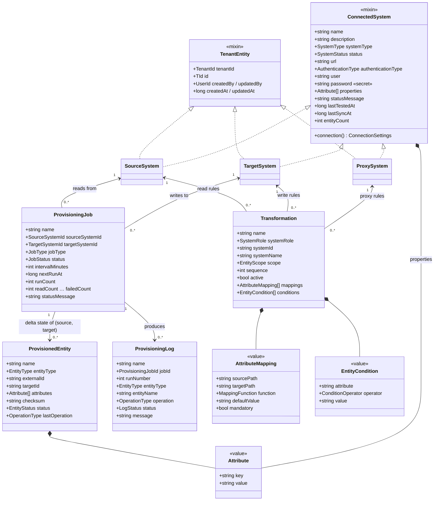

## Class Diagram — Enumerations

```mermaid
classDiagram
    class SystemType {
        <<enumeration>>
        ias
        ldap
        sapHr
        successFactors
        scim
        csv
        azureAd
        custom
    }
    class SystemStatus {
        <<enumeration>>
        configuring
        active
        inactive
        error
    }
    class SystemRole {
        <<enumeration>>
        source
        target
        proxy
    }
    class AuthenticationType {
        <<enumeration>>
        none
        basic
        oauth2ClientCredentials
        certificate
    }
    class JobType {
        <<enumeration>>
        full
        delta
        simulate
    }
    class JobStatus {
        <<enumeration>>
        scheduled
        running
        completed
        failed
        cancelled
    }
    class OperationType {
        <<enumeration>>
        create
        update
        delete
        skip
    }
    class LogStatus {
        <<enumeration>>
        success
        failed
        skipped
        simulated
    }
    class EntityType {
        <<enumeration>>
        user
        group
    }
    class EntityStatus {
        <<enumeration>>
        active
        inactive
        pending
        error
    }
    class EntityScope {
        <<enumeration>>
        all
        user
        group
    }
    class MappingFunction {
        <<enumeration>>
        none
        lowerCase
        upperCase
        trim
        constant
    }
    class ConditionOperator {
        <<enumeration>>
        equals
        notEquals
        contains
        startsWith
        endsWith
        present
        absent
    }
```

## Class Diagram — Domain and Application Services

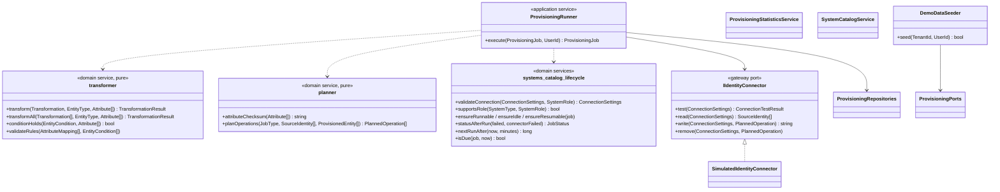

## State Diagram — System lifecycle

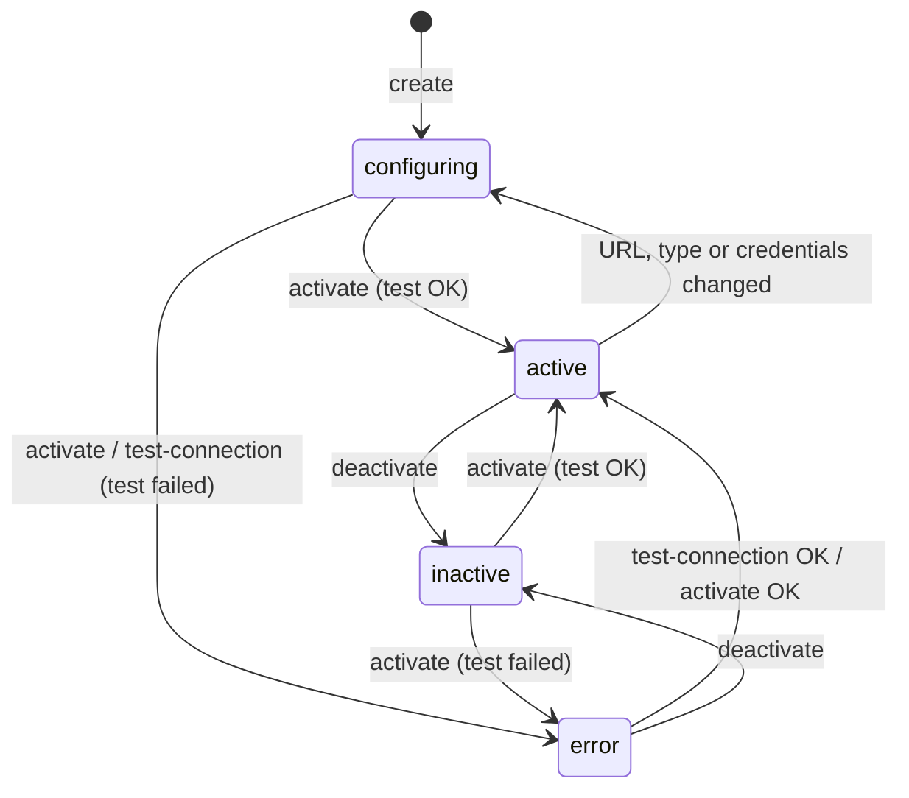

## State Diagram — Job lifecycle

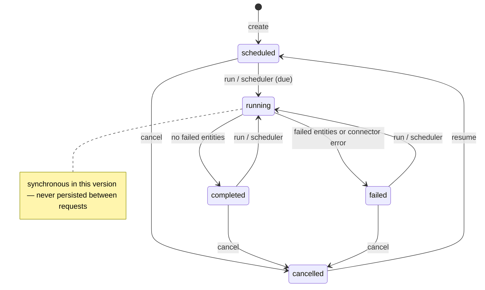

## Activity Diagram — Provisioning run (`ProvisioningRunner.execute`)

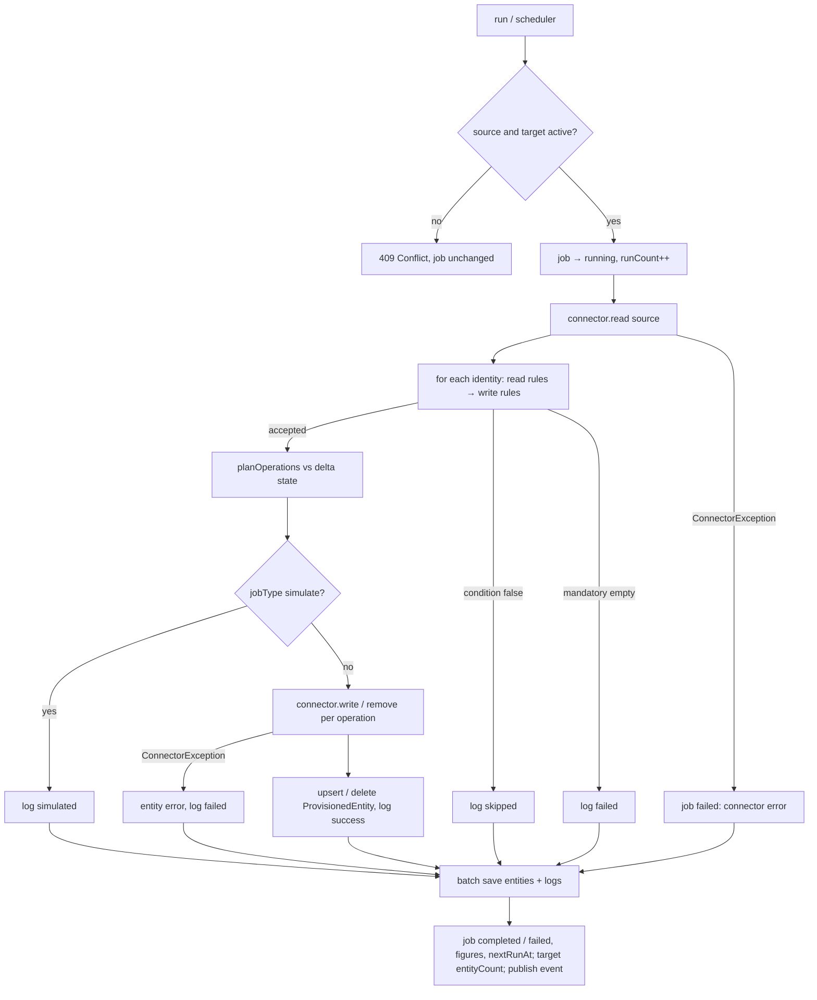

## Component Diagram — Hexagonal Architecture

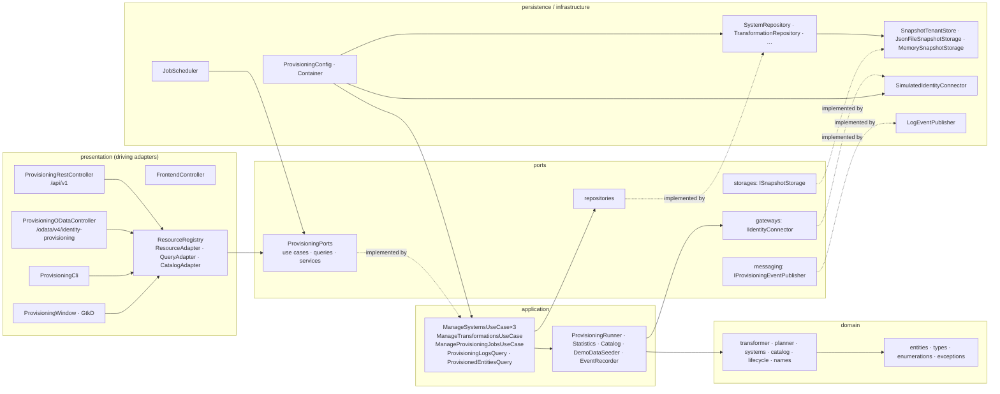

## Class Diagram — Generic use cases and adapters

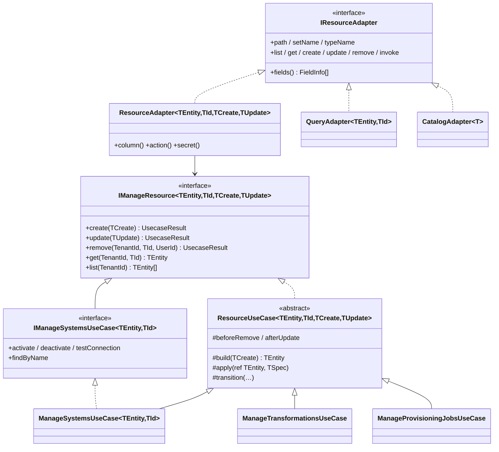

## Sequence Diagram — Fiori runs a job

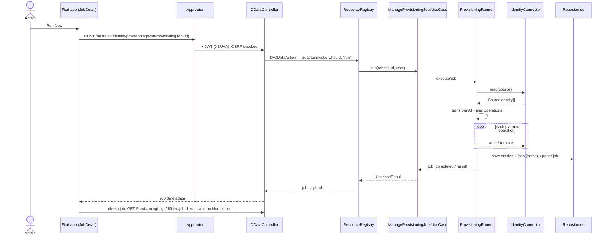

## Sequence Diagram — Scheduled delta run

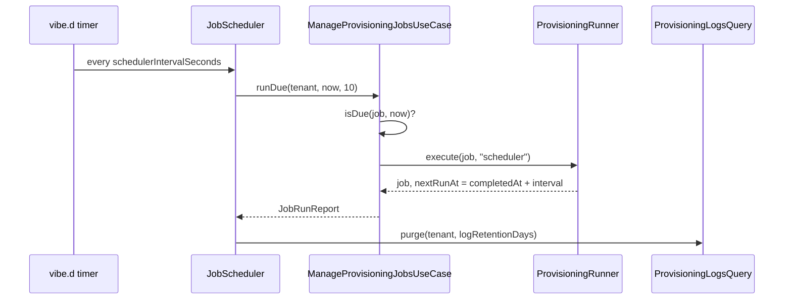

## Sequence Diagram — CLI and server share data

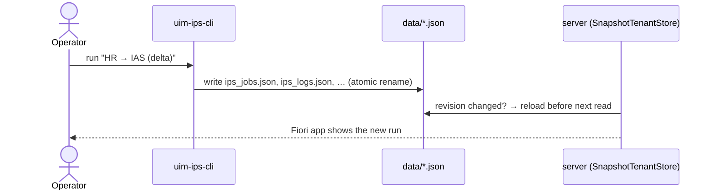

## Deployment Diagram — SAP BTP (Cloud Foundry)

```mermaid
flowchart TB
    U[Browser] -->|HTTPS| AR
    subgraph CF["Cloud Foundry space (mta.yaml)"]
        AR[identity-provisioning-approuter<br/>@sap/approuter · Fiori app in resources/]
        SRV[identity-provisioning-srv<br/>binary_buildpack · D/vibe.d]
        XS[(identity-provisioning-xsuaa)]
        CFG[(identity-provisioning-config<br/>user-provided)]
    end
    AR -->|destination identity-provisioning-srv<br/>forwardAuthToken| SRV
    AR --- XS
    SRV --- XS
    SRV --- CFG
    SRV -.connectors.-> EXT[(SuccessFactors · LDAP · IAS · SCIM · Entra ID)]
```
