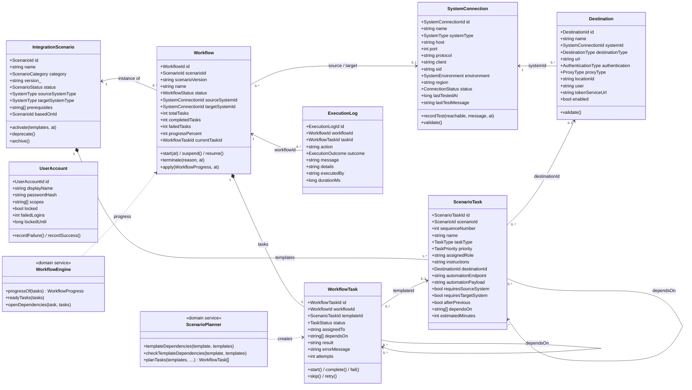
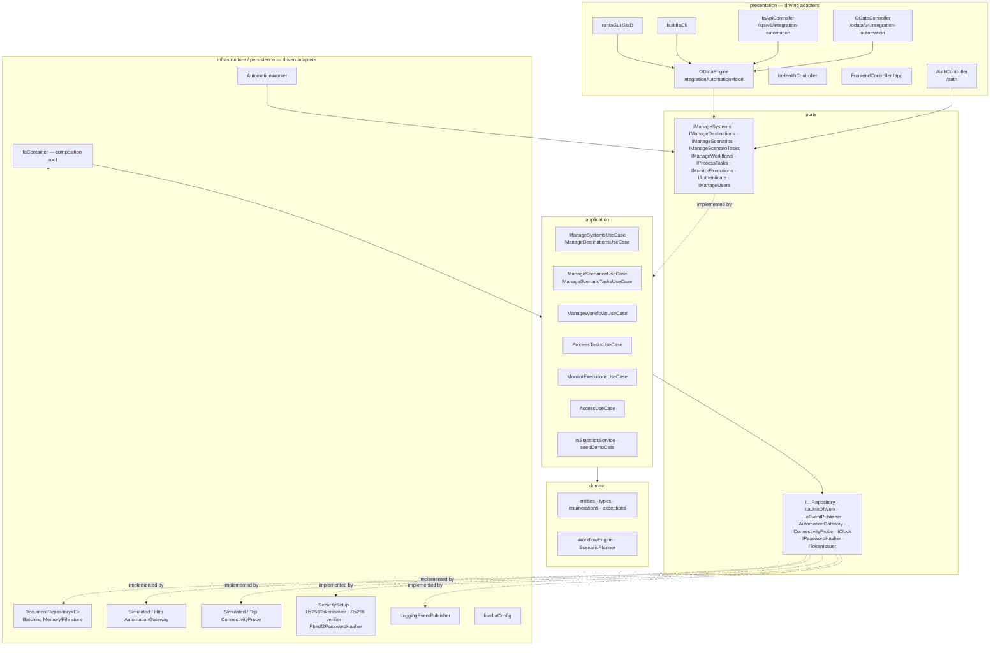
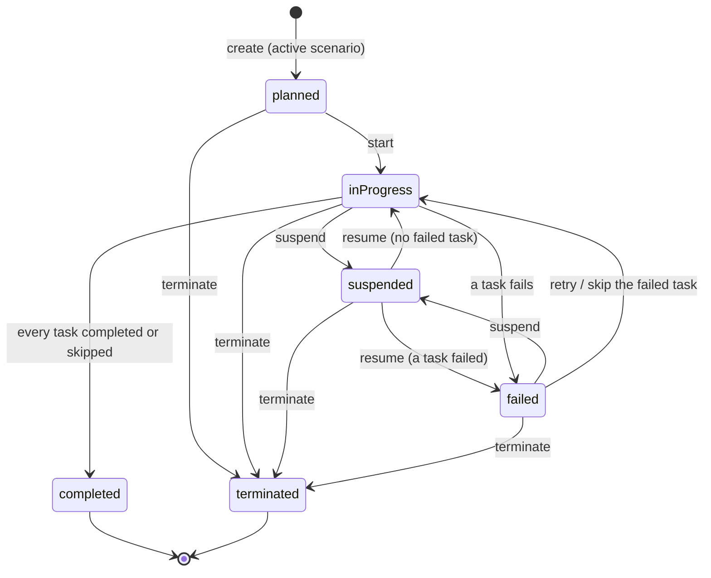
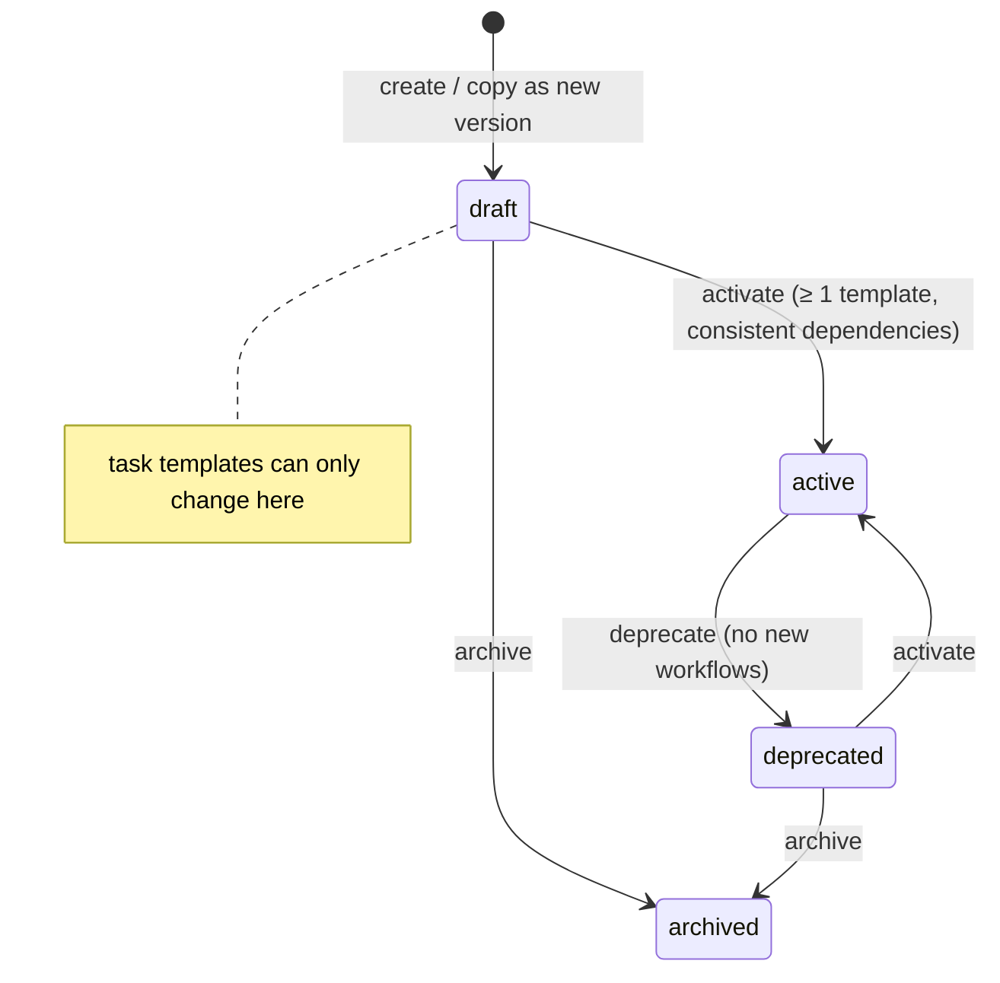
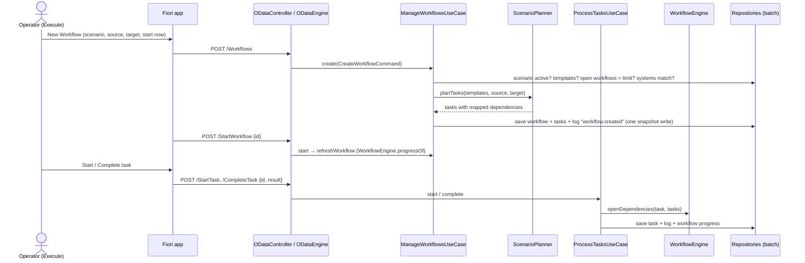
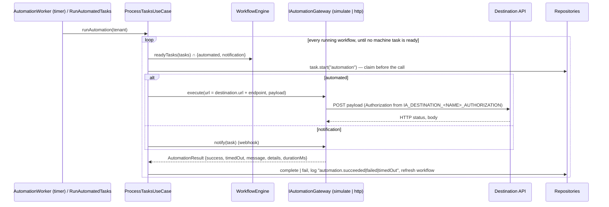

# UML — UIM Integration Automation

Diagrams of the redesigned service (backend 2.0). Mermaid renders them on GitHub/GitLab and in most Markdown viewers.

## 1. Domain model



Every entity mixes in `TenantEntity` (tenantId, id, createdAt/By, updatedAt/By). Enumerations are string valued
(`ScenarioStatus`, `ScenarioCategory`, `SystemType`, `SystemEnvironment`, `ConnectionStatus`, `DestinationType`,
`AuthenticationType`, `ProxyType`, `TaskType`, `TaskPriority`, `TaskStatus`, `WorkflowStatus`, `ExecutionOutcome`).

## 2. Hexagonal components



## 3. Workflow lifecycle



## 4. Task lifecycle

```mermaid
stateDiagram-v2
  [*] --> pending
  pending --> inProgress : start (dependencies done) / automation claims it
  inProgress --> completed : complete / approve / automation 2xx
  inProgress --> failed : fail / reject / automation error or timeout
  pending --> failed : fail
  failed --> pending : retry (attempts + 1 on next start)
  pending --> skipped : skip (reason; not approvals)
  failed --> skipped : skip (reason; not approvals)
  completed --> [*]
  skipped --> [*]
```



## 5. Scenario lifecycle



## 6. Sequence — instantiate and run a workflow



## 7. Sequence — automated task execution



## 8. Sequence — built-in login (authMode jwt)

```mermaid
sequenceDiagram
  actor U as User
  participant C as Component.js / session.js
  participant A as AuthController
  participant AC as AccessUseCase
  participant H as Pbkdf2PasswordHasher
  participant I as Hs256TokenIssuer
  C->>A: GET /auth/config
  A-->>C: {mode: "jwt", loginRequired: true}
  U->>C: user name, password (LoginDialog)
  C->>A: POST /auth/login
  A->>AC: login(LoginRequest)
  AC->>H: verify(password, hash)
  alt wrong / unknown / locked
    AC-->>A: unauthorized (failed login counted, lock after 5)
    A-->>C: 401
  else ok
    AC->>I: issue(tenant, user, scopes)
    A-->>C: {access_token, expires_in, scope "Read Execute …", user}
    C->>C: sessionStorage; ODataModel with Authorization header; buttons by scope
  end
  C->>A: OData / REST with Bearer token → verified (HS256), scopes enforced by ODataEngine
```

## 9. Deployment

```mermaid
flowchart LR
  B[Browser] -->|HTTPS| AR["approuter<br/>(Node.js, XSUAA login)"]
  AR -->|"/odata, /api, /auth (forwardAuthToken)"| BE["integration-automation-srv<br/>(D binary, binary_buildpack)"]
  AR -->|static| RES["resources/ (Fiori app)"]
  AR <--> XS[(XSUAA)]
  BE <--> XS
  BE --- CFG[(integration-automation-config<br/>user-provided)]
  BE --- FS[(data/integration-automation.json)]
  BE -->|automated tasks| APIs[(Destination APIs<br/>S/4HANA, SuccessFactors, BTP, …)]
  BE -->|connection tests| SYS[(Landscape systems)]
```


