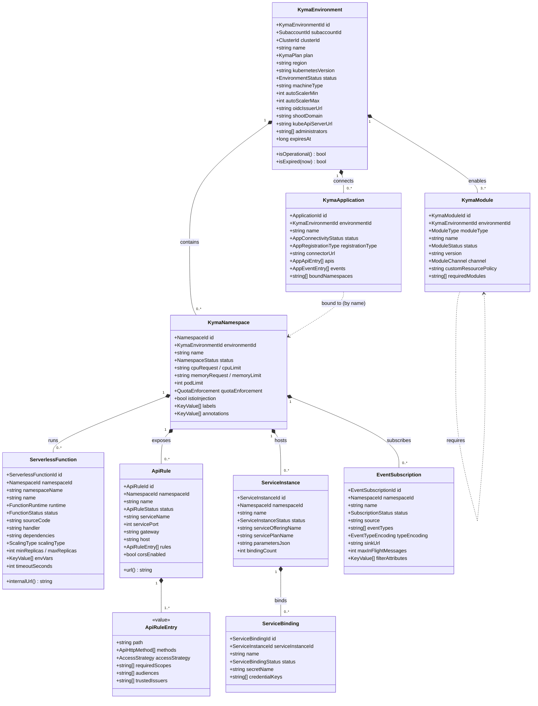
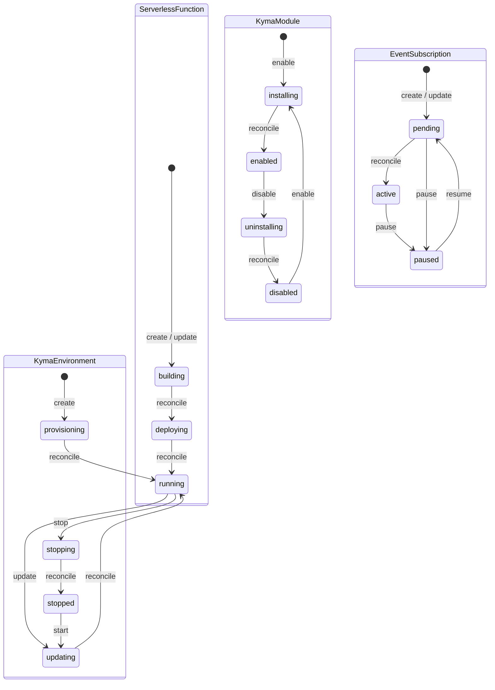
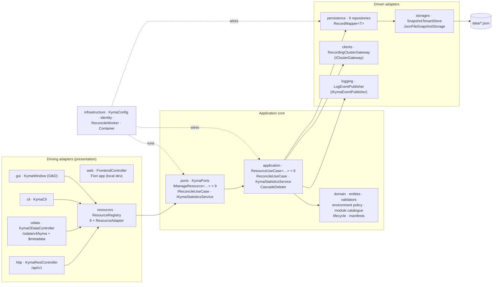
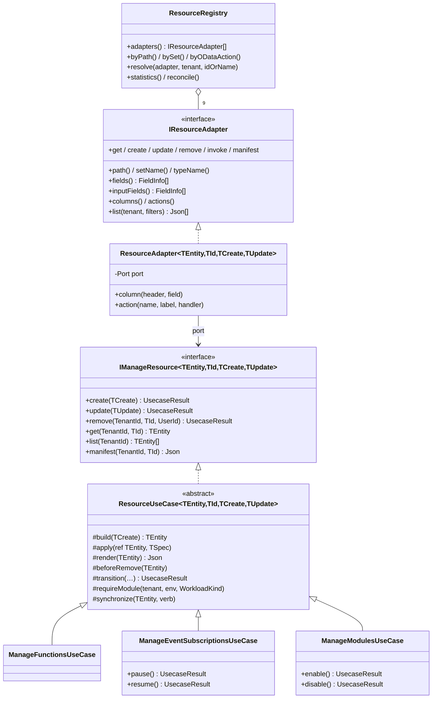
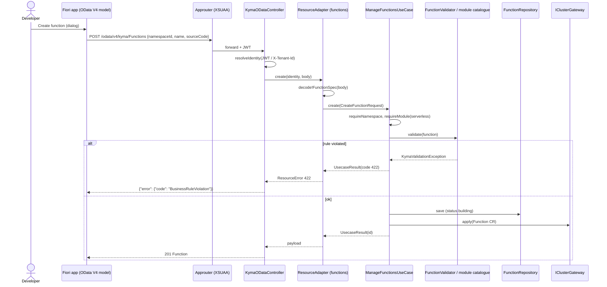
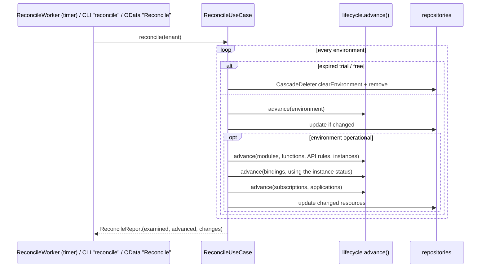
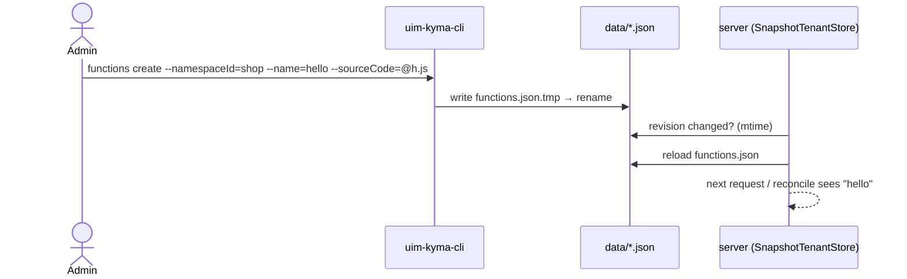
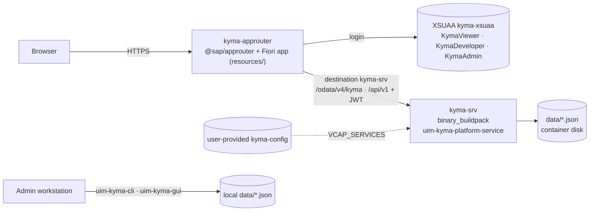

# UML — Kyma Runtime Service

Diagrams of the hexagonal backend (`backend/source/uim/platform/kyma`), the Fiori
frontend and the BTP deployment. All diagrams are Mermaid.

## Class Diagram — Domain Entities

All aggregates mix in `TenantEntity` (`tenantId`, `id`, `createdBy/At`, `updatedBy/At`).

`*--` marks cascading deletion: deleting an environment or namespace removes everything inside it.
A service instance with bindings cannot be deleted.

## State Diagram — Lifecycles driven by the reconciler

Further transitions: API rule `notReady → ok`, service instance `creating/updating → ready`,
service binding `creating → ready` once its instance is ready, application
`disconnected → pairing (connect) → connected`. Workloads only progress on an operational
runtime; expired trial/free runtimes are deleted by the reconciler.

## Component Diagram — Hexagonal Architecture

Dependencies point inwards: presentation knows only `KymaPorts`; use cases know only
port interfaces (`KymaRepositories`, `IClusterGateway`, `IKymaEventPublisher`).

## Class Diagram — Generic use cases and adapters

Payloads, records, `$metadata`, CLI tables and GUI forms are derived from the D structs by
`helpers/codec` (`encode`, `decode(json, base)`, `describe!T`, `assignMatching`).

## Sequence Diagram — Fiori creates a function

## Sequence Diagram — Reconciliation

## Sequence Diagram — CLI and server share data

## Deployment Diagram — SAP BTP (Cloud Foundry)

