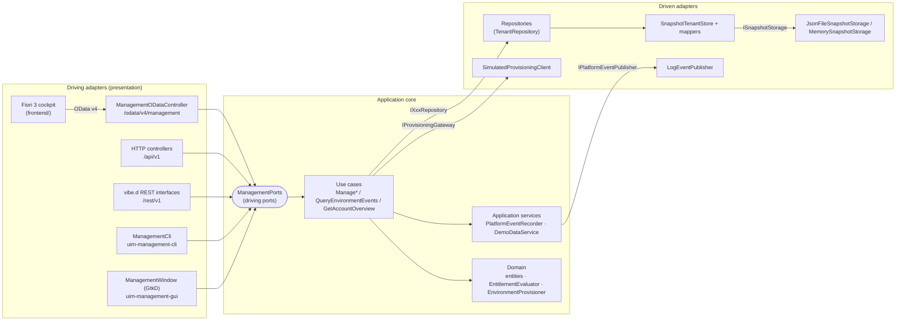
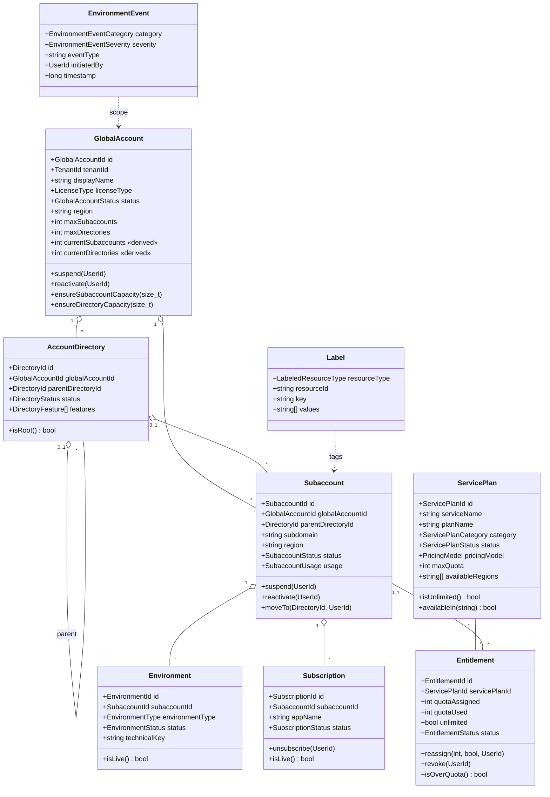
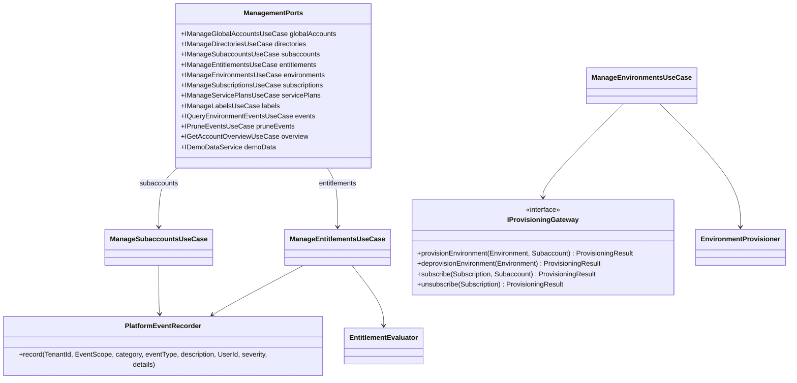
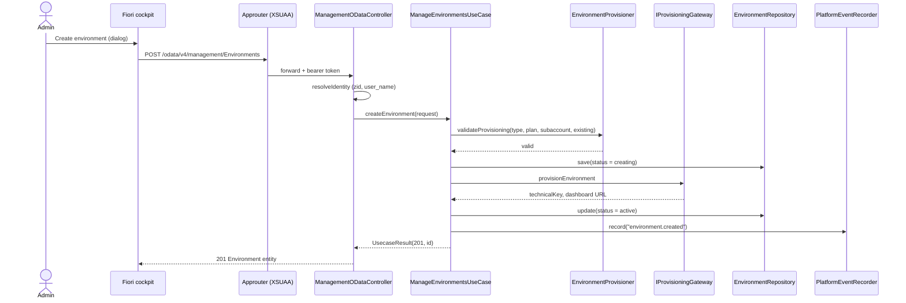
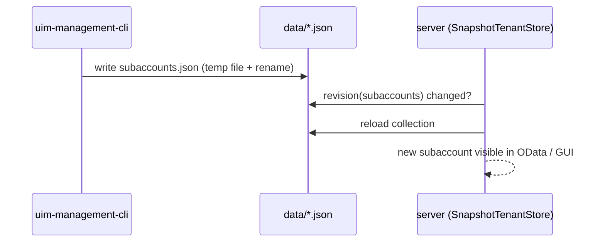

# UML — Cloud Management Service

Diagrams of the hexagonal architecture in `backend/source/uim/platform/management/`.

## Component diagram — ports and adapters

The container (`infrastructure/container.d`) is the only place that knows
concrete classes. Server, CLI and GUI each build their own container on the same
`dataDir`, so they share data; `SnapshotTenantStore` reloads a collection when
another process changed its file.

## Class diagram — domain

All entities mix in `TenantEntity` (`tenantId`, `id`, `createdBy/At`,
`updatedBy/At`; timestamps in stdTime hnsecs). Invalid lifecycle transitions
throw `InvalidStateTransition`, limits throw `LimitExceeded`; the use cases turn
them into `UsecaseResult` codes (`ResultCode`: 400, 404, 409, 422).

## Class diagram — driving ports

## Sequence — provision an environment from the Fiori cockpit

## Sequence — CLI and GUI share data with the server

