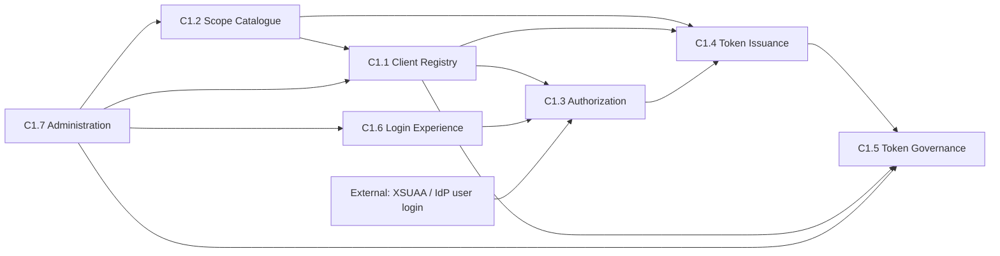
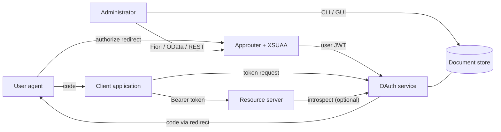

# NAF v4 Architecture Description — OAuth 2.0 Service

> This is the NATO Architecture Framework v4 description of the UIM Platform
> OAuth 2.0 Service 2.0. The service is modelled on the SAP BTP OAuth 2.0
> service. It is an authorization server that registers clients and scopes,
> runs the authorization code (PKCE), client credentials and refresh token
> grants, issues signed JWT access tokens, and supports token introspection,
> revocation and login page branding. It can be operated through OData v4
> (SAP Fiori), REST, a CLI and a GtkD desktop GUI.

---

## 1. NAF v4 grid coverage

| View | Viewpoints covered | Section |
| --- | --- | --- |
| **C** Concepts | C1 Capability Taxonomy, C2 Enterprise Vision, C3 Capability Dependencies | §2 |
| **S** Service Specifications | S1 Service Taxonomy, S3 Service Interfaces, S4 Service Functions and Policies, S5 Service States | §3 |
| **L** Logical | L1 Node Types, L2 Logical Scenario, L4 Logical Activities, L6 Logical Sequence, L7 Logical Data Model, L8 Logical Constraints | §4 |
| **P** Physical Resources | P1 Resource Types, P2 Resource Structure, P4 Resource Functions, P5 Resource Interactions | §5 |
| **A** Architecture Metadata | A3 Architecture Decisions, A7 Standards, A8 Risks | §6 |

---

## 2. Concepts (C)

### C1 — Capability taxonomy

```text
Delegated Authorization (OAuth 2.0)
├── C1.1 Client Registry
│   ├── Register confidential / public clients
│   ├── Generate, hash and rotate client secrets
│   ├── Redirect URI, grant type and scope allow-lists
│   └── Client lifecycle (active / inactive / blocked)
├── C1.2 Scope Catalogue
│   ├── Define scopes per application (resource server)
│   └── Activate / deactivate scopes
├── C1.3 Authorization
│   ├── Authorization endpoint (code flow)
│   ├── PKCE (S256, plain)
│   └── Consent of the authenticated user (via approuter / XSUAA)
├── C1.4 Token Issuance
│   ├── Client credentials grant
│   ├── Authorization code grant
│   ├── Refresh token grant with rotation
│   └── Signed JWT access tokens (platform claim set)
├── C1.5 Token Governance
│   ├── Introspection (RFC 7662)
│   ├── Revocation (RFC 7009, per token / per client)
│   ├── Replay detection (codes, refresh tokens)
│   └── Expiry purge (background worker)
├── C1.6 Login Experience
│   └── Branding per tenant / per client
└── C1.7 Administration
    ├── Fiori 3 web UI, OData v4, REST
    ├── Command line interface
    └── Desktop GUI
```

### C2 — Enterprise vision

| Goal | Description | Measure |
| --- | --- | --- |
| G1 Standard-conformant delegation | Applications get access tokens through standard OAuth 2.0 flows, with no custom protocols | RFC 6749/7636/7662/7009/8414 behaviour covered by tests |
| G2 Secure by default | No plain secrets at rest, no implicit or password grant, PKCE for public clients, exact redirect URIs | Secret and token hashes only. A validation rule exists for each item. |
| G3 Platform-wide tokens | Every UIM platform service accepts the tokens without an adapter | Integration test: `resolveRequestContext` accepts issued tokens |
| G4 Containment of compromise | Stolen codes or refresh tokens are detected, and compromised clients can be stopped immediately | Replay → grant revoked. Block or rotate → all tokens revoked. |
| G5 Operability | Administrators can work in a browser, a shell or on a desktop | Fiori, CLI and GUI share one engine |

### C3 — Capability dependencies



The service does **not** authenticate end users itself. It relies on the
approuter and XSUAA (or another identity provider in front of it) to identify
the resource owner.

---

## 3. Service specifications (S)

### S1 — Service taxonomy

| Service | Consumers | Port |
| --- | --- | --- |
| Authorization service | Browsers / user agents of client apps | `IAuthorize` |
| Token service | Client applications | `IIssueTokens`, `IAuthenticateClients` |
| Token introspection and revocation service | Resource servers, clients | `IIntrospectTokens` |
| Client management service | Administrators | `IManageClients` |
| Scope management service | Administrators | `IManageScopes` |
| Token administration service | Administrators, purge worker | `IManageTokens` |
| Branding service | Login page, administrators | `IManageBrandings` |
| Statistics service | Administrators (KPI header) | `IOAuthStatisticsService` |

### S3 — Service interfaces

| Interface | Protocol / format | Authentication |
| --- | --- | --- |
| `/oauth/authorize` | HTTP GET/POST, `302` redirect | Verified user token (approuter / XSUAA). `X-User-Id` is accepted only with `trustUserHeader` (development). |
| `/oauth/token` | HTTP POST, form-encoded in, JSON out | `client_secret_basic`, `client_secret_post`, `none` (public + PKCE) |
| `/oauth/introspect` | HTTP POST form → JSON (RFC 7662) | Confidential client |
| `/oauth/revoke` | HTTP POST form (RFC 7009) | Client (own tokens only) |
| `/.well-known/oauth-authorization-server` | JSON (RFC 8414) | none |
| `/oauth/branding` | JSON | none (public data) |
| `/odata/v4/oauth` | OData v4 JSON, `$metadata` CSDL XML, `$batch` | XSUAA RS256 (scopes Read/Manage), HS256 or open (development) |
| `/api/v1/oauth` | REST/JSON | Same as OData |
| `uim-oauth-cli` | Command line, text / JSON / CSV | OS user with access to the data file |
| `uim-oauth-gui` | GTK 3 desktop | OS user with access to the data file |
| `/health` | JSON | none |

### S4 — Service functions and policies

| ID | Policy | Enforced in |
| --- | --- | --- |
| P-1 | Supported grants: `authorization_code`, `client_credentials`, `refresh_token`. The implicit and password grants are not offered. | `GrantType`, `IssueTokensUseCase` |
| P-2 | Public clients must use PKCE and cannot use `client_credentials` | `OAuthClient.validate`, `AuthorizeUseCase` |
| P-3 | Redirect URIs are absolute and matched exactly. No fragments or wildcards. `https` is required, `http` only for loopback, private-use schemes for native apps. | `redirectUriProblem`, `OAuthClient.allowsRedirect` |
| P-4 | Errors that occur before the redirect URI is validated are never redirected | `IAuthorize.redirectUriFor`, `OAuthProtocolController.authorize` |
| P-5 | Requested scopes must be allowed for the client and active. An empty request means all allowed active scopes. | `grantScopes` |
| P-6 | A refresh can only narrow the scope. Rotation keeps the scope ceiling and the absolute lifetime. | `refreshScopes`, `IssueTokensUseCase.issue` |
| P-7 | Codes are single use. A replayed code revokes the tokens issued with it. | `IssueTokensUseCase.redeemCode` |
| P-8 | A replayed rotated refresh token revokes all live tokens of that client and user | `IssueTokensUseCase.refresh` |
| P-9 | Blocking a client or rotating its secret revokes all of its tokens | `ManageClientsUseCase` |
| P-10 | Secrets, tokens and codes are stored only as SHA-256 hashes (secrets salted), compared in constant time, never serialized and never logged | `credentials`, mappers, serializers |
| P-11 | Random values come from the kernel CSPRNG. The generator fails closed. | `SystemSecretGenerator` |
| P-12 | Unknown clients and wrong secrets get the same `invalid_client` answer (no client enumeration) | `AuthenticateClientsUseCase` |
| P-13 | A scope cannot be deleted while it is allowed for a client. A branding cannot be deleted while a client uses it. There is one default branding per tenant. | `ManageScopesUseCase`, `ManageBrandingsUseCase` |
| P-14 | Token lifetimes: access tokens 60 s – 1 d, refresh tokens 60 s – 1 y, codes 30 – 600 s | `OAuthClient.validate`, `validateConfig` |
| P-15 | Custom CSS must not contain constructs that break out of the style element or execute script | `customCssProblem` |

### S5 — Service states

| Object | States | Transitions |
| --- | --- | --- |
| OAuth client | active, inactive, blocked | `status` update. Blocking revokes all tokens. Delete removes the client's tokens and codes. |
| Authorization code | active → used / expired / revoked | Token request; expiry; client block or rotate; replay |
| Access token | active → expired / revoked | Expiry; revocation (manual, client blocked, secret rotated, parent revoked, replay) |
| Refresh token | active → revoked(rotated) / revoked / expired | Use (rotation); revocation; expiry. A replay of a rotated token → grant revoked. |
| Scope | active, inactive | Inactive scopes are no longer granted. Tokens already issued keep them until they expire. |

---

## 4. Logical (L)

### L1 — Node types

| Node | Responsibility |
| --- | --- |
| Client application | Starts the flows and holds the tokens (confidential: server side; public: browser or device) |
| User agent | Carries the authorization request and response (browser redirects) |
| Approuter + XSUAA | Authenticates the user and forwards the user token |
| OAuth service | Authorization server: registry, flows, token issuance and governance |
| Resource server | Platform service that validates tokens locally (shared key) or by introspection |
| Administrator workstation | Fiori UI, CLI and GUI |
| Document store | Persistence of clients, scopes, token records, codes, brandings and the signing key |

### L2 — Logical scenario (connectivity)



### L4 — Logical activities (register → authorize → issue → govern)

1. **Register:** the administrator creates scopes. Then they register a client with grant types, redirect URIs and allowed scopes. A confidential client gets a generated secret, shown once.
2. **Authorize:** the user agent calls `/authorize`. The service validates the client and redirect URI, checks the user, PKCE and scopes, and stores a code hash.
3. **Issue:** the client authenticates and exchanges the code (or uses client credentials). The service verifies PKCE, signs the JWT, stores the token record and, if allowed, a refresh token.
4. **Use:** the resource server validates the JWT locally, or calls `/introspect` when it needs to see revocations.
5. **Refresh:** the client exchanges its refresh token. The old token is retired and a new pair is issued.
6. **Govern:** tokens are revoked (RFC 7009, per client, by blocking or by rotating the secret). Replays are detected, and the worker purges expired records.

### L6 — Logical sequences

The sequences are in [UML.md](UML.md): authorization code + PKCE, refresh
rotation with replay detection, and token validation by a resource server.

### L7 — Logical data model

| Entity | Key attributes | Relationships |
| --- | --- | --- |
| OAuthClient | clientId (unique per tenant), clientType, status, secretHash + salt, redirectUris[], allowedScopes[], grantTypes[], token lifetimes, contacts[], brandingId | allowed scopes → OAuthScope (by name); 0..1 → BrandingConfig |
| OAuthScope | name (unique per tenant), applicationId, status | — |
| AccessToken | id = JWT `jti`, tokenHash, clientId, userId, scopes[], grantType, status, issuedAt/expiresAt/revokedAt, revocationReason | → client; 0..1 → RefreshToken; 0..1 → AuthorizationCode |
| RefreshToken | tokenHash, clientId, userId, scopes[], status, expiresAt, replacedById | → client; rotation chain via replacedById |
| AuthorizationCode | codeHash, clientId, userId, redirectUri, scopes[], codeChallenge + method, status, expiresAt, usedAt | → client |
| BrandingConfig | name (unique), colors, URLs, texts, customCss, isDefault (one per tenant) | ← clients |
| Signing key | HS256 secret (only if none is configured), partition `_system` | — |

All business entities have an id, a tenant and audit fields (created/updated
at/by). They are stored as one JSON document per entity in the collections
`oauth.*`, partitioned by tenant.

### L8 — Logical constraints

| Constraint | Value |
| --- | --- |
| Scope token syntax | 1–128 printable ASCII characters, no space, `"` or `\` |
| Client ID syntax | letters, digits and `- _ . ! \|`, at most 128 characters |
| PKCE verifier / challenge | 43–128 characters `[A-Za-z0-9-._~]` |
| Signing secret | at least 32 characters (generated keys: 48 random bytes) |
| Generated secrets / tokens / codes | 32 random bytes, base64url |
| Request size | 4 MiB per HTTP request, 1 MiB per REST body |
| Tenancy | Every lookup is scoped to the caller's tenant |

---

## 5. Physical resources (P)

### P1 / P2 — Resource types and structure

| Resource | Realisation |
| --- | --- |
| `uim-oauth-platform-service` | D executable (vibe.d 0.10.3 HTTP server, ldc2 release build) |
| `uim-oauth-cli` | D executable (same container and storage) |
| `uim-oauth-gui` | D executable with GtkD 3.11 (GTK 3.24) |
| Fiori app | UI5 1.120 static resources (`frontend/`), served by the approuter or under `/app` |
| Approuter | Node.js 20, `@sap/approuter` 20 |
| Document store | `MemoryDocumentStore` or `FileDocumentStore` (atomic JSON snapshot) |
| Shared library | `uim-platform:service` (OData engine, CLI, GUI, configuration, security, storage) |

### P4 / P5 — Deployment and interactions

| Target | Units | Notes |
| --- | --- | --- |
| SAP BTP Cloud Foundry | `oauth-srv` (binary buildpack), `oauth-approuter`, `oauth-xsuaa`, `oauth-config` (signing secret, issuer) | `mta.yaml`; health check `/health`; single instance with the file store |
| Kubernetes | Deployment (1 replica, Recreate, non-root, read-only rootfs), ConfigMap, Secret `uim-oauth-signing`, Service :8114 | `k8s/`; `/data` volume (use a PVC) |
| Container | Multi-stage OCI image (ldc 1.40 → Ubuntu 24.04) | `backend/Dockerfile`, `backend/Containerfile` (build context = repository root) |
| Workstation | CLI and GUI on the same data file as a local server | `--data-file=` |

The deployment diagram is in [UML.md](UML.md#deployment-diagram).

---

## 6. Architecture metadata (A)

### A3 — Architecture decisions

| ID | Decision | Rationale |
| --- | --- | --- |
| AD-1 | Hexagonal / Clean Architecture with explicit driving and driven ports | The protocol rules (PKCE, scope policy, rotation) can be tested without vibe.d. Adapters can be replaced. |
| AD-2 | One EDM model and one `ODataEngine` for OData, REST, CLI and GUI | Identical validation, scopes and query semantics. This replaces six hand-written CRUD controllers of 1.x. |
| AD-3 | Protocol endpoints are a separate adapter that calls the protocol ports directly | OAuth wire formats (form-encoded, RFC error codes, redirects) differ from the management APIs |
| AD-4 | HS256 JWT access tokens with the XSUAA/UAA claim set | Platform services can validate them with the existing `resolveRequestContext`. No extra dependency. |
| AD-5 | A token record is stored for every issued JWT (`jti` + hash) | Revocation, introspection, statistics and replay containment |
| AD-6 | Hashes instead of encryption for secrets, tokens and codes | Nothing to decrypt means nothing can leak. 256-bit random values make a fast hash sufficient. |
| AD-7 | Refresh token rotation with an absolute lifetime and family revocation on replay | OAuth 2.0 Security BCP §4.14; limits the damage of a stolen refresh token |
| AD-8 | The resource owner comes only from a verified upstream token. The header shortcut is opt-in for development. | The service does not authenticate users itself, so a spoofable identity must never reach `/authorize` |
| AD-9 | `ITokenSigner` and `ISecretGenerator` are driven ports | RS256/JWKS or an HSM can be added later without touching the use cases. Tests stay deterministic where needed. |
| AD-10 | Document store `memory` / `file`, with the generated signing key kept in the store | Zero dependencies for development. Server, CLI and GUI share data and the key. |

### A7 — Standards

| Area | Standard |
| --- | --- |
| Authorization | RFC 6749 (OAuth 2.0), RFC 7636 (PKCE), RFC 7662 (Introspection), RFC 7009 (Revocation), RFC 8414 (AS Metadata), RFC 9207 (`iss` response parameter), OAuth 2.0 Security BCP, RFC 8252 (native apps) |
| Tokens | RFC 7519 (JWT), RFC 7515 (JWS, HS256) |
| API | OASIS OData v4.01 (CSDL XML, JSON format, `$batch`), SAP OData vocabularies (UI, Common), OASIS Core and Capabilities vocabularies |
| Platform security | SAP XSUAA (RS256 user tokens, scopes Read/Manage) |
| UI | SAP Fiori 3 design, SAPUI5 1.120 |
| Deployment | SAP MTA 3.3, Cloud Foundry binary buildpack, OCI images, Kubernetes apps/v1 |
| Language | D (dmd/ldc2), vibe.d 0.10.3, GTK 3.24 via GtkD 3.11 |

### A8 — Risks and open points

| Risk | Mitigation / next step |
| --- | --- |
| A shared HS256 key means every resource server holding it could mint tokens | Keep the key in a secret store. Use introspection for untrusted resource servers. Planned: RS256 + JWKS behind `ITokenSigner`. |
| The file store allows one instance only | Implement `IDocumentStore` for a database before scaling out |
| Brute force on the token endpoint | Secrets are 256-bit random values. Add rate limiting at the approuter or ingress. |
| Local JWT validation does not see revocations | Short access token lifetimes; introspection for sensitive APIs |
| Management APIs are open without XSUAA or `requireAuthentication` | Development only. Production deployments bind XSUAA or set `jwtSecret`. |
