# UML — OAuth 2.0 Service

These diagrams describe the 2.0 implementation in
`backend/source/uim/platform/oauth/`.

## Component diagram (hexagonal architecture)

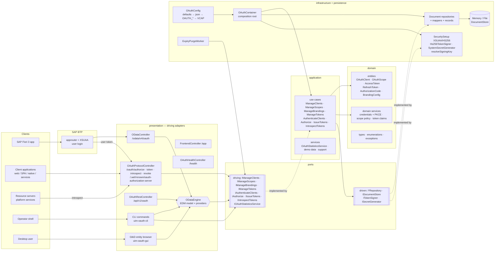

Dependencies point inward. The domain uses no I/O and no vibe.d. The
application layer depends only on ports. Two kinds of adapters drive the
service: the management adapters, which share the EDM-driven engine, and the
protocol controller, which calls the protocol ports directly.

## Domain class diagram

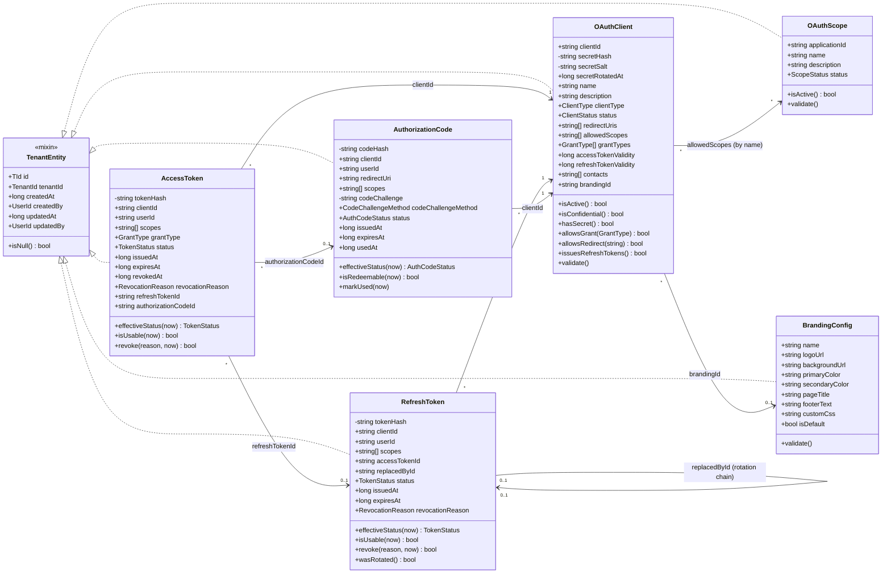

Private (`-`) fields are persisted but never serialized by any adapter.

### Enumerations and domain services

```mermaid
classDiagram
  class ClientType {
    <<enumeration>>
    confidential
    public
  }
  class ClientStatus {
    <<enumeration>>
    active
    inactive
    blocked
  }
  class GrantType {
    <<enumeration>>
    authorization_code
    client_credentials
    refresh_token
  }
  class CodeChallengeMethod {
    <<enumeration>>
    none
    plain
    S256
  }
  class TokenStatus {
    <<enumeration>>
    active
    expired
    revoked
  }
  class AuthCodeStatus {
    <<enumeration>>
    active
    used
    expired
    revoked
  }
  class ScopeStatus {
    <<enumeration>>
    active
    inactive
  }
  class RevocationReason {
    <<enumeration>>
    manual
    clientBlocked
    clientDeleted
    secretRotated
    rotated
    replayDetected
    parentRevoked
  }
  class OAuthError {
    <<enumeration>>
    invalid_request
    invalid_client
    invalid_grant
    unauthorized_client
    unsupported_grant_type
    unsupported_response_type
    invalid_scope
    access_denied
    login_required
    server_error
  }

  class credentials {
    <<domain service>>
    +hashSecret(salt, secret) string
    +fingerprint(value) string
    +verifySecret(salt, hash, presented) bool
    +constantTimeEquals(a, b) bool
    +isValidCodeVerifier(v) bool
    +s256Challenge(verifier) string
    +verifyPkce(method, challenge, verifier) bool
  }
  class scope_policy {
    <<domain service>>
    +grantScopes(requested, allowed, active) string[]
    +refreshScopes(requested, original) string[]
  }
  class token_claims {
    <<domain service>>
    +accessTokenClaims(AccessToken, issuer) Json
  }
  class OAuthException {
    +OAuthErrorKind kind
  }
  class OAuthProtocolException {
    +OAuthError error
    +httpStatus() int
  }
```

`OAuthException` (invalid, notFound, conflict, ruleViolation) is used by the
management APIs and maps to 400/404/409/422. `OAuthProtocolException` carries
the RFC 6749 error code and maps to 400 or 401 on the protocol endpoints.

## Ports and application

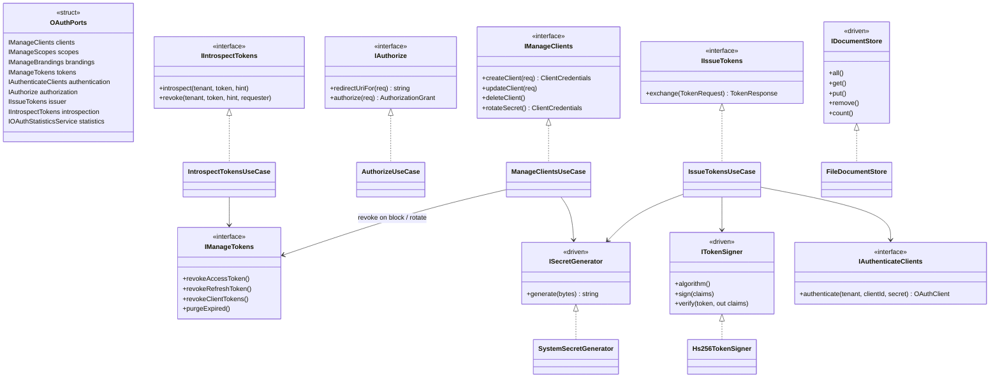

## State machines

### OAuth client

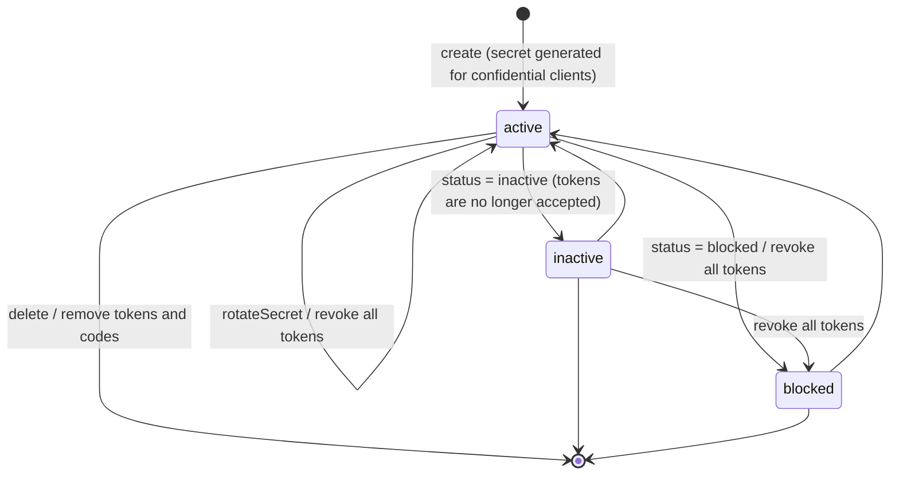

### Authorization code

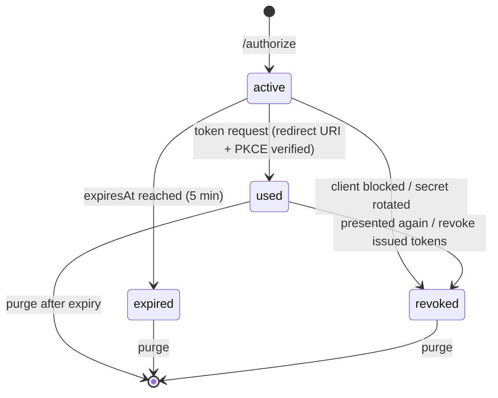

### Refresh token (rotation)

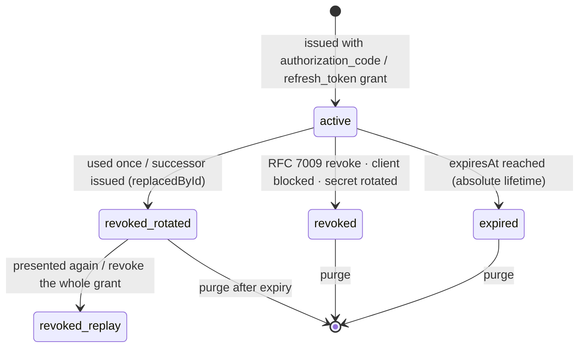

An access token is `active` until it expires (→ `expired`) or is revoked
(→ `revoked`). Revoking its refresh token revokes the access token too
(`parentRevoked`).

## Sequence: authorization code + PKCE (public client)

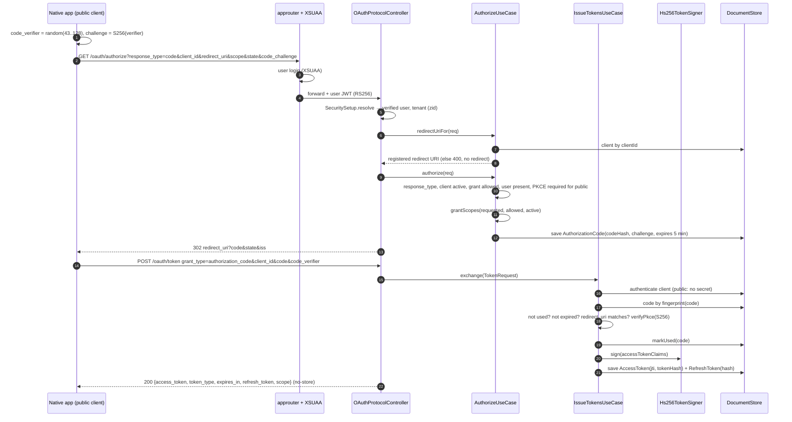

## Sequence: refresh token rotation and replay detection

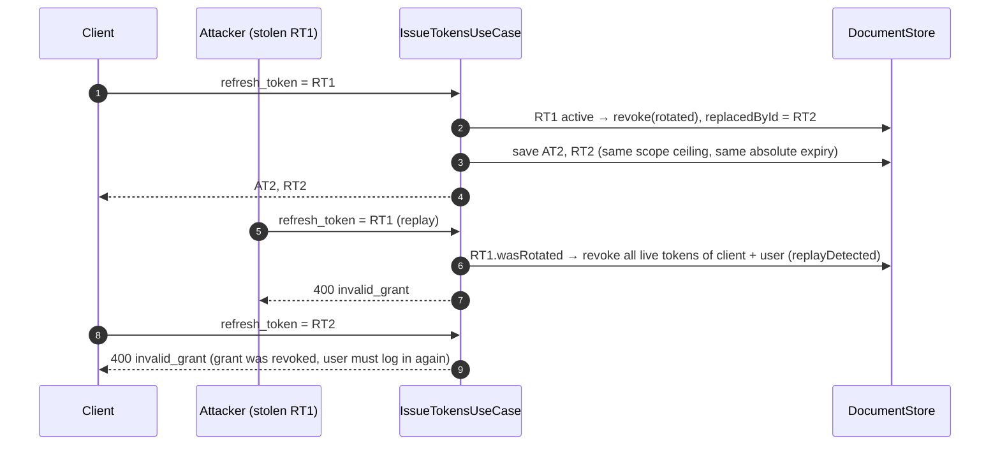

## Sequence: resource server validates a token

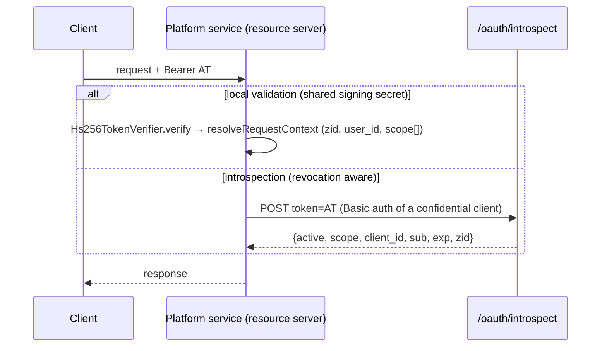

Local validation is fast but does not see revocations until the token
expires. Introspection does see them.

## Deployment diagram

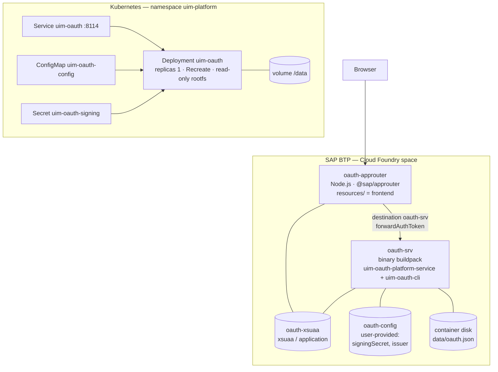
