# UML — Object Store Service

Diagrams of the UIM Object Store service (Mermaid). Package and module names refer
to `backend/source/uim/platform/object_store/`.

## Class Diagram — Domain Entities

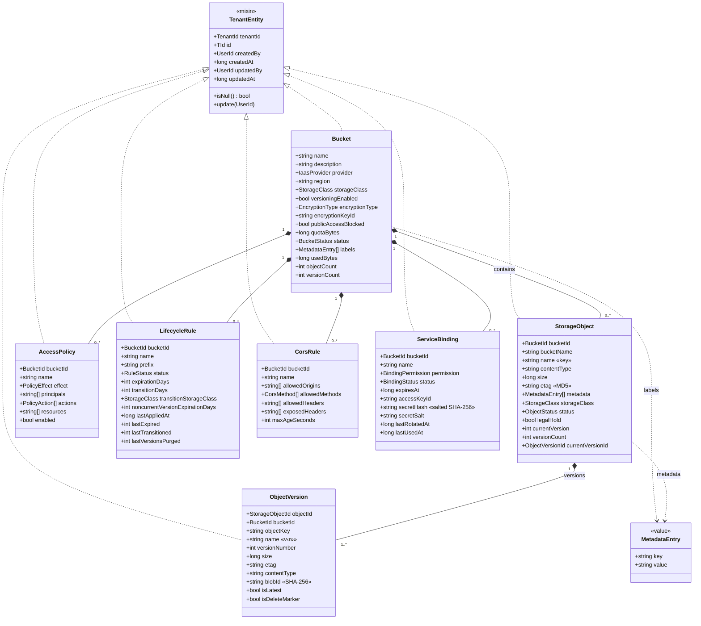

## Class Diagram — Enumerations and Reference Data

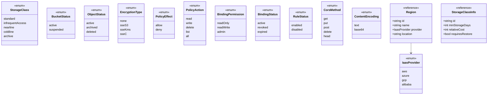

## Class Diagram — Domain and Application Services

```mermaid
classDiagram
  class naming {
    <<domain service>>
    +bucketNameError(name) string
    +validateObjectKey(key, maxLength)
    +wildcardMatch(text, pattern) bool
  }
  class checksums {
    <<domain service>>
    +contentEtag(data) string «MD5»
    +contentAddress(data) string «SHA-256»
    +hashSecret(secret, salt) string
    +constantTimeEquals(a, b) bool
    +newAccessKeyId() string
    +newSecretAccessKey() string
  }
  class bucket_rules {
    <<domain service>>
    +validateEncryption(Bucket)
    +validateQuota(Bucket)
    +ensureQuota(Bucket, delta)
    +ensureWritable(Bucket)
    +ensureNotOnHold(StorageObject)
    +ensureReadable(StorageObject)
  }
  class access_evaluator {
    <<domain service>>
    +evaluateAccess(policies, principal, action, key, publicAccessBlocked) AccessDecision
  }
  class cors_matcher {
    <<domain service>>
    +validateCorsRule(CorsRule)
    +matchCors(rules, origin, method, headers) CorsDecision
  }
  class lifecycle_planner {
    <<domain service>>
    +validateLifecycleRule(LifecycleRule)
    +planLifecycle(rules, objects, versions, now) LifecycleStep[]
  }
  class catalogs {
    <<domain service>>
    +supportedRegions
    +storageClassCatalog
    +requireRegion(provider, region, default) string
  }

  class ObjectStorageService {
    <<application service>>
    -ObjectStoreRepositories repos
    -IBlobStorage blobs
    -StorageLimits limits
    +write(bucket, key, ContentSource, ...) StorageObject
    +deleteObject(StorageObject, actor) bool
    +purgeObject(StorageObject)
    +purgeVersion(ObjectVersion, actor)
    +read(tenant, bucket, key, version) ObjectContent
    +recount(tenant, bucket)
  }
  class ObjectStoreStatisticsService {
    <<application service>>
    +statistics(tenant) ObjectStoreStatistics
  }
  class ObjectStoreCatalogService {
    <<application service>>
    +regions() Region[]
    +storageClasses() StorageClassInfo[]
  }
  class EventRecorder {
    <<application service>>
    +publish(topic, payload)
  }

  ObjectStorageService ..> bucket_rules
  ObjectStorageService ..> checksums
  ObjectStorageService ..> naming
  ObjectStorageService --> IBlobStorage
  ObjectStoreCatalogService ..> catalogs
```

## Class Diagram — Use Cases and Ports

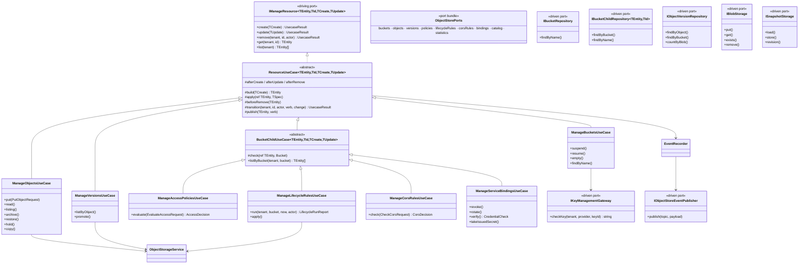

## State Diagram — Lifecycles

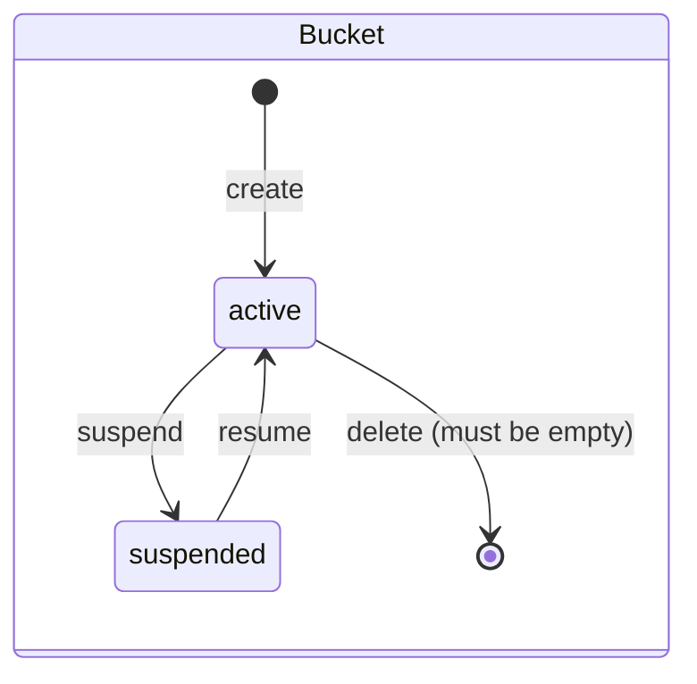

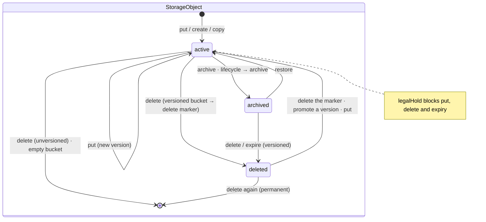

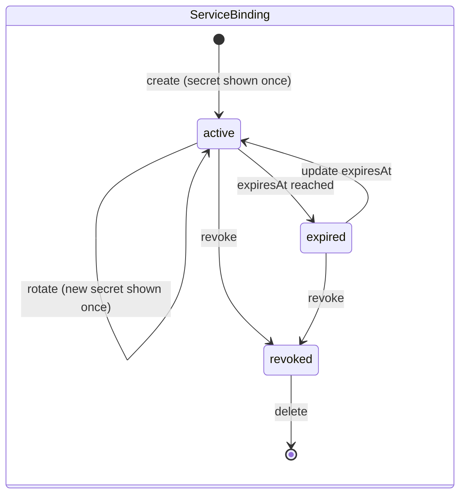

## Activity Diagram — Writing an object (`ObjectStorageService.write`)

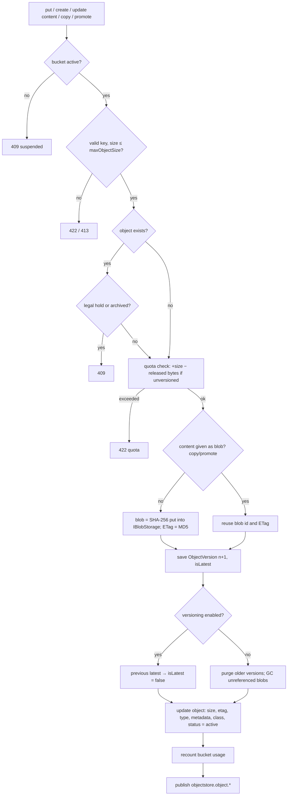

## Activity Diagram — Data plane authorization (`ResourceRegistry.authorize`)

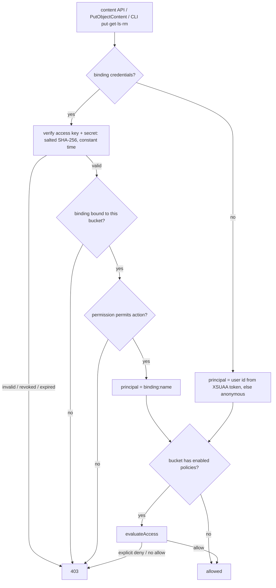

## Component Diagram — Hexagonal Architecture

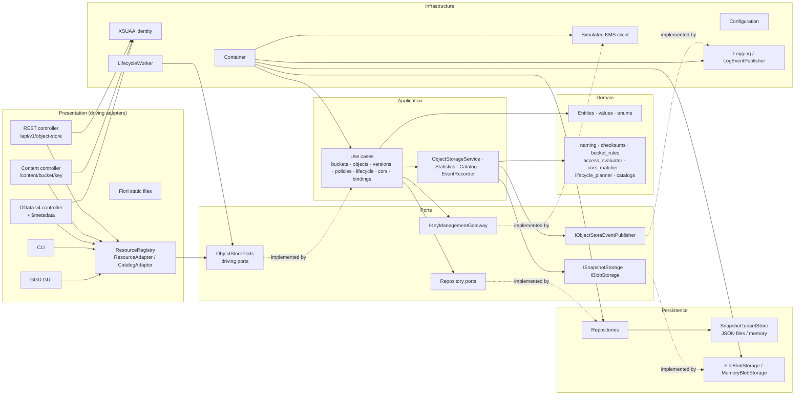

## Sequence Diagram — Fiori uploads a file

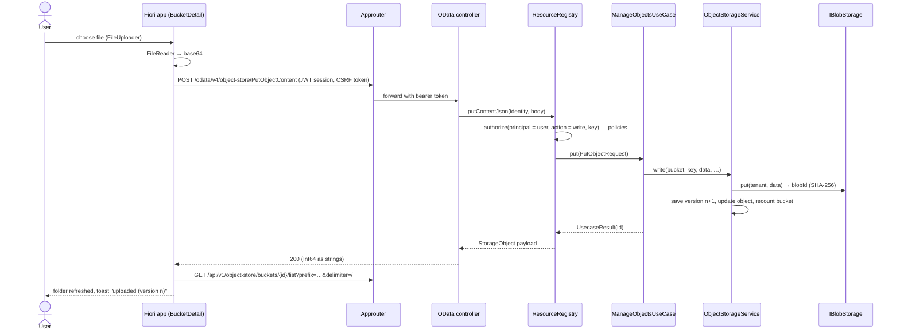

## Sequence Diagram — Service binding uses the content API

```mermaid
sequenceDiagram
  actor A as Admin
  participant C as CLI / Fiori
  participant UC as ManageServiceBindingsUseCase
  participant App as Client application
  participant CT as Content controller
  participant R as ResourceRegistry

  A->>C: bindings create --bucket-id=media --name=ci --permission=readWrite
  C->>UC: create → accessKeyId, secret (salted hash stored)
  UC-->>C: binding + secretAccessKey (only this once)
  A->>App: configure endpoint, access key id, secret
  App->>CT: PUT /content/media/builds/app.zip (Authorization: OSK id:secret)
  CT->>R: putContent(caller)
  R->>UC: verify(accessKeyId, secret) → valid, readWrite, bucket media
  R->>R: permits(readWrite, write) · policies for binding:ci
  R-->>CT: object (version, ETag)
  CT-->>App: 200 ETag, X-Version-Number
  A->>C: bindings rotate ci → new secret; old secret → 403
```

## Sequence Diagram — Lifecycle run

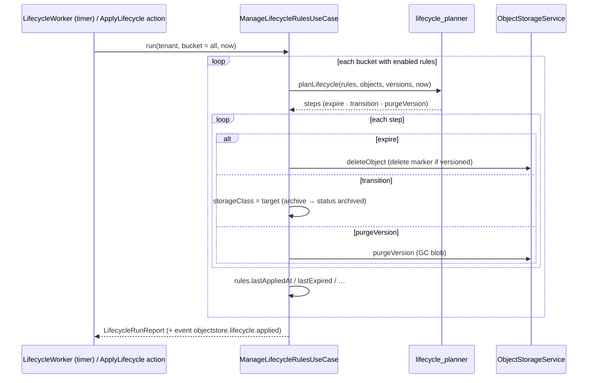

## Sequence Diagram — CLI and server share data

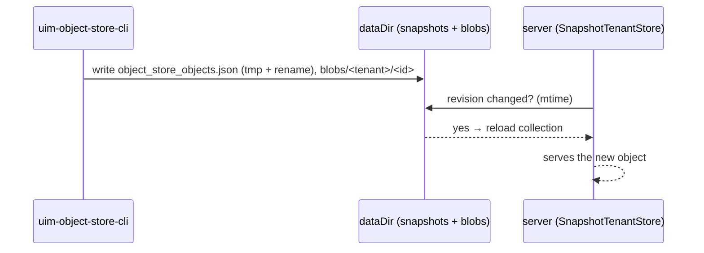

## Deployment Diagram — SAP BTP (Cloud Foundry)

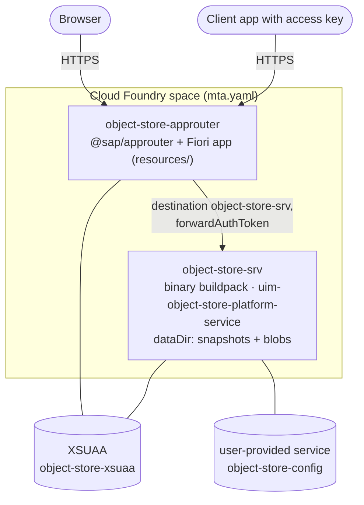

Kubernetes (`k8s/`): Deployment `cloud-object-store` (port 8092, non-root,
read-only root filesystem, `/app/data` volume), Service, ConfigMap.
