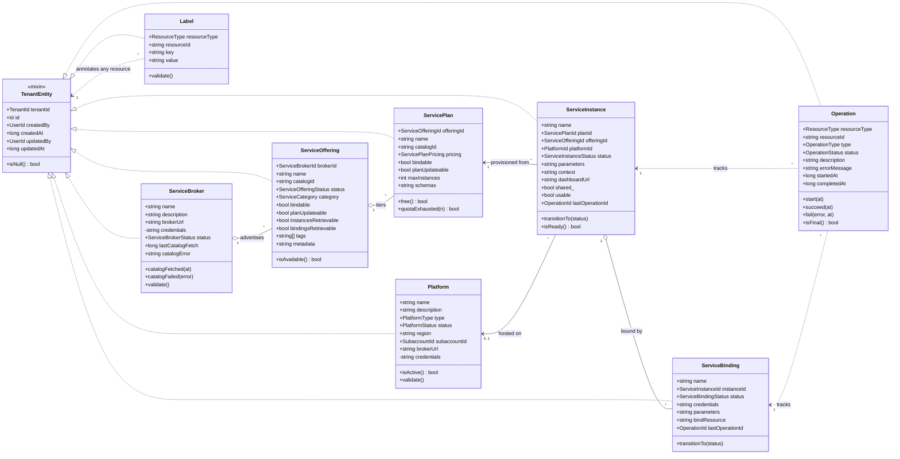
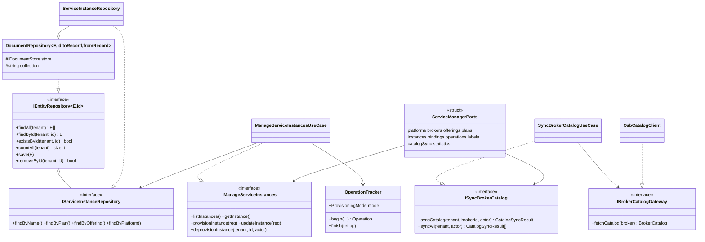
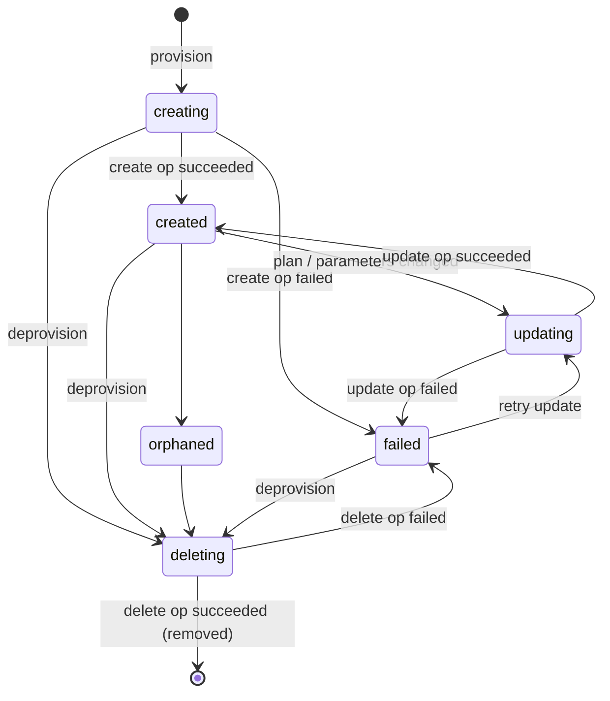
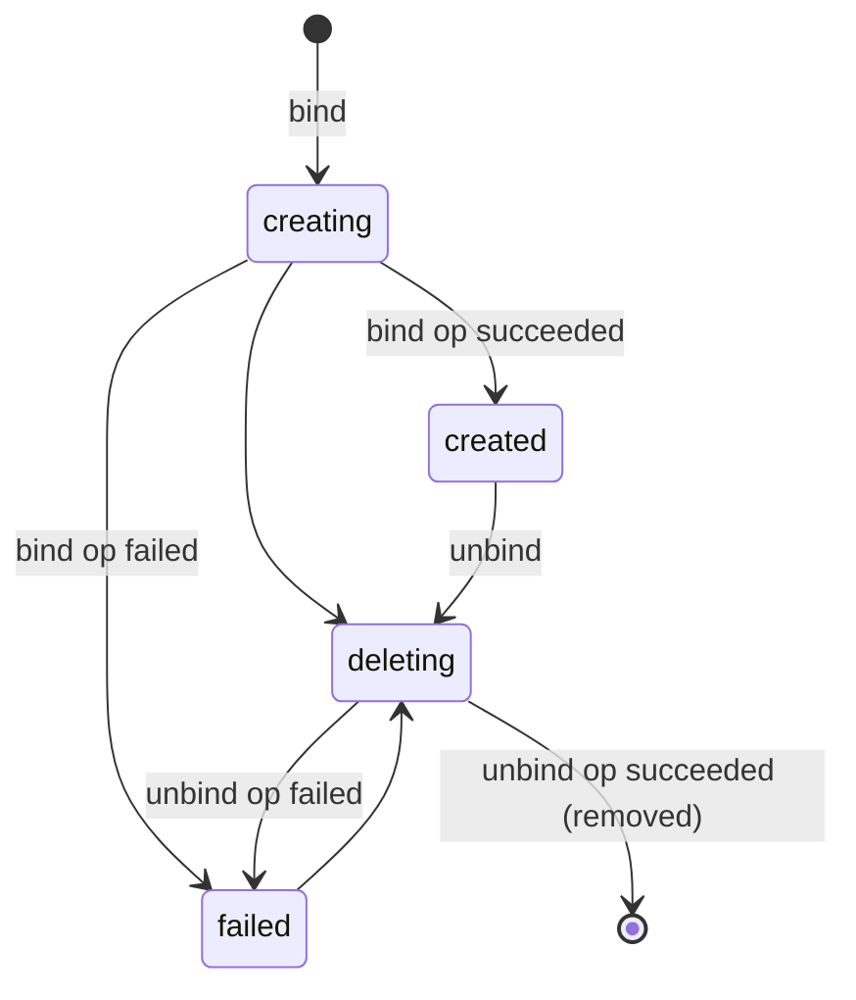
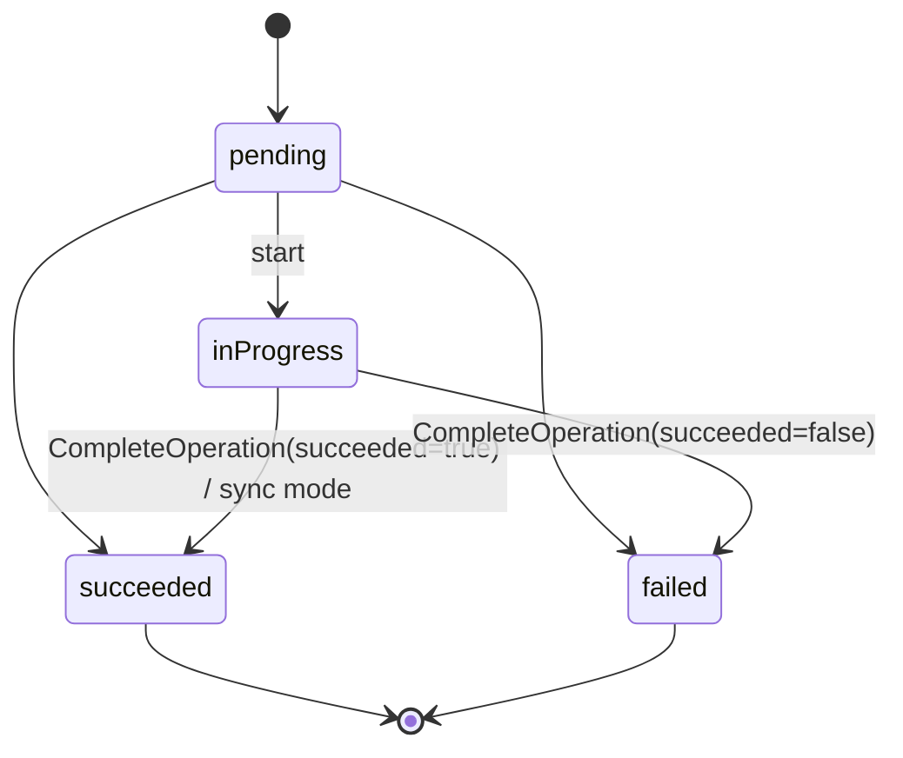
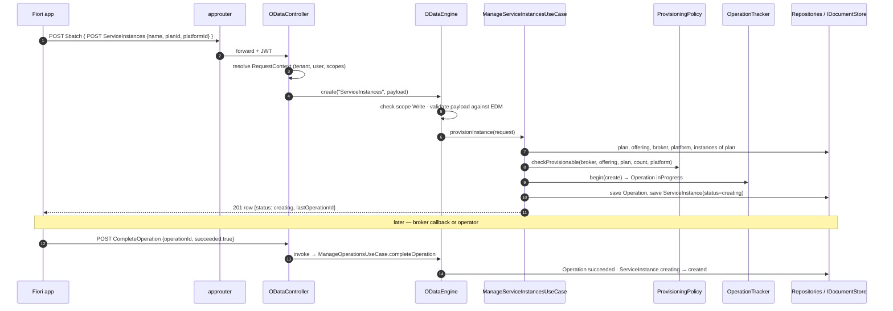
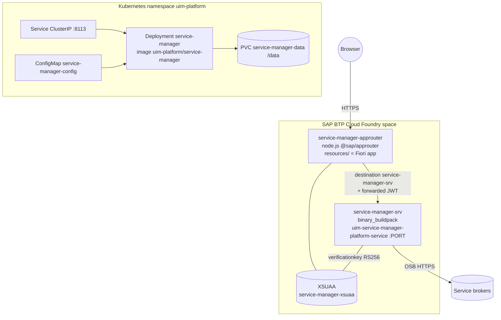

# UML — Service Manager

These diagrams describe the 2.0 implementation in `backend/source/uim/platform/service_manager/`.

## Component diagram (hexagonal architecture)

```mermaid
flowchart LR
  subgraph Clients
    Fiori[SAP Fiori 3 app]
    Scripts[Scripts / services]
    Admin[Operator shell]
    Desk[Desktop user]
    Broker[(OSB service broker)]
  end

  subgraph BTP[SAP BTP]
    AR[approuter + XSUAA]
  end

  subgraph Presentation[presentation — driving adapters]
    OD[ODataController\n/odata/v4/service-manager]
    REST[ServiceManagerRestController\n/api/v1/service-manager]
    CLI[CLI commands\nuim-service-manager-cli]
    GUI[GtkD entity browser\nuim-service-manager-gui]
    WEB[FrontendController /app]
    ENG{{ODataEngine\nEDM model + providers}}
  end

  subgraph Application
    UC[Use case interactors]
    SVC[OperationTracker · StatisticsService\nResourceDirectory · DemoData]
  end

  subgraph Domain
    ENT[Entities]
    POL[Lifecycle · ProvisioningPolicy\nCatalogReconciler · Validation]
  end

  subgraph Ports
    DP[driving: IManage* · ISyncBrokerCatalog\nIServiceManagerStatistics]
    RP[driven: I*Repository]
    GP[driven: IBrokerCatalogGateway]
  end

  subgraph Persistence
    REPO[DocumentRepository + mappers]
    STORE[(IDocumentStore\nmemory | JSON file)]
  end

  subgraph Infrastructure
    CFG[ServiceManagerConfig]
    SEC[SecuritySetup RS256/HS256]
    OSB[OsbCatalogClient]
    WRK[CatalogSyncWorker]
    CNT[ServiceManagerContainer]
  end

  Fiori --> AR --> OD
  Scripts --> REST
  Admin --> CLI
  Desk --> GUI
  OD --> ENG
  REST --> ENG
  CLI --> ENG
  GUI --> ENG
  ENG --> DP
  WRK --> DP
  DP -. implemented by .-> UC
  UC --> SVC
  UC --> POL
  UC --> ENT
  UC --> RP
  UC --> GP
  RP -. implemented by .-> REPO --> STORE
  GP -. implemented by .-> OSB --> Broker
  CNT --> UC
  CNT --> REPO
  CNT --> ENG
  OD --> SEC
  REST --> SEC
```

## Domain class diagram



## Ports and application



## State machines

### Service instance



### Service binding



### Operation



In **synchronous** mode (`syncProvisioning: true`, the default), the operation finishes within the
request and the resource reaches `created` or is removed immediately. In **asynchronous** mode, the
resource stays in its transitional state until `CompleteOperation` is called.

## Sequence: provision a service instance (OData, asynchronous mode)



## Sequence: catalog sync

```mermaid
sequenceDiagram
  autonumber
  participant C as CLI / REST / OData / CatalogSyncWorker
  participant UC as SyncBrokerCatalogUseCase
  participant GW as OsbCatalogClient
  participant B as Service broker
  participant RC as reconcileCatalog()
  participant RP as Repositories

  C->>UC: syncCatalog(tenant, brokerId, actor)
  UC->>RP: broker (must not be inactive)
  UC->>GW: fetchCatalog(broker)
  GW->>B: GET /v2/catalog (X-Broker-API-Version, Basic auth)
  alt broker fails
    B-->>GW: error / non-200 / invalid JSON
    GW-->>UC: ServiceManagerException(gateway)
    UC->>RP: broker.catalogFailed(msg) → registrationFailed if never synced
    UC-->>C: 502 BadGateway
  else catalog
    B-->>GW: {services:[...plans]}
    UC->>RP: offerings + plans of the broker
    UC->>RC: match by catalogId → create / update / retire (removed)
    UC->>RP: save offerings, plans; broker.catalogFetched(now)
    UC-->>C: CatalogSyncResult (+created ~updated −removed)
  end
```

## Deployment diagram


