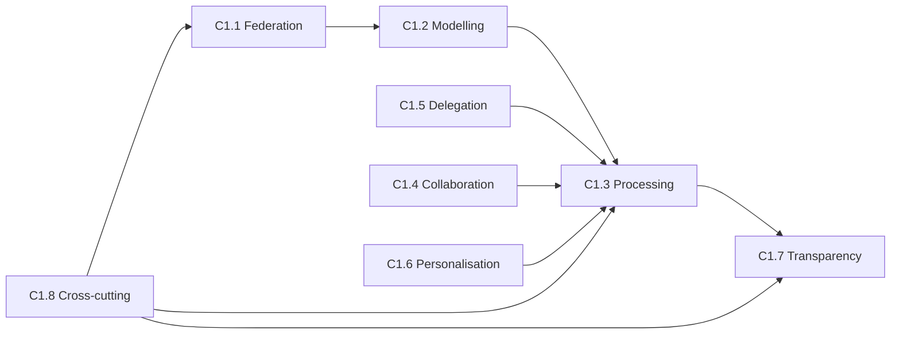
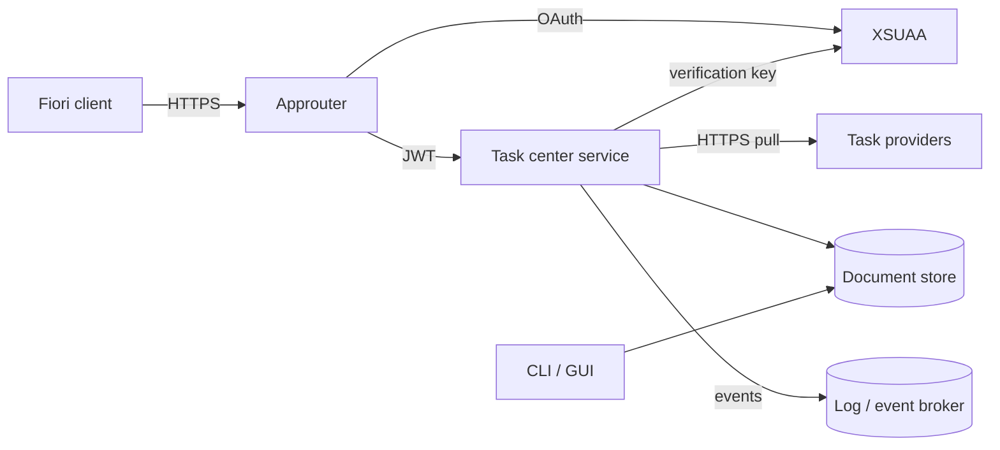
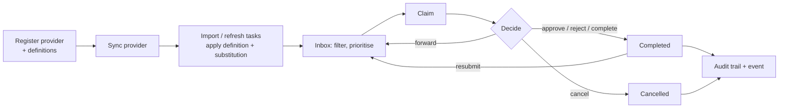

# NAF v4 Architecture Description — Task Center

> NATO Architecture Framework v4 (NAF v4) description of the UIM Platform
> Task Center 2.0 — a unified inbox that federates human tasks from SAP and
> third-party task providers and lets users process them through SAP Fiori,
> REST/OData v4, a command line interface and a GtkD desktop GUI.

| | |
| --- | --- |
| Architecture | UIM Task Center 2.0 |
| Scope | Backend service, Fiori app, approuter, CLI, GUI, deployment |
| Implementation | `backend/source/uim/platform/task_center/` (D / vibe.d), `frontend/` (UI5) |
| Related | [README.md](README.md), [UML.md](UML.md) |

## 1. NAF v4 grid coverage

| Viewpoint | Subject | Section |
| --- | --- | --- |
| C1 Capability taxonomy | What the task center can do | §2 |
| C2 Enterprise vision | Goals and outcomes | §2 |
| C3 Capability dependencies | How capabilities build on each other | §2 |
| S1 Service taxonomy | Offered services | §3 |
| S3 Service interfaces | OData, REST, CLI, GUI, provider gateway, events | §3 |
| S4 Service functions and policies | Rules enforced by the service | §3 |
| S5 Service states | Task, provider, substitution states | §3 |
| L1 Node types | Logical nodes | §4 |
| L2 Logical scenario | Connectivity | §4 |
| L4 Logical activities | Federate → process → audit | §4 |
| L6 Logical sequences | Reference to UML sequences | §4 |
| L7 Logical data model | Entities and relations | §4 |
| L8 Logical constraints | Invariants | §4 |
| P1/P2 Resource types and structure | Software artefacts | §5 |
| P4/P5 Deployment and interactions | BTP, Kubernetes, desktop | §5 |
| A3 Architecture decisions | Key decisions with rationale | §6 |
| A7 Standards | Applied standards | §6 |

## 2. Concepts (C)

### C1 — Capability taxonomy

```text
Task Center
├── C1.1  Task federation
│   ├── C1.1.1  Provider registry (S/4HANA, SuccessFactors, Ariba, Fieldglass, Concur, SAP Build, custom)
│   ├── C1.1.2  Provider authentication (OAuth 2.0 client credentials, Basic, API key)
│   ├── C1.1.3  Pull synchronisation (on demand, periodic worker), upsert by external id
│   └── C1.1.4  Feed normalisation (OData v2/v4, SAP workflow field names and codes)
├── C1.2  Task modelling
│   ├── C1.2.1  Task definitions (category, default priority, SLA, allowed actions, requires claim)
│   └── C1.2.2  Ad-hoc tasks via API
├── C1.3  Task processing
│   ├── C1.3.1  Claim / release
│   ├── C1.3.2  Forward (substitution aware)
│   ├── C1.3.3  Decide: approve / reject / complete / cancel
│   ├── C1.3.4  Escalate (priority) and resubmit
│   └── C1.3.5  Caller-specific available actions
├── C1.4  Collaboration
│   ├── C1.4.1  Comments (author owned)
│   └── C1.4.2  Attachment metadata
├── C1.5  Delegation
│   ├── C1.5.1  Substitution rules with periods and definition scope
│   ├── C1.5.2  Auto-forwarding of new and forwarded tasks
│   └── C1.5.3  Cycle prevention
├── C1.6  Personalisation
│   └── C1.6.1  Saved inbox filters → OData $filter, one default per user
├── C1.7  Transparency
│   ├── C1.7.1  Immutable action audit trail
│   ├── C1.7.2  Domain events (sap.taskcenter.task.*)
│   └── C1.7.3  Key figures (open, overdue, high priority, decisions, provider health)
└── C1.8  Cross-cutting
    ├── C1.8.1  Multi-tenancy (tenant partitioned store)
    ├── C1.8.2  Authentication and authorisation (XSUAA scopes Read / Process / Manage)
    ├── C1.8.3  Layered configuration (files, env, VCAP_SERVICES, CLI)
    └── C1.8.4  Health and structured logging
```

### C2 — Enterprise vision

| Aspect | Description |
| --- | --- |
| Vision | One inbox for every business-critical decision, regardless of the system it comes from |
| Outcomes | Shorter approval cycle times; no missed deadlines (SLA, overdue visibility); no blocked work during absences (substitution) |
| Users | Approvers and task processors (Fiori, mobile), operators (CLI), power users (desktop GUI), integrations (REST/OData) |
| Measures | Overdue tasks, unassigned tasks, providers in error, decisions per period (Statistics singleton) |

### C3 — Capability dependencies



Federation relies on modelling (imported tasks match definitions by name);
processing relies on delegation (forward/auto-forward) and feeds transparency
(audit trail, events, statistics).

## 3. Service specifications (S)

### S1 — Service taxonomy

| Service | Capability | Consumers |
| --- | --- | --- |
| Inbox query service | C1.3, C1.6 | Fiori, CLI `inbox`/`filter`, GUI |
| Task processing service | C1.3 | Fiori, REST `/tasks/:id/<action>`, OData `PerformTaskAction`, CLI |
| Task administration service | C1.2 | Integrations, administrators |
| Provider federation service | C1.1 | Worker, OData `SyncProvider`/`SyncAllProviders`, CLI `sync` |
| Delegation service | C1.5 | Users (own rules), administrators |
| Collaboration service | C1.4 | Users |
| Audit and analytics service | C1.7 | Auditors, operators |

### S3 — Service interfaces

| Interface | Protocol | Port / adapter |
| --- | --- | --- |
| OData v4 `/odata/v4/task-center` | HTTP, JSON, CSDL `$metadata` with UI annotations, `$batch` | `ODataController` → `ODataEngine` |
| REST `/api/v1/task-center` | HTTP, JSON | `TaskCenterRestController` → `ODataEngine` |
| CLI `uim-task-center-cli` | process, text / JSON / CSV | `buildTaskCenterCli` → `ODataEngine` |
| Desktop GUI `uim-task-center-gui` | GTK 3 | `runEntityBrowser` → `ODataEngine` |
| Provider gateway (outbound) | HTTP GET, OAuth 2.0 | `ITaskProviderGateway` ← `HttpTaskProviderClient` |
| Task events (outbound) | structured log lines (replaceable, e.g. Event Mesh) | `ITaskEventPublisher` ← `LoggingTaskEventPublisher` |
| Health | `GET /health` | `TaskCenterHealthController` |

### S4 — Service functions and policies

| Policy | Rule | Enforced in |
| --- | --- | --- |
| P1 Lifecycle | Status changes only through actions; finished tasks are read-only except resubmit | `TaskLifecycle`, `ManageTasksUseCase` |
| P2 Claim ownership | Claimed tasks are released, forwarded, cancelled and decided only by the claimer | `TaskLifecycle` |
| P3 Requires claim | Definitions may demand a claim before approve/reject/complete | `TaskLifecycle` |
| P4 Allowed actions | A non-empty list restricts approve, reject, complete, cancel, escalate, resubmit | `UIMTask.allows` |
| P5 Decisions | Approve/reject only for approval/review tasks unless explicitly allowed | `TaskLifecycle` |
| P6 Substitution | Active auto-forward rules redirect new and forwarded tasks; definition-bound rules win; no cycles | `SubstitutionPolicy` |
| P7 Personal data | Substitution rules, filters and comments belong to their owner; *Manage* overrides | use cases (`requireOwner`) |
| P8 Referential integrity | Providers with definitions/tasks and definitions with unfinished tasks cannot be deleted; deleting a task removes its comments, attachments, history | use cases |
| P9 Uniqueness | Provider and definition names per tenant; filter names per user; external id per provider | use cases |
| P10 Authorisation | Read / Process / Manage scopes per entity set and action | `ODataEngine` (scopes from the EDM model) |
| P11 Secrets | Provider secrets are write-only and never serialised | serializers |

### S5 — Service states

See the state machines in [UML.md](UML.md#state-machines): task
(open, reserved, inProgress, forwarded, completed, cancelled, failed), task
provider (inactive, active, error) and substitution rule (pending, active,
expired, inactive).

## 4. Logical (L)

### L1 — Node types

| Node | Responsibility |
| --- | --- |
| Fiori client | Inbox, task detail, administration tabs |
| Approuter | Login (XSUAA), routing, CSRF, static Fiori resources |
| Task center service | Domain logic, APIs, federation worker |
| Document store | Tenant partitioned JSON documents (memory or file snapshot) |
| Task provider | System of record of the original tasks |
| Identity provider (XSUAA) | Tokens, scopes, role collections |
| Operator workstation | CLI, GtkD GUI |

### L2 — Logical scenario (connectivity)



### L4 — Logical activities



### L6 — Logical sequences

The sequences *claim and approve a task* and *provider sync* are specified in
[UML.md](UML.md#sequence-claim-and-approve-a-task-fiori-odata).

### L7 — Logical data model

| Entity | Key attributes | Relations |
| --- | --- | --- |
| Task | title, status, priority, category, outcome, assignee, substitutedFor, claimedBy, dueDate, allowedActions | → Definition 0..1, → Provider 0..1, ← Comments, Attachments, Actions |
| TaskDefinition | name (unique), category, defaultPriority, dueInDays, allowedActions, requiresClaim, isActive | → Provider 0..1 |
| TaskProvider | name (unique), providerType, status, authType, endpointUrl, lastSyncAt/Error | ← Definitions, Tasks |
| TaskComment | taskId, author, content | → Task |
| TaskAttachment | taskId, fileName, fileSize, mimeType, url, status | → Task |
| TaskAction | taskId, actionType, performedBy/At, from/toStatus, forwardTo, comment | → Task (immutable) |
| SubstitutionRule | userId, substituteId, definitionId?, status, period, isAutoForward | → Definition 0..1 |
| UserTaskFilter | userId, name, criteria, isDefault | — |

All entities carry tenantId and audit fields (createdAt/By, updatedAt/By).

### L8 — Logical constraints

- A task's `externalTaskId` is unique per provider and requires a provider.
- `dueDate`, `startDate`, `endDate` are ISO calendar dates; `endDate ≥ startDate`.
- A user cannot substitute themselves; auto-forward rules must not form cycles in overlapping periods.
- A user has at most one default filter.
- Attachments ≤ 25 MB, file names without path separators.
- Provider endpoints are http(s) URLs; OAuth 2.0 needs a token endpoint and client id.

## 5. Physical resources (P)

### P1 / P2 — Resource types and structure

| Resource | Artefact |
| --- | --- |
| Service binary | `uim-task-center-platform-service` (D, vibe.d 0.10.x, `uim-platform:service`) |
| CLI binary | `uim-task-center-cli` |
| GUI binary | `uim-task-center-gui` (GtkD 3.11, GTK 3.24) |
| Fiori app | `frontend/` (UI5 1.120, sap_fiori_3, i18n en/de) |
| Approuter | `@sap/approuter` 20 |
| Configuration | `backend/config/default.json`, env `TASK_CENTER_*`, `VCAP_SERVICES` |
| Data | JSON snapshot `task-center.json` (file store) |
| Container image | `backend/Dockerfile` / `Containerfile` (ldc build, Ubuntu 24.04 runtime, non-root) |

### P4 / P5 — Deployment and interactions

| Target | Units | Notes |
| --- | --- | --- |
| SAP BTP Cloud Foundry | `task-center-srv` (binary buildpack), `task-center-approuter`, `task-center-xsuaa`, `task-center-config` | `mta.yaml`; periodic sync every 300 s |
| Kubernetes | Deployment (1 replica, Recreate, read-only root FS, non-root), Service :8103, ConfigMap, volume `/data` | `k8s/` |
| Workstation | CLI and GUI on the same data file as a local server | `--data-file` |

The deployment diagram is in [UML.md](UML.md#deployment-diagram).

## 6. Architecture metadata (A)

### A3 — Architecture decisions

| # | Decision | Rationale |
| --- | --- | --- |
| AD1 | Hexagonal architecture (domain → ports → application → adapters) | Business rules testable without HTTP, storage or GTK; adapters exchangeable |
| AD2 | One EDM model drives OData, REST, CLI and GUI via `ODataEngine` | Identical validation, scopes and errors on every channel; the Fiori annotations and the CLI/GUI forms come from the same source |
| AD3 | Status changes only through `PerformTaskAction` | Guarantees the lifecycle rules and a complete audit trail; `status` is computed in the model |
| AD4 | `availableActions` computed per caller | The UI shows only what the user may do; the server still re-checks |
| AD5 | Pull federation behind `ITaskProviderGateway` | Works with any provider exposing a task feed; testable with `StaticTaskProviderGateway` |
| AD6 | Imported tasks go through `IManageTasks.createTask` | Definition defaults and substitution apply to federated tasks exactly as to local ones |
| AD7 | Domain events behind `ITaskEventPublisher` | Logging today, an event broker (SAP Event Mesh) tomorrow without touching use cases |
| AD8 | Tenant partitioned document store (memory / file) | Zero-dependency development and single-node operation; repository ports allow a database later |
| AD9 | Keep the 1.x REST paths | Existing integrations keep working; they now share the engine |
| AD10 | Saved filters compile to OData `$filter` | One filter language for Fiori, CLI and API |

### A7 — Standards

| Standard | Use |
| --- | --- |
| OData v4.0 (OASIS) | Service protocol, CSDL, `$batch`, query options |
| OData vocabularies (Core, Capabilities, Common, UI) | `$metadata` annotations for Fiori |
| SAP Fiori 3 design / UI5 | Frontend |
| OAuth 2.0, JWT (RS256, HS256) | Authentication, provider access |
| SAP XSUAA / approuter | BTP security and routing |
| ISO 8601 | Dates and timestamps |
| MTA (Multi-Target Application) | BTP deployment |
| OCI images, Kubernetes | Container deployment |
| Apache License 2.0 | Licensing |
