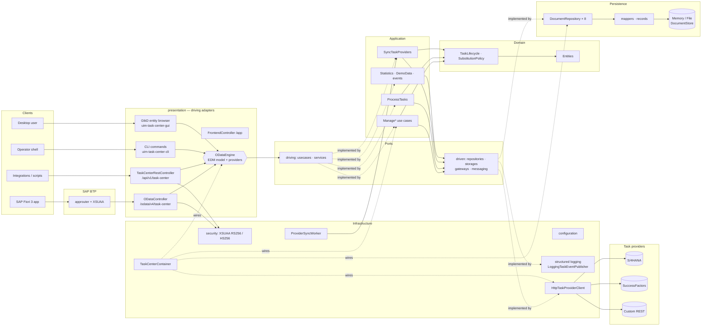
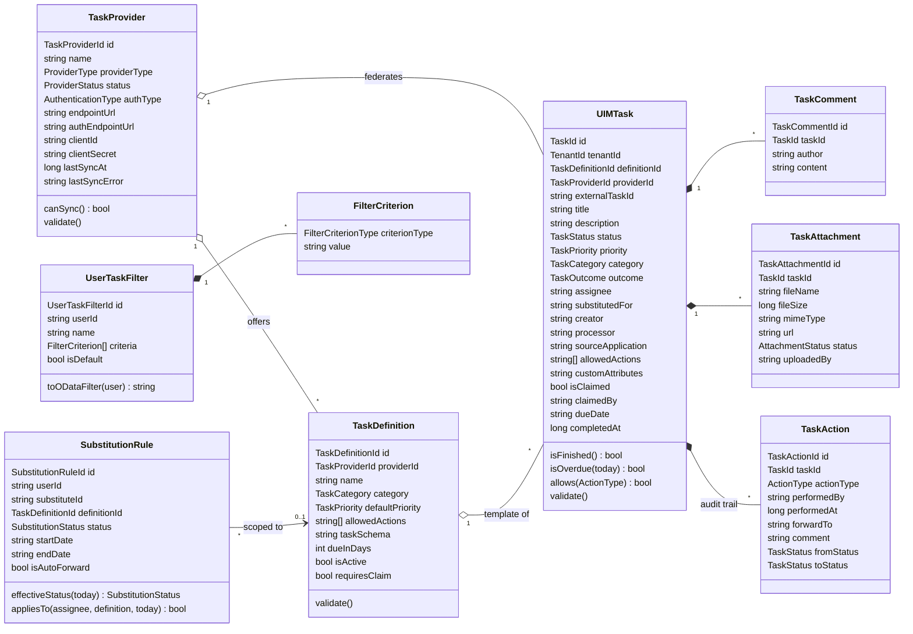
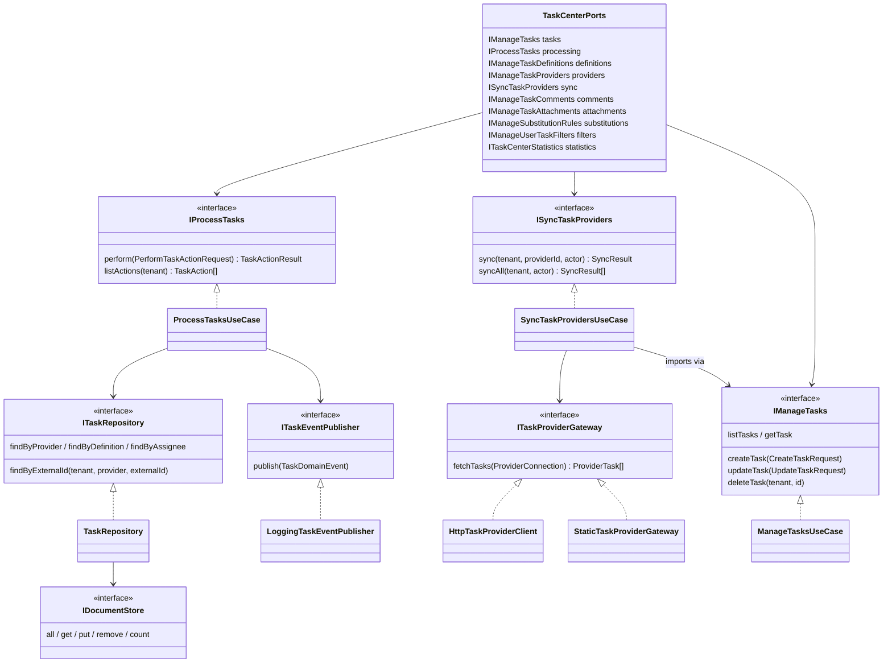
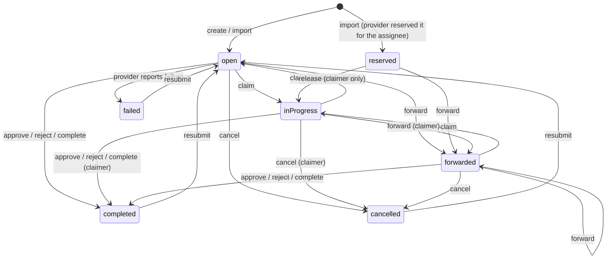
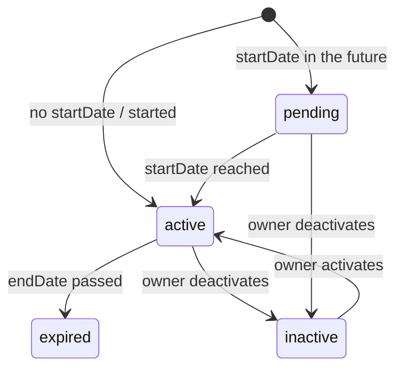
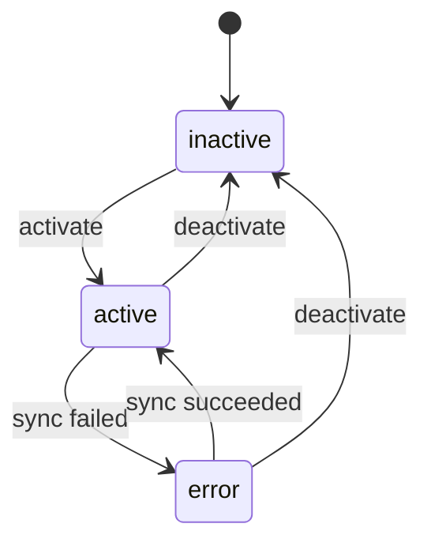
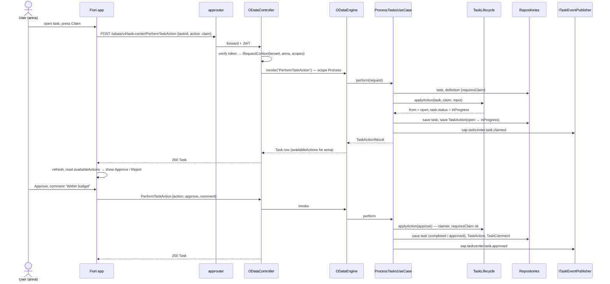
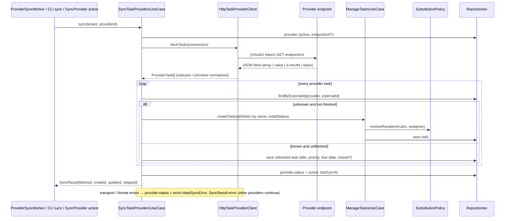

# UML — Task Center

These diagrams describe the 2.0 implementation in
`backend/source/uim/platform/task_center/`.

## Component diagram (hexagonal architecture)

Dependencies point inwards: `domain` imports nothing of the outer layers,
`application` depends on `ports` interfaces only, adapters depend on ports.

## Domain class diagram

Every entity mixes in `TenantEntity` (id, tenantId, createdAt/By, updatedAt/By).

### Enumerations and domain services

```mermaid
classDiagram
  class TaskStatus { <<enumeration>> open reserved inProgress forwarded completed cancelled failed }
  class TaskPriority { <<enumeration>> low medium high veryHigh }
  class TaskCategory { <<enumeration>> approval review toDoItem notification action workflow informational }
  class TaskOutcome { <<enumeration>> none approved rejected completed cancelled }
  class ActionType { <<enumeration>> claim release forward approve reject complete cancel escalate resubmit }
  class ProviderType { <<enumeration>> s4hana successFactors ariba fieldglass concur sapBuild custom }
  class ProviderStatus { <<enumeration>> active inactive syncing error }
  class AuthenticationType { <<enumeration>> none oauth2 basicAuth apiKey certificate saml }
  class SubstitutionStatus { <<enumeration>> active inactive pending expired }
  class AttachmentStatus { <<enumeration>> uploaded processing available deleted }
  class FilterCriterionType { <<enumeration>> status priority provider category dueDate assignee creator taskDefinition }

  class TaskLifecycle {
    <<domain service>>
    checkAction(task, action, input)
    applyAction(task, action, input) TaskStatus
    availableActions(task, actor, requiresClaim) ActionType[]
    escalated(priority) TaskPriority
  }
  class SubstitutionPolicy {
    <<domain service>>
    resolveRecipient(rules, assignee, definition, today) Recipient
    checkForwardingCycle(rules, candidate, today)
    periodsOverlap(s1, e1, s2, e2) bool
  }
  class TaskCenterException {
    TaskCenterErrorKind kind
  }
  class TaskCenterErrorKind { <<enumeration>> invalid notFound conflict ruleViolation forbidden gateway }
  TaskCenterException --> TaskCenterErrorKind
```

## Ports and application

## State machines

### Task

`escalate` keeps the status and raises the priority. Definitions with
*requires claim* only accept decisions in `inProgress`.

### Substitution rule (effective status)

### Task provider

## Sequence: claim and approve a task (Fiori, OData)

## Sequence: provider sync (federation)

## Deployment diagram

```mermaid
flowchart TB
  subgraph CF[SAP BTP · Cloud Foundry space]
    AR[task-center-approuter\nnode.js · Fiori resources]
    SRV[task-center-srv\nbinary buildpack\nuim-task-center-platform-service]
    UAA[(task-center-xsuaa\nxsuaa · application)]
    UPS[(task-center-config\nuser-provided)]
    AR -- destination task-center-srv\nforwardAuthToken --> SRV
    AR -. login .-> UAA
    SRV -. VCAP_SERVICES verificationkey .-> UAA
    SRV -. syncTenants .-> UPS
  end
  Browser((Browser)) --> AR
  SRV --> Prov[(Task providers)]

  subgraph K8s[Kubernetes · namespace uim-platform]
    DEP[Deployment task-center\nreplicas 1 · Recreate]
    CM[ConfigMap task-center-config]
    SVCK[Service task-center :8103]
    VOL[(volume /data)]
    CM --> DEP
    SVCK --> DEP
    DEP --> VOL
  end

  subgraph Desktop[Workstation]
    CLIX[uim-task-center-cli]
    GUIX[uim-task-center-gui]
    FILE[(data/task-center.json)]
    CLIX --> FILE
    GUIX --> FILE
  end
```

