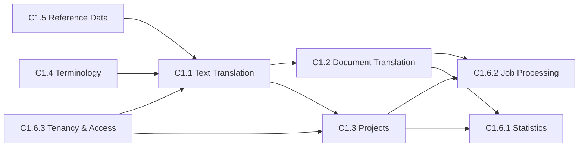

# NAF v4 Architecture Description — Translation Hub Service

> NATO Architecture Framework v4 (NAF v4) description of the UIM Platform Translation
> Hub service. It covers synchronous text and document translation, translation projects
> with per-language texts, the company glossary, quality estimation and asynchronous
> jobs. These are exposed through REST, OData v4 (SAP Fiori), a CLI and a desktop GUI.

---

## 1. NAF v4 Grid Mapping

| NAF View | Viewpoint | Covered Below |
|---|---|---|
| **NCV** – Capability View | C1 Capability Taxonomy, C2 Enterprise Vision, C3 Capability Dependencies | §2 |
| **NSV** – Service View | NSOV-1 Service Taxonomy, NSOV-2 Service Definitions, NSOV-3 Service Interfaces | §3 |
| **NOV** – Operational View | NOV-1 Concept, NOV-2 Node Connectivity, NOV-5 Operational Activities | §4 |
| **NLV** – Logical View | NLV-1 Logical Data Model, NLV-2 Logical Components, NLV-6 State Transitions | §5 |
| **NPV** – Physical View | NPV-1 Physical Deployment, NPV-2 Configuration | §6 |
| **NIV** – Information View | NIV-1 Information Structure, NIV-2 Business Rules | §7 |
| **Architecture decisions** | — | §8 |
| **Traceability** | capabilities → services → components | §9 |

---

## 2. Capability View (NCV)

### C1 – Capability Taxonomy

```
C1  Translation
├── C1.1  Text Translation
│   ├── C1.1.1  Software / UI text translation (batch, text types, domains)
│   ├── C1.1.2  Provider selection (MLTR, neural MT, company MLTR, LLM)
│   └── C1.1.3  Quality estimation & truncation risk
├── C1.2  Document Translation
│   ├── C1.2.1  Synchronous (plain, Markdown, HTML, JSON values, .properties values)
│   └── C1.2.2  Asynchronous jobs (submit, process, cancel, retry)
├── C1.3  Software Translation Projects
│   ├── C1.3.1  Project management (file, Git, ABAP, API sources; languages; provider)
│   ├── C1.3.2  Text management (text keys, text types, max length, context)
│   ├── C1.3.3  Project translation runs & progress tracking
│   ├── C1.3.4  Manual translation & review (human in the loop)
│   └── C1.3.5  Import / export of .properties resource bundles
├── C1.4  Terminology
│   ├── C1.4.1  Company glossary (mandatory / optional, domain-specific)
│   └── C1.4.2  Glossary enforcement during translation
├── C1.5  Reference Data
│   └── C1.5.1  Languages, domains, text types, providers
└── C1.6  Operations
    ├── C1.6.1  Statistics / KPIs
    ├── C1.6.2  Background job processing
    └── C1.6.3  Multi-tenancy & role-based access (XSUAA)
```

### C2 – Enterprise Vision

| Goal | Outcome |
|---|---|
| Ship multilingual software faster | Developers push resource bundles (CLI / REST), translate the whole project in one run, and export the bundles per language. |
| Consistent terminology | Company terms are enforced during machine translation; machine translation cannot break protected terms. |
| Controlled quality | Every translation carries a score, a level and a truncation-risk flag; translators review or override it, and reviewed translations are never overwritten. |
| One service, many channels | The same core serves pipelines (REST/CLI), business users (Fiori) and desktop translators (GtkD). |
| Provider independence | Engines are behind one gateway, so MLTR, NMT or LLM can be swapped per project or per request. |

### C3 – Capability Dependencies



---

## 3. Service View (NSV)

### NSOV-1 – Service Taxonomy

| Service | Kind | Port |
|---|---|---|
| S1 Perform Translation | synchronous, stateless | `IPerformTranslationUseCase` |
| S2 Manage Projects | resource + actions | `IManageProjectsUseCase` |
| S3 Manage Project Texts | resource + actions | `IManageProjectTextsUseCase` |
| S4 Manage Glossary | resource | `IManageGlossaryUseCase` |
| S5 Manage Jobs | resource + actions + batch | `IManageJobsUseCase` |
| S6 Catalog | read-only reference data | `ITranslationCatalogService` |
| S7 Statistics | read-only aggregate | `ITranslationStatisticsService` |
| S8 Translation Engine | driven (external) | `ITranslationProviderGateway` |
| S9 Event Publishing | driven (external) | `ITranslationEventPublisher` |
| S10 Snapshot Storage | driven (technical) | `ISnapshotStorage` |

### NSOV-2 – Service Definitions

| Service | Operations | Pre-/post-conditions |
|---|---|---|
| S1 | `translateTexts`, `translateDocument` | Languages supported and different; batch ≤ `maxBatchSize`, text ≤ `maxTextLength`, document ≤ `maxDocumentLength`; the provider must be known (422) and available (409). Nothing is stored. |
| S2 | CRUD, `activate`, `translate(force)`, `archive`, `reopen` | Name unique and fixed; archived projects are read-only; delete cascades to texts and is blocked by open jobs. |
| S3 | CRUD, `translate`, `setTranslation(language, text)`, `review(language)` | Key unique per project; a change of the source text discards its translations; a manual translation is reviewed with quality 100. |
| S4 | CRUD | Term unique per pair and domain (case-insensitive); the name is derived. |
| S5 | create, delete, `process`, `processPending(limit)`, `cancel`, `retry` | Jobs are immutable (update → 409); running jobs cannot be deleted; failures are stored, never thrown. |
| S6 | `languages`, `domains`, `textTypes`, `providers` | static; providers report availability |
| S7 | `statistics(tenant)` | derived from the repositories at call time |
| S8 | `translate`, `available` | must keep placeholders `⟦n⟧` unchanged |

### NSOV-3 – Service Interfaces

| Interface | Protocol | Endpoint | Consumers |
|---|---|---|---|
| REST | HTTP/JSON | `/api/v1/translation/{translate, documents/translate[/async], process-jobs, statistics, resources, <resource>[/{id}[/<action>]]}` | build pipelines, other services |
| OData v4 | HTTP/JSON + CSDL | `/odata/v4/translation` (entity sets, `Statistics`, unbound actions, `$metadata`) | SAP Fiori app |
| CLI | process | `uim-translation-cli <command>` | developers, automation |
| GUI | GTK 3 | `uim-translation-gui` | desktop translators |
| Health | HTTP | `/api/v1/health` | CF / Kubernetes probes |

---

## 4. Operational View (NOV)

### NOV-1 – Concept

Developers push resource bundles (`import-texts`, REST) into a translation project. A
translation run fills every target language, with glossary terms enforced. Translators
check low-quality or truncation-risk texts in the Fiori app or the GUI, override and
review them. The bundles are then exported per language (`export-texts`). Ad-hoc texts
and documents are translated synchronously, or as background jobs when they are large.

### NOV-2 – Operational Node Connectivity

| From | To | Exchange |
|---|---|---|
| Business user (browser) | Approuter | HTTPS, XSUAA login |
| Approuter | translation-srv | OData v4 / REST with forwarded JWT |
| CI pipeline | translation-srv | REST (texts, project runs, export via CLI) |
| Developer workstation | snapshot storage | CLI / GUI on the same `data/` directory |
| translation-srv | translation engines | `ITranslationProviderGateway` (simulated by default) |
| translation-srv | event broker / log | `ITranslationEventPublisher` |

### NOV-5 – Operational Activities

| # | Activity | Actor | Service |
|---|---|---|---|
| A1 | Maintain glossary terms | Terminologist (Admin) | S4 |
| A2 | Create a project, define languages and provider | Admin | S2 |
| A3 | Import source texts | Developer / CI | S3 |
| A4 | Run translation (project or software job) | Translator / worker | S2, S5 |
| A5 | Review, correct or set translations | Translator | S3 |
| A6 | Export translated bundles | Developer / CI | S3 (CLI) |
| A7 | Translate ad-hoc texts and documents | Any user | S1, S5 |
| A8 | Monitor progress and quality | Lead | S7 |

---

## 5. Logical View (NLV)

### NLV-1 – Logical Data Model

| Entity | Key | Main attributes | Relations |
|---|---|---|---|
| TranslationProject | tenantId + id | name, projectType, sourceLanguage, targetLanguages[], provider, domainName, status, textCount, completionPercent | 1 → * ProjectText |
| ProjectText | tenantId + id | projectId, name (key), sourceText, textType, maxLength, status | * → 1 project; 1 ◆ * TextTranslation |
| TextTranslation (value) | language within text | text, provider, qualityScore, glossaryHits, reviewed | — |
| GlossaryEntry | tenantId + id | source/target language, source/target term, domainName, mandatory, caseSensitive | — |
| TranslationJob | tenantId + id | jobType, projectId, languages, provider, content, translatedContent, quality, status, attempts | * → 0..1 project |
| Language / TranslationDomain / TextTypeInfo / ProviderInfo | id | reference data | — |

### NLV-2 – Logical Components

| Layer | Components |
|---|---|
| Domain | entities, value objects, enumerations, exceptions; services `languages`, `catalogs`, `glossary`, `quality`, `names`, `lifecycle` |
| Ports | `TranslationPorts` (driving), `TranslationRepositories`, `ITranslationProviderGateway`, `ITranslationEventPublisher`, `ISnapshotStorage` (driven) |
| Application | `ResourceUseCase<…>` with the project, text, glossary and job interactors; `PerformTranslationUseCase`; `Translator`, `ProjectTranslationService`, catalog, statistics, `EventRecorder` |
| Persistence | repositories, `RecordMapper<T>`, `SnapshotTenantStore`, `JsonFileSnapshotStorage`, `MemorySnapshotStorage` |
| Infrastructure | `TranslationConfig` (defaults → file → env → VCAP), identity (XSUAA), `SimulatedTranslationProvider`, `JobWorker`, `Container` |
| Presentation | `ResourceRegistry` (`ResourceAdapter`, `CatalogAdapter`), REST, OData v4 (model, metadata, query, controller), CLI, GtkD GUI, web (Fiori app) |
| Frontend | UI5 app `uim.translation`: Main (overview, workbench, tabs), ProjectDetail object page |

### NLV-6 – State Transitions

| Entity | States | Triggers |
|---|---|---|
| Project | draft → active → inProgress ⇄ completed; * → archived → active | activate, translation run, progress, archive, reopen |
| Text | untranslated → partial → translated → reviewed | translation, review, source change (→ untranslated), new target language |
| Job | pending → processing → completed / failed; pending/processing → cancelled; failed/cancelled → pending | worker / process, cancel, retry |

See [UML.md](UML.md) for the state diagrams.

---

## 6. Physical View (NPV)

### NPV-1 – Physical Deployment

| Target | Artefacts | Notes |
|---|---|---|
| SAP BTP Cloud Foundry | `mta.yaml`: `translation-srv` (binary buildpack), `translation-approuter`, `translation-xsuaa`, `translation-config` | the approuter serves the Fiori app from `resources/` |
| Kubernetes / Podman | `backend/Containerfile`, `k8s/` (ConfigMap, Deployment, Service) | image with server, CLI, config and Fiori app; `/app/data` volume |
| Workstation | `uim-translation-cli`, `uim-translation-gui` | share `data/` with a local server |

### NPV-2 – Configuration

| Key | Default | Source |
|---|---|---|
| host / port | 0.0.0.0 / 8096 | `TRANSLATION_HOST/PORT`, `PORT` |
| storage / dataDir | file / data | `TRANSLATION_STORAGE`, `TRANSLATION_DATA_DIR` |
| odataPath / restPath | /odata/v4/translation · /api/v1/translation | env |
| jobIntervalSeconds / jobTenants | 5 / default | env, VCAP |
| providers / defaultProvider | all four / machineMt | env, VCAP |
| maxTextLength / maxBatchSize / maxDocumentLength | 5000 / 100 / 1 000 000 | env, VCAP |
| frontendDir | ../frontend | env |

The precedence is: defaults → `config/default.json` → environment → `VCAP_SERVICES`
(`translation-config`).

---

## 7. Information View (NIV)

### NIV-1 – Information Structure

- **Payloads** are derived by reflection from the domain structs. Enums are written by
  name, timestamps as ISO 8601 strings and ids as strings.
- **OData** exposes the same structure: entity types, the complex types
  `TextTranslation`, `TranslatedText`, `TranslateTextsResult`,
  `DocumentTranslationResult` and `JobRunReport`, and `Common.Label` annotations.
- **Records** are JSON snapshots, one file per collection
  (`{schemaVersion, collection, records}`). Timestamps are stored as raw std time.

### NIV-2 – Business Rules

| # | Rule | Enforced in |
|---|---|---|
| R1 | Languages must be supported BCP-47 tags (primary subtag in the catalogue) and are normalized (`de_ch` → `de-CH`). | `languages.requireLanguage` |
| R2 | Source and target language differ; project target languages are unique. | `validateLanguagePair`, `requireTargetLanguages` |
| R3 | Project names are unique per tenant and fixed; the source language is fixed once texts exist. | `ManageProjectsUseCase` |
| R4 | Git projects need a repository URL (the default branch is `main`); ABAP projects need a system ID. | `ManageProjectsUseCase.check` |
| R5 | Archived projects are read-only (texts, runs, software jobs). | `lifecycle.ensureWritable` |
| R6 | Text keys are unique per project and match `[A-Za-z0-9_.-]{1,120}`. | `names.validateTextKey` |
| R7 | Changing a source text discards its translations. | `ManageProjectTextsUseCase.apply` |
| R8 | Reviewed translations are never replaced by machine runs, `force` included. | `ProjectTranslationService.translateText` |
| R9 | Mandatory glossary terms are enforced by every provider, optional ones only by `companyMltr`; matching is whole-word and case-insensitive unless `caseSensitive`. | `glossary.applicableEntries`, `protectTerms` |
| R10 | Quality is the engine score + 2 per glossary hit, −20 above an explicit maxLength, clamped to 1–100. | `quality.adjustQuality` |
| R11 | Jobs are immutable; only pending jobs are processed, only pending or processing jobs are cancelled, only failed or cancelled jobs are retried. | `lifecycle`, `ManageJobsUseCase` |
| R12 | A project with open jobs cannot be deleted; deleting a project deletes its texts. | `ManageProjectsUseCase` |
| R13 | Reference data is read-only (405). | `CatalogAdapter` |

---

## 8. Architecture Decisions

| # | Decision | Rationale | Consequence |
|---|---|---|---|
| AD1 | Hexagonal layout per the `fiori-vibed-architecture` skill (domain / ports / application / persistence / infrastructure / presentation) | Same structure as `connectivity`; clear dependency direction | Presentation sees only `TranslationPorts` |
| AD2 | Protocol-neutral resource registry | REST, OData, CLI and GUI share validation, naming and actions | New resources appear in all channels at once |
| AD3 | Compile-time reflection codec | Payloads, records, `$metadata`, tables and forms come from the structs | No hand-written mappers; PATCH via `decode(patch, base)` |
| AD4 | Glossary protection with placeholders | Engines cannot mistranslate company terms | The engine gateway must preserve `⟦n⟧` |
| AD5 | Provider gateway with a deterministic simulated engine | Offline development and reproducible tests | Real MLTR / NMT / LLM clients plug in without use-case changes |
| AD6 | Jobs store failures instead of throwing | Background work stays observable | `statusMessage` and `attempts`; retry action |
| AD7 | JSON snapshot storage shared by server, CLI and GUI | Simple local operation, no database | Not for concurrent writers at scale; replace `ISnapshotStorage` for production |
| AD8 | Keep `/api/v1/translation/*` paths | Existing clients keep working | List response shape changed to `{items, count}` |
| AD9 | OData without `$batch` | Smaller controller | UI5 model uses `groupId: "$direct"` |
| AD10 | JWT decoded, not verified, in the backend | The approuter validates tokens | Do not expose the backend without signature verification |

---

## 9. Traceability Matrix

| Capability | Service | Components | Adapters |
|---|---|---|---|
| C1.1 Text translation | S1, S8 | `PerformTranslationUseCase`, `Translator`, `quality` | REST `/translate`, OData `TranslateTexts`, CLI `translate`, GUI workbench, Fiori Translate tab |
| C1.2.1 Document translation | S1 | `Translator.translateDocument` | REST `/documents/translate`, OData `TranslateDocument`, CLI `translate-document` |
| C1.2.2 Async jobs | S5 | `ManageJobsUseCase`, `JobWorker` | REST `/jobs`, `/process-jobs`; OData `TranslationJobs`, `ProcessJobs`; CLI `process-jobs`; Fiori Jobs tab |
| C1.3.1 Projects | S2 | `ManageProjectsUseCase`, `ProjectTranslationService` | `/projects`, `TranslationProjects`, Fiori Projects + ProjectDetail |
| C1.3.2–4 Texts, runs, review | S3 | `ManageProjectTextsUseCase`, `lifecycle` | `/texts`, `ProjectTexts`, actions `translate`, `set-translation`, `review` |
| C1.3.5 Import / export | S3 | `TranslationCli.importTexts/exportTexts`, `parseProperties` | CLI |
| C1.4 Terminology | S4 | `ManageGlossaryUseCase`, `glossary` | `/glossaries`, `GlossaryEntries` |
| C1.5 Reference data | S6 | `TranslationCatalogService`, `CatalogAdapter` | `/languages`, `/domains`, `/text-types`, `/providers` |
| C1.6.1 Statistics | S7 | `TranslationStatisticsService` | `/statistics`, `Statistics`, CLI `stats`, GUI Overview, Fiori KPI header |
| C1.6.3 Tenancy & access | — | `resolveIdentity`, `xs-security.json` | Approuter routes and scopes |
