# UML — Translation Hub Service

Diagrams of the hexagonal backend (`backend/source/uim/platform/translation`), the
Fiori frontend and the BTP deployment. All diagrams are Mermaid.

## Class Diagram — Domain Entities

All aggregates mix in `TenantEntity` (`tenantId`, `id`, `createdBy/At`, `updatedBy/At`).
Project texts belong to one project and carry one `TextTranslation` per target language.
Jobs of type `software` reference a project; text and document jobs carry their content.

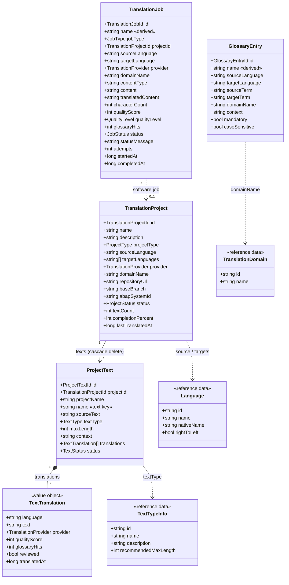

## Class Diagram — Enumerations

```mermaid
classDiagram
    class ProjectType { <<enumeration>> file git abap api }
    class ProjectStatus { <<enumeration>> draft active inProgress completed archived }
    class TextStatus { <<enumeration>> untranslated partial translated reviewed }
    class TextType { <<enumeration>> uiText tooltip errorMessage documentation notification emailBody reportTitle log }
    class TranslationProvider { <<enumeration>> mltr machineMt companyMltr llm }
    class QualityLevel { <<enumeration>> excellent good adequate poor unknown }
    class JobType { <<enumeration>> text document software }
    class JobStatus { <<enumeration>> pending processing completed failed cancelled }
```

## Class Diagram — Domain and Application Services

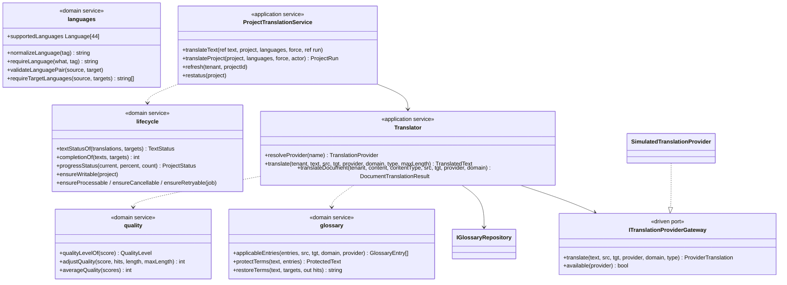

## State Diagram — Lifecycles

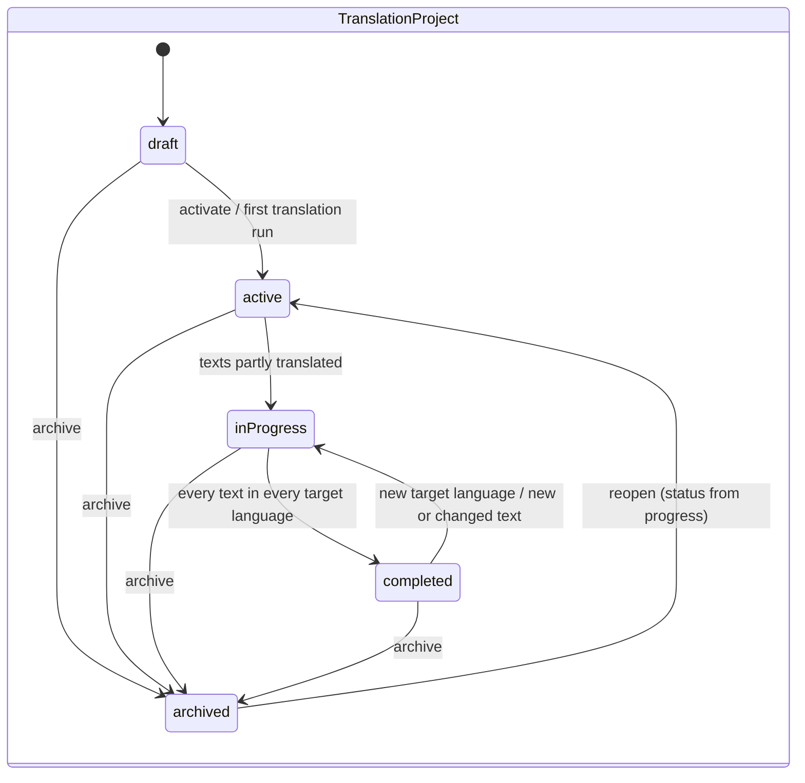

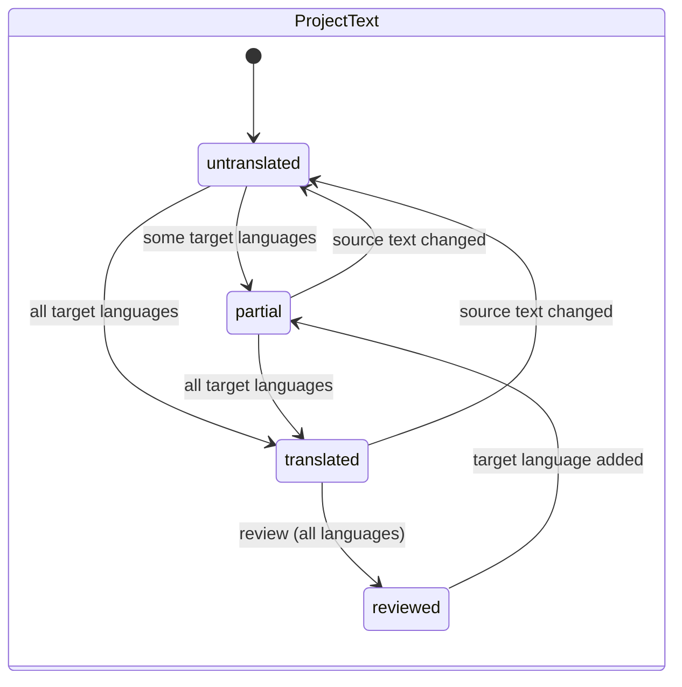

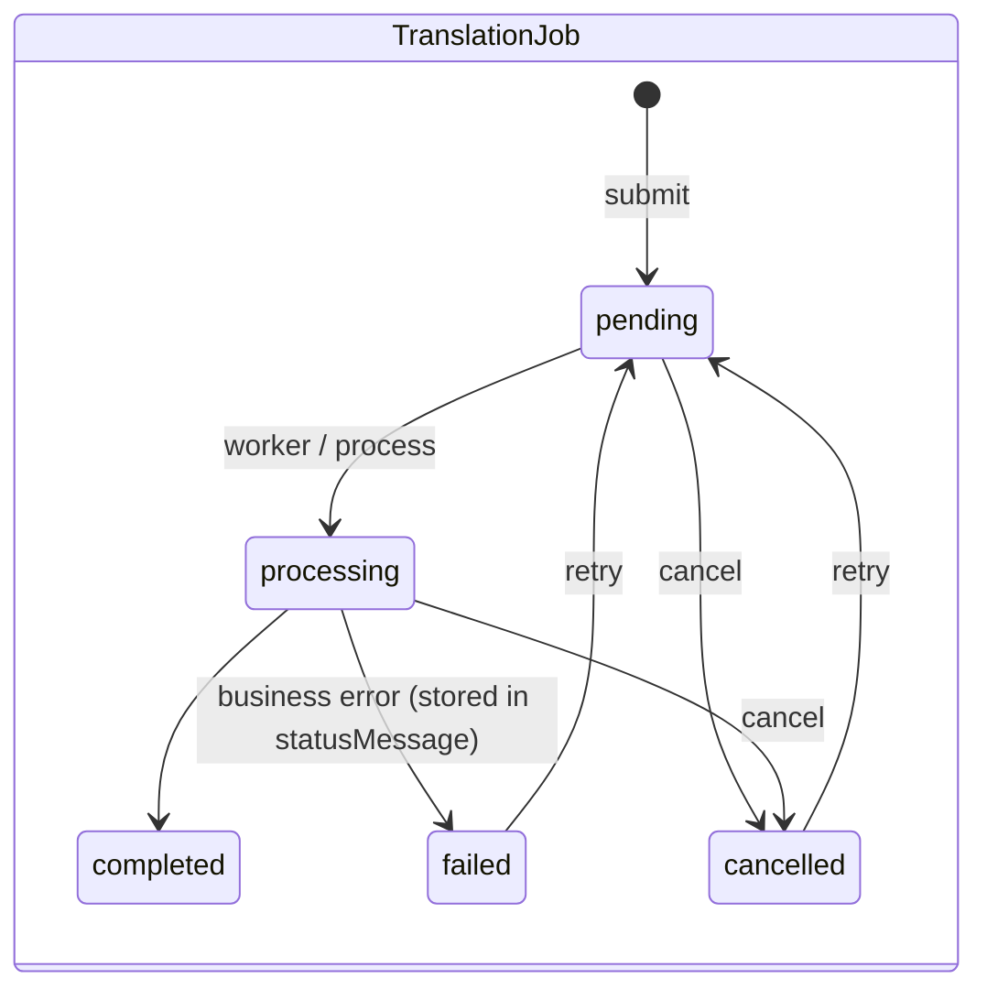

## Activity Diagram — Translation pipeline (`Translator.translate`)

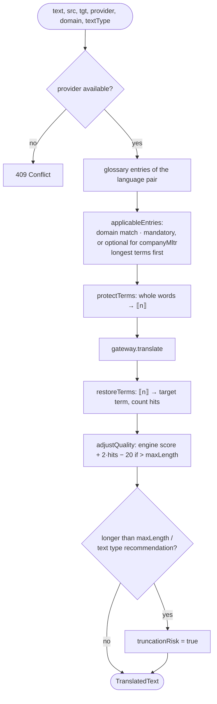

## Component Diagram — Hexagonal Architecture

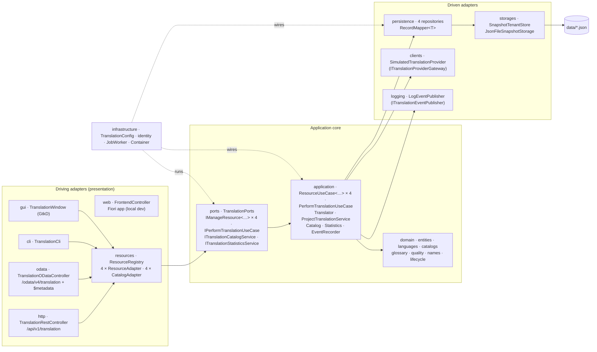

Dependencies point inwards. Presentation knows only `TranslationPorts`. Use cases know
only the port interfaces (`TranslationRepositories`, `ITranslationProviderGateway`,
`ITranslationEventPublisher`).

## Class Diagram — Generic use cases and adapters

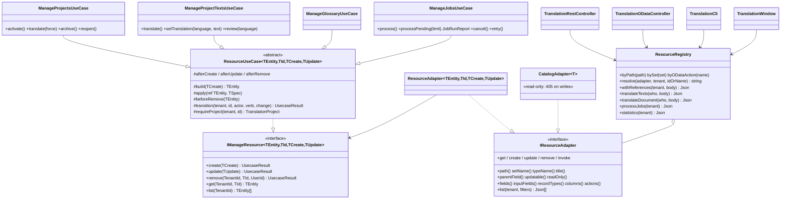

## Sequence Diagram — Fiori translates a project

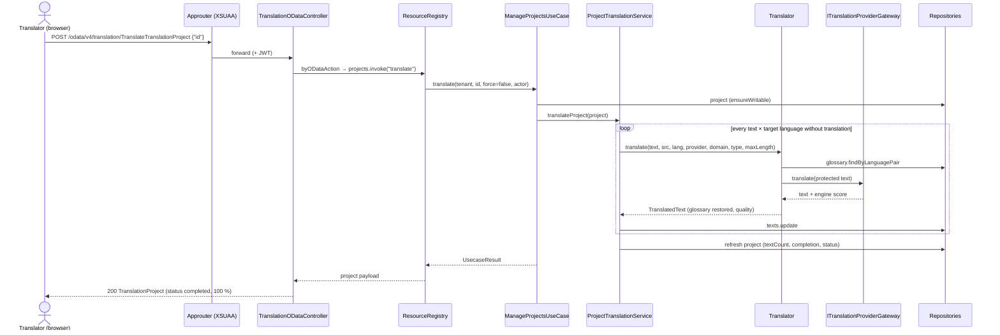

## Sequence Diagram — Asynchronous document job

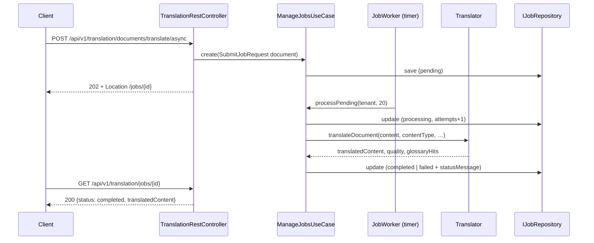

## Sequence Diagram — CLI and server share data

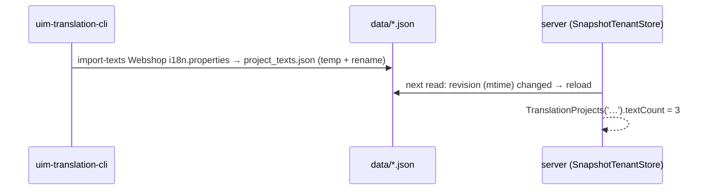

## Deployment Diagram — SAP BTP (Cloud Foundry)

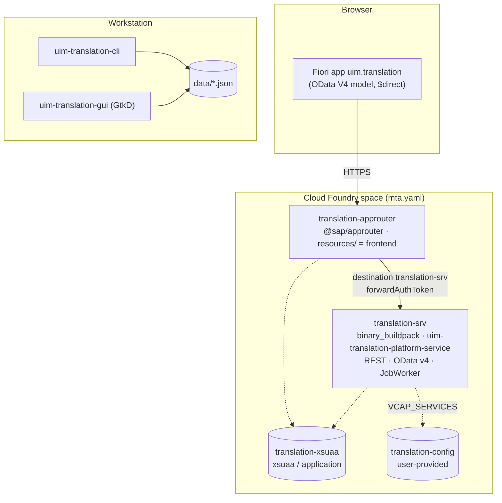
