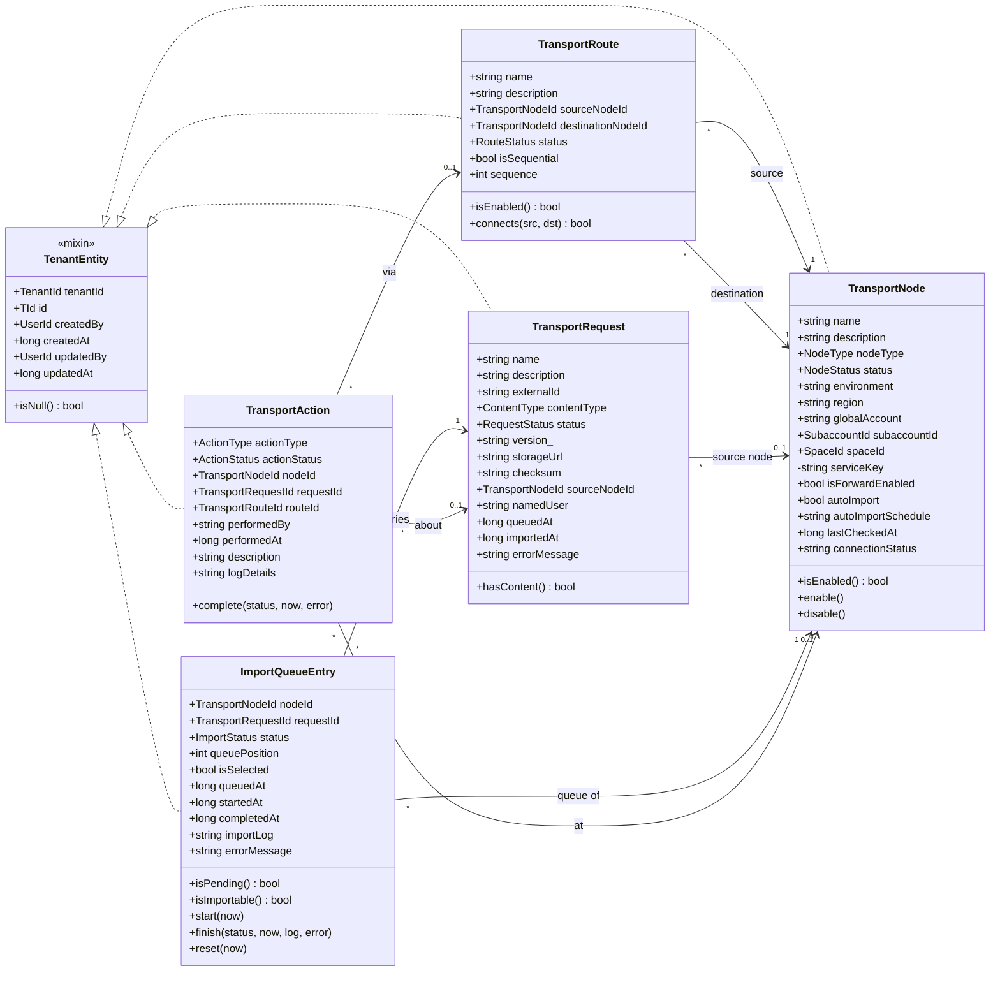
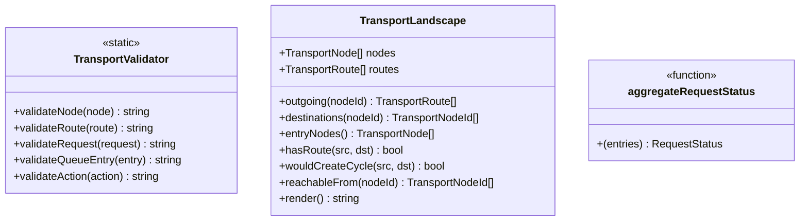
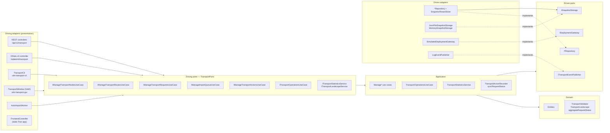
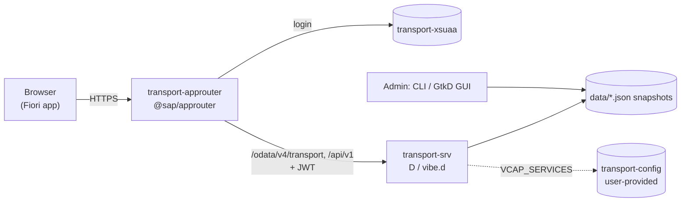
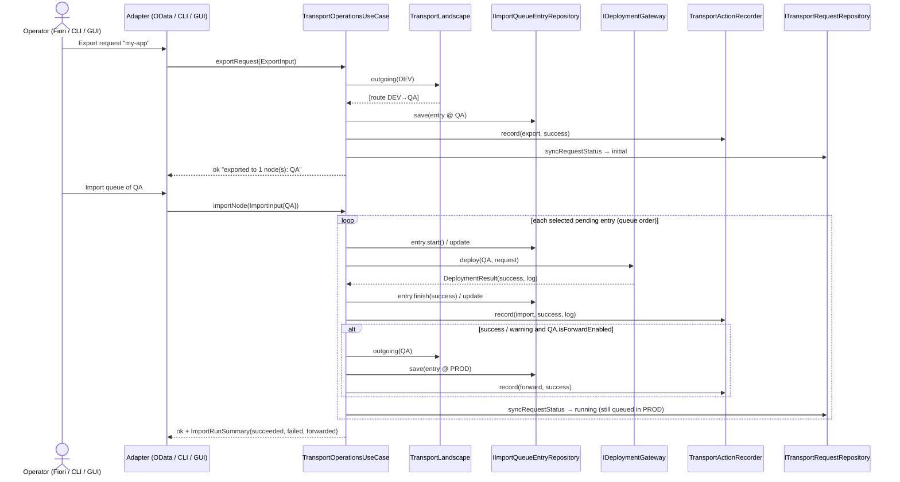
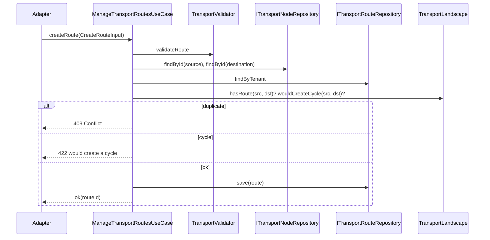
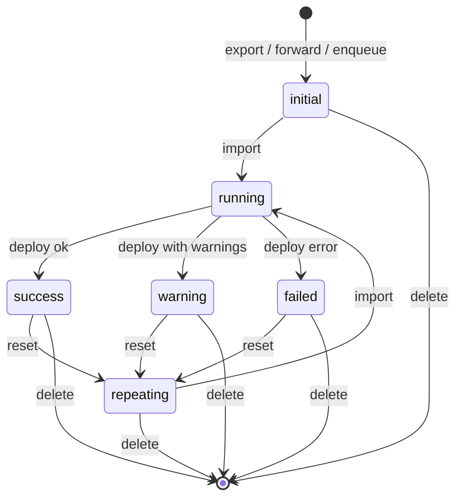
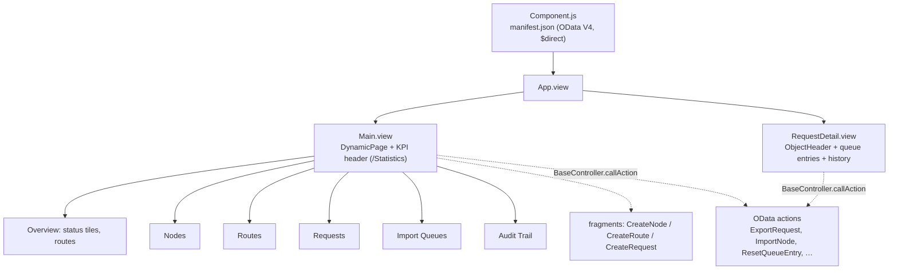

# UML Diagrams — Cloud Transport Management

Diagrams of the redesigned transport service (backend `backend/source/uim/platform/transport`,
Fiori app `frontend/`, approuter `approuter/`). See [README.md](README.md) for the
overview and [NAFv4.md](NAFv4.md) for the architecture description.

## 1. Domain model (class diagram)

### Enumerations

```mermaid
classDiagram
    direction LR
    class NodeType {
        <<enumeration>>
        cloudFoundry
        abap
        neo
        kyma
        other
    }
    class NodeStatus {
        <<enumeration>>
        enabled
        disabled
    }
    class RouteStatus {
        <<enumeration>>
        enabled
        disabled
    }
    class ContentType {
        <<enumeration>>
        mtaArchive
        integrationContent
        htmlApp
        abapCorContent
        other
    }
    class RequestStatus {
        <<enumeration>>
        initial
        running
        success
        failed
        warning
        outdated
        repeating
    }
    class ImportStatus {
        <<enumeration>>
        initial
        running
        success
        failed
        warning
        repeating
    }
    class ActionType {
        <<enumeration>>
        export
        import
        forward
        reset
        delete
        schedule
    }
    class ActionStatus {
        <<enumeration>>
        initial
        running
        success
        failed
        warning
    }
```

External names drop D's trailing underscore (`ActionType.export_` ⇄ `"export"`), see
`domain/enumerations/names.d`.

### Domain services

## 2. Hexagonal architecture (component diagram)

`infrastructure/container.d` wires everything; the entry points `app.d`, `cli.d` and
`gui.d` build the adapters on `container.ports`.

## 3. Deployment view (SAP BTP)

## 4. Sequence — export, import and forward

## 5. Sequence — creating a route (cycle protection)

## 6. State machine — import queue entry

The aggregated request status follows: any `failed` → failed; any `running` → running;
any `repeating` → repeating; some `initial` and some finished → running (in transit);
all `initial` → initial; any `warning` → warning; otherwise success.

## 7. Presentation — Fiori app structure

