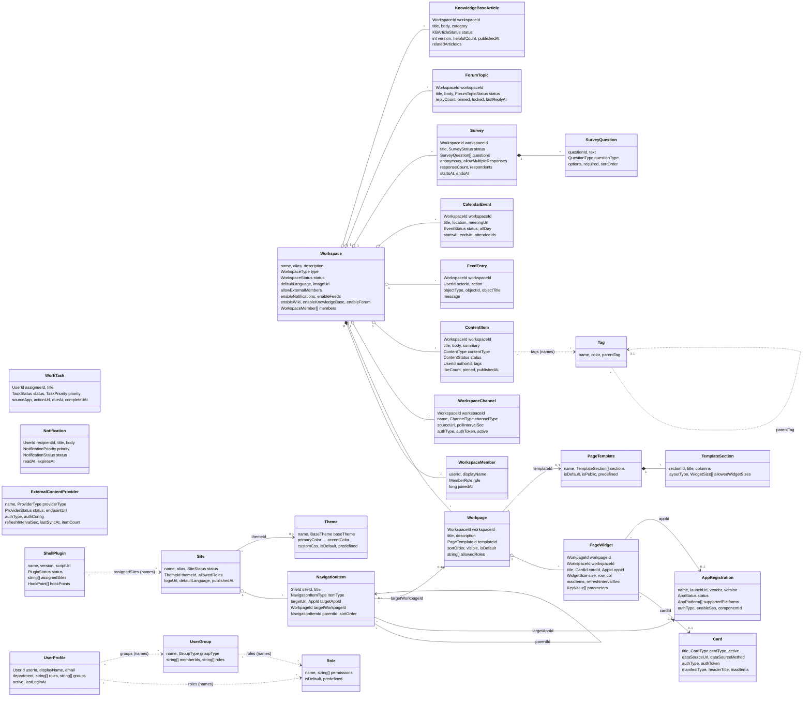
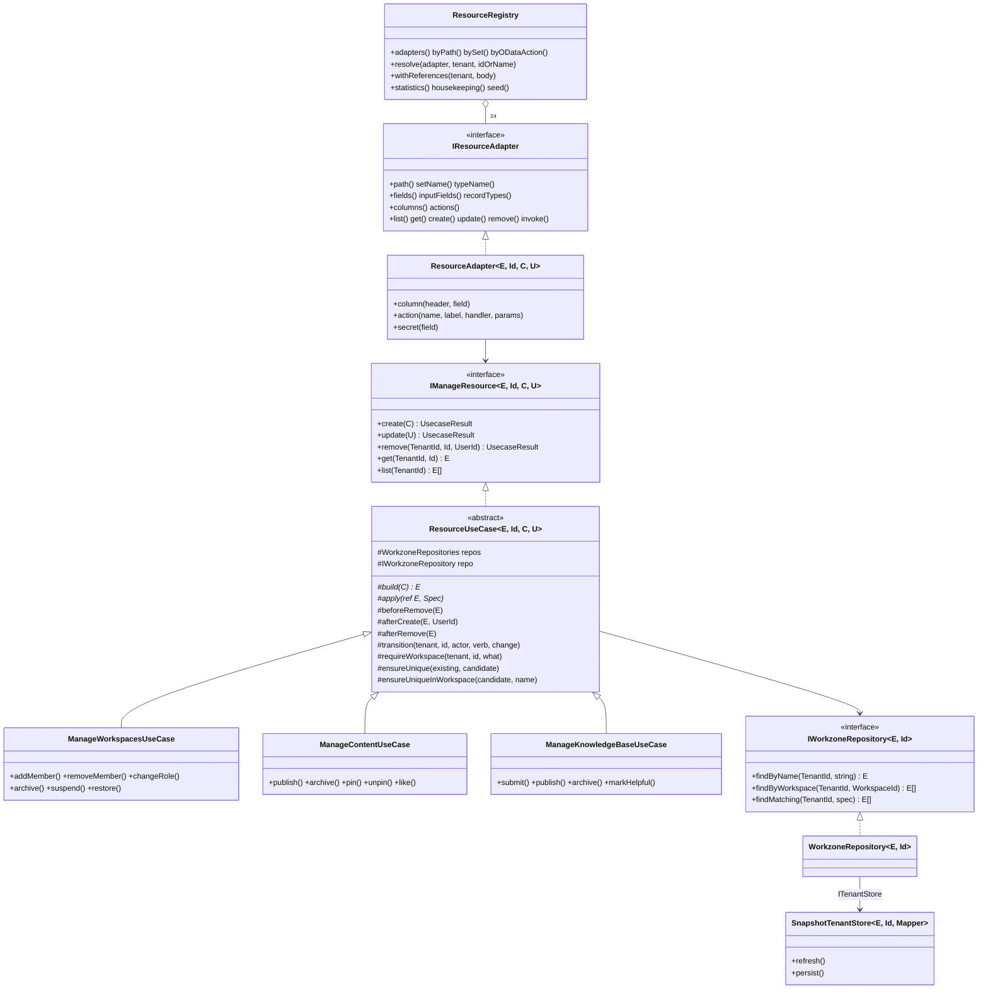
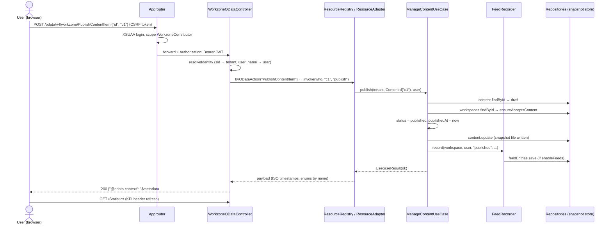
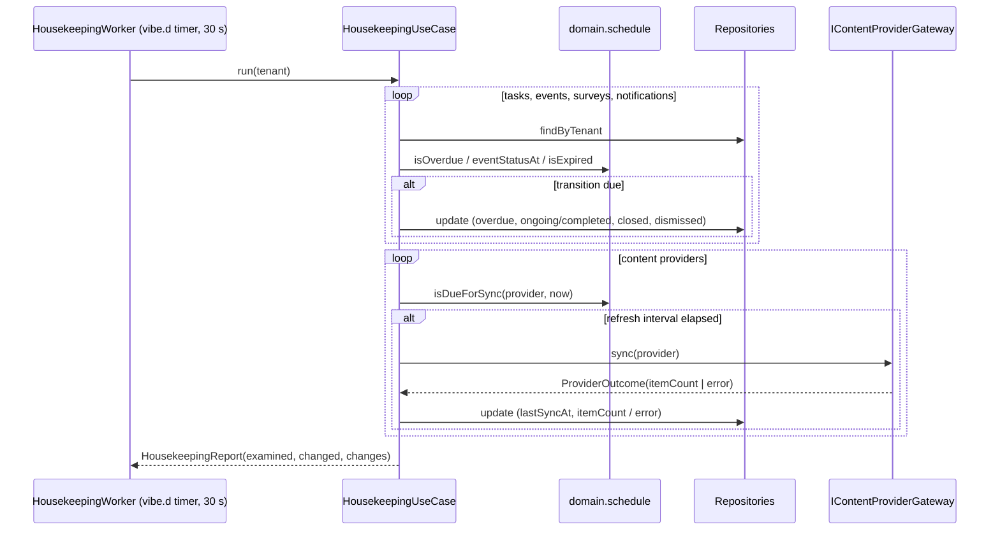
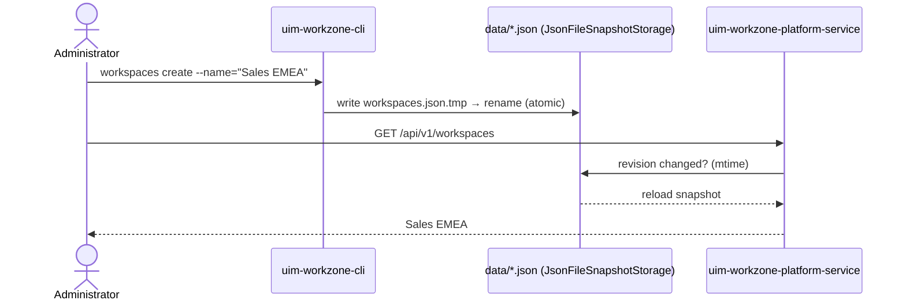
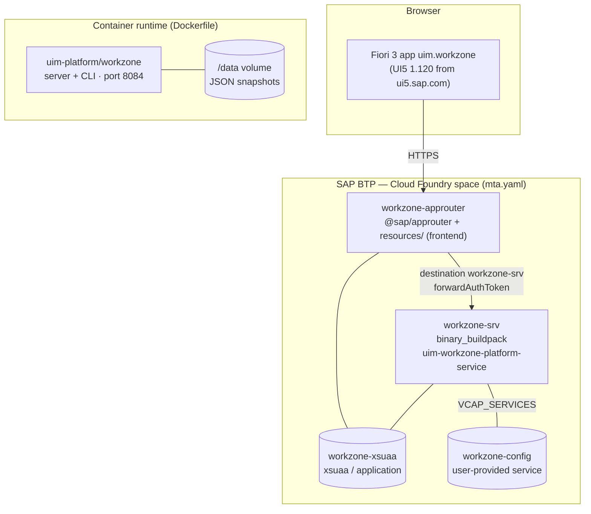

# UML — Work Zone Service

Diagrams of the Work Zone service (backend `uim.platform.workzone`, Fiori app
`uim.workzone`, approuter). All diagrams use Mermaid.

## Class Diagram — Domain Entities

Every aggregate mixes in `TenantEntity!(Id)` (`tenantId`, `id`, `createdBy`,
`createdAt`, `updatedBy`, `updatedAt`). References to roles, groups and sites are
kept by name; all other references are typed ids.

`o--` marks containment with cascading deletion (workspace → content, workpage →
widgets, site → navigation). `..>` marks references by name.

## State Diagram — Lifecycles

Transitions are triggered by actions (REST `POST /<resource>/<id>/<action>`, OData
`<Action><Type>`, CLI, GUI). Transitions marked *(housekeeping)* happen on their own
when time passes.

```mermaid
stateDiagram-v2
  state "Workspace" as WS {
    [*] --> active
    active --> archived : archive
    active --> suspended : suspend
    archived --> active : restore
    suspended --> active : restore
  }
  state "Content item" as CI {
    [*] --> draft
    draft --> published : publish (body required → feed entry)
    draft --> ciArchived : archive
    published --> ciArchived : archive
  }
  state "Knowledge base article" as KB {
    [*] --> kbDraft
    kbDraft --> review : submit
    review --> kbPublished : publish (reviewer ≠ author, version + 1)
    kbPublished --> kbDraft : update
    kbDraft --> kbArchived : archive
    review --> kbArchived : archive
    kbPublished --> kbArchived : archive
  }
  state "Task" as T {
    [*] --> open
    open --> inProgress : start
    open --> overdue : dueAt passed (housekeeping)
    inProgress --> overdue : dueAt passed (housekeeping)
    overdue --> overdue : start
    open --> completed : complete
    inProgress --> completed : complete
    overdue --> completed : complete
    open --> cancelled : cancel
    inProgress --> cancelled : cancel
    completed --> open : reopen
    cancelled --> open : reopen
  }
  state "Survey" as S {
    [*] --> sDraft
    sDraft --> sActive : activate (valid questions)
    sActive --> closed : close / endsAt passed (housekeeping)
    closed --> sArchived : archive
    sDraft --> sArchived : archive
  }
  state "Calendar event" as E {
    [*] --> scheduled
    scheduled --> ongoing : startsAt (housekeeping)
    ongoing --> eCompleted : endsAt (housekeeping)
    scheduled --> eCancelled : cancel
    ongoing --> eCancelled : cancel
  }
  state "Site" as SI {
    [*] --> siDraft
    siDraft --> siPublished : publish (≥ 1 visible navigation item)
    siPublished --> maintenance : start-maintenance
    maintenance --> siPublished : publish
    siPublished --> siDraft : unpublish
    maintenance --> siDraft : unpublish
    siDraft --> siArchived : archive
    siPublished --> siArchived : archive
  }
  state "Content provider" as P {
    [*] --> disconnected
    disconnected --> connected : connect (gateway ok)
    disconnected --> error : connect (gateway failed)
    error --> connected : connect
    connected --> connected : sync / refresh interval (housekeeping)
    connected --> error : sync failed
    connected --> disconnected : disconnect / endpoint changed
  }
```

Notifications: `unread` (or `actionRequired` for critical ones) → `read` ⇄ `unread` → `dismissed` (dismiss, or when `expiresAt` passes during housekeeping).

## Component Diagram — Hexagonal Architecture

```mermaid
flowchart LR
  subgraph Driving["Driving adapters (presentation)"]
    REST["http: WorkzoneRestController<br/>/api/v1"]
    OD["odata: WorkzoneODataController<br/>$metadata · query · actions"]
    CLI["cli: WorkzoneCli"]
    GUI["gui: WorkzoneWindow (GtkD)"]
    WEB["web: FrontendController"]
    REG["resources: ResourceRegistry<br/>ResourceAdapter × 24"]
  end
  subgraph Ports["ports"]
    DP["WorkzonePorts<br/>IManage*UseCase · IHousekeepingUseCase<br/>IWorkzoneStatisticsService · IWorkzoneSeedService"]
    RP["IWorkzoneRepository!(E, Id)<br/>WorkzoneRepositories"]
    SP["ISnapshotStorage"]
    MP["IWorkzoneEventPublisher"]
    GP["IContentProviderGateway"]
  end
  subgraph App["application"]
    UC["usecases: ResourceUseCase → Manage*UseCase<br/>HousekeepingUseCase"]
    AS["services: CascadeDeleter · FeedRecorder<br/>WorkzoneSeedService · WorkzoneStatisticsService"]
    DTO["dtos: *Spec · Create/Update requests<br/>WorkzoneStatistics · reports"]
  end
  subgraph Dom["domain"]
    ENT["entities (24 aggregates)"]
    DS["services: membership · names · schedule<br/>navigation · scoping"]
    EX["exceptions: Validation 422 · NotFound 404 · Conflict 409"]
  end
  subgraph Driven["driven adapters"]
    PER["persistence: WorkzoneRepository<br/>SnapshotTenantStore · RecordMapper"]
    STO["storages: JsonFileSnapshotStorage<br/>MemorySnapshotStorage"]
    CLT["infrastructure/clients:<br/>SimulatedContentProviderGateway"]
    LOG["infrastructure/logging:<br/>LogEventPublisher"]
  end
  INF["infrastructure: Container · WorkzoneConfig<br/>identity (XSUAA) · HousekeepingWorker"]

  REST --> REG
  OD --> REG
  CLI --> REG
  GUI --> REG
  REG --> DP
  DP -.implemented by.-> UC
  DP -.implemented by.-> AS
  UC --> RP
  UC --> MP
  UC --> GP
  UC --> DS
  AS --> RP
  DS --> ENT
  RP -.implemented by.-> PER
  PER --> SP
  SP -.implemented by.-> STO
  GP -.implemented by.-> CLT
  MP -.implemented by.-> LOG
  INF --> DP
  INF --> PER
```

## Class Diagram — Generic use cases and adapters

The remaining 21 interactors follow the same pattern. The codec
(`helpers/codec.d`) encodes entities to payloads and records, and decodes payloads
into specs: a PATCH decodes the patch on top of the spec of the current entity.
`describe!T` generates the field metadata for OData `$metadata`, CLI `fields` and
the GUI and Fiori forms.

## Sequence Diagram — Fiori publishes content

## Sequence Diagram — Housekeeping

## Sequence Diagram — CLI and server share data

## Deployment Diagram — SAP BTP (Cloud Foundry) and containers

